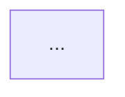

# CitiCore Banking Platform - Architecture Documentation Deliverables

## Overview

This document provides an index of all architecture documentation and diagrams created for the CitiCore Banking Platform. All documents are based on the **existing design** as documented in the repository - no redesign or implementation changes were made.

---

## Documentation Files

### 1. Main Architecture Document
| File | Description | Location |
|------|-------------|----------|
| **CITICORE_TARGET_STATE_ARCHITECTURE.md** | Comprehensive target state architecture documentation covering all aspects of the platform | `architecture/docs/CITICORE_TARGET_STATE_ARCHITECTURE.md` |

**Contents:**
- Product Overview & Functional Modules
- User Roles & Access Matrix
- Microservices Architecture & Responsibilities
- Database Architecture & Schema Ownership
- Service Communication Patterns (Sync/Async)
- Event-Driven Architecture & Kafka Topics
- Financial Transaction Processing (Saga)
- Double-Entry Ledger Architecture
- Security Architecture (Auth, AuthZ, Data Protection)
- Infrastructure & Deployment (Docker, Kubernetes, CI/CD)
- Monitoring & Observability (Metrics, Tracing, Logging, Alerting)
- End-to-End Workflows (Onboarding, Account Management, Fund Transfer)
- Architecture Review Observations (35 items documented)

### 2. Architecture Review Observations
| File | Description | Location |
|------|-------------|----------|
| **ARCHITECTURE_REVIEW_OBSERVATIONS.md** | Documented observations requiring stakeholder review and approval | `architecture/docs/ARCHITECTURE_REVIEW_OBSERVATIONS.md` |

**Categories:**
- Missing Information (8 items - 2 Critical, 3 High)
- Contradictory Design Decisions (4 items - 1 Critical, 2 High)
- Architectural Problems (12 items - 4 Critical, 5 High)
- Ambiguous Service Responsibilities (6 items - 1 Critical, 2 High)
- Unclear Communication Flows (5 items - 1 Critical, 2 High)

---

## Diagram Files (Mermaid Format)

All diagrams are in `.mmd` format and renderable in Mermaid-compatible viewers (GitHub, GitLab, Notion, Obsidian, VS Code with Mermaid extension, Mermaid Live Editor).

### System Architecture Diagrams

| # | File | Description | Key Elements |
|---|------|-------------|--------------|
| 01 | `01-overall-system-architecture.mmd` | Overall CitiCore System Architecture | External clients, API Gateway, Platform services, Core banking services, Data layer |
| 02 | `02-complete-microservices-architecture.mmd` | Complete Microservices Architecture | Detailed service internals: APIs, entities, databases, Kafka, Feign clients |
| 03 | `03-service-communication-architecture.mmd` | Service Communication Architecture | Synchronous (Feign/REST), Asynchronous (Kafka), Outbox pattern, Resilience patterns |

### Data & Transaction Diagrams

| # | File | Description | Key Elements |
|---|------|-------------|--------------|
| 04 | `04-database-architecture.mmd` | Database Architecture (ER Diagram) | 5 databases, tables, columns, constraints, cross-DB references, planned Ledger DB |
| 08 | `08-fund-transfer-workflow.mmd` | Fund Transfer Workflow (Saga) | Complete choreography: initiation, debit, credit, completion, failure paths, reversal |
| 09 | `09-financial-ledger-architecture.mmd` | Financial Ledger Architecture | Current vs Target state, Chart of Accounts, Journal entries, Posting rules, Invariants |
| 10 | `10-kafka-outbox-architecture.mmd` | Kafka & Transactional Outbox | Outbox pattern, Kafka cluster, Topics, Consumers, Serialization, Consumer config |

### Security & Workflow Diagrams

| # | File | Description | Key Elements |
|---|------|-------------|--------------|
| 05 | `05-auth-authorization-flow.mmd` | Authentication & Authorization Flow | Login, Token validation, Refresh rotation, Logout, MFA (planned), Password reset (planned), RBAC |
| 06 | `06-customer-onboarding-workflow.mmd` | Customer Onboarding Workflow | Registration, Email verification, Profile, KYC upload/admin review, Account creation, Ledger posting |
| 07 | `07-account-management-workflow.mmd` | Account Management Workflow | Balance (cache/replica), Deposit/Withdraw (locking, ledger), Statements, PDF, Create/Close, Transfer validation |

### Infrastructure & Operations Diagrams

| # | File | Description | Key Elements |
|---|------|-------------|--------------|
| 11 | `11-security-architecture.mmd` | Security Architecture | Perimeter, Gateway, Auth/AuthZ, Service-to-service, Data protection, App security, Container, Infrastructure, Monitoring |
| 12 | `12-aws-k8s-deployment-architecture.mmd` | AWS & Kubernetes Deployment | EKS cluster, Namespaces, Deployments (HPA/PDB), Managed services (RDS, MSK, ElastiCache), DR region, CI/CD, Networking |
| 13 | `13-monitoring-observability-architecture.mmd` | Monitoring & Observability | Instrumentation (Metrics/Tracing/Logging), Collection (Prometheus/Loki/Tempo), Storage, Visualization (Grafana), Alerting, Health checks |

---

## Source Documents Referenced

The following existing documents in the repository were analyzed to create this architecture documentation:

| Document | Purpose |
|----------|---------|
| `PROJECT_ARCHITECTURE.md` | Original system architecture, microservices detail, data flows, tech stack |
| `SECURITY_AUDIT.md` | Security vulnerabilities (32 findings), OWASP mapping, fix recommendations |
| `DATABASE_AUDIT.md` | Database schema analysis, integrity gaps, migration scripts, indexing strategy |
| `BANKING_FUNCTIONALITY_GAP_ANALYSIS.md` | Functional coverage matrix (35% implemented), gaps by domain, roadmap |
| `IMPLEMENTATION_ROADMAP.md` | Phased implementation plan (20 weeks), priorities, resource allocation, milestones |
| `PRODUCTION_READINESS.md` | Production gaps assessment (45% ready), observability, resilience, deployment, CI/CD |
| `docker-compose.yml` | Local deployment topology, service configurations, networks, volumes |
| Source code (215 Java files) | Service implementations, configurations, entities, controllers, Kafka consumers |

---

## Diagram Rendering Instructions

### Viewing Mermaid Diagrams

**Option 1: VS Code**
1. Install "Markdown Preview Mermaid Support" extension
2. Open `.mmd` files or embed in markdown with ```mermaid fences

**Option 2: GitHub/GitLab**
- Mermaid diagrams render natively in markdown files
- Rename `.mmd` to `.md` and wrap content in ```mermaid ... ```

**Option 3: Mermaid Live Editor**
- Visit: https://mermaid.live/
- Paste diagram code for instant preview and export (PNG, SVG, PDF)

**Option 4: Notion/Obsidian/Other Markdown Tools**
- Most modern markdown tools support Mermaid natively

### Example Embedding in Markdown

```markdown

```

---

## Consistency Verification

All diagrams and documentation have been cross-verified for consistency:

| Check | Status |
|-------|--------|
| Service names/ports match across all diagrams | ✅ Verified |
| Database names/schemas match PROJECT_ARCHITECTURE.md | ✅ Verified |
| Kafka topics match PROJECT_ARCHITECTURE.md Section 7.1 | ✅ Verified |
| Security controls match SECURITY_AUDIT.md findings | ✅ Verified |
| Database constraints match DATABASE_AUDIT.md recommendations | ✅ Verified |
| Workflow steps match IMPLEMENTATION_ROADMAP phases | ✅ Verified |
| Deployment architecture matches PRODUCTION_READINESS.md | ✅ Verified |
| No new microservices introduced beyond documented | ✅ Verified |
| No technology stack changes from existing design | ✅ Verified |

---

## Next Steps for Stakeholders

1. **Review Architecture Documents** - Read `CITICORE_TARGET_STATE_ARCHITECTURE.md` for complete picture
2. **Review Observations** - Review `ARCHITECTURE_REVIEW_OBSERVATIONS.md` for 35 items needing decisions
3. **Prioritize Critical Decisions** - 6 decisions required this week (see Observations doc Section 7)
4. **Validate Diagrams** - Render Mermaid diagrams to verify visual accuracy
5. **Approve Baseline** - Once decisions made, this becomes the approved architecture baseline
6. **Implementation** - Proceed with IMPLEMENTATION_ROADMAP.md Phase 0 (Critical Fixes)

---

## File Structure Summary

```
architecture/
├── docs/
│   ├── CITICORE_TARGET_STATE_ARCHITECTURE.md    (Main architecture doc)
│   └── ARCHITECTURE_REVIEW_OBSERVATIONS.md      (35 observations for review)
└── diagrams/
    ├── 01-overall-system-architecture.mmd
    ├── 02-complete-microservices-architecture.mmd
    ├── 03-service-communication-architecture.mmd
    ├── 04-database-architecture.mmd
    ├── 05-auth-authorization-flow.mmd
    ├── 06-customer-onboarding-workflow.mmd
    ├── 07-account-management-workflow.mmd
    ├── 08-fund-transfer-workflow.mmd
    ├── 09-financial-ledger-architecture.mmd
    ├── 10-kafka-outbox-architecture.mmd
    ├── 11-security-architecture.mmd
    ├── 12-aws-k8s-deployment-architecture.mmd
    └── 13-monitoring-observability-architecture.mmd
```

---

## Document Control

| Version | Date | Author | Changes |
|---------|------|--------|---------|
| 1.0 | 2026-11-17 | Architecture Team | Initial deliverables package |

---

**END OF DELIVERABLES INDEX**