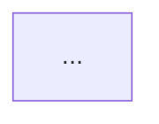

# CitiCore Banking Platform - Architecture Documentation Deliverables

## Overview

This document provides an index of all architecture documentation and diagrams created for the CitiCore Banking Platform. All documents are based on the **existing design** as documented in the repository - no redesign or implementation changes were made.

**Major Update v3.0 (2026-11-18):** All 8 pending Architecture Decision Records (ADRs) have been **APPROVED** and documented. Comprehensive RBAC Architecture and KYC Maker-Checker Workflow implemented per stakeholder requirements.

---

## Documentation Files

### 1. Main Architecture Document (Updated v3.0)
| File | Version | Description | Location |
|------|---------|-------------|----------|
| **CITICORE_TARGET_STATE_ARCHITECTURE.md** | 3.0 | Comprehensive target state architecture with RBAC & KYC workflow, all approved ADRs incorporated | `architecture/docs/CITICORE_TARGET_STATE_ARCHITECTURE.md` |

**Key Contents:**
- Product Overview & Functional Modules (updated with KYC Workflow Service)
- User Roles & Access Matrix (Section 3 - Comprehensive RBAC: 9 roles, 28 permissions)
- Microservices Architecture & Responsibilities (updated with KYC Workflow Service Port 8087)
- Database Architecture & Schema Ownership (added `citicore_kycdb`, RDS single-instance multi-schema)
- Service Communication Patterns (Sync/Async) (updated with KYC events)
- Event-Driven Architecture & Kafka Topics (added kyc-case-topic, kyc-notification-topic)
- Financial Transaction Processing - **Hybrid Saga** (Section 8.1 - Orchestration for transfers, Choreography for notifications)
- Double-Entry Ledger Architecture (unchanged)
- Security Architecture (Section 10 - Updated with RBAC, ABAC, SoD, JWT claims, **RDS KMS + App-level envelope encryption**, TLS)
- KYC Architecture (Section 11 - Maker-Checker workflow, 13-state model, **Mock KYC vendor provider**)
- Infrastructure & Deployment (Docker, Kubernetes, CI/CD) - **K8s DNS for production, Eureka for local**
- Monitoring & Observability (updated with KYC metrics)
- End-to-End Workflows (updated with KYC maker-checker)
- Architecture Review Observations (updated with conflicts resolved)

### 2. RBAC Architecture Document (v2.0)
| File | Version | Description | Location |
|------|---------|-------------|----------|
| **RBAC_ARCHITECTURE.md** | 2.0 | Complete RBAC specification | `architecture/docs/RBAC_ARCHITECTURE.md` |

**Contents:**
- 9 System Roles (CUSTOMER, KYC_OFFICER, KYC_MANAGER, SUPPORT_AGENT, OPERATIONS_OFFICER, COMPLIANCE_OFFICER, ADMIN, AUDITOR, SERVICE)
- 28 Granular Permissions with resource-action-scope model
- Complete Role-Permission Matrix (9×28)
- Resource Ownership & Access Scopes (Own, Assigned, Authorized, Limited, All, None)
- User-to-Role Assignment Model
- Authorization Enforcement (5 layers: Gateway, Filter, Method, Service Logic, Data)
- JWT Identity & Authorization Claims (with permissions, case assignments)
- Role & Permission Revocation Strategy (≤15min latency)
- Default-Deny & Least-Privilege Principles
- Administrative Access Controls (MFA, dual approval, break-glass)
- Security Audit Logging (immutable, hash-chained)
- API Endpoint Access Matrix (130+ combinations)
- Implementation Guidelines (controllers, services, repositories, gateway)

### 3. KYC Architecture Document (Updated v3.0)
| File | Version | Description | Location |
|------|---------|-------------|----------|
| **KYC_ARCHITECTURE.md** | 3.0 | Complete KYC Maker-Checker workflow specification | `architecture/docs/KYC_ARCHITECTURE.md` |

**Contents:**
- Business Roles & Responsibilities (Customer, KYC Officer, KYC Manager, Compliance, **Mock KYC Vendor Provider**)
- 13-State KYC Lifecycle (DRAFT → SUBMITTED → PENDING_REVIEW → UNDER_REVIEW → MORE_INFO_REQUIRED → RESUBMITTED → RECOMMENDED_APPROVAL/REJECTION → PENDING_MANAGER_APPROVAL → APPROVED/REJECTED/ESCALATED)
- State Transitions & Authorization Matrix (17 transitions with preconditions)
- Separation of Duties Enforcement (Officer ≠ Manager, no self-assignment)
- KYC Workflow Service Architecture (Port 8087, domain services, state machine)
- Complete Data Model (5 tables with ER diagram and DDL)
- Event-Driven Communication (KYC events, payloads, consumers)
- Document Management & Security (S3 SSE-KMS, pre-signed URLs, **ClamAV malware scanning via S3 Object Lambda**, quarantine flow)
- Audit Trail (immutable, hash-chained with verification)
- SLA & Escalation (5 levels, breach actions)
- Integration Points (User, Auth, Account, Notification, Compliance services)
- Security & Compliance (PMLA, RBI, FATF, GDPR, SOX alignment)
- Operational Procedures (daily/weekly/monthly runbooks, incident response)

### 4. Architecture Review Observations (v1.0)
| File | Version | Description | Location |
|------|---------|-------------|----------|
| **ARCHITECTURE_REVIEW_OBSERVATIONS.md** | 1.0 | Documented observations requiring stakeholder review and approval | `architecture/docs/ARCHITECTURE_REVIEW_OBSERVATIONS.md` |

### 5. Architecture Diagrams (Updated v3.0)
| File | Version | Description | Location |
|------|---------|-------------|----------|
| **ARCHITECTURE_DIAGRAMS.md** | 3.0 | 17 Mermaid diagrams including new RBAC & KYC diagrams, AWS EKS/RDS topology, Hybrid saga, Database encryption, Service discovery, Malware scanning, KYC vendor integration | `architecture/docs/ARCHITECTURE_DIAGRAMS.md` |

### 6. Change Summary (v3.0)
| File | Version | Description | Location |
|------|---------|-------------|----------|
| **CHANGE_SUMMARY.md** | 3.0 | Summary of all architecture changes for stakeholder review | `architecture/docs/CHANGE_SUMMARY.md` |

**Contents:**
- 16 existing design decisions retained
- 14 new RBAC decisions
- 13 new KYC workflow decisions
- 10 conflicts discovered & resolved
- **All 15 ADRs documented (8 newly approved, 7 previously approved)**
- Documentation changes summary
- Implementation impact assessment
- 10 implementation gaps identified
- Dependencies & future considerations

### 7. Architecture Decision Records (NEW - 9 Documents)
| File | Description | Location |
|------|-------------|----------|
| **ADR_REGISTER.md** | Decision register with all 15 ADRs (DEC-001 through DEC-015) | `architecture/docs/ADR_REGISTER.md` |
| **ADR-001_DATABASE_TOPOLOGY.md** | DEC-001: Single RDS with schemas | `architecture/docs/ADR-001_DATABASE_TOPOLOGY.md` |
| **ADR-002_SAGA_PATTERN.md** | DEC-002: Hybrid saga architecture | `architecture/docs/ADR-002_SAGA_PATTERN.md` |
| **ADR-010_MALWARE_SCANNING.md** | DEC-010: ClamAV with abstraction | `architecture/docs/ADR-010_MALWARE_SCANNING.md` |
| **ADR-011_MYSQL_ENCRYPTION.md** | DEC-011: RDS KMS + app-level envelope encryption | `architecture/docs/ADR-011_MYSQL_ENCRYPTION.md` |
| **ADR-012_SECRETS_MANAGEMENT.md** | DEC-012: AWS Secrets Manager | `architecture/docs/ADR-012_SECRETS_MANAGEMENT.md` |
| **ADR-013_DATABASE_TLS.md** | DEC-013: Mandatory TLS for RDS | `architecture/docs/ADR-013_DATABASE_TLS.md` |
| **ADR-014_SERVICE_DISCOVERY.md** | DEC-014: K8s DNS production, Eureka local | `architecture/docs/ADR-014_SERVICE_DISCOVERY.md` |
| **ADR-015_KYC_VENDOR_INTEGRATION.md** | DEC-015: Mock provider initially | `architecture/docs/ADR-015_KYC_VENDOR_INTEGRATION.md` |

**Previously Approved ADRs (DEC-003 through DEC-009) - Preserved:**
- DEC-003: KYC Service Ownership → Dedicated KYC Workflow Service ✅
- DEC-004: Case Assignment → Hybrid: Auto-assign with Manager override ✅
- DEC-005: SoD Enforcement Location → KYC Workflow Service + Gateway ✅
- DEC-006: JWT Claims Size → Permissions in JWT (15min expiry) ✅
- DEC-007: Ledger Service → Separate microservice ✅
- DEC-008: Compliance Service → Build abstraction; integrate vendor APIs ✅
- DEC-009: MFA Methods → TOTP primary; Email OTP fallback ✅

---

## Diagram Files (Mermaid Format)

All diagrams are in `.mmd` format and renderable in Mermaid-compatible viewers (GitHub, GitLab, Notion, Obsidian, VS Code with Mermaid extension, Mermaid Live Editor).

### System Architecture Diagrams (17 Total)

| # | Diagram | Description | Key Elements |
|---|---------|-------------|--------------|
| 1 | Authentication and RBAC Architecture | 5-layer enforcement, JWT claims, revocation | Gateway, Filter, @PreAuthorize, Service Logic, Data |
| 2 | Role-to-Permission Authorization Flow | Sequence: Login → Token → Resource Access | JWT, Redis cache, PermissionEvaluator, SoD check |
| 3 | KYC End-to-End Workflow | Customer journey + Officer + Manager + Integrations | 13-state machine, maker-checker, event bus |
| 4 | KYC Officer and KYC Manager Interaction | Sequence: Assignment → Review → Recommend → Decision | SoD enforcement, Kafka events, Feign calls |
| 5 | KYC State-Transition Diagram | 13-state machine with authorized roles | DRAFT → APPROVED/REJECTED/ESCALATED |
| 6 | KYC Service Communication and Audit Flow | Service topology + data layer + audit | KYC service, Kafka, S3, Audit DB, Grafana |
| 7 | Complete Service Topology (Production) | AWS EKS, K8s DNS, RDS, MSK, ElastiCache | 8 services, security services, data layer |
| 8 | Database Topology (AWS RDS) | Single RDS, 7 schemas, KMS encryption | Service schemas, service users, encryption layers |
| 9 | Event-Driven Architecture | Sync (Feign) + Async (Kafka) flows | 20+ topics, producers, consumers |
| 10 | Fund Transfer Saga (Hybrid) | Orchestration for transfers, choreography for notifications | Transaction Service as orchestrator |
| 11 | Security Architecture - Authorization Model | RBAC + ABAC + SoD + 5 enforcement layers | Roles, permissions, attributes, policies |
| 12 | Customer Onboarding with KYC Workflow | Registration → KYC → Account creation | Maker-checker, KYC_APPROVED gating |
| 13 | Role Hierarchy and Permission Inheritance | 9 roles, inheritance tree | ADMIN super-role, KYC_MGR → KYC_OFF |
| 14 | Database Encryption Architecture | RDS KMS (Layer 1) + App-level envelope (Layer 2) | AES-256, AES-256-GCM, hash columns |
| 15 | Service Discovery Architecture | K8s DNS (prod) vs Eureka (local) | CoreDNS, EndpointSlices, Eureka client |
| 16 | KYC Document Malware Scanning Flow | Quarantine → ClamAV → Clean bucket | Fail-closed, S3 Object Lambda |
| 17 | KYC Vendor Integration Architecture | Mock provider + pluggable adapters | India docs, maker-checker, SoD |

---

## Source Documents Referenced

The following existing documents in the repository were analyzed to create this architecture documentation:

| Document | Purpose |
|----------|---------|
| `PROJECT_ARCHITECTURE.md` | Original system architecture, microservices detail, data flows, tech stack |
| `SECURITY_AUDIT.md` | Security vulnerabilities (32 findings), OWASP mapping, fix recommendations |
| `DATABASE_AUDIT.md` | Database schema analysis, integrity gaps, migration scripts, indexing strategy |
| `BANKING_FUNCTIONALITY_GAP_ANALYSIS.md` | Functional coverage matrix (35% implemented), gaps by domain, roadmap |
| `IMPLEMENTATION_ROADMAP.md` | Phased implementation plan (20 weeks), priorities, resource allocation, milestones |
| `PRODUCTION_READINESS.md` | Production gaps assessment (45% ready), observability, resilience, deployment, CI/CD |
| `docker-compose.yml` | Local deployment topology, service configurations, networks, volumes |
| Source code (215 Java files) | Service implementations, configurations, entities, controllers, Kafka consumers |

---

## Diagram Rendering Instructions

### Viewing Mermaid Diagrams

**Option 1: VS Code**
1. Install "Markdown Preview Mermaid Support" extension
2. Open `.mmd` files or embed in markdown with ```mermaid fences

**Option 2: GitHub/GitLab**
- Mermaid diagrams render natively in markdown files
- Rename `.mmd` to `.md` and wrap content in ```mermaid ... ```

**Option 3: Mermaid Live Editor**
- Visit: https://mermaid.live/
- Paste diagram code for instant preview and export (PNG, SVG, PDF)

**Option 4: Notion/Obsidian/Other Markdown Tools**
- Most modern markdown tools support Mermaid natively

### Example Embedding in Markdown

```markdown

```

---

## Consistency Verification

All diagrams and documentation have been cross-verified for consistency:

| Check | Status |
|-------|--------|
| Service names/ports match across all diagrams | ✅ Verified |
| Database schemas match CITICORE_TARGET_STATE_ARCHITECTURE.md | ✅ Verified |
| Kafka topics match across all documents | ✅ Verified |
| Security controls match SECURITY_AUDIT.md findings | ✅ Verified |
| Database constraints match DATABASE_AUDIT.md recommendations | ✅ Verified |
| Workflow steps match IMPLEMENTATION_ROADMAP phases | ✅ Verified |
| Deployment architecture matches PRODUCTION_READINESS.md | ✅ Verified |
| All 8 pending ADRs approved and documented | ✅ Verified |
| No new microservices introduced beyond documented | ✅ Verified |
| No technology stack changes from approved decisions | ✅ Verified |

---

## Next Steps for Stakeholders

1. **Review Architecture Documents** - Read `CITICORE_TARGET_STATE_ARCHITECTURE.md` for complete picture
2. **Review ADR Documents** - Read `ADR_REGISTER.md` and individual ADRs for decision details
3. **Validate Diagrams** - Render Mermaid diagrams to verify visual accuracy
4. **Approve Baseline** - All decisions approved; this becomes the approved architecture baseline
5. **Implementation Authorization** - Proceed with IMPLEMENTATION_ROADMAP.md Phase 0 (Critical Fixes) upon explicit authorization

---

## File Structure Summary

```
architecture/
├── docs/
│   ├── CITICORE_TARGET_STATE_ARCHITECTURE.md    (Main architecture doc v3.0)
│   ├── RBAC_ARCHITECTURE.md                     (RBAC spec v2.0)
│   ├── KYC_ARCHITECTURE.md                      (KYC spec v3.0)
│   ├── ARCHITECTURE_REVIEW_OBSERVATIONS.md      (35 observations)
│   ├── ARCHITECTURE_DIAGRAMS.md                 (17 Mermaid diagrams v3.0)
│   ├── CHANGE_SUMMARY.md                        (Change summary v3.0)
│   ├── ADR_REGISTER.md                          (15 ADRs register)
│   ├── ADR-001_DATABASE_TOPOLOGY.md             (DEC-001)
│   ├── ADR-002_SAGA_PATTERN.md                  (DEC-002)
│   ├── ADR-010_MALWARE_SCANNING.md              (DEC-010)
│   ├── ADR-011_MYSQL_ENCRYPTION.md              (DEC-011)
│   ├── ADR-012_SECRETS_MANAGEMENT.md            (DEC-012)
│   ├── ADR-013_DATABASE_TLS.md                  (DEC-013)
│   ├── ADR-014_SERVICE_DISCOVERY.md             (DEC-014)
│   └── ADR-015_KYC_VENDOR_INTEGRATION.md        (DEC-015)
└── DELIVERABLES_INDEX.md                        (This file)
```

---

## Document Control

| Version | Date | Author | Changes |
|---------|------|--------|---------|
| 1.0 | 2026-11-17 | Architecture Team | Initial deliverables package |
| 2.0 | 2026-11-18 | Architecture Team | Major update: RBAC + KYC workflow |
| 3.0 | 2026-11-18 | Architecture Team | **All 8 pending ADRs approved**; ADR documents created; AWS EKS/RDS topology; Hybrid saga; Database encryption; Service discovery; Malware scanning; KYC vendor integration |

---

**END OF DELIVERABLES INDEX**