# CitiCore Banking Platform - Architecture Diagrams (Mermaid)

This document contains all Mermaid diagrams for the CitiCore architecture, updated with RBAC and KYC Maker-Checker workflow and all 8 approved ADRs.

---

## 1. Authentication and RBAC Architecture

```mermaid
%%{init: {'theme': 'base', 'themeVariables': {'primaryColor': '#1e3a8a', 'fontSize': '12px'}}}%%
graph TB
    subgraph IDP ["Identity Provider"]
        AUTH[Auth Service<br/>Port 8081]
        DB_AUTH[(citicore_authdb)]
    end
    
    subgraph RBAC_ENGINE ["RBAC Engine"]
        ROLES[Role Definitions<br/>9 System Roles]
        PERMS[Permission Catalog<br/>28 Granular Permissions]
        MATRIX[Role-Permission Matrix]
        EVALUATOR[PermissionEvaluator<br/>SpEL + ABAC]
    end
    
    subgraph ENFORCEMENT ["Authorization Enforcement Layers"]
        GW[API Gateway<br/>JWT Validation + Coarse RBAC]
        FILTER[JwtAuthenticationFilter<br/>Token Validation + SecurityContext]
        ANNOTATION[@PreAuthorize<br/>Method-Level RBAC]
        LOGIC[Service Logic<br/>Ownership + ABAC + SoD]
        DATA[Repository Queries<br/>Row-Level Scoping]
    end
    
    subgraph CLAIMS ["JWT Claims"]
        TOKEN[Access Token<br/>15min HS256]
        REFRESH[Refresh Token<br/>7 days Opaque]
        CLAIMS[Claims: sub, email, roles, permissions,<br/>kycStatus, riskScore, assignedCases, authorizedCases]
    end
    
    subgraph REVOCATION ["Revocation Strategy"]
        CACHE[Redis Cache<br/>15min TTL + Invalidation]
        BLOCKLIST[Emergency Blocklist<br/>Immediate]
        REFRESH_REVOKE[Refresh Token Revocation<br/>Immediate]
    end
    
    AUTH --> DB_AUTH
    AUTH --> TOKEN
    AUTH --> REFRESH
    TOKEN --> CLAIMS
    ROLES --> MATRIX
    PERMS --> MATRIX
    MATRIX --> EVALUATOR
    GW --> FILTER
    FILTER --> ANNOTATION
    ANNOTATION --> LOGIC
    LOGIC --> DATA
    EVALUATOR --> ANNOTATION
    CLAIMS --> GW
    CLAIMS --> FILTER
    CACHE --> EVALUATOR
    BLOCKLIST --> GW
    REFRESH_REVOKE --> AUTH
```

---

## 2. Role-to-Permission Authorization Flow

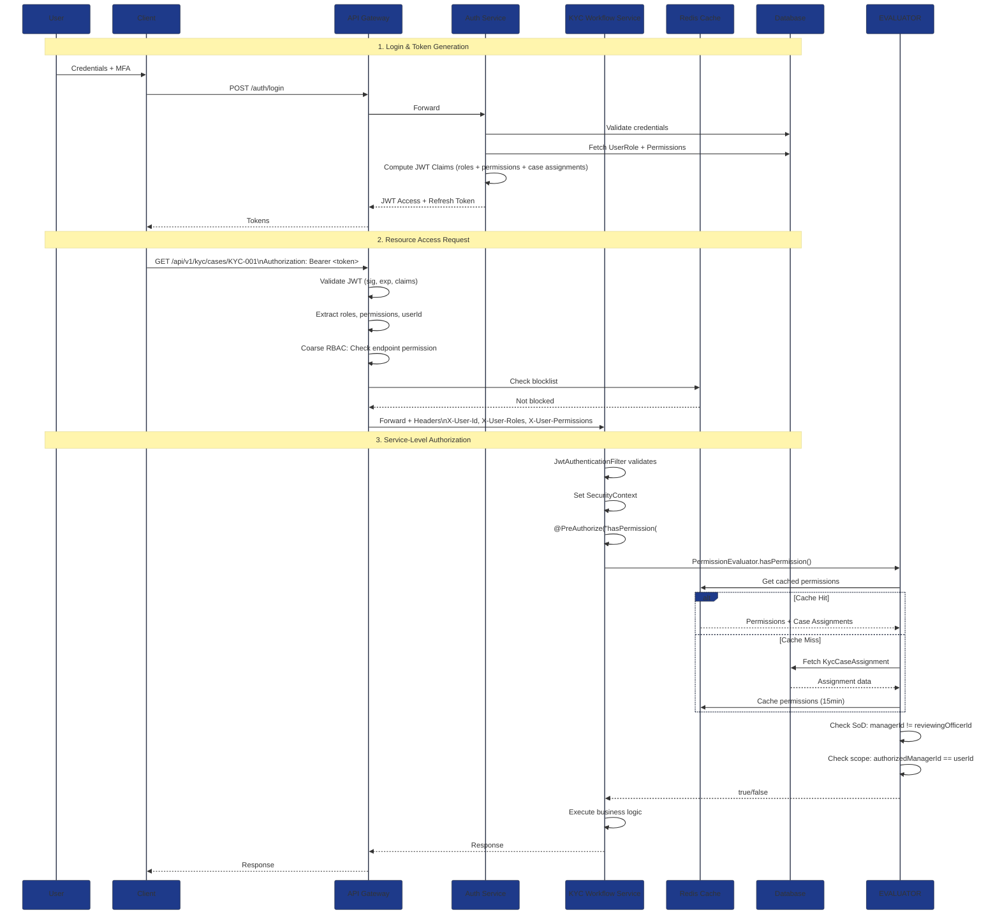

---

## 3. KYC End-to-End Workflow

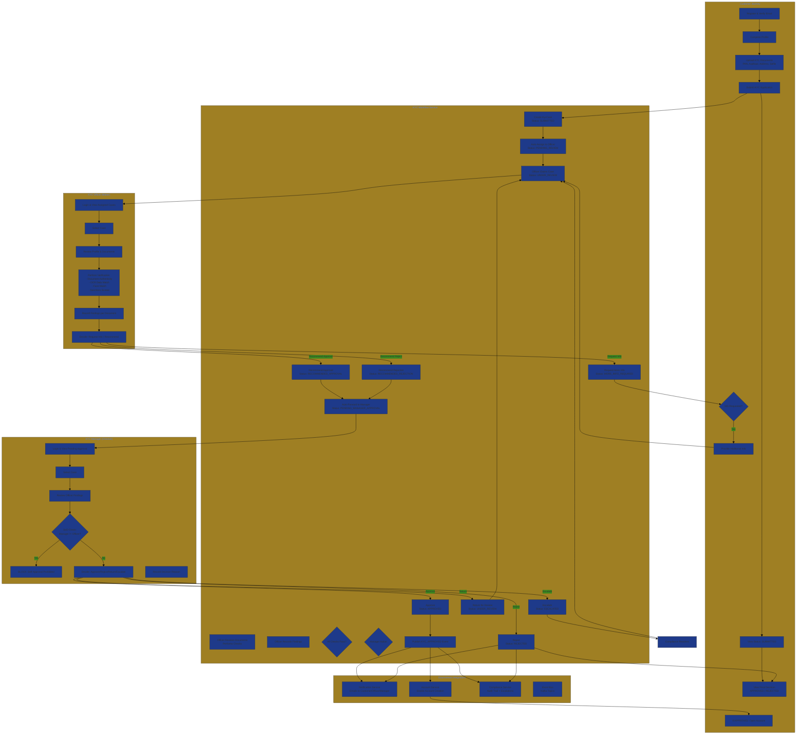

---

## 4. KYC Officer and KYC Manager Interaction

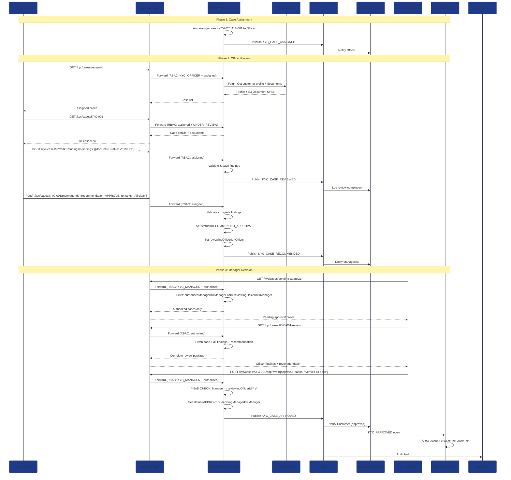

---

## 5. KYC State-Transition Diagram

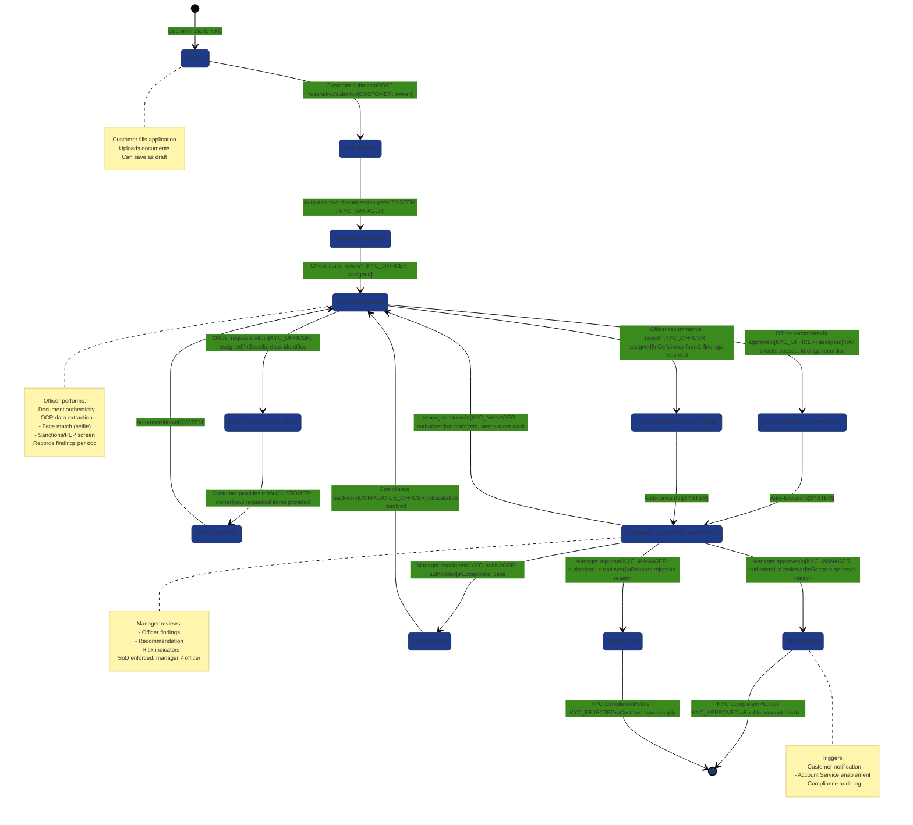

---

## 6. KYC Service Communication and Audit Flow

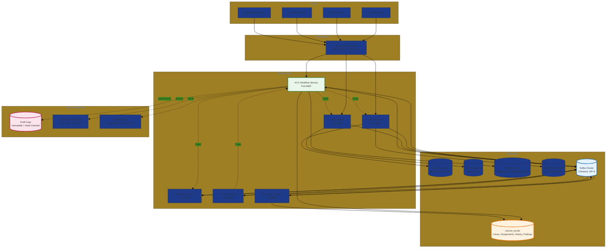

---

## 7. Complete Service Topology (Production - AWS EKS)

```mermaid
%%{init: {'theme': 'base', 'themeVariables': {'primaryColor': '#1e3a8a', 'fontSize': '10px'}}}%%
graph TB
    subgraph EXTERNAL ["External Clients"]
        CLIENT[Web/Mobile App]
        ADMIN[Admin Portal]
        EXT_API[External APIs]
    end

    subgraph GATEWAY ["API Gateway Layer"]
        GW[API Gateway<br/>Port 8080<br/>Spring Cloud Gateway]
    end

    subgraph DISCOVERY ["Service Discovery & Config"]
        K8S_DNS[Kubernetes DNS (CoreDNS)<br/>Production Service Discovery]
        CONFIG[Config Server<br/>Port 8888]
        EUREKA[Eureka Server<br/>Port 8761<br/><i>Local Development Only</i>]
    end

    subgraph CORE ["Core Banking Services"]
        AUTH[Auth Service<br/>Port 8081]
        USER[User Service<br/>Port 8082]
        KYC[KYC Workflow Service<br/>Port 8087<br/><b>NEW</b>]
        ACC[Account Service<br/>Port 8083]
        TXN[Transaction Service<br/>Port 8084]
        NOTIF[Notification Service<br/>Port 8085]
        LEDGER[Ledger Service<br/>Port 8086<br/><i>Planned</i>]
        COMPLIANCE[Compliance Service<br/>Port 8088<br/><i>Planned</i>]
    end

    subgraph DATA ["AWS Data Layer"]
        RDS[(AWS RDS MySQL 8.0<br/>Multi-Schema, KMS Encrypted)]
        REDIS[(Redis 7<br/>ElastiCache, Cache & Rate Limit)]
        KAFKA[Kafka 3.8<br/>MSK, Event Bus]
        S3[(AWS S3<br/>SSE-KMS, KYC Documents)]
    end

    subgraph SECURITY ["Security Services"]
        SECRETS[AWS Secrets Manager<br/>DB Credentials, JWT Secret]
        KMS[AWS KMS<br/>RDS Encryption + Field Encryption]
    end

    CLIENT --> GW
    ADMIN --> GW
    EXT_API --> GW

    GW --> K8S_DNS
    GW --> CONFIG
    GW --> AUTH
    GW --> USER
    GW --> KYC
    GW --> ACC
    GW --> TXN
    GW --> NOTIF
    GW -.-> LEDGER
    GW -.-> COMPLIANCE

    AUTH --> K8S_DNS
    AUTH --> CONFIG
    AUTH --> RDS
    AUTH --> KAFKA
    AUTH --> REDIS
    AUTH --> SECRETS
    AUTH -.-> KMS

    USER --> K8S_DNS
    USER --> CONFIG
    USER --> RDS
    USER --> KAFKA
    USER --> S3
    USER --> SECRETS

    KYC --> K8S_DNS
    KYC --> CONFIG
    KYC --> RDS
    KYC --> KAFKA
    KYC --> USER
    KYC --> AUTH
    KYC --> S3
    KYC --> SECRETS

    ACC --> K8S_DNS
    ACC --> CONFIG
    ACC --> RDS
    ACC --> KAFKA
    ACC --> REDIS
    ACC --> USER
    ACC --> KYC
    ACC --> SECRETS

    TXN --> K8S_DNS
    TXN --> CONFIG
    TXN --> RDS
    TXN --> KAFKA
    TXN --> ACC
    TXN --> SECRETS

    NOTIF --> K8S_DNS
    NOTIF --> CONFIG
    NOTIF --> KAFKA
    NOTIF --> SECRETS

    LEDGER --> K8S_DNS
    LEDGER --> CONFIG
    LEDGER --> RDS
    LEDGER --> KAFKA
    LEDGER --> ACC
    LEDGER --> TXN
    LEDGER --> SECRETS

    COMPLIANCE --> K8S_DNS
    COMPLIANCE --> CONFIG
    COMPLIANCE --> RDS
    COMPLIANCE --> KAFKA
    COMPLIANCE --> KYC
    COMPLIANCE --> USER
    COMPLIANCE --> SECRETS

    EUREKA -.->|Local Dev Only| AUTH
    EUREKA -.->|Local Dev Only| USER
    EUREKA -.->|Local Dev Only| KYC
    EUREKA -.->|Local Dev Only| ACC
    EUREKA -.->|Local Dev Only| TXN
    EUREKA -.->|Local Dev Only| NOTIF
```

---

## 8. Database Topology (AWS RDS - Single Instance, Multi-Schema)

```mermaid
%%{init: {'theme': 'base', 'themeVariables': {'primaryColor': '#1e3a8a', 'fontSize': '10px'}}}%%
graph TB
    subgraph RDS_MYSQL ["AWS RDS for MySQL 8.0 (Single Deployment, KMS Encrypted)"]
        subgraph SCHEMAS ["Service Schemas (Separate Credentials)"]
            AUTH_SCHEMA[(citicore_authdb<br/>users, roles, user_roles, refresh_tokens, login_attempts)]
            KYC_SCHEMA[(citicore_kycdb<br/>kyc_cases, kyc_case_assignments,<br/>kyc_case_history, kyc_review_findings,<br/>kyc_document_refs)]
            ACC_SCHEMA[(citicore_account<br/>accounts, account_statements,<br/>account_outbox, account_sequences,<br/>account_holds)]
            TXN_SCHEMA[(citicore_transactiondb<br/>transactions, outbox_events,<br/>idempotency_keys, daily_limits)]
            USER_SCHEMA[(citicore_userdb<br/>user_profiles, kyc_documents)]
            LEDGER_SCHEMA[(citicore_ledgerdb<br/>ledger_accounts, journal_entries,<br/>journal_lines, ledger_balances<br/><i>Planned</i>)]
            COMPLIANCE_SCHEMA[(citicore_compliancedb<br/>sanctions, pep, monitoring,<br/>sar, reports<br/><i>Planned</i>)]
        end
        
        subgraph ENCRYPTION ["Encryption Layer"]
            KMS_RDS[AWS KMS<br/>Customer-Managed Key<br/>RDS Storage Encryption]
            KMS_FIELD[AWS KMS<br/>Field Encryption Key<br/>Envelope Encryption]
        end
    end

    subgraph REDIS_CLUSTER ["Redis Cluster (ElastiCache)"]
        CACHE[(Cache: Balance, Session, Rate Limit,<br/>Case Assignments, User Permissions)]
    end

    subgraph KAFKA_CLUSTER ["Kafka Cluster (MSK)"]
        TOPICS[Topics: 3 partitions, RF=3<br/>transfer-requested, debit-success,<br/>credit-success, reversal, kyc, kyc-case,<br/>kyc-notification, otp, account-events, DLQs]
    end

    subgraph S3_STORAGE ["AWS S3 (SSE-KMS Encrypted)"]
        KYC_DOCS_QUARANTINE[(Quarantine Bucket<br/>Unscanned Uploads)]
        KYC_DOCS_CLEAN[(Clean Bucket<br/>Scanned Documents)]
    end

    AUTH_SVC[Auth Service] --> AUTH_SCHEMA
    USER_SVC[User Service] --> USER_SCHEMA
    KYC_SVC[KYC Workflow Service] --> KYC_SCHEMA
    KYC_SVC --> CACHE
    ACC_SVC[Account Service] --> ACC_SCHEMA
    ACC_SVC --> CACHE
    TXN_SVC[Transaction Service] --> TXN_SCHEMA
    LEDGER_SVC[Ledger Service] --> LEDGER_SCHEMA
    COMPLIANCE_SVC[Compliance Service] --> COMPLIANCE_SCHEMA
    ALL_SVC[All Services] --> KAFKA_CLUSTER
    USER_SVC --> KYC_DOCS_QUARANTINE
    KYC_SVC --> KYC_DOCS_CLEAN
    
    KMS_RDS -.->|Transparent| RDS_MYSQL
    KMS_FIELD -.->|Envelope| SCHEMAS
```

---

## 9. Event-Driven Architecture (Async Flow)

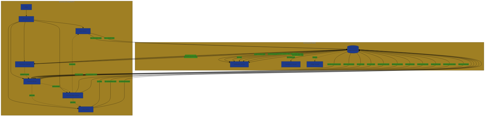

---

## 10. Fund Transfer Saga (Hybrid: Orchestration for Transfers)

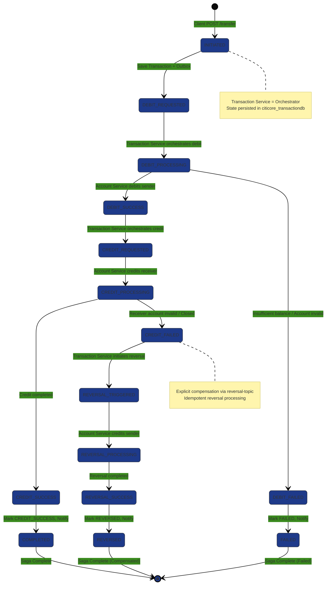

### Hybrid Saga Pattern Summary

| Domain | Pattern | Owner | Rationale |
|--------|---------|-------|-----------|
| **Fund Transfers** | **Orchestration** | Transaction Service | Financial consistency; centralized state; explicit compensation |
| **Notifications** | **Choreography** | Notification Service | Independent; fire-and-forget; no compensation |
| **Audit Events** | **Async Consumption** | Compliance Service | Independent; idempotent; no saga participation |

---

## 11. Security Architecture - Authorization Model

```mermaid
%%{init: {'theme': 'base', 'themeVariables': {'primaryColor': '#1e3a8a', 'fontSize': '11px'}}}%%
graph TB
    subgraph RBAC ["Role-Based Access Control"]
        ROLES[Roles: CUSTOMER, KYC_OFFICER, KYC_MANAGER, SUPPORT_AGENT, OPERATIONS_OFFICER, COMPLIANCE_OFFICER, ADMIN, AUDITOR, SERVICE]
        PERMISSIONS[Permissions: 28 granular permissions\n(See RBAC_ARCHITECTURE.md)]
        ROLE_PERM[Role-Permission Mapping\n(See Section 4 Matrix)]
    end
    
    subgraph ABAC ["Attribute-Based Access Control"]
        ATTRS[Attributes: userId, accountOwnership, kycCaseAssignment, kycCaseAuthorization, kycStatus, riskScore, caseScope]
        POLICIES[Policies: Ownership, KYC Case Assignment, KYC Case Authorization, Separation of Duties, KYC Required, Daily Limits]
    end
    
    subgraph SOD ["Separation of Duties"]
        SOD_ENGINE[SoD Enforcement Engine\nKYC Workflow Service]
        SOD_RULES[Rules: Officer ≠ Manager for same case\nNo self-assignment\nCompliance independence]
    end
    
    subgraph ENFORCEMENT ["Enforcement Points"]
        GATEWAY[API Gateway: JWT validation, RBAC coarse check, Rate limiting]
        FILTER[JwtAuthenticationFilter: Token validation, SecurityContext, Permission extraction]
        ANNOTATION[@PreAuthorize: Method-level RBAC + SpEL]
        SERVICE[Service Logic: ABAC ownership checks, Business rules, SoD]
        KYC_ENFORCE[KYC Workflow Engine: State machine, Maker-Checker enforcement, Case assignment]
    end
    
    ROLES --> PERMISSIONS
    PERMISSIONS --> ROLE_PERM
    ATTRS --> POLICIES
    SOD_RULES --> SOD_ENGINE
    GATEWAY --> FILTER
    FILTER --> ANNOTATION
    ANNOTATION --> SERVICE
    SERVICE --> KYC_ENFORCE
    SOD_ENGINE --> KYC_ENFORCE
    POLICIES --> SERVICE
```

---

## 12. Customer Onboarding with KYC Workflow

```mermaid
%%{init: {'theme': 'base', 'themeVariables': {'primaryColor': '#1e3a8a', 'fontSize': '9px'}}}%%
flowchart TD
    START([Customer Visits App]) --> REGISTER[POST /auth/register]
    REGISTER --> VALIDATE{Valid Input?}
    VALIDATE -->|No| ERROR1[Return 400]
    VALIDATE -->|Yes| SAVE_USER[Save User (PENDING)]
    SAVE_USER --> GEN_OTP[Generate 8-char OTP]
    GEN_OTP --> SAVE_OTP[Save OTP (10min expiry)]
    SAVE_OTP --> PUBLISH_OTP[Publish otp-verification-topic]
    PUBLISH_OTP --> EMAIL_OTP[Notification: Send Email]
    EMAIL_OTP --> RETURN[Return 201]
    RETURN --> VERIFY_UI[Customer Enters OTP]
    VERIFY_UI --> VERIFY_API[POST /auth/verify]
    VERIFY_API --> CHECK_OTP{OTP Valid?}
    CHECK_OTP -->|No| ERROR2[Return 400]
    CHECK_OTP -->|Yes| ACTIVATE[User: ACTIVE, verified]
    ACTIVATE --> ISSUE_TOKENS[Generate JWT + Refresh]
    ISSUE_TOKENS --> RETURN_TOKENS[Return Tokens]
    RETURN_TOKENS --> PROFILE[Complete Profile]
    PROFILE --> KYC_UPLOAD[Upload KYC Docs]
    KYC_UPLOAD --> KYC_SUBMIT[Submit KYC Application]
    KYC_SUBMIT --> KYC_PENDING[KYC Status: SUBMITTED]
    KYC_PENDING --> KYC_WF_CREATE[KYC Workflow: Create Case]
    KYC_WF_CREATE --> AUTO_ASSIGN[Auto-assign to Officer]
    AUTO_ASSIGN --> NOTIFY_OFFICER[Notify Officer]
    NOTIFY_OFFICER --> OFFICER_REVIEW[Officer Reviews]
    OFFICER_REVIEW --> REVIEW_ACTION{Officer Action}
    REVIEW_ACTION -->|Request Info| REQUEST_INFO[Status: MORE_INFO_REQUIRED]
    REQUEST_INFO --> CUSTOMER_RESPOND[Customer Provides Info]
    CUSTOMER_RESPOND --> RESUBMITTED[Status: RESUBMITTED]
    RESUBMITTED --> OFFICER_REVIEW
    REVIEW_ACTION -->|Recommend Approve| RECOMMEND_APPROVE[Status: RECOMMENDED_APPROVAL]
    REVIEW_ACTION -->|Recommend Reject| RECOMMEND_REJECT[Status: RECOMMENDED_REJECTION]
    RECOMMEND_APPROVE --> MANAGER_REVIEW[Manager Reviews]
    RECOMMEND_REJECT --> MANAGER_REVIEW
    MANAGER_REVIEW --> MANAGER_ACTION{Manager Action}
    MANAGER_ACTION -->|Approve| APPROVED[Status: APPROVED]
    MANAGER_ACTION -->|Reject| REJECTED[Status: REJECTED]
    MANAGER_ACTION -->|Return| RETURN_REVIEW[Status: UNDER_REVIEW]
    MANAGER_ACTION -->|Escalate| ESCALATED[Status: ESCALATED]
    RETURN_REVIEW --> OFFICER_REVIEW
    ESCALATED --> COMPLIANCE_RESOLVE[Compliance Resolves]
    COMPLIANCE_RESOLVE --> OFFICER_REVIEW
    APPROVED --> KYC_APPROVED_EVENT[Publish KYC_APPROVED]
    KYC_APPROVED_EVENT --> ACCOUNT_CREATE[Customer Creates Account]
    REJECTED --> REAPPLY[Customer Can Reapply]
    REAPPLY --> KYC_UPLOAD
    ACCOUNT_CREATE --> KYC_CHECK[Feign KYC Status]
    KYC_CHECK -->|Not Approved| ERROR3[Return 400: KYC Required]
    KYC_CHECK -->|Approved| CREATE_ACC_DB[Create Account]
    CREATE_ACC_DB --> PUBLISH_ACC[Publish ACCOUNT_CREATED]
    PUBLISH_ACC --> LEDGER_POST[Ledger: Journal Entry]
    LEDGER_POST --> SUCCESS[Account Created]
    SUCCESS --> END([Onboarding Complete])
```

---

## 13. Role Hierarchy and Permission Inheritance

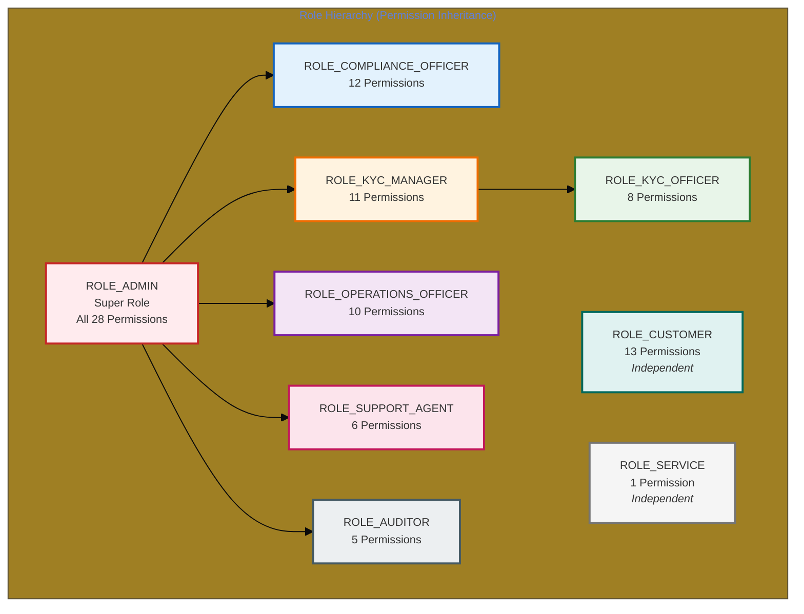

---

## 14. Database Encryption Architecture (RDS KMS + App-Level Envelope)

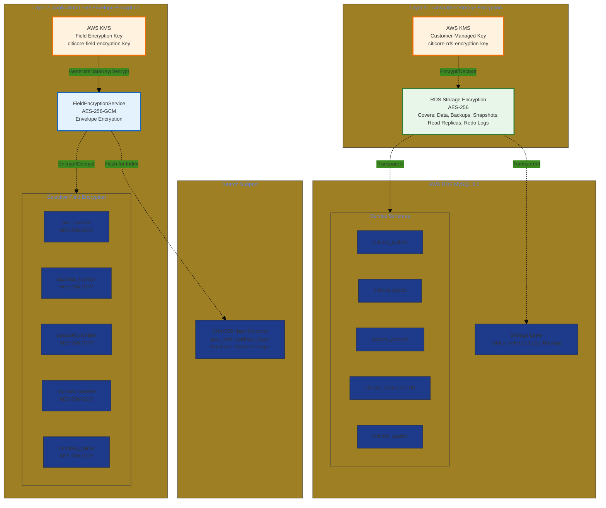

---

## 15. Service Discovery Architecture

```mermaid
%%{init: {'theme': 'base', 'themeVariables': {'primaryColor': '#1e3a8a', 'fontSize': '10px'}}}%%
graph TB
    subgraph PROD ["Production (AWS EKS)"]
        K8S_DNS[Kubernetes DNS (CoreDNS)<br/>Service Discovery]
        
        subgraph SERVICES ["Kubernetes Services"]
            AUTH_SVC[auth-service<br/>ClusterIP / Headless]
            USER_SVC[user-service<br/>ClusterIP / Headless]
            KYC_SVC[kyc-workflow-service<br/>ClusterIP / Headless]
            ACC_SVC[account-service<br/>ClusterIP / Headless]
            TXN_SVC[transaction-service<br/>ClusterIP / Headless]
        end
        
        COREDNS[CoreDNS<br/>Cluster Domain:<br/>svc.cluster.local]
        ENDPOINTS[EndpointSlices<br/>Pod IP Tracking]
    end
    
    subgraph LOCAL ["Local Development (Docker Compose)"]
        EUREKA[Eureka Server<br/>Port 8761]
        
        subgraph LOCAL_SERVICES ["Services with Eureka Client"]
            L_AUTH[auth-service]
            L_USER[user-service]
            L_KYC[kyc-workflow-service]
            L_ACC[account-service]
            L_TXN[transaction-service]
        end
    end
    
    subgraph RESOLUTION ["Name Resolution"]
        PROD_DNS[auth-service.citicore-prod.svc.cluster.local<br/>→ Pod IPs (headless) / ClusterIP (LB)]
        LOCAL_DNS[Eureka Registry<br/>HTTP Heartbeat]
    end
    
    PROD_DNS -.-> K8S_DNS
    K8S_DNS --> COREDNS
    COREDNS --> ENDPOINTS
    ENDPOINTS --> SERVICES
    
    LOCAL_DNS -.-> EUREKA
    EUREKA --> LOCAL_SERVICES
    
    style K8S_DNS fill:#e8f5e9,stroke:#2e7d32,stroke-width:2px
    style EUREKA fill:#fff3e0,stroke:#ef6c00,stroke-width:2px
    style COREDNS fill:#e3f2fd,stroke:#1565c0,stroke-width:2px
```

---

## 16. KYC Document Malware Scanning Flow

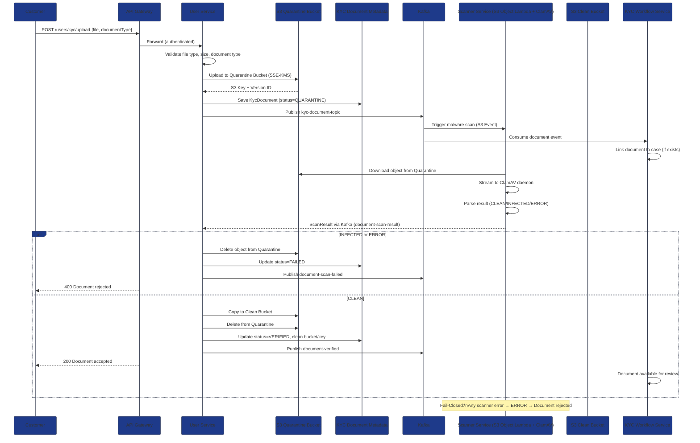

---

## 17. KYC Vendor Integration Architecture

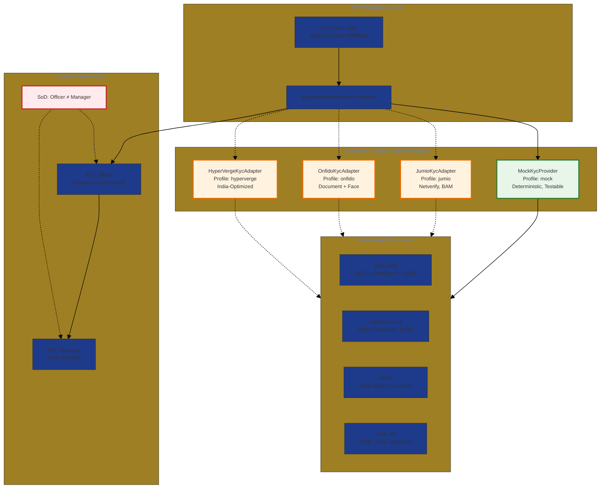

---

## Document Control

| Version | Date | Author | Changes |
|---------|------|--------|---------|
| 1.0 | 2026-11-17 | Architecture Team | Initial diagrams |
| 2.0 | 2026-11-18 | Architecture Team | **Major Update**: Added RBAC architecture, KYC maker-checker workflow, KYC state machine, Officer/Manager interaction, Updated service topology, Updated database topology, Updated event flows, Added authorization model, Added onboarding workflow |
| 3.0 | 2026-11-18 | Architecture Team | **All 8 ADRs Approved**: Updated service topology for AWS EKS, RDS single-instance multi-schema, Hybrid saga orchestration, Database encryption layers, Service discovery (K8s DNS vs Eureka), Malware scanning flow, KYC vendor integration, Role hierarchy |

---

**END OF DOCUMENT**