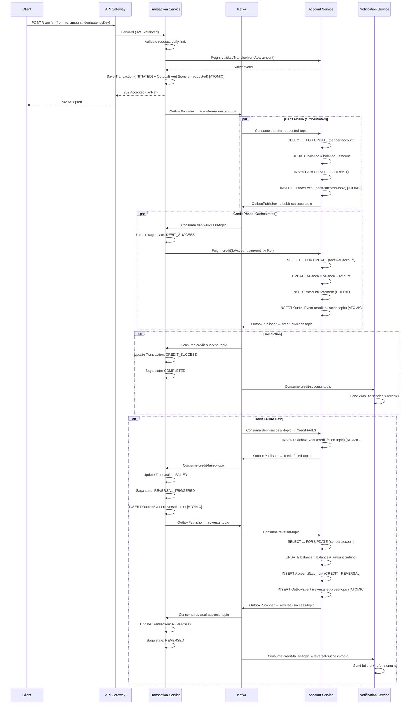

# ADR-002: Saga Pattern — Hybrid Orchestration/Choreography

## Status
✅ **APPROVED** (2026-11-18)

## Context

CitiCore uses distributed transactions for fund transfers and other cross-service operations. The current implementation uses a choreography-based saga with Kafka events, but the Transaction Service acts as a central coordinator for fund transfers, creating ambiguity.

**Requirements:**
- Financial consistency for fund transfers (no duplicate postings, no lost money)
- Clear ownership of saga state
- Reliable compensation on failures
- Independent notification processing
- Audit events consumed asynchronously

## Decision

**Use a hybrid saga architecture:**

| Domain | Pattern | Owner | Rationale |
|--------|---------|-------|-----------|
| **Fund Transfers** | **Orchestration** | Transaction Service | Financial consistency; centralized state; explicit compensation coordination |
| **Notifications** | **Choreography** | Notification Service | Independent; fire-and-forget; no compensation needed |
| **Audit/Compliance Events** | **Async Event Consumption** | Compliance Service | Independent; idempotent; no saga participation |

### Fund Transfer Saga (Orchestration)

**Transaction Service** acts as the **orchestration owner** for fund transfers.

#### Saga State Machine
```
INITIATED → DEBIT_REQUESTED → DEBIT_PROCESSING → DEBIT_SUCCESS/DEBIT_FAILED
                                        ↓
                              DEBIT_SUCCESS → CREDIT_REQUESTED → CREDIT_PROCESSING → CREDIT_SUCCESS/CREDIT_FAILED
                                        ↓                                                   ↓
                              CREDIT_SUCCESS → COMPLETED                          CREDIT_FAILED → REVERSAL_TRIGGERED → REVERSAL_PROCESSING → REVERSAL_SUCCESS → REVERSED
                                        ↓                                                   ↓
                              DEBIT_FAILED → FAILED
```

#### Orchestration Responsibilities

| Responsibility | Implementation |
|----------------|----------------|
| **State Persistence** | Persistent saga state in `citicore_transactiondb` (INITIATED, DEBIT_REQUESTED, DEBIT_SUCCESS, CREDIT_REQUESTED, CREDIT_SUCCESS, CREDIT_FAILED, REVERSAL_TRIGGERED, REVERSAL_SUCCESS, COMPLETED, FAILED, REVERSED) |
| **Outbox Publishing** | Transactional outbox for reliable command/event publishing |
| **Compensation Coordination** | Explicit `reversal-topic` publication on credit failure |
| **Retry Policies** | Exponential backoff (3 retries) for each step; DLQ after exhaustion |
| **Idempotency** | Client-provided `Idempotency-Key`; server-side deduplication per user |
| **Timeout Monitoring** | Scheduled job to detect stuck sagas; manual intervention queue |
| **Observability** | Saga correlation IDs propagated via Kafka headers and MDC |

#### Sequence Flow (Orchestrated)



### Notification Choreography

Notifications use **pure choreography** — services publish events, Notification Service consumes independently:

| Event | Publisher | Consumer | Compensation |
|-------|-----------|----------|--------------|
| `credit-success-topic` | Account Service | Notification Service | None (idempotent) |
| `credit-failed-topic` | Account Service | Notification Service | None |
| `reversal-success-topic` | Account Service | Notification Service | None |
| `kyc-case-topic` | KYC Workflow Service | Notification Service | None |
| `otp-verification-topic` | Auth Service | Notification Service | None |

### Audit Event Consumption

Compliance Service consumes all saga and KYC events asynchronously for audit trail:

| Event | Publisher | Consumer | Processing |
|-------|-----------|----------|------------|
| All `kyc-case-topic` | KYC Workflow Service | Compliance Service | Immutable audit log |
| All fund transfer events | Transaction/Account Service | Compliance Service | Regulatory reporting |
| Security events | All services | Compliance Service | SIEM integration |

## Alternatives Considered

| Option | Description | Pros | Cons | Verdict |
|--------|-------------|------|------|---------|
| **A) Pure Choreography** | All services react to events; no central coordinator | Simple; decoupled | No central state; hard to coordinate compensation; timeout handling difficult | ❌ Rejected for transfers |
| **B) Pure Orchestration** | Central orchestrator for all workflows | Centralized control; explicit state | Single point of failure; orchestrator becomes bottleneck; overkill for notifications | ❌ Rejected |
| **C) Hybrid (Selected)** | Orchestration for transfers; choreography for notifications/audit | Right tool per domain; clear ownership | Slightly more complex; two patterns to maintain | ✅ **Selected** |

## Consequences & Trade-offs

### Positive
- **Financial Consistency**: Orchestration ensures money never lost; explicit compensation
- **Clear Ownership**: Transaction Service owns transfer state; no ambiguity
- **Operational Clarity**: Stuck sagas visible in Transaction Service; manual intervention possible
- **Notification Independence**: Notification failures don't affect transfer saga
- **Audit Decoupling**: Compliance processing doesn't block business flows

### Negative
- **Two Patterns**: Team must understand both orchestration and choreography
- **Transaction Service Complexity**: Owns orchestration logic; must be highly available
- **Feign Dependency**: Orchestration uses synchronous Feign for credit; circuit breaker required

## Security Implications

- **Idempotency**: Client-provided keys + server deduplication prevent duplicate transfers
- **Pessimistic Locking**: `SELECT FOR UPDATE` on accounts prevents race conditions
- **Outbox Pattern**: Guarantees exactly-once event publishing
- **Saga Correlation IDs**: Propagated via Kafka headers for traceability

## Implementation Considerations

1. **Saga State Table**: New table in `citicore_transactiondb` with correlation ID, current state, step history, timestamps
2. **Timeout Job**: Scheduled job (every 5 min) to detect sagas stuck > 10 min; alert + manual queue
3. **Circuit Breaker**: Resilience4j on `AccountFeignClient.credit()` with fail-closed fallback
4. **Idempotency Keys**: Composite unique `(auth_user_id, idempotency_key)` in `idempotency_keys` table
5. **Monitoring**: Metrics for saga duration, state distribution, failure rates, compensation triggers

## Dependencies

- **DEC-001**: Database Topology (schemas for transactiondb, account)
- **DEC-005**: SoD Enforcement (Transaction Service orchestrates; KYC approval separate)
- **Transactional Outbox**: Existing pattern (Section 7.3 in Target Architecture)
- **Kafka**: Existing event bus (Section 7.1)

## Future Considerations

- **Saga Persistence**: Consider event sourcing for saga state if audit requirements grow
- **Distributed Tracing**: Full OpenTelemetry integration for saga correlation
- **Compensation Testing**: Chaos engineering for reversal scenarios
- **Multi-currency**: Extend saga for FX conversion step

---

## Document Control

| Version | Date | Author | Changes |
|---------|------|--------|---------|
| 1.0 | 2026-11-18 | Architecture Team | Initial ADR |

---

**END OF ADR**