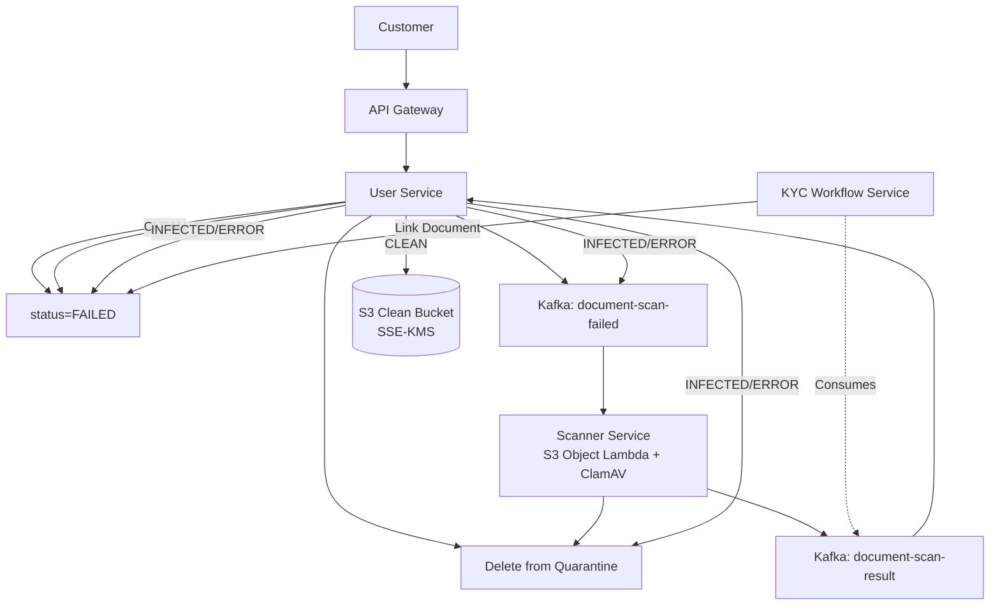

# ADR-010: Document Malware Scanning — ClamAV with Scanner Abstraction

## Status
✅ **APPROVED** (2026-11-18)

## Context

CitiCore accepts KYC document uploads from customers. These documents are stored in AWS S3 and accessed by KYC officers during review. Malware scanning is required to prevent malicious file uploads.

**Requirements:**
- Scan all uploaded documents for malware
- Quarantine documents until scan completes
- Release only clean documents
- Reject/quarantine infected documents
- Fail closed if scanner unavailable
- Record scanning metadata
- Architecture must support future commercial vendor replacement

## Decision

**Use a scanner abstraction interface with ClamAV as the initial implementation via S3 Object Lambda.**

### Architecture



### Scanner Abstraction Interface

```java
public interface DocumentScanner {
    
    /**
     * Scan a document in S3 for malware.
     * @param bucket S3 bucket name
     * @param key S3 object key
     * @return ScanResult with verdict and metadata
     * @throws ScannerUnavailableException if scanner cannot be reached
     */
    ScanResult scan(String bucket, String key) throws ScannerUnavailableException;
    
    /**
     * Check if scanner is healthy and available.
     */
    boolean isHealthy();
    
    /**
     * Get scanner implementation name/version.
     */
    String getScannerInfo();
}

public record ScanResult(
    ScanVerdict verdict,           // CLEAN, INFECTED, ERROR
    String details,                // Virus name, error message, etc.
    String scannerName,            // e.g., "ClamAV 1.4.0"
    String scannerVersion,
    Instant scannedAt,
    Map<String, String> metadata   // File size, scan duration, signatures version
) {}

public enum ScanVerdict {
    CLEAN,      // Document is safe
    INFECTED,   // Malware detected
    ERROR       // Scanner error (fail-closed)
}
```

### ClamAV Implementation (Initial)

| Aspect | Specification |
|--------|---------------|
| **Deployment** | S3 Object Lambda function (Node.js/Python) + ClamAV daemon |
| **Trigger** | S3 ObjectCreated event on Quarantine bucket |
| **Scan Process** | Download object → Stream to ClamAV → Parse result |
| **Signature Updates** | Freshclam daily via cron in Lambda layer or sidecar |
| **Timeout** | 30 seconds per file (configurable) |
| **Max File Size** | 100 MB (configurable) |
| **Fail-Closed** | Any scanner error → ERROR verdict → document rejected |

### S3 Bucket Structure

| Bucket | Purpose | Encryption | Access |
|--------|---------|------------|--------|
| `citicore-kyc-quarantine` | New uploads awaiting scan | SSE-KMS | User Service write; Scanner read; Auto-delete on result |
| `citicore-kyc-clean` | Scanned clean documents | SSE-KMS | User Service move; KYC Service read via pre-signed URLs |
| `citicore-kyc-infected` | Infected documents (optional retention) | SSE-KMS | Security team only; auto-delete after 30 days |

### Document Metadata Status Flow

```
UPLOADED → QUARANTINE → SCANNING → VERIFIED (moved to Clean bucket)
                    ↓
              FAILED (deleted from Quarantine; optional copy to Infected bucket)
```

### KYC Document Entity Updates

```java
@Entity
@Table(name = "kyc_documents")
public class KycDocument {
    // ... existing fields ...
    
    @Enumerated(EnumType.STRING)
    @Column(name = "scan_status", nullable = false)
    private ScanStatus scanStatus; // QUARANTINE, SCANNING, VERIFIED, FAILED
    
    @Column(name = "scan_verdict")
    private String scanVerdict; // CLEAN, INFECTED, ERROR
    
    @Column(name = "scan_details", columnDefinition = "TEXT")
    private String scanDetails;
    
    @Column(name = "scanner_name")
    private String scannerName;
    
    @Column(name = "scanner_version")
    private String scannerVersion;
    
    @Column(name = "scanned_at")
    private Instant scannedAt;
    
    @Column(name = "s3_bucket_clean")
    private String s3BucketClean; // Set when VERIFIED
    
    @Column(name = "s3_key_clean")
    private String s3KeyClean; // Set when VERIFIED
}
```

### Security Controls

1. **No Direct Access**: KYC officers access documents only via pre-signed URLs to Clean bucket
2. **Quarantine Isolation**: Quarantine bucket has no public access; no pre-signed URLs generated
3. **Fail-Closed**: Scanner timeout/error → document rejected; no automatic approval
4. **Audit Trail**: Every scan result logged in `kyc_document_scan_audit` table
5. **No False Clean**: Successful scan ≠ document authenticity (separate verification process)

## Alternatives Considered

| Option | Description | Pros | Cons | Verdict |
|--------|-------------|------|------|---------|
| **A) ClamAV via S3 Object Lambda** | Serverless, auto-scales, integrated with S3 | No infrastructure; pay-per-scan; fail-closed | Limited to ClamAV signatures; cold starts | ✅ **Selected** |
| **B) EC2 ClamAV Fleet** | Dedicated EC2 instances with ClamAV | Full control; custom signatures | Ops overhead; scaling; cost | ❌ Rejected |
| **C) AWS GuardDuty Malware Protection** | Managed AWS service | Integrated; no ops | S3-only; limited customization; cost | Future evaluation |
| **D) Commercial Vendor (e.g., CrowdStrike, Sophos)** | Enterprise AV APIs | Advanced detection; threat intel | Cost; vendor lock-in; contracts | Future integration |

## Consequences & Trade-offs

### Positive
- **Zero Infrastructure Ops**: S3 Object Lambda manages compute
- **Fail-Closed Security**: Any scanner issue blocks document
- **Vendor Agnostic**: Abstraction allows future vendor swap
- **Cost Effective**: Pay per scan; no idle capacity
- **Audit Trail**: Complete scan metadata for compliance

### Negative
- **Signature Dependency**: ClamAV signatures may miss zero-day malware
- **Cold Start Latency**: Lambda cold starts add ~1-2s to scan time
- **File Size Limits**: Lambda payload limits constrain max file size
- **No Heuristic/ML**: ClamAV is signature-based only

## Security Implications

- **Malware ≠ Authenticity**: Clean scan only means no known malware; document verification (OCR, face match) is separate
- **Quarantine Enforcement**: KYC Workflow Service must not link documents until `VERIFIED`
- **Encryption**: Both buckets use SSE-KMS (customer-managed key)
- **Access Logging**: All S3 access logged to CloudTrail

## Implementation Considerations

1. **Lambda Runtime**: Python 3.11 with ClamAV layer (clamav-lambda-layer)
2. **Signature Updates**: Daily freshclam via EventBridge scheduled Lambda
3. **Monitoring**: CloudWatch metrics for scan duration, verdict distribution, error rate
4. **Alerting**: Alert on ERROR verdict rate > 5%; INFECTED rate spike
4. **Testing**: Synthetic EICAR test file for pipeline validation

## Dependencies

- **DEC-001**: Database Topology (KYC document metadata in kyc_document_refs)
- **DEC-011**: MySQL Encryption (scan metadata encrypted)
- **KYC_ARCHITECTURE.md §9**: Document management flow
- **AWS**: S3, Lambda, EventBridge, CloudWatch, KMS

## Future Migration Considerations

| Trigger | Action |
|---------|--------|
| **Regulatory requirement** | Integrate commercial vendor (GuardDuty, CrowdStrike) via scanner abstraction |
| **Advanced threats** | Add heuristic/ML-based scanner as secondary check |
| **Performance** | Migrate to dedicated scanner fleet if volume exceeds Lambda limits |
| **Multi-region** | Deploy scanner abstraction in each region |

---

## Document Control

| Version | Date | Author | Changes |
|---------|------|--------|---------|
| 1.0 | 2026-11-18 | Architecture Team | Initial ADR |

---

**END OF ADR**