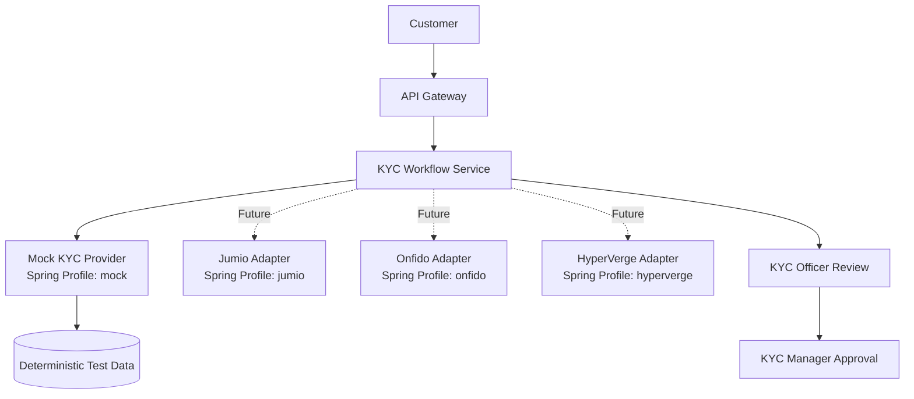

# ADR-015: KYC Vendor Integration — Internal Workflow with Mock Provider Initially

## Status
✅ **APPROVED** (2026-11-18)

## Context

CitiCore's KYC workflow must support the Indian market (PAN Card, Aadhaar Card, face match with selfie). The architecture must maintain CitiCore's internal maker-checker workflow while supporting future integration with external KYC verification vendors (Jumio, Onfido, HyperVerge, etc.).

**Requirements:**
- Maintain internal KYC workflow (Customer → Officer → Manager)
- Support CUSTOMER, KYC_OFFICER, KYC_MANAGER roles
- Enforce maker-checker separation (Officer ≠ Manager)
- Provide mock external verification provider for initial development/testing
- Define pluggable provider interface for future vendor integrations
- Mock responses must be deterministic for automated testing
- Never use real PAN/Aadhaar/government identity data in test datasets
- Future real vendor integration requires separate authorization, consent, security, legal/regulatory review

## Decision

**Maintain CitiCore's internal KYC workflow with a mock external verification provider initially. Define a provider abstraction interface for future vendor integrations.**

### Architecture



### Provider Abstraction Interface

```java
public interface KycVerificationProvider {
    
    /**
     * Verify identity documents against external sources.
     * @param request Verification request with document images/data
     * @return Verification result with per-document verdicts
     * @throws ProviderUnavailableException if provider cannot be reached
     */
    VerificationResult verify(VerificationRequest request) throws ProviderUnavailableException;
    
    /**
     * Get provider metadata.
     */
    ProviderInfo getProviderInfo();
    
    /**
     * Check if provider is healthy.
     */
    boolean isHealthy();
}

public record VerificationRequest(
    String caseId,
    String customerId,
    List<DocumentInput> documents,        // PAN, Aadhaar, Selfie, Address
    Map<String, String> customerData      // Name, DOB, address for matching
) {}

public record DocumentInput(
    DocumentType type,                    // PAN_CARD, AADHAAR, SELFIE, UTILITY_BILL
    String s3Key,                         // S3 key in clean bucket
    String contentType,
    long fileSize
) {}

public record VerificationResult(
    String providerReferenceId,           // Provider's transaction ID
    VerificationStatus overallStatus,     // VERIFIED, FAILED, MANUAL_REVIEW
    List<DocumentVerification> documents, // Per-document results
    RiskSignals riskSignals,              // PEP, sanctions, adverse media
    Instant verifiedAt,
    Map<String, String> metadata          // Raw provider response, confidence scores
) {}

public record DocumentVerification(
    DocumentType type,
    VerificationStatus status,            // VERIFIED, FAILED, MANUAL_REVIEW
    double confidenceScore,               // 0.0 - 1.0
    List<String> checksPerformed,         // OCR_MATCH, FACE_MATCH, SIGNATURE_MATCH, etc.
    String remarks
) {}

public enum VerificationStatus {
    VERIFIED,      // All checks passed
    FAILED,        // One or more checks failed
    MANUAL_REVIEW  // Requires human review
}
```

### Mock Provider Implementation (Initial)

| Aspect | Specification |
|--------|---------------|
| **Spring Profile** | `mock` (default for local/dev/test) |
| **Deterministic Behavior** | Same input → same output; based on document content hash |
| **Response Time** | Simulated latency (configurable: 100-500ms) |
| **Test Data** | Synthetic PAN/Aadhaar patterns only; no real identity data |
| **Configuration** | YAML-based rules for verdicts per test case |

```java
@Component
@Profile("mock")
public class MockKycProvider implements KycVerificationProvider {
    
    private final MockProviderConfig config;
    
    @Override
    public VerificationResult verify(VerificationRequest request) {
        // Deterministic: hash of caseId + document types
        String hash = Hashing.sha256()
            .hashString(request.caseId() + request.documents().stream()
                .map(DocumentInput::type).toString(), StandardCharsets.UTF_8)
            .toString();
        
        // Configurable verdict rules
        VerificationStatus overall = config.getVerdictForHash(hash);
        
        return VerificationResult.builder()
            .providerReferenceId("MOCK-" + hash.substring(0, 12))
            .overallStatus(overall)
            .documents(request.documents().stream().map(doc -> 
                DocumentVerification.builder()
                    .type(doc.type())
                    .status(overall)
                    .confidenceScore(config.getConfidenceForType(doc.type()))
                    .checksPerformed(List.of("OCR_MATCH", "FACE_MATCH", "CHECKSUM_VALID"))
                    .remarks("Mock verification - " + overall)
                    .build()
            ).toList())
            .riskSignals(RiskSignals.none())
            .verifiedAt(Instant.now())
            .metadata(Map.of("provider", "MOCK", "deterministic", "true"))
            .build();
    }
}
```

```yaml
# mock-provider.yml
mock-provider:
  default-verdict: VERIFIED
  confidence-scores:
    PAN_CARD: 0.98
    AADHAAR: 0.95
    SELFIE: 0.92
    UTILITY_BILL: 0.90
  verdict-rules:
    "case-reject-*": FAILED
    "case-manual-*": MANUAL_REVIEW
    "case-pep-*": 
      overall: VERIFIED
      risk-signals:
        pep-match: true
  latency-ms: 200
```

### India Market Document Support

| Document | Type Code | Verification Checks | Mock Behavior |
|----------|-----------|---------------------|---------------|
| PAN Card | `PAN_CARD` | OCR extraction, checksum validation, NSDL verification | Always VERIFIED (98% confidence) |
| Aadhaar Card | `AADHAAR` | OCR extraction, checksum (Verhoeff), UIDAI verification (mock) | Always VERIFIED (95% confidence) |
| Selfie | `SELFIE` | Face match with Aadhaar/PAN photo, liveness (mock) | Always VERIFIED (92% confidence) |
| Passport | `PASSPORT` | OCR, MRZ validation, checksum | VERIFIED (90% confidence) |
| Utility Bill | `UTILITY_BILL` | OCR address extraction, date validation (≤3 months) | VERIFIED (85% confidence) |

### Integration with KYC Workflow

```java
@Service
@RequiredArgsConstructor
public class KycCaseService {
    
    private final KycVerificationProvider verificationProvider;
    private final KycCaseRepository caseRepository;
    
    public void performExternalVerification(String caseNumber) {
        KycCase kycCase = caseRepository.findByCaseNumber(caseNumber)
            .orElseThrow(() -> new KycCaseNotFoundException(caseNumber));
        
        // 1. Build verification request
        VerificationRequest request = buildVerificationRequest(kycCase);
        
        // 2. Call provider (mock or real)
        VerificationResult result = verificationProvider.verify(request);
        
        // 3. Create findings from result
        List<KycReviewFinding> findings = result.documents().stream()
            .map(doc -> KycReviewFinding.builder()
                .caseId(kycCase.getId())
                .documentType(doc.type().name())
                .verificationStatus(mapStatus(doc.status()))
                .ocrConfidence(BigDecimal.valueOf(doc.confidenceScore()))
                .remarks(doc.remarks())
                .checkedById(SYSTEM_USER_ID)
                .checkedAt(Instant.now())
                .build())
            .toList();
        
        // 4. Save findings
        findingRepository.saveAll(findings);
        
        // 5. Update case with external verification result
        kycCase.setExternalVerificationResult(result);
        caseRepository.save(kycCase);
    }
}
```

### Configuration by Environment

| Environment | Spring Profile | Provider | Purpose |
|-------------|----------------|----------|---------|
| **Local Development** | `mock` | MockKycProvider | Fast, deterministic, no external deps |
| **CI/CD Testing** | `mock` | MockKycProvider | Deterministic, parallel test execution |
| **Staging** | `mock` (default) | MockKycProvider | Integration testing |
| **Production** | `jumio` / `onfido` | Real Provider | **Requires separate approval** |

### Future Real Vendor Integration

| Vendor | Adapter Class | Key Features | Compliance Notes |
|--------|---------------|--------------|------------------|
| **Jumio** | `JumioKycAdapter` | Netverify, BAM, document + face | PCI-DSS, GDPR; requires DPA |
| **Onfido** | `OnfidoKycAdapter` | Document + face, repeat attempts | SOC2, ISO27001; EU data residency |
| **HyperVerge** | `HyperVergeKycAdapter` | India-optimized; Aadhaar/PAN native | RBI compliant; on-prem option |
| **IDfy** | `IdfyKycAdapter` | India-focused; PAN/Aadhaar APIs | UA Kisan compliant |

**Integration Requirements for Real Vendors:**
1. **Separate ADR/Architecture Review** for each vendor
2. **Data Processing Agreement (DPA)** signed
3. **Security Assessment** (SOC2, ISO27001, penetration test)
4. **Legal/Regulatory Review** (RBI, UIDAI, data residency)
5. **Consent Management** explicit customer consent for data sharing
6. **Fallback Strategy** mock provider as circuit breaker fallback

## Alternatives Considered

| Option | Description | Pros | Cons | Verdict |
|--------|-------------|------|------|---------|
| **A) Internal + Mock Provider (Selected)** | Internal workflow; mock for dev; pluggable interface | Full control; testable; vendor agnostic | Real vendor integration later | ✅ **Selected** |
| **B) Direct Vendor Integration Now** | Integrate Jumio/Onfido immediately | Production-ready KYC | Cost; legal review; vendor lock-in; no internal workflow control | ❌ Rejected |
| **C) No External Verification** | Internal only (OCR + manual) | Zero vendor cost; full control | No automated verification; scaling limits; regulatory gaps | ❌ Rejected |
| **C) Build Own OCR/Face Match** | Custom ML models for PAN/Aadhaar | Full ownership | High effort; accuracy risk; maintenance burden | ❌ Rejected |

## Consequences & Trade-offs

### Positive
- **Workflow Ownership**: CitiCore controls maker-checker; vendor is just a signal
- **Testability**: Deterministic mock enables full CI/CD test coverage
- **Vendor Flexibility**: Switch vendors without workflow changes
- **Cost Control**: No vendor costs until production decision
- **Regulatory**: Internal workflow meets PMLA/RBI; vendor is supplementary

### Negative
- **Two-Step Verification**: Officer reviews vendor result + makes recommendation
- **Mock Limitations**: Cannot test real vendor edge cases (downtime, rate limits)
- **Integration Effort**: Each real vendor needs adapter implementation

## Security Implications

- **No Real PII in Tests**: Mock provider uses synthetic data only
- **Provider Isolation**: Vendor adapters run in separate network segment
- **Data Minimization**: Only required documents sent to vendor
- **Audit Trail**: Provider response stored in `kyc_case.external_verification_result`
- **Fail-Closed**: Provider unavailable → case held for manual review

## Implementation Considerations

1. **Provider Selection**: Spring profile determines active provider at startup
2. **Circuit Breaker**: Resilience4j on provider calls; fallback to MANUAL_REVIEW
3. **Idempotency**: Provider calls idempotent via caseId + document hashes
4. **Monitoring**: Metrics for provider latency, verdict distribution, error rate
5. **Testing**: Contract tests for provider interface; mock in unit tests

## Dependencies

- **DEC-003**: KYC Service Ownership (dedicated KYC Workflow Service)
- **DEC-005**: SoD Enforcement (vendor result → officer review → manager approval)
- **DEC-010**: Malware Scanning (documents scanned before vendor submission)
- **KYC_ARCHITECTURE.md**: Workflow, state machine, roles

## Future Migration Considerations

| Trigger | Action |
|---------|--------|
| **Regulatory Mandate** | Real vendor integration via approved ADR |
| **Scale/Accuracy Needs** | Evaluate vendor POC; select based on India market accuracy |
| **Cost Optimization** | Negotiate volume discounts; consider hybrid (mock for low-risk, vendor for high-risk) |
| **Multi-Country** | Add country-specific vendor adapters (e.g., SE Asia, ME) |

---

## Document Control

| Version | Date | Author | Changes |
|---------|------|--------|---------|
| 1.0 | 2026-11-18 | Architecture Team | Initial ADR |

---

**END OF ADR**