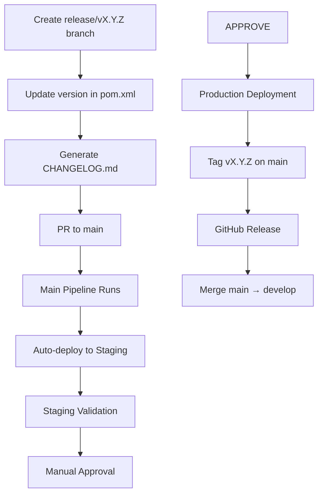

# CitiCore Banking Platform - CI/CD and SDLC Architecture

## Document Information

| Field | Value |
|-------|-------|
| **Document Title** | CitiCore CI/CD and SDLC Architecture |
| **Version** | 1.0 |
| **Status** | Draft for Review |
| **Classification** | Internal - Confidential |
| **Author** | Architecture Team |
| **Reviewers** | Engineering Lead, DevOps Lead, Security Lead, Platform Team |
| **Last Updated** | 2026-11-19 |

---

## Table of Contents

1. [Overview](#1-overview)
2. [Branch Strategy](#2-branch-strategy)
3. [Versioning Strategy](#3-versioning-strategy)
4. [Pull Request Pipeline](#4-pull-request-pipeline)
5. [Main Branch Pipeline](#5-main-branch-pipeline)
6. [Release Pipeline](#6-release-pipeline)
7. [Staging Deployment](#7-staging-deployment)
8. [Production Deployment](#8-production-deployment)
9. [Environment Promotion](#9-environment-promotion)
10. [GitHub Actions OIDC Federation](#10-github-actions-oidc-federation)
11. [Artifact Management](#11-artifact-management)
12. [Quality Gates](#12-quality-gates)
13. [Rollback Procedures](#13-rollback-procedures)
14. [Pipeline Observability](#14-pipeline-observability)
15. [SDLC Governance](#15-sdlc-governance)

---

## 1. Overview

This document defines the complete CI/CD and SDLC architecture for the CitiCore Banking Platform. It implements a modern, secure, and auditable software delivery lifecycle aligned with the approved target-state architecture and ADR decisions.

### 1.1 CI/CD Principles

| Principle | Description |
|-----------|-------------|
| **Immutable Artifacts** | Container images built once, promoted through environments |
| **Progressive Validation** | Increasing confidence: Local → PR → CI → Staging → Production |
| **Security First** | Shift-left security; scan at every stage |
| **Audit Trail** | Full traceability from commit to production |
| **Immutable Infrastructure** | Infrastructure changes via Terraform; no manual changes |
| **Rollback Ready** | Every deployment reversible within minutes |
| **Zero-Downtime** | Blue/Green or Canary deployments |

### 1.2 Pipeline Overview

```mermaid
%%{init: {'theme': 'base', 'themeVariables': {'primaryColor': '#1e3a8a', 'fontSize': '10px'}}}%%
flowchart TD
    subgraph DEV ["👨‍💻 Developer Workflow"]
        DEV_COMMIT[Commit to Feature Branch]
        DEV_PUSH[Push to GitHub]
        DEV_PR[Create Pull Request]
    end

    subgraph PR_PIPELINE ["🔍 Pull Request Pipeline"]
        PR_CHECKOUT[Checkout]
        PR_SETUP[Setup Java 17 + Maven + Docker]
        PR_CACHE[Cache Dependencies]
        PR_LINT[Static Analysis<br/>Checkstyle + SpotBugs + PMD]
        PR_UNIT[Unit Tests<br/>mvn test]
        PR_DEP[Dependency Scan<br/>OWASP Dependency Check]
        PR_SECRET[Secret Scan<br/>TruffleHog]
        PR_DOCKER[Docker Build Validation]
        PR_INTEGRATION[Integration Tests<br/>Testcontainers]
        PR_QUALITY[Quality Gates]
        PR_REPORT[Publish Reports]
    end

    subgraph MAIN_PIPELINE ["🚀 Main Branch Pipeline"]
        MAIN_BUILD[Build Application]
        MAIN_TEST[Automated Tests]
        MAIN_DOCKER[Build Versioned Images]
        MAIN_SCAN[Container Scan<br/>Trivy]
        MAIN_PUSH[Push to GHCR/ECR<br/>SemVer Tags]
        MAIN_ARTIFACTS[Generate Artifacts<br/>Helm Charts + SBOM]
    end

    subgraph STAGING ["🚀 Staging Deployment"]
        STAGE_TRIGGER[Main Success / Manual]
        STAGE_OIDC[OIDC → AWS STS]
        STAGE_HELM[Helm Deploy<br/>citicore-staging]
        STAGE_MIGRATE[Flyway Migrations]
        STAGE_TESTS[Smoke + Integration Tests]
        STAGE_VALIDATE[Connectivity Validation]
    end

    subgraph PROD ["🏭 Production Deployment"]
        PROD_APPROVE[Manual Approval]
        PROD_OIDC[OIDC → AWS STS]
        PROD_HELM[Helm Deploy<br/>citicore-prod]
        PROD_MIGRATE[Flyway Migrations]
        PROD_ROLLOUT[Blue/Green or Canary]
        PROD_VERIFY[Health Verification]
        PROD_MONITOR[Intensive Monitoring]
    end

    DEV_COMMIT --> DEV_PUSH --> DEV_PR
    DEV_PR --> PR_CHECKOUT
    PR_CHECKOUT --> PR_SETUP --> PR_CACHE --> PR_LINT
    PR_LINT --> PR_UNIT --> PR_DEP --> PR_SECRET --> PR_DOCKER
    PR_DOCKER --> PR_INTEGRATION --> PR_QUALITY --> PR_REPORT
    PR_REPORT -->|All Pass| MAIN_BUILD
    PR_REPORT -->|Fail| BLOCK[Block Merge]
    
    MAIN_BUILD --> MAIN_TEST --> MAIN_DOCKER --> MAIN_SCAN
    MAIN_SCAN --> MAIN_PUSH --> MAIN_ARTIFACTS
    MAIN_ARTIFACTS --> STAGE_TRIGGER
    
    STAGE_TRIGGER --> STAGE_OIDC --> STAGE_HELM
    STAGE_HELM --> STAGE_MIGRATE --> STAGE_TESTS --> STAGE_VALIDATE
    STAGE_VALIDATE -.->|Manual| PROD_APPROVE
    
    PROD_APPROVE --> PROD_OIDC --> PROD_HELM
    PROD_HELM --> PROD_MIGRATE --> PROD_ROLLOUT
    PROD_ROLLOUT --> PROD_VERIFY --> PROD_MONITOR
```



---

## 2. Branch Strategy

### 2.1 Git Branching Model (Trunk-Based with Release Branches)


### 2.2 Branch Types & Policies

| Branch Type | Naming | Protection | Merge Policy | Deployment |
|-------------|--------|------------|--------------|------------|
| **main** | `main` | Required reviews (2), Status checks, Linear history | Squash merge | Triggers Main Pipeline |
| **Feature** | `feature/JIRA-123-description` | No direct push to main | PR required | None (local only) |
| **Bugfix** | `bugfix/JIRA-456-description` | PR required | PR required | None (local only) |
| **Release** | `release/v1.2.0` | Required reviews (2), Status checks | PR to main | Staging → Production |
| **Hotfix** | `hotfix/v1.1.1-critical-fix` | Required reviews (2), Status checks | PR to release branch | Staging → Production |

### 2.3 Branch Protection Rules

```yaml
# GitHub Branch Protection (main)
main:
  required_reviews: 2
  dismiss_stale_reviews: true
  require_code_owner_review: true
  required_status_checks:
    - "CI / Lint"
    - "CI / Unit Tests"
    - "CI / Dependency Scan"
    - "CI / Secret Scan"
    - "CI / Docker Build"
    - "CI / Integration Tests"
    - "CI / Quality Gates"
  enforce_admins: true
  allow_force_push: false
  allow_deletion: false
  required_linear_history: true
  required_conversation_resolution: true
```

---

## 3. Versioning Strategy

### 3.1 Semantic Versioning (SemVer 2.0)

```
MAJOR.MINOR.PATCH[-PRERELEASE][+BUILD]

Examples:
  v1.0.0          - Initial release
  v1.1.0          - New features, backward compatible
  v1.1.1          - Bug fixes, backward compatible
  v2.0.0          - Breaking changes
  v1.2.0-rc.1     - Release candidate
  v1.2.0-beta.3   - Beta release
  v1.0.0+build.123 - Build metadata (Git SHA)
```

### 3.2 Version Assignment

| Trigger | Version Bump | Example |
|---------|-------------|---------|
| **Breaking API change** | MAJOR | `1.2.0` → `2.0.0` |
| **New feature (backward compat)** | MINOR | `1.2.0` → `1.3.0` |
| **Bug fix** | PATCH | `1.2.0` → `1.2.1` |
| **Release candidate** | MINOR + `-rc.N` | `1.3.0-rc.1` |
| **Hotfix on release branch** | PATCH on release | `1.2.0` → `1.2.1` |

### 3.3 Container Image Tags

```bash
# SemVer tags (immutable)
ghcr.io/citicore/auth-service:v1.2.3
ghcr.io/citicore/user-service:v1.2.3

# Git SHA for traceability
ghcr.io/citicore/auth-service:v1.2.3-a1b2c3d

# Latest pointers (mutable)
ghcr.io/citicore/auth-service:latest
ghcr.io/citicore/auth-service:stable

# PR validation (ephemeral)
ghcr.io/citicore/auth-service:pr-123-a1b2c3d
```

---

## 4. Pull Request Pipeline

### 4.1 Trigger

```yaml
on:
  pull_request:
    types: [opened, synchronize, reopened, ready_for_review]
    branches: [main]
  push:
    branches: [feature/**, bugfix/**]
```

### 4.2 Pipeline Stages

```yaml
jobs:
  lint:
    name: Static Analysis
    runs-on: ubuntu-latest
    steps:
      - uses: actions/checkout@v4
      - uses: actions/setup-java@v4
        with:
          java-version: '17'
          distribution: 'temurin'
          cache: maven
      - run: ./mvnw checkstyle:check spotbugs:check pmd:check -q
  
  unit-tests:
    name: Unit Tests
    runs-on: ubuntu-latest
    steps:
      - uses: actions/checkout@v4
      - uses: actions/setup-java@v4
        with:
          java-version: '17'
          distribution: 'temurin'
          cache: maven
      - run: ./mvnw test -Dspring.profiles.active=test
      - uses: actions/upload-artifact@v4
        with:
          name: test-results
          path: '**/target/surefire-reports/*.xml'
  
  dependency-scan:
    name: Dependency Vulnerability Scan
    runs-on: ubuntu-latest
    steps:
      - uses: actions/checkout@v4
      - uses: actions/setup-java@v4
        with:
          java-version: '17'
          distribution: 'temurin'
          cache: maven
      - run: ./mvnw org.owasp:dependency-check-maven:check -DfailBuildOnCVSS=7
  
  secret-scan:
    name: Secret Scanning
    runs-on: ubuntu-latest
    steps:
      - uses: actions/checkout@v4
        with:
          fetch-depth: 0
      - uses: trufflesecurity/trufflehog@v3
        with:
          path: ./
          base: main
          head: HEAD
  
  docker-build:
    name: Docker Build Validation
    runs-on: ubuntu-latest
    steps:
      - uses: actions/checkout@v4
      - name: Set up Docker Buildx
        uses: docker/setup-buildx-action@v3
      - name: Build test target
        run: |
          docker build --target test -t citicore/auth-service:test .
      - name: Run container tests
        run: |
          docker run --rm citicore/auth-service:test ./mvnw test
  
  integration-tests:
    name: Integration Tests
    runs-on: ubuntu-latest
    services:
      mysql:
        image: mysql:8.0
        env:
          MYSQL_ROOT_PASSWORD: test
          MYSQL_DATABASE: test
        ports: [3306:3306]
        options: --health-cmd="mysqladmin ping" --health-interval=10s
      kafka:
        image: apache/kafka:3.8
        env:
          KAFKA_NODE_ID: 1
          KAFKA_PROCESS_ROLES: broker,controller
          KAFKA_LISTENERS: PLAINTEXT://:9092,CONTROLLER://:9093
          KAFKA_ADVERTISED_LISTENERS: PLAINTEXT://kafka:9092
          KAFKA_LISTENER_SECURITY_PROTOCOL_MAP: CONTROLLER:PLAINTEXT,PLAINTEXT:PLAINTEXT
          KAFKA_CONTROLLER_LISTENER_NAMES: CONTROLLER
          KAFKA_CONTROLLER_QUORUM_VOTERS: 1@kafka:9093
        ports: [9092:9092]
      redis:
        image: redis:7-alpine
        ports: [6379:6379]
    steps:
      - uses: actions/checkout@v4
      - uses: actions/setup-java@v4
        with:
          java-version: '17'
          distribution: 'temurin'
          cache: maven
      - run: ./mvnw verify -Dspring.profiles.active=test -DskipUnitTests=true
  
  quality-gates:
    name: Quality Gates
    runs-on: ubuntu-latest
    needs: [lint, unit-tests, dependency-scan, secret-scan, docker-build, integration-tests]
    if: always()
    steps:
      - name: Check coverage
        run: |
          COVERAGE=$(cat target/site/jacoco/jacoco.xml | xpath -q -e 'string(/report/counter[@type="LINE"]/@missed)')
          if [ "$COVERAGE" -gt 20 ]; then exit 1; fi
      - name: Check vulnerabilities
        run: |
          if [ -f dependency-check-report.html ]; then
            grep -q "High\|Critical" dependency-check-report.html && exit 1 || true
          fi
      - name: Check secrets
        run: |
          # TruffleHog exits non-zero if secrets found
          true
```

---

## 5. Main Branch Pipeline

### 5.1 Trigger

```yaml
on:
  push:
    branches: [main]
  workflow_dispatch:
    inputs:
      version:
        description: 'Version override (optional)'
        required: false
        type: string
```

### 5.2 Pipeline Stages

```yaml
jobs:
  build:
    name: Build Application
    runs-on: ubuntu-latest
    steps:
      - uses: actions/checkout@v4
        with:
          fetch-depth: 0
      - uses: actions/setup-java@v4
        with:
          java-version: '17'
          distribution: 'temurin'
          cache: maven
      - run: ./mvnw clean package -DskipTests
      - uses: actions/upload-artifact@v4
        with:
          name: jars
          path: '**/target/*.jar'
  
  test:
    name: Automated Tests
    runs-on: ubuntu-latest
    needs: build
    steps:
      - uses: actions/checkout@v4
      - uses: actions/setup-java@v4
        with:
          java-version: '17'
          distribution: 'temurin'
          cache: maven
      - uses: actions/download-artifact@v4
        with:
          name: jars
      - run: ./mvnw test -Dspring.profiles.active=test
  
  docker-build:
    name: Build Versioned Images
    runs-on: ubuntu-latest
    needs: build
    outputs:
      image-tag: ${{ steps.set-tag.outputs.tag }}
    steps:
      - uses: actions/checkout@v4
        with:
          fetch-depth: 0
      - name: Determine version
        id: version
        run: |
          VERSION=$(./mvnw help:evaluate -Dexpression=project.version -q -DforceStdout)
          echo "version=$VERSION" >> $GITHUB_OUTPUT
      - name: Set image tag
        id: set-tag
        run: |
          echo "tag=v${{ needs.build.outputs.version }}" >> $GITHUB_OUTPUT
      - name: Set up Docker Buildx
        uses: docker/setup-buildx-action@v3
      - name: Login to GHCR
        uses: docker/login-action@v3
        with:
          registry: ghcr.io
          username: ${{ github.actor }}
          password: ${{ secrets.GITHUB_TOKEN }}
      - name: Build and push
        uses: docker/build-push-action@v5
        with:
          context: .
          push: true
          tags: |
            ghcr.io/${{ github.repository_owner }}/auth-service:${{ steps.set-tag.outputs.tag }}
            ghcr.io/${{ github.repository_owner }}/auth-service:${{ github.sha }}
          cache-from: type=gha
          cache-to: type=gha,mode=max
  
  container-scan:
    name: Container Scan
    runs-on: ubuntu-latest
    needs: docker-build
    steps:
      - name: Run Trivy
        uses: aquasecurity/trivy-action@master
        with:
          image-ref: 'ghcr.io/${{ github.repository_owner }}/auth-service:${{ needs.docker-build.outputs.image-tag }}'
          severity: 'CRITICAL,HIGH'
          exit-code: '1'
  
  push-registry:
    name: Push to ECR (Staging)
    runs-on: ubuntu-latest
    needs: [docker-build, container-scan]
    if: github.ref == 'refs/heads/main'
    permissions:
      id-token: write
      contents: read
    steps:
      - name: Configure AWS Credentials
        uses: aws-actions/configure-aws-credentials@v4
        with:
          role-to-assume: arn:aws:iam::STAGING_ACCOUNT:role/github-actions-staging-push
          aws-region: us-east-1
      - name: Login to ECR
        run: aws ecr get-login-password --region us-east-1 | docker login --username AWS --password-stdin ${{ secrets.ECR_REGISTRY }}
      - name: Retag and push
        run: |
          docker tag ghcr.io/${{ github.repository_owner }}/auth-service:${{ needs.docker-build.outputs.image-tag }} \
            ${{ secrets.ECR_REGISTRY }}/auth-service:${{ needs.docker-build.outputs.image-tag }}
          docker push ${{ secrets.ECR_REGISTRY }}/auth-service:${{ needs.docker-build.outputs.image-tag }}
  
  generate-artifacts:
    name: Generate Release Artifacts
    runs-on: ubuntu-latest
    needs: [build, push-registry]
    steps:
      - uses: actions/checkout@v4
        with:
          fetch-depth: 0
      - name: Generate changelog
        uses: mikepenz/release-changelog-builder-action@v4
        with:
          configuration: .github/changelog-config.json
      - name: Generate SBOM
        uses: anchore/sbom-action@v0
        with:
          path: .
          format: spdx-json
      - name: Package Helm charts
        run: |
          helm package ./helm/citicore -d ./artifacts
      - name: Upload artifacts
        uses: actions/upload-artifact@v4
        with:
          name: release-artifacts
          path: |
            artifacts/
            CHANGELOG.md
            sbom.spdx.json
          retention-days: 90
```

---

## 6. Release Pipeline

### 6.1 Release Branch Workflow

```yaml
on:
  push:
    branches: [release/**]
  workflow_dispatch:
    inputs:
      version:
        description: 'Release version'
        required: true
        type: string
```

### 6.2 Release Process



---

## 7. Staging Deployment

### 7.1 Trigger

```yaml
on:
  workflow_run:
    workflows: ["Main Branch Pipeline"]
    types: [completed]
    branches: [main]
  workflow_dispatch:
    inputs:
      image-tag:
        description: 'Image tag to deploy'
        required: false
```

### 7.2 Deployment Job

```yaml
jobs:
  deploy-staging:
    name: Deploy to Staging
    runs-on: ubuntu-latest
    environment: staging
    permissions:
      id-token: write
      contents: read
    steps:
      - name: Checkout Helm charts
        uses: actions/checkout@v4
        with:
          path: helm
      
      - name: Configure AWS Credentials (OIDC)
        uses: aws-actions/configure-aws-credentials@v4
        with:
          role-to-assume: arn:aws:iam::STAGING_ACCOUNT:role/github-actions-staging-deploy
          aws-region: us-east-1
      
      - name: Setup Helm
        uses: azure/setup-helm@v4
        with:
          version: v3.13+
      
      - name: Setup kubectl
        uses: aws-actions/amazon-eks-gamesdk-setup@v1
        with:
          cluster-name: citicore-staging
      
      - name: Deploy with Helm
        run: |
          helm upgrade --install citicore ./helm/citicore \
            --namespace citicore-staging \
            --create-namespace \
            -f ./helm/citicore/values-staging.yaml \
            --set global.imageTag=${{ github.event.inputs.image-tag || github.sha }} \
            --wait --timeout 10m
      
      - name: Run Flyway Migrations
        run: |
          kubectl -n citicore-staging exec -it deploy/auth-service -- \
            java -cp /app/app.jar org.flywaydb.commandline.Main migrate
      
      - name: Run Smoke Tests
        run: |
          ./scripts/smoke-tests.sh https://api.staging.citicore.io
      
      - name: Run Integration Tests
        run: |
          ./mvnw test -Dspring.profiles.active=staging \
            -Dtest=*IntegrationTest -Dstaging.url=https://api.staging.citicore.io
      
      - name: Validate Connectivity
        run: |
          ./scripts/validate-connectivity.sh staging
```

---

## 8. Production Deployment

### 8.1 Trigger

```yaml
on:
  workflow_dispatch:
    inputs:
      version:
        description: 'Release version to deploy'
        required: true
        type: string
      rollout-strategy:
        description: 'Rollout strategy'
        required: true
        type: choice
        options: [blue-green, canary]
```

### 8.2 Deployment Job

```yaml
jobs:
  deploy-production:
    name: Deploy to Production
    runs-on: ubuntu-latest
    environment: production
    permissions:
      id-token: write
      contents: read
    steps:
      - name: Checkout Helm charts
        uses: actions/checkout@v4
        with:
          path: helm
      
      - name: Configure AWS Credentials (OIDC)
        uses: aws-actions/configure-aws-credentials@v4
        with:
          role-to-assume: arn:aws:iam::PROD_ACCOUNT:role/github-actions-prod-deploy
          aws-region: us-east-1
      
      - name: Setup Helm & kubectl
        uses: azure/setup-helm@v4
      
      - name: Deploy with Helm (Blue/Green)
        if: ${{ inputs.rollout-strategy == 'blue-green' }}
        run: |
          # Deploy to inactive color
          ACTIVE_COLOR=$(kubectl get svc api-gateway -n citicore-prod -o jsonpath='{.metadata.labels.color}')
          INACTIVE_COLOR=$([ "$ACTIVE_COLOR" = "blue" ] && echo "green" || echo "blue")
          
          helm upgrade --install citicore-${INACTIVE_COLOR} ./helm/citicore \
            --namespace citicore-prod \
            -f ./helm/citicore/values-prod.yaml \
            --set global.color=${INACTIVE_COLOR} \
            --set global.imageTag=${{ inputs.version }} \
            --wait --timeout 15m
          
          # Run smoke tests on inactive
          ./scripts/smoke-tests.sh https://${INACTIVE_COLOR}.api.citicore.io
          
          # Switch traffic
          kubectl patch svc api-gateway -n citicore-prod \
            -p '{"spec":{"selector":{"color":"'${INACTIVE_COLOR}'"}}}'
          
          # Verify
          ./scripts/smoke-tests.sh https://api.citicore.io
      
      - name: Deploy Production (Canary)
        if: ${{ inputs.rollout-strategy == 'canary' }}
        run: |
          # Requires Istio
          helm upgrade --install citicore ./helm/citicore \
            --namespace citicore-prod \
            -f ./helm/citicore/values-prod.yaml \
            --set global.imageTag=${{ inputs.version }} \
            --set canary.enabled=true \
            --set canary.weight=10 \
            --wait --timeout 15m
          
          # Progressive rollout via Istio VirtualService
          for weight in 10 25 50 75 100; do
            kubectl patch virtualservice api-gateway -n citicore-prod \
              -p '{"spec":{"http":[{"route":[{"destination":{"host":"api-gateway","subset":"v'${inputs.version}'"},"weight":'$weight'},{"destination":{"host":"api-gateway","subset":"stable"},"weight":'$((100-weight))'}]}]}}'
            sleep 300
            ./scripts/verify-health.sh
          done
      
      - name: Verify Health Checks
        run: |
          ./scripts/verify-production-health.sh
      
      - name: Monitor Post-Deployment
        run: |
          sleep 900  # 15 min intensive monitoring
          ./scripts/check-error-rates.sh
      
      - name: Tag Release
        if: success()
        run: |
          git tag -a ${{ inputs.version }} -m "Release ${{ inputs.version }}"
          git push origin ${{ inputs.version }}
          gh release create ${{ inputs.version }} --generate-notes
```

---

## 9. Environment Promotion

### 9.1 Promotion Rules

| Promotion | Trigger | Approval | Validation |
|-----------|---------|----------|------------|
| **PR → CI** | Push to PR | Auto | All PR checks pass |
| **CI → Staging** | Main pipeline success | Auto | Staging smoke tests |
| **Staging → Prod** | Manual dispatch | Manual (2 approvers) | Staging validation + Approval |

### 9.2 Promotion Gates

| Gate | Staging | Production |
|------|---------|------------|
| **Code Review** | ✅ (PR) | ✅ (Release PR) |
| **Unit Tests** | ✅ | ✅ |
| **Integration Tests** | ✅ | ✅ |
| **Contract Tests** | ✅ | ✅ |
| **Security Scan** | ✅ | ✅ |
| **Performance Test** | Optional | ✅ |
| **Manual Approval** | ❌ | ✅ (2 approvers) |
| **Rollback Plan** | ✅ | ✅ |

---

## 10. GitHub Actions OIDC Federation

### 10.1 AWS IAM Trust Policy

```json
{
  "Version": "2012-10-17",
  "Statement": [
    {
      "Effect": "Allow",
      "Principal": {
        "Federated": "arn:aws:iam::ACCOUNT_ID:oidc-provider/token.actions.githubusercontent.com"
      },
      "Action": "sts:AssumeRoleWithWebIdentity",
      "Condition": {
        "StringLike": {
          "token.actions.githubusercontent.com:sub": [
            "repo:ORG/REPO:ref:refs/heads/main",
            "repo:ORG/REPO:ref:refs/heads/release/*",
            "repo:ORG/REPO:environment:staging",
            "repo:ORG/REPO:environment:production"
          ]
        }
      }
    }
  ]
}
```

### 10.2 IAM Roles

| Role | Account | Trusted Entities | Permissions |
|------|---------|------------------|-------------|
| `github-actions-staging-deploy` | Staging | GitHub OIDC (main, release/*) | EKS, ECR, RDS, Secrets Manager, CloudWatch |
| `github-actions-staging-push` | Staging | GitHub OIDC (main) | ECR Push |
| `github-actions-prod-deploy` | Production | GitHub OIDC (environment:production) | EKS, ECR, RDS, Secrets Manager, Route53, CloudWatch |
| `github-actions-prod-push` | Production | GitHub OIDC (tag) | ECR Push |

---

## 11. Artifact Management

### 11.1 Container Registry

| Registry | Purpose | Lifecycle Policy |
|----------|---------|------------------|
| **GHCR** | PR validation, main branch | 7 days (PR), 30 days (main) |
| **ECR Staging** | Staging deployments | 30 days (keep 30 images) |
| **ECR Production** | Production deployments | 90 days (keep 100 images) |

### 11.2 Artifact Types

| Artifact | Storage | Retention |
|----------|---------|-----------|
| **Container Images** | GHCR / ECR | Per registry policy |
| **Helm Charts** | GitHub Packages / ECR | 1 year |
| **SBOM** | GitHub Artifacts | 1 year |
| **Changelog** | GitHub Release | Permanent |
| **Test Reports** | GitHub Artifacts | 30 days |
| **Coverage Reports** | GitHub Pages / SonarQube | 90 days |

### 11.3 SBOM Generation

```yaml
- name: Generate SBOM
  uses: anchore/sbom-action@v0
  with:
    path: .
    format: spdx-json
    output-file: sbom.spdx.json
```

---

## 12. Quality Gates

### 12.1 Gate Definitions

| Gate | Stage | Threshold | Tool | Blocking |
|------|-------|-----------|------|----------|
| **Code Coverage** | PR, Main | ≥ 80% line | JaCoCo | ✅ |
| **Mutation Coverage** | Main | ≥ 60% | Pitest | ⚠️ Warning |
| **Static Analysis** | PR, Main | Zero critical/high | Checkstyle, SpotBugs, PMD | ✅ |
| **Dependencies** | PR, Main | Zero critical CVEs | OWASP Dependency Check | ✅ |
| **Secrets** | PR, Main | Zero detected | TruffleHog | ✅ |
| **Container Scan** | Main, Release | Zero critical/high | Trivy | ✅ |
| **SAST** | Main | Zero critical | CodeQL | ✅ |
| **DAST** | Staging | Zero critical | OWASP ZAP | ⚠️ Warning |
| **Performance** | Staging/Prod | p99 < 500ms | k6 | ⚠️ Warning |
| **Contract Tests** | PR, Main | All pass | Pact | ✅ |

### 12.2 Quality Gate Implementation

```yaml
- name: Quality Gate Evaluation
  run: |
    FAILED=0
    
    # Coverage
    COVERAGE=$(cat target/site/jacoco/jacoco.xml | \
      xpath -q -e 'string(/report/counter[@type="LINE"]/@covered)')
    TOTAL=$(cat target/site/jacoco/jacoco.xml | \
      xpath -q -e 'string(/report/counter[@type="LINE"]/@missed)')
    PCT=$((COVERAGE * 100 / (COVERAGE + TOTAL)))
    if [ $PCT -lt 80 ]; then
      echo "❌ Coverage $PCT% < 80%"
      FAILED=1
    fi
    
    # Dependencies
    if grep -q "CVSS.*[89]\." dependency-check-report.html 2>/dev/null; then
      echo "❌ Critical/High vulnerabilities found"
      FAILED=1
    fi
    
    # Container scan
    if [ -f trivy-report.json ]; then
      CRITICAL=$(jq '.Results[].Vulnerabilities[] | select(.Severity=="CRITICAL") | length' trivy-report.json)
      if [ "$CRITICAL" -gt 0 ]; then
        echo "❌ $CRITICAL critical container vulnerabilities"
        FAILED=1
      fi
    fi
    
    if [ $FAILED -eq 1 ]; then
      echo "::error::Quality gate failed"
      exit 1
    fi
```

---

## 13. Rollback Procedures

### 13.1 Helm Rollback

```bash
# Quick rollback (last release)
helm rollback citicore -n citicore-prod

# Rollback to specific revision
helm rollback citicore 5 -n citicore-prod

# Verify
kubectl rollout status deployment/api-gateway -n citicore-prod
```

### 13.2 Blue/Green Rollback

```bash
# Switch ALB traffic back to previous color
ACTIVE_COLOR=$(kubectl get svc api-gateway -n citicore-prod -o jsonpath='{.metadata.labels.color}')
PREVIOUS_COLOR=$([ "$ACTIVE_COLOR" = "blue" ] && echo "green" || echo "blue")

kubectl patch svc api-gateway -n citicore-prod \
  -p '{"spec":{"selector":{"color":"'$PREVIOUS_COLOR'"}}}'

# Verify
curl -f https://api.citicore.io/actuator/health
```

### 13.3 Canary Rollback

```bash
# Set canary weight to 0
kubectl patch virtualservice api-gateway -n citicore-prod \
  -p '{"spec":{"http":[{"route":[{"destination":{"host":"api-gateway","subset":"stable"},"weight":100}]}]}}'

# Or delete canary deployment
helm uninstall citicore-canary -n citicore-prod
```

### 13.4 Database Rollback

```bash
# Flyway undo (if supported)
flyway undo -configFiles=/etc/flyway/prod.conf

# Or manual restore from snapshot
aws rds restore-db-instance-from-db-snapshot \
  --db-instance-identifier citicore-prod-db-restored \
  --db-snapshot-identifier citicore-prod-db-snapshot-20240115 \
  --db-instance-class db.r6g.2xlarge
```

---

## 14. Pipeline Observability

### 14.1 Metrics

| Metric | Source | Dashboard |
|--------|--------|-----------|
| **Pipeline Duration** | GitHub Actions | CI/CD Overview |
| **Success Rate** | GitHub Actions | CI/CD Overview |
| **Deployment Frequency** | GitHub Actions + Helm | Deployment Tracker |
| **Lead Time** | GitHub + Helm | DORA Metrics |
| **MTTR** | GitHub + Alertmanager | Incident Tracker |
| **Quality Gate Pass Rate** | GitHub Actions | Quality Dashboard |

### 14.2 Pipeline Dashboards

```yaml
# Grafana Dashboard Panels
panels:
  - title: "Pipeline Duration (p50/p95)"
    targets:
      - expr: histogram_quantile(0.50, rate(github_actions_workflow_duration_seconds_bucket[1h]))
      - expr: histogram_quantile(0.95, rate(github_actions_workflow_duration_seconds_bucket[1h]))
  
  - title: "Deployment Success Rate"
    targets:
      - expr: sum(rate(github_actions_job_success_total[1h])) / sum(rate(github_actions_job_total[1h]))
  
  - title: "Lead Time for Changes"
    targets:
      - expr: histogram_quantile(0.50, rate(github_actions_lead_time_seconds_bucket[1h]))
  
  - title: "Quality Gate Pass Rate"
    targets:
      - expr: sum(rate(github_actions_quality_gate_pass_total[1h])) / sum(rate(github_actions_quality_gate_total[1h]))
```

---

## 15. SDLC Governance

### 15.1 Change Advisory Board (CAB)

| Meeting | Frequency | Attendees | Decisions |
|---------|-----------|-----------|-----------|
| **Weekly CAB** | Weekly | Platform Lead, Security Lead, Engineering Leads | Standard changes, capacity |
| **Emergency CAB** | As needed | Platform Lead, Security Lead, Engineering Director | Emergency changes |
| **Architecture Review** | Monthly | All Leads + Architects | Major architectural changes |

### 15.2 Compliance Reporting

| Report | Frequency | Audience | Content |
|--------|-----------|----------|---------|
| **Deployment Report** | Per deployment | Engineering | Version, changes, validation results |
| **Security Scan Report** | Per pipeline | Security | Vulnerabilities, secrets, compliance |
| **Deployment Compliance** | Monthly | Compliance | Change audit trail, approvals |
| **DORA Metrics** | Monthly | Engineering Leadership | DORA 4 keys |

### 15.3 Audit Trail

```yaml
# Every deployment creates audit record
deployment_audit:
  deployment_id: "uuid"
  timestamp: "ISO8601"
  trigger: "github_actions | manual"
  actor: "github_user"
  environment: "staging | production"
  version: "v1.2.3"
  git_sha: "a1b2c3d"
  approvals:
    - approver: "user1"
      timestamp: "ISO8601"
      role: "platform-lead"
    - approver: "user2"
      timestamp: "ISO8601"
      role: "security-lead"
  validation:
    smoke_tests: "passed"
    integration_tests: "passed"
    connectivity: "passed"
  rollback_ready: true
  rollback_tested: false
```

---

## Document Control

| Version | Date | Author | Changes |
|---------|------|--------|---------|
| 1.0 | 2026-11-19 | Architecture Team | Initial CI/CD and SDLC Architecture |

---

**END OF DOCUMENT**