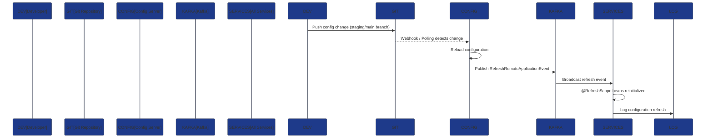
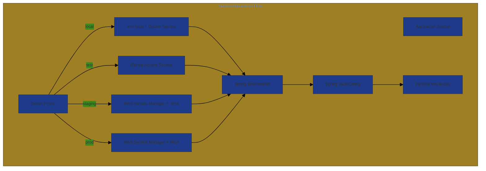
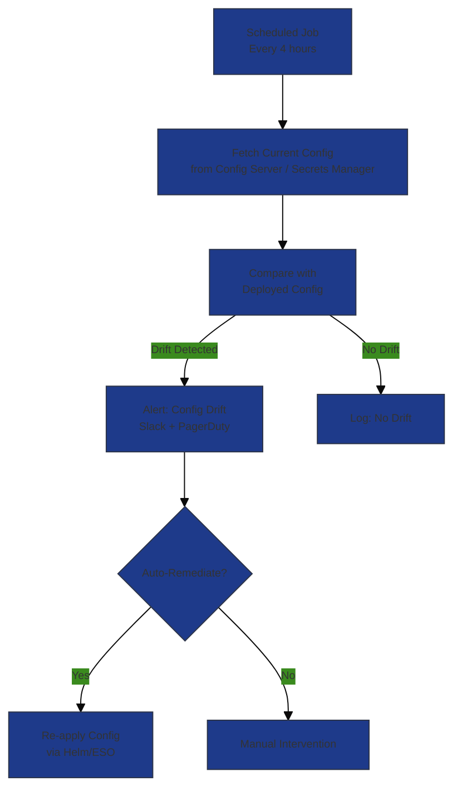

# CitiCore Banking Platform - Configuration Management Architecture

## Document Information

| Field | Value |
|-------|-------|
| **Document Title** | CitiCore Configuration Management Architecture |
| **Version** | 1.0 |
| **Status** | Draft for Review |
| **Classification** | Internal - Confidential |
| **Author** | Architecture Team |
| **Reviewers** | Engineering Lead, DevOps Lead, Platform Team |
| **Last Updated** | 2026-11-19 |

---

## Table of Contents

1. [Overview](#1-overview)
2. [Configuration Architecture](#2-configuration-architecture)
3. [Spring Profiles Strategy](#3-spring-profiles-strategy)
4. [Spring Cloud Config](#4-spring-cloud-config)
5. [Configuration Categories](#5-configuration-categories)
6. [Secrets Management](#6-secrets-management)
7. [External Service Abstractions](#7-external-service-abstractions)
8. [Feature Flags](#8-feature-flags)
9. [Configuration Validation](#9-configuration-validation)
10. [Deployment-Time Configuration](#10-deployment-time-configuration)
11. [Runtime Configuration Updates](#11-runtime-configuration-updates)
12. [Configuration Drift Detection](#11-configuration-drift-detection)
13. [Migration Strategy](#12-migration-strategy)

---

## 1. Overview

This document defines the comprehensive configuration management architecture for the CitiCore Banking Platform across all environments (Local, CI, Staging, Production).

### 1.1 Objectives

| Objective | Description |
|-----------|-------------|
| **Environment Parity** | Same application code behaves consistently across environments |
| **Zero Hardcoded Values** | No environment-specific values in source code |
| **Secure Secrets** | Zero secrets in source code, images, or Git history |
| **Runtime Flexibility** | Configuration changes without rebuild/restart where possible |
| **Auditability** | Full traceability of configuration changes |
| **Developer Experience** | Simple local setup; powerful production capabilities |

### 1.2 Configuration Principles

| Principle | Implementation |
|-----------|----------------|
| **Explicit over Implicit** | All configuration declared; no magic defaults |
| **Profile-Based** | Spring profiles drive environment selection |
| **Externalized** | Config external to application artifacts |
| **Hierarchical** | Base → Profile → Environment → Secrets |
| **Validated** | Schema validation at startup |
| **Observable** | Configuration changes logged and audited |

---

## 2. Configuration Architecture

### 2.1 Configuration Hierarchy

```mermaid
%%{init: {'theme': 'base', 'themeVariables': {'primaryColor': '#1e3a8a', 'fontSize': '10px'}}}%%
graph TB
    subgraph HIERARCHY ["Configuration Resolution Hierarchy (Highest Priority Wins)"]
        SECRETS[Secrets Manager / .env.local<br/>Priority: HIGHEST]
        ENV_VARS[Environment Variables<br/>Docker / K8s / GitHub Actions]
        PROFILE[Profile-specific YAML<br/>application-{profile}.yml]
        BASE[application.yml<br/>Common defaults]
        DEFAULTS[Spring Boot Defaults<br/>Priority: LOWEST]
    end
    
    DEFAULTS --> BASE
    BASE --> PROFILE
    PROFILE --> ENV_VARS
    ENV_VARS --> SECRETS
```

### 2.2 Configuration Sources by Environment

| Source | Local | CI/Test | Staging | Production |
|--------|-------|---------|---------|------------|
| **Base Config** | `application.yml` (jar) | `application.yml` (jar) | `application.yml` (jar) | `application.yml` (jar) |
| **Profile Config** | `application-local.yml` | `application-test.yml` | Config Server (Git) | Config Server (Git) |
| **Environment Variables** | `.env.local` + Docker Secrets | GitHub Actions Secrets | K8s EnvFrom (Secrets Manager) | K8s EnvFrom (Secrets Manager) |
| **Docker/K8s Secrets** | Docker Compose Secrets | N/A | K8s Secrets (ESO) | K8s Secrets (ESO) |
| **Spring Cloud Config** | Native (local files) | Native (test files) | Git Backend (staging branch) | Git Backend (main branch) |
| **Secrets Manager** | ❌ | ❌ | ✅ (via ESO) | ✅ (via ESO) |

---

## 3. Spring Profiles Strategy

### 3.1 Profile Definitions

| Profile | Purpose | Activated By |
|---------|---------|--------------|
| **local** | Developer laptop (Docker Compose) | `SPRING_PROFILES_ACTIVE=local` |
| **test** | CI integration tests (Testcontainers) | `SPRING_PROFILES_ACTIVE=test` |
| **staging** | AWS Staging environment | `SPRING_PROFILES_ACTIVE=staging` |
| **prod** | AWS Production environment | `SPRING_PROFILES_ACTIVE=prod` |

### 3.2 Profile Activation

```yaml
# Docker Compose (local)
environment:
  - SPRING_PROFILES_ACTIVE=local

# Kubernetes (staging/prod)
env:
  - name: SPRING_PROFILES_ACTIVE
    valueFrom:
      configMapKeyRef:
        name: citicore-config
        key: spring.profile
```

### 3.3 Profile-Specific Configuration Files

```
src/main/resources/
├── application.yml                 # Base configuration (all environments)
├── application-local.yml           # Local Docker Compose overrides
├── application-test.yml            # CI/Testcontainers overrides
├── application-staging.yml         # Staging-specific (loaded from Config Server)
└── application-prod.yml            # Production-specific (loaded from Config Server)
```

---

## 4. Spring Cloud Config

### 4.1 Architecture

```mermaid
%%{init: {'theme': 'base', 'themeVariables': {'primaryColor': '#1e3a8a', 'fontSize': '10px'}}}%%
graph TB
    subgraph CONFIG_SERVER ["Spring Cloud Config Server"]
        LOCAL_MODE[Local Profile<br/>Native: file:///config-repo]
        TEST_MODE[Test Profile<br/>Native: file:///config-repo-test]
        STAGING_MODE[Staging Profile<br/>Git Backend: staging branch]
        PROD_MODE[Prod Profile<br/>Git Backend: main branch]
    end
    
    subgraph CONFIG_REPOS ["Configuration Repositories"]
        LOCAL_REPO[config-repo-local/<br/>application.yml<br/>application-local.yml<br/>...]
        TEST_REPO[config-repo-test/<br/>application.yml<br/>application-test.yml<br/>...]
        GIT_REPO[Git Repository<br/>main branch (prod)<br/>staging branch (staging)]
    end
    
    subgraph CLIENTS ["Client Services"]
        AUTH[Auth Service]
        USER[User Service]
        KYC[KYC Workflow]
        ACC[Account Service]
        TXN[Transaction Service]
        NOTIF[Notification Service]
        GATEWAY[API Gateway]
    end
    
    LOCAL_MODE --> LOCAL_REPO
    TEST_MODE --> TEST_REPO
    STAGING_MODE --> GIT_REPO
    PROD_MODE --> GIT_REPO
    
    CONFIG_SERVER -->|HTTP| CLIENTS
    CLIENTS -->|Spring Cloud Bus| KAFKA[Kafka: Config Refresh]
```

### 4.2 Config Server Configuration

#### Local/Development (Native Profile)

```yaml
# config-server/src/main/resources/application-local.yml
spring:
  cloud:
    config:
      server:
        native:
          search-locations: file:/config-repo
  profiles:
    active: native
```

#### Staging/Production (Git Backend)

```yaml
# Config Server (staging/prod)
spring:
  cloud:
    config:
      server:
        git:
          uri: https://github.com/org/citicore-config
          default-label: main
          search-paths: '{application}'
          username: ${GIT_CONFIG_USER}
          password: ${GIT_CONFIG_TOKEN}
          clone-on-start: true
          force-pull: true
  profiles:
    active: git
  cloud:
    bus:
      enabled: true
      kafka:
        binder:
          brokers: ${KAFKA_BOOTSTRAP_SERVERS}
```

### 4.3 Client Configuration

```yaml
# Each service bootstrap.yml
spring:
  application:
    name: auth-service
  cloud:
    config:
      enabled: true
      uri: ${CONFIG_SERVER_URI:http://config-server:8888}
      fail-fast: true
      retry:
        initial-interval: 1000
        max-attempts: 6
        multiplier: 1.1
      profile: ${SPRING_PROFILES_ACTIVE:local}
  cloud:
    bus:
      enabled: true
      kafka:
        binder:
          brokers: ${KAFKA_BOOTSTRAP_SERVERS}
```

### 4.4 Config Refresh



### 4.5 Encryption/Decryption

```bash
# Encrypt a value
curl -X POST http://config-server:8888/encrypt \
  -d "my-secret-value"

# Decrypt a value
curl -X POST http://config-server:8888/decrypt \
  -d "encrypted-value"

# In YAML, use {cipher} prefix
spring:
  datasource:
    password: '{cipher}AQA...encrypted-value...'
```

---

## 5. Configuration Categories

### 5.1 Category Matrix

| Category | Description | Examples | Sensitivity | Storage |
|----------|-------------|----------|-------------|---------|
| **Application Defaults** | Base config shared across all envs | Timeouts, pool sizes, defaults | Low | `application.yml` (jar) |
| **Environment Config** | Environment-specific endpoints, flags | Kafka brokers, DB hosts, feature flags | Low | Profile YAML / Config Server |
| **Secrets** | Credentials, keys, tokens | DB passwords, JWT secret, API keys | Critical | Secrets Manager / .env.local |
| **Feature Flags** | Toggle features per environment | KYC mock provider, dual balance | Low | Profile YAML / Config Server |
| **External Integrations** | Third-party service config | KYC provider, email provider, OCR | Medium | Profile YAML + Secrets |
| **Resource Limits** | Container resource requests | CPU, memory, heap size | Low | Helm values / K8s resources |

### 5.2 Detailed Category Definitions

#### 5.2.1 Application Defaults (`application.yml`)

```yaml
# Base configuration - shared across ALL environments
server:
  port: 8080
  shutdown: graceful
  servlet:
    context-path: /api/v1

spring:
  jackson:
    serialization:
      write-dates-as-timestamps: false
    default-property-inclusion: non_null
  jpa:
    hibernate:
      ddl-auto: validate
    open-in-view: false
    properties:
      hibernate:
        format_sql: false
        jdbc:
          time_zone: UTC

# Default pool settings (can be overridden)
spring:
  datasource:
    hikari:
      maximum-pool-size: 20
      minimum-idle: 5
      connection-timeout: 30000
      idle-timeout: 600000
      max-lifetime: 1800000
      connection-test-query: SELECT 1

# Kafka defaults
spring:
  kafka:
    producer:
      key-serializer: org.apache.kafka.common.serialization.StringSerializer
      value-serializer: org.apache.kafka.common.serialization.StringSerializer
      acks: all
      retries: 3
      properties:
        delivery.timeout.ms: 30000
    consumer:
      key-deserializer: org.apache.kafka.common.serialization.StringDeserializer
      value-deserializer: org.apache.kafka.common.serialization.StringDeserializer
      group-id: ${spring.application.name}
      auto-offset-reset: earliest
      enable-auto-commit: false
      isolation-level: read_committed

# Redis defaults
spring:
  data:
    redis:
      timeout: 2000ms
      lettuce:
        pool:
          max-active: 20
          max-idle: 10
          min-idle: 5

# Observability
management:
  endpoints:
    web:
      exposure:
        include: health,info,metrics,prometheus,refresh
  endpoint:
    health:
      probes:
        enabled: true
  metrics:
    export:
      prometheus:
        enabled: true
  tracing:
    sampling:
      probability: 0.1
```

#### 5.2.2 Environment-Specific Configuration

```yaml
# application-local.yml
spring:
  profiles:
    active: local
  cloud:
    kubernetes:
      discovery:
        enabled: false
  eureka:
    client:
      service-url:
        defaultZone: http://eureka-server:8761/eureka
      register-with-eureka: true
      fetch-registry: true
    instance:
      prefer-ip-address: true

spring:
  kafka:
    bootstrap-servers: kafka:9092
    security:
      protocol: PLAINTEXT
  datasource:
    url: jdbc:mysql://mysql:3306/${spring.application.name}?useSSL=false&allowPublicKeyRetrieval=true
  data:
    redis:
      host: redis
      port: 6379
      ssl:
        enabled: false

aws:
  s3:
    endpoint: http://minio:9000
    region: us-east-1
    path-style-access: true

spring:
  mail:
    host: mailpit
    port: 1025

kyc:
  provider: mock
  mock:
    default-verdict: VERIFIED
```

#### 5.2.3 Feature Flags

```yaml
# Feature flags per environment
features:
  kyc:
    mock-provider: true
    dual-balance: true
    document-ocr: false
    face-match: false
  account:
    dual-balance: true
    interest-accrual: false
    pdf-statements: false
  transaction:
    beneficiary-management: false
    scheduled-transfers: false
  security:
    mfa-enabled: true
    account-lockout: true
    password-policy: true
```

---

## 6. Secrets Management

### 6.1 Secrets Architecture



### 6.2 Secrets Mapping

| Secret | Local | Test | Staging | Production |
|--------|-------|------|---------|------------|
| **DB Credentials** | `.env.local` | GitHub Secrets | Secrets Manager | Secrets Manager |
| **JWT Secret** | `.env.local` | GitHub Secrets | Secrets Manager | Secrets Manager |
| **S3 Credentials** | `.env.local` | GitHub Secrets | Secrets Manager | Secrets Manager |
| **Redis Credentials** | `.env.local` | GitHub Secrets | Secrets Manager | Secrets Manager |
| **Kafka SASL** | N/A | N/A | Secrets Manager | Secrets Manager |
| **SendGrid API Key** | `.env.local` | GitHub Secrets | Secrets Manager | Secrets Manager |
| **Google Vision** | `.env.local` | GitHub Secrets | Secrets Manager | Secrets Manager |
| **ClamAV** | N/A | N/A | Secrets Manager | Secrets Manager |

### 6.3 Spring Cloud AWS Secrets Manager Integration

```yaml
# bootstrap.yml (or application.yml with spring.config.import)
spring:
  config:
    import: "aws-secretsmanager:"
  cloud:
    aws:
      secretsmanager:
        enabled: true
        region: ${AWS_REGION:us-east-1}
        prefix: /citicore/${spring.profiles.active}
        profile-separator: _
        default-context: application
        name: ${spring.application.name}
```

### 6.4 External Secrets Operator (K8s)

```yaml
# ExternalSecret for auth-service
apiVersion: external-secrets.io/v1beta1
kind: ExternalSecret
metadata:
  name: auth-service-secrets
  namespace: citicore-prod
spec:
  refreshInterval: 1h
  secretStoreRef:
    name: aws-secrets-manager
    kind: ClusterSecretStore
  target:
    name: auth-service-secrets
    creationPolicy: Owner
  data:
    - secretKey: db-username
      remoteRef:
        key: citicore/prod/auth/db-credentials
        property: username
    - secretKey: db-password
      remoteRef:
        key: citicore/prod/auth/db-credentials
        property: password
    - secretKey: jwt-secret
      remoteRef:
        key: citicore/prod/auth/jwt-secret
    - secretKey: mail-username
      remoteRef:
        key: citicore/prod/auth/mail-credentials
        property: username
    - secretKey: mail-password
      remoteRef:
        key: citicore/prod/auth/mail-credentials
        property: password
```

### 6.5 ClusterSecretStore

```yaml
apiVersion: external-secrets.io/v1beta1
kind: ClusterSecretStore
metadata:
  name: aws-secrets-manager
spec:
  provider:
    aws:
      service: SecretsManager
      region: us-east-1
      auth:
        jwt:
          serviceAccountRef:
            name: external-secrets
            namespace: external-secrets
```

---

## 7. External Service Abstractions

### 7.1 Abstraction Pattern

```java
// Unified interface - implementation selected by profile
public interface DocumentStorage {
    String upload(InputStream input, String bucket, String key, String contentType);
    InputStream download(String bucket, String key);
    String generatePresignedUrl(String bucket, String key, Duration expiry);
    void delete(String bucket, String key);
}

// Local: MinioDocumentStorage (@Profile("local", "test"))
// AWS: S3DocumentStorage (@Profile("staging", "prod"))
```

### 7.2 Service Abstractions Matrix

| Service | Interface | Local Implementation | AWS Implementation | Profile Selection |
|---------|-----------|---------------------|-------------------|-------------------|
| **Object Storage** | `DocumentStorage` | MinioDocumentStorage | S3DocumentStorage | `@Profile({"local","test"})` vs `@Profile({"staging","prod"})` |
| **Email** | `EmailService` | MailpitEmailService | SesEmailService | `@Profile({"local","test"})` vs `@Profile({"staging","prod"})` |
| **KYC Verification** | `KycVerificationProvider` | MockKycProvider | JumioKycAdapter / OnfidoKycAdapter | `@Profile({"local","test","staging"})` vs `@Profile("prod")` |
| **Malware Scanning** | `DocumentScanner` | LocalClamAVScanner | S3ObjectLambdaScanner | `@Profile({"local","test"})` vs `@Profile({"staging","prod"})` |
| **Service Discovery** | `ServiceRegistry` | EurekaClient | K8sDiscoveryClient | `@Profile({"local","test"})` vs `@Profile({"staging","prod"})` |

### 7.3 Configuration by Abstraction

```yaml
# application-local.yml
storage:
  type: minio
  minio:
    endpoint: http://minio:9000
    access-key: ${MINIO_ROOT_USER}
    secret-key: ${MINIO_ROOT_PASSWORD}
    bucket-quarantine: citicore-kyc-quarantine
    bucket-clean: citicore-kyc-clean

email:
  type: mailpit
  mailpit:
    host: mailpit
    port: 1025

kyc:
  provider: mock
  mock:
    default-verdict: VERIFIED

scanner:
  type: clamav
  clamav:
    host: clamav
    port: 3310

discovery:
  type: eureka
  eureka:
    client:
      service-url:
        defaultZone: http://eureka-server:8761/eureka
```

```yaml
# application-prod.yml
storage:
  type: s3
  s3:
    region: us-east-1
    bucket-quarantine: citicore-prod-kyc-quarantine
    bucket-clean: citicore-prod-kyc-clean

email:
  type: ses
  ses:
    region: us-east-1
    configuration-set: citicore-prod-emails

kyc:
  provider: jumio
  jumio:
    api-token: ${JUMIO_API_TOKEN}
    api-secret: ${JUMIO_API_SECRET}

scanner:
  type: s3-object-lambda
  s3-object-lambda:
    arn: ${SCANNER_LAMBDA_ARN}

discovery:
  type: kubernetes
  kubernetes:
    discovery:
      enabled: true
```

---

## 8. Feature Flags

### 8.1 Feature Flag Architecture

```java
@Component
@ConfigurationProperties(prefix = "features")
public class FeatureFlags {
    private KycFeatures kyc = new KycFeatures();
    private AccountFeatures account = new AccountFeatures();
    private TransactionFeatures transaction = new TransactionFeatures();
    private SecurityFeatures security = new SecurityFeatures();
    
    // Getters/setters
}

@Data
public class KycFeatures {
    private boolean mockProvider = true;
    private boolean dualBalance = true;
    private boolean documentOcr = false;
    private boolean faceMatch = false;
}
```

### 8.2 Feature Flag Configuration

```yaml
# application-local.yml
features:
  kyc:
    mock-provider: true
    dual-balance: true
    document-ocr: false
    face-match: false
  account:
    dual-balance: true
    interest-accrual: false
    pdf-statements: false
  transaction:
    beneficiary-management: false
    scheduled-transfers: false
  security:
    mfa-enabled: true
    account-lockout: true
    password-policy: true
```

```yaml
# application-prod.yml
features:
  kyc:
    mock-provider: false
    dual-balance: true
    document-ocr: true
    face-match: true
  account:
    dual-balance: true
    interest-accrual: true
    pdf-statements: true
  transaction:
    beneficiary-management: true
    scheduled-transfers: true
  security:
    mfa-enabled: true
    account-lockout: true
    password-policy: true
```

### 8.3 Usage in Code

```java
@Service
@RequiredArgsConstructor
public class KycService {
    
    private final FeatureFlags features;
    private final KycVerificationProvider verificationProvider;
    
    public void submitKyc(KycSubmissionRequest request) {
        if (features.getKyc().isMockProvider()) {
            // Use mock provider
            verificationProvider.verify(request);
        } else {
            // Use real provider
            verificationProvider.verify(request);
        }
    }
}
```

---

## 9. Configuration Validation

### 9.1 Startup Validation

```java
@Component
public class ConfigurationValidator implements ApplicationRunner {
    
    @Value("${spring.datasource.url}")
    private String datasourceUrl;
    
    @Value("${spring.kafka.bootstrap-servers}")
    private String kafkaBrokers;
    
    @Value("${jwt.secret}")
    private String jwtSecret;
    
    @Override
    public void run(ApplicationArguments args) {
        validateRequiredProperties();
        validateJwtSecret();
        validateDatabaseConnection();
        validateKafkaConnection();
    }
    
    private void validateRequiredProperties() {
        List<String> required = List.of(
            "spring.datasource.url",
            "spring.kafka.bootstrap-servers",
            "jwt.secret",
            "spring.data.redis.host"
        );
        
        for (String prop : required) {
            if (environment.getProperty(prop) == null) {
                throw new IllegalStateException("Required property missing: " + prop);
            }
        }
    }
    
    private void validateJwtSecret() {
        if (jwtSecret == null || jwtSecret.length() < 32) {
            throw new IllegalStateException("JWT_SECRET must be at least 32 characters");
        }
        if (jwtSecret.equals("CHANGE_ME_IN_PRODUCTION_MIN_32_CHARS")) {
            throw new IllegalStateException("JWT_SECRET is using default value!");
        }
    }
}
```

### 9.2 Configuration Schema Validation

```yaml
# Spring Boot Config Metadata (META-INF/spring-configuration-metadata.json)
{
  "groups": [
    {
      "name": "storage",
      "type": "com.citicore.config.StorageConfig",
      "sourceType": "java"
    },
    {
      "name": "features",
      "type": "com.citicore.config.FeatureFlags",
      "sourceType": "java"
    }
  ],
  "properties": [
    {
      "name": "storage.type",
      "type": "java.lang.String",
      "description": "Storage backend type (minio, s3)",
      "defaultValue": "minio"
    },
    {
      "name": "features.kyc.mock-provider",
      "type": "java.lang.Boolean",
      "description": "Enable mock KYC provider",
      "defaultValue": true
    }
  ]
}
```

---

## 10. Deployment-Time Configuration

### 10.1 Helm Values Structure

```yaml
# helm/citicore/values-prod.yaml
global:
  imageRegistry: ghcr.io
  imageTag: v1.2.3
  imagePullSecrets: [ghcr-credentials]
  
  # Common configuration
  config:
    spring:
      profiles:
        active: prod
      datasource:
        hikari:
          maximum-pool-size: 30
      kafka:
        bootstrap-servers: ${KAFKA_BOOTSTRAP_SERVERS}
        security:
          protocol: SASL_SSL
        properties:
          sasl:
            mechanism: AWS_MSK_IAM
      data:
        redis:
          ssl:
            enabled: true
      cloud:
        kubernetes:
          discovery:
            enabled: true
        loadbalancer:
          kubernetes:
            enabled: true

# Service-specific overrides
auth-service:
  replicaCount: 3
  resources:
    limits:
      memory: 1Gi
      cpu: 1000m
    requests:
      memory: 512Mi
      cpu: 500m
  env:
    - name: SPRING_PROFILES_ACTIVE
      value: "prod"
    - name: SPRING_CONFIG_IMPORT
      value: "aws-secretsmanager:"

account-service:
  replicaCount: 5
  resources:
    limits:
      memory: 2Gi
      cpu: 2000m
  env:
    - name: SPRING_PROFILES_ACTIVE
      value: "prod"
```

### 10.2 Environment-Specific Helm Values

| File | Environment | Purpose |
|------|-------------|---------|
| `values.yaml` | Base | Common defaults |
| `values-local.yaml` | Local | Docker Compose (not used with Helm) |
| `values-test.yaml` | CI/Test | Testcontainers config |
| `values-staging.yaml` | Staging | Staging-specific overrides |
| `values-prod.yaml` | Production | Production overrides |

---

## 11. Runtime Configuration Updates

### 11.1 Spring Cloud Bus Refresh

```bash
# Trigger refresh for all services
curl -X POST http://config-server:8888/actuator/busrefresh

# Or target specific service
curl -X POST http://auth-service:8081/actuator/refresh
```

### 11.2 @RefreshScope Beans

```java
@Component
@RefreshScope
@ConfigurationProperties(prefix = "features")
public class FeatureFlags {
    // Automatically refreshed on /actuator/refresh
    private boolean mockProvider = true;
    // ...
}
```

### 11.3 External Secrets Operator Sync

```yaml
# ExternalSecret automatically syncs from Secrets Manager
# Refresh interval configurable
spec:
  refreshInterval: 1h  # Sync every hour
  
# Force immediate sync
kubectl annotate externalsecret auth-service-secrets \
  force-sync=now --overwrite
```

---

## 12. Configuration Drift Detection

### 12.1 Drift Detection Strategy



### 12.2 Drift Detection Implementation

```yaml
# Kubernetes ConfigMap for expected config
apiVersion: v1
kind: ConfigMap
metadata:
  name: citicore-expected-config
  namespace: citicore-prod
data:
  expected-config.yaml: |
    # Expected configuration checksum
    services:
      auth-service:
        config-map: auth-service-config
        secrets: auth-service-secrets
      user-service:
        config-map: user-service-config
        secrets: user-service-secrets
      # ... all services

---
# CronJob for drift detection
apiVersion: batch/v1
kind: CronJob
metadata:
  name: config-drift-detector
  namespace: citicore-prod
spec:
  schedule: "0 */4 * * *"  # Every 4 hours
  jobTemplate:
    spec:
      template:
        spec:
          serviceAccountName: config-drift-detector
          containers:
          - name: detector
            image: citicore/config-drift-detector:latest
            env:
            - name: NAMESPACE
              value: citicore-prod
            - name: EXPECTED_CONFIG_CM
              value: citicore-expected-config
          restartPolicy: OnFailure
```

---

## 13. Migration Strategy

### 13.1 From Current to Target State

| Phase | Action | Timeline |
|-------|--------|----------|
| **Phase 1** | Add Spring Cloud Config Server (native) | Sprint 1 |
| **Phase 2** | Migrate local config to profiles | Sprint 1 |
| **Phase 3** | Implement profile-specific YAML files | Sprint 1 |
| **Phase 4** | Add Config Server Git backend for staging | Sprint 2 |
| **Phase 5** | Implement AWS Secrets Manager + IRSA | Sprint 2 |
| **Phase 6** | Deploy External Secrets Operator | Sprint 2 |
| **Phase 7** | Migrate staging to Git-backed Config Server | Sprint 3 |
| **Phase 7** | Migrate production to Git-backed Config Server | Sprint 3 |
| **Phase 8** | Implement External Secrets Operator in prod | Sprint 3 |
| **Phase 9** | Enable Spring Cloud Bus for config refresh | Sprint 4 |
| **Phase 10** | Implement drift detection | Sprint 4 |

### 13.2 Backward Compatibility

- **Config Server**: Supports both native and Git backends simultaneously
- **Profiles**: New profiles additive; existing `local` profile unchanged
- **Secrets**: `.env.local` continues to work; AWS Secrets Manager additive
- **Abstractions**: Interface-based; implementations swappable without code changes

---

## Document Control

| Version | Date | Author | Changes |
|---------|------|--------|---------|
| 1.0 | 2026-11-19 | Architecture Team | Initial Configuration Management Architecture |

---

**END OF DOCUMENT**