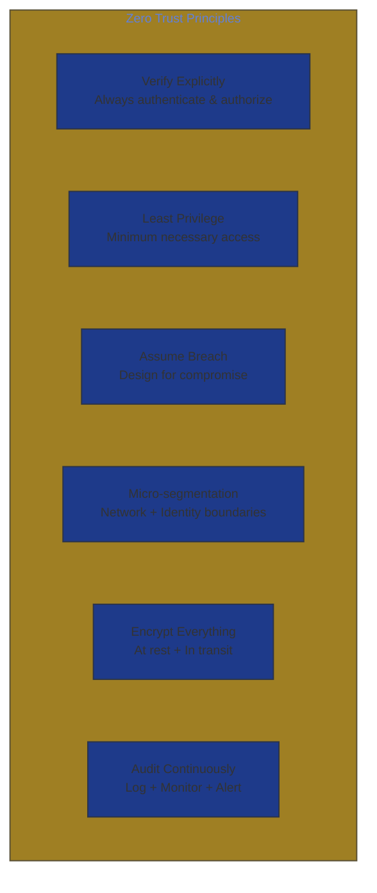
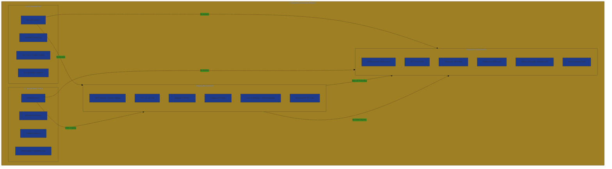
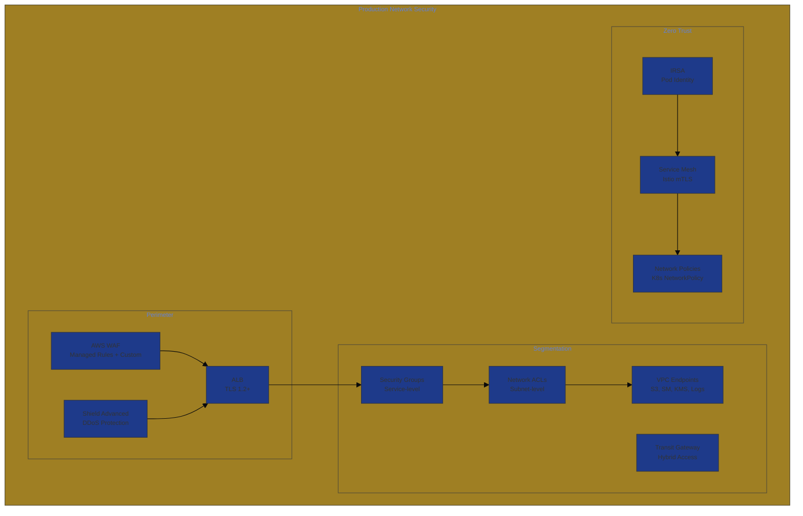
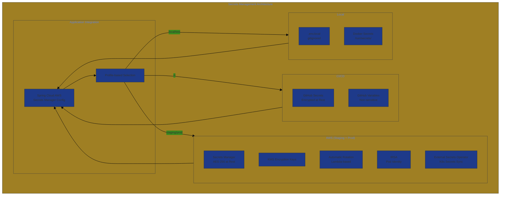
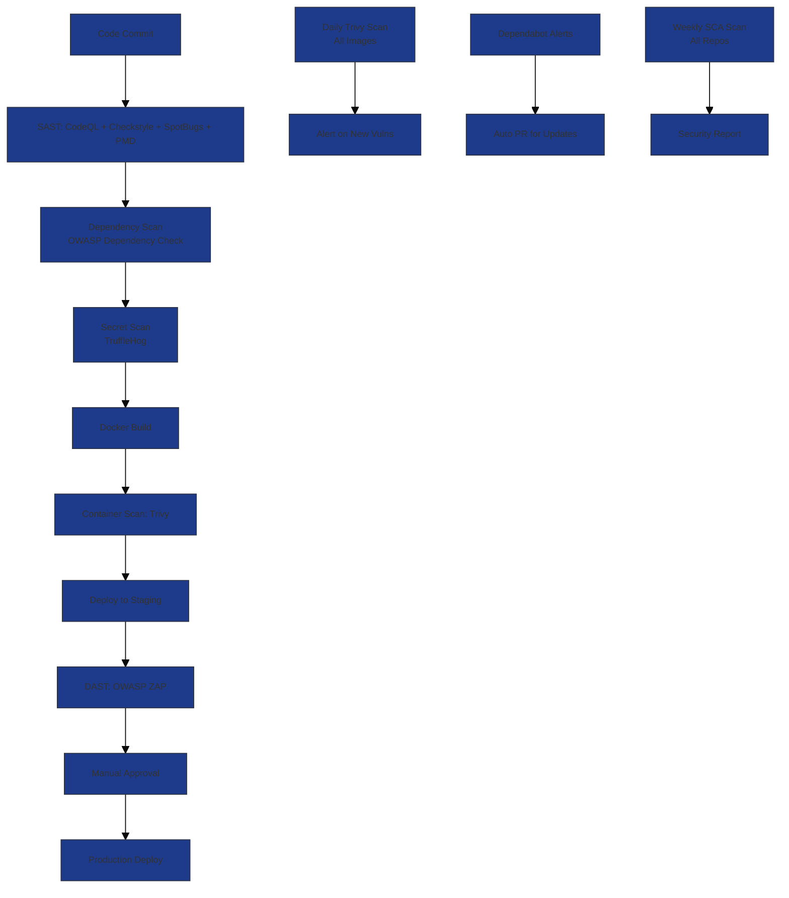
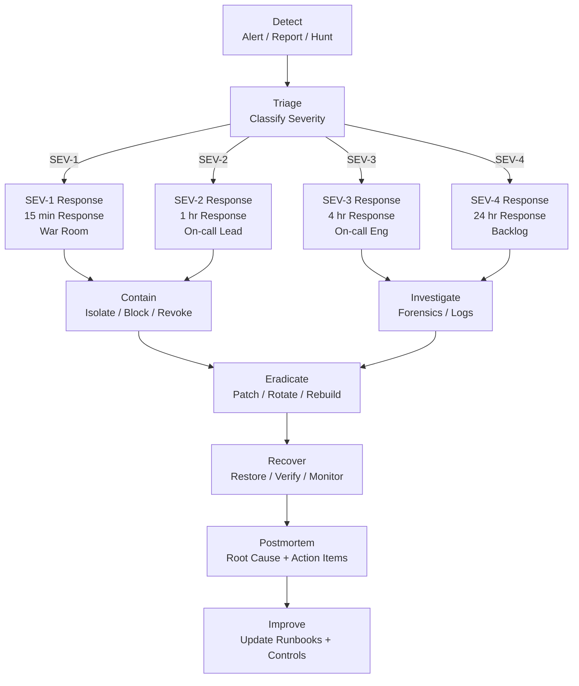

# CitiCore Banking Platform - Environment Security Architecture

## Document Information

| Field | Value |
|-------|-------|
| **Document Title** | CitiCore Environment Security Architecture |
| **Version** | 1.0 |
| **Status** | Draft for Review |
| **Classification** | Internal - Confidential |
| **Author** | Architecture Team |
| **Reviewers** | Security Lead, Engineering Lead, Platform Team, Compliance Officer |
| **Last Updated** | 2026-11-19 |

---

## Table of Contents

1. [Overview](#1-overview)
2. [Security Principles](#2-security-principles)
3. [Environment Isolation](#3-environment-isolation)
4. [Identity & Access Management](#4-identity--access-management)
5. [Network Security](#5-network-security)
6. [Data Protection](#6-data-protection)
7. [Secrets Management](#7-secrets-management)
8. [Vulnerability Management](#8-vulnerability-management)
9. [Compliance & Audit](#9-compliance--audit)
10. [Incident Response](#10-incident-response)
11. [Security Testing](#11-security-testing)
12. [Security Monitoring](#12-security-monitoring)

---

## 1. Overview

This document defines the comprehensive security architecture for all CitiCore environments (Local, CI, Staging, Production), implementing a defense-in-depth strategy aligned with the approved target-state architecture and ADR decisions.

### 1.1 Security Objectives

| Objective | Description |
|-----------|-------------|
| **Confidentiality** | Protect customer PII, financial data, and intellectual property |
| **Integrity** | Ensure data accuracy and prevent unauthorized modifications |
| **Availability** | Maintain 99.9% uptime with resilient architecture |
| **Auditability** | Complete traceability of all actions and changes |
| **Compliance** | Meet PCI-DSS, SOX, RBI, GDPR requirements |
| **Resilience** | Defend against and recover from security incidents |

### 1.2 Security Principles

| Principle | Implementation |
|-----------|----------------|
| **Zero Trust** | Never trust, always verify; least privilege access |
| **Defense in Depth** | Multiple security layers at network, host, application, data levels |
| **Least Privilege** | Minimum necessary permissions for every identity |
| **Secure by Default** | Secure configurations out of the box |
| **Shift Left Security** | Security integrated early in SDLC |
| **Immutable Infrastructure** | No manual changes; all changes via IaC |
| **Audit Everything** | Complete audit trail for all actions |
| **Fail Secure** | Default deny; fail closed on security failures |

---

## 2. Security Principles (Expanded)

### 2.1 Zero Trust Architecture



### 2.2 Security Controls by Layer

| Layer | Controls | Local | CI | Staging | Production |
|-------|----------|-------|-----|---------|------------|
| **Network** | Segmentation, TLS, WAF, VPC Endpoints | Docker Bridge | Ephemeral | VPC + SG + NACL + VPC Endpoints | VPC + SG + NACL + VPC Endpoints + WAF + Shield |
| **Identity** | MFA, IRSA, RBAC, ABAC | Local Users | GitHub OIDC | IRSA + IAM | IRSA + IAM + Break-glass |
| **Host** | Non-root, Read-only FS, Dropped Caps | Docker Defaults | Container Defaults | Hardened AMIs + K8s PSP | Hardened AMIs + K8s PSP + Istio |
| **Application** | Input Validation, Output Encoding, CSP, HSTS | Enabled | Enabled | Enabled + WAF | Enabled + WAF + Shield |
| **Data** | Encryption, Masking, Tokenization | None | None | RDS KMS + App-level + S3 SSE-KMS | RDS KMS + App-level + S3 SSE-KMS + Object Lock |
| **Secrets** | Rotation, Least Privilege, Audit | .env.local | GitHub Secrets | Secrets Manager + IRSA | Secrets Manager + IRSA + Auto-rotation |
| **Runtime** | Admission Control, Runtime Security | N/A | N/A | Admission Controllers | Admission + Falco + Kyverno |

---

## 3. Environment Isolation

### 3.1 Isolation Boundaries



### 3.2 Data Isolation

| Data Type | Local | CI | Staging | Production |
|-----------|-------|-----|---------|------------|
| **Customer PII** | Synthetic | Synthetic | Anonymized | Real |
| **Financial Data** | Synthetic | Synthetic | Anonymized | Real |
| **KYC Documents** | Synthetic | Synthetic | Anonymized | Real |
| **Transaction Records** | Synthetic | Synthetic | Anonymized | Real |
| **Audit Logs** | Local | Ephemeral | Staging Logs | Production Logs |
| **Secrets** | Local Only | GitHub Secrets | Staging Secrets | Production Secrets |
| **Encryption Keys** | None | None | Staging KMS | Production KMS |

### 3.3 Network Isolation

| Control | Local | CI | Staging | Production |
|---------|-------|-----|---------|------------|
| **VPC** | Docker Bridge | Ephemeral | 10.1.0.0/16 (2 AZ) | 10.0.0.0/16 (3 AZ) |
| **Public Access** | None | None | ALB Only | ALB + WAF + Shield |
| **Database Access** | localhost | Testcontainers | Private Subnet + SG | Private Subnet + SG + RDS Proxy |
| **Kafka Access** | localhost | Testcontainers | Private Subnet + SG + IAM | Private Subnet + SG + IAM |
| **Redis Access** | localhost | Testcontainers | Private Subnet + SG + TLS | Private Subnet + SG + TLS |
| **S3 Access** | localhost | Testcontainers | VPC Endpoint | VPC Endpoint |
| **Internet Egress** | Allowed | Allowed | NAT Gateway | NAT Gateway (restricted) |
| **Service Mesh** | None | None | Optional (Istio prep) | Istio (planned) |

---

## 4. Identity & Access Management

### 4.1 Human Access

```mermaid
%%{init: {'theme': 'base', 'themeVariables': {'primaryColor': '#1e3a8a', 'fontSize': '10px'}}}%%
graph TB
    subgraph HUMAN_ACCESS ["Human Identity & Access"]
        IDP[Identity Provider<br/>Corporate SSO]
        
        subgraph ROLES ["IAM Roles"]
            DEV_ROLE[Developer Role<br/>Read-only Staging<br/>No Prod Access]
            PLATFORM_ROLE[Platform Engineer<br/>Staging Deploy<br/>Prod Read-only]
            SECURITY_ROLE[Security Engineer<br/>Audit Access All Env]
            DBA_ROLE[DBA<br/>Staging RDS Access<br/>Prod RDS (Break-glass)]
            RELEASE_ROLE[Release Manager<br/>Staging + Prod Deploy]
            ADMIN_ROLE[Platform Admin<br/>Full Access + Break-glass]
        end
        
        IDP --> ROLES
        ROLES -->|Assume Role| AWS_ACCOUNTS[AWS Accounts]
        
        AWS_ACCOUNTS --> STAGING[Staging Account]
        AWS_ACCOUNTS --> PROD[Production Account]
        
        BREAK_GLASS[Break-glass Procedure<br/>Time-limited + Audited + Approved]
        ADMIN_ROLE -.->|Emergency| BREAK_GLASS
        DBA_ROLE -.->|Emergency| BREAK_GLASS
    end
```

### 4.2 Service Identity (IRSA)

| Service | IAM Role | Permissions |
|---------|----------|-------------|
| `auth-service` | `citicore-prod-auth-service` | Secrets Manager (auth/*), RDS authdb |
| `user-service` | `citicore-prod-user-service` | Secrets Manager (user/*), S3, RDS userdb |
| `kyc-workflow-service` | `citicore-prod-kyc-service` | Secrets Manager (kyc/*), S3, RDS kyc db |
| `account-service` | `citicore-prod-account-service` | Secrets Manager (account/*), RDS account, ElastiCache |
| `transaction-service` | `citicore-prod-txn-service` | Secrets Manager (txn/*), RDS txn db |
| `ledger-service` | `citicore-prod-ledger-service` | RDS ledger db |
| `compliance-service` | `citicore-prod-compliance-service` | RDS compliance db |
| `monitoring` | `citicore-prod-monitoring` | CloudWatch, X-Ray |

### 4.3 RBAC Matrix (Application-Level)

| Permission | CUSTOMER | KYC_OFFICER | KYC_MANAGER | SUPPORT | OPERATIONS | COMPLIANCE | ADMIN | AUDITOR |
|------------|:--------:|:-----------:|:-----------:|:-------:|:----------:|:----------:|:-----:|:-------:|
| `CUSTOMER_PROFILE_READ` | Own | Assigned | Authorized | All | All | All | All | All |
| `CUSTOMER_PROFILE_WRITE` | Own | ❌ | ❌ | ❌ | ❌ | ❌ | All | ❌ |
| `KYC_DOCUMENT_UPLOAD` | Own | ❌ | ❌ | ❌ | ❌ | ❌ | All | ❌ |
| `KYC_DOCUMENT_READ` | Own | Assigned | Authorized | Limited | All | All | All | All |
| `KYC_CASE_ASSIGN` | ❌ | ❌ | ✅ | ❌ | ❌ | ❌ | ✅ | ❌ |
| `KYC_CASE_REVIEW` | ❌ | Assigned | Authorized | ❌ | ❌ | All | All | ❌ |
| `KYC_CASE_RECOMMEND` | ❌ | Assigned | ❌ | ❌ | ❌ | ❌ | ❌ | ❌ |
| `KYC_CASE_APPROVE` | ❌ | ❌ | Authorized* | ❌ | ❌ | ❌ | ✅ | ❌ |
| `KYC_CASE_REJECT` | ❌ | ❌ | Authorized* | ❌ | ❌ | ✅ | ✅ | ❌ |
| `ACCOUNT_CREATE` | Own | ❌ | ❌ | ❌ | ✅ | ❌ | All | ❌ |
| `ACCOUNT_READ` | Own | Assigned | Authorized | All | All | All | All | All |
| `ACCOUNT_TRANSFER` | Own | ❌ | ❌ | ❌ | ❌ | ❌ | All | ❌ |
| `ADMIN_USER_MANAGE` | ❌ | ❌ | ❌ | ❌ | ❌ | ❌ | ✅ | ❌ |
| `ADMIN_ROLE_ASSIGN` | ❌ | ❌ | ❌ | ❌ | ❌ | ❌ | ✅ | ❌ |
| `AUDIT_TRAIL_READ` | ❌ | ❌ | ❌ | ❌ | ❌ | ✅ | ✅ | ✅ |

*Authorized* = Authorized for case, NOT the reviewing officer (SoD)

---

## 5. Network Security

### 5.1 Network Security Controls



### 5.2 Security Group Rules (Production)

| Security Group | Inbound Rules | Outbound Rules |
|----------------|---------------|----------------|
| **ALB External** | 0.0.0.0/0 → HTTPS 443 | Ephemeral (1024-65535) |
| **ALB Internal** | ALB External SG → HTTPS 443 | EKS Nodes SG → HTTPS 443 |
| **EKS Nodes** | ALB Internal SG → HTTPS 443 | RDS SG → 3306, MSK SG → 9098, ElastiCache SG → 6379, S3 VPC EP → 443 |
| **RDS** | EKS Nodes SG → 3306 | None |
| **MSK** | EKS Nodes SG → 9098 | None |
| **ElastiCache** | EKS Nodes SG → 6379 | None |
| **S3 VPC Endpoint** | EKS Nodes SG → 443 | None |
| **Secrets Manager EP** | EKS Nodes SG → 443 | None |

### 5.3 TLS Configuration

| Connection | Protocol | Certificate | Validation |
|------------|----------|-------------|------------|
| **Client → ALB** | TLS 1.2+ | ACM (auto-renew) | Full |
| **ALB → Pod** | TLS 1.2+ | Self-signed (internal) | None (internal) |
| **Pod → RDS** | TLS 1.2+ | RDS CA | Full (verifyServerCertificate=true) |
| **Pod → MSK** | TLS 1.2+ | MSK CA | Full (IAM Auth) |
| **Pod → ElastiCache** | TLS 1.2+ | ElastiCache CA | Full |
| **Pod → S3** | TLS 1.2+ | AWS CA | Full |
| **Service-to-Service** | mTLS (Phase 2) | Istio CA | Mutual |

---

## 6. Data Protection

### 6.1 Encryption Matrix

| Data State | Local | CI | Staging | Production |
|------------|-------|-----|---------|------------|
| **RDS Storage** | None | None | RDS KMS (CMK) | RDS KMS (CMK) |
| **RDS Backups** | None | None | RDS KMS (CMK) | RDS KMS (CMK) |
| **RDS Snapshots** | None | None | RDS KMS (CMK) | RDS KMS (CMK) |
| **MSK Storage** | None | None | KMS | KMS |
| **ElastiCache** | None | None | KMS | KMS |
| **EBS Volumes** | None | None | KMS | KMS |
| **S3 Objects** | None | None | SSE-KMS | SSE-KMS + Object Lock |
| **S3 Versioning** | None | None | Enabled | Enabled |
| **App-Level PII** | None | None | Envelope (AES-256-GCM + KMS) | Envelope (AES-256-GCM + KMS) |
| **In Transit (RDS)** | Disabled | Disabled | TLS 1.2+ (enforced) | TLS 1.2+ (enforced) |
| **In Transit (MSK)** | PLAINTEXT | PLAINTEXT | TLS 1.2+ + IAM | TLS 1.2+ + IAM |
| **In Transit (Redis)** | Disabled | Disabled | TLS 1.2+ | TLS 1.2+ |
| **In Transit (ALB)** | N/A | N/A | TLS 1.2+ | TLS 1.2+ (ACM) |
| **Service-to-Service** | N/A | N/A | mTLS (planned) | mTLS (Istio) |

### 6.2 PII Protection

| Data Element | Classification | Protection |
|-------------|----------------|------------|
| **PAN** | High | Envelope Encryption (AES-256-GCM + KMS) + Masking |
| **Aadhaar** | High | Envelope Encryption + Masking (last 4 only) |
| **Passport** | High | Envelope Encryption + Masking |
| **Account Number** | Medium | Envelope Encryption |
| **Customer Name** | Medium | Encryption at rest |
| **Address** | Medium | Encryption at rest |
| **Phone/Email** | Low | Encryption at rest |
| **Transaction History** | High | Encryption at rest + Audit trail |
| **KYC Documents** | Critical | S3 SSE-KMS + Object Lock + Malware Scan |

### 6.3 Data Masking Rules

| Field | Display Mask | Log Mask | API Response |
|-------|--------------|----------|--------------|
| PAN | `**** **** **** 1234` | `**** **** **** 1234` | `**** **** **** 1234` |
| Aadhaar | `**** **** 1234` | `**** **** 1234` | `**** **** 1234` |
| Account Number | `**** 5678` | `**** 5678` | `**** 5678` (full for owner) |
| Phone | `+1 *** *** 1234` | `+1 *** *** 1234` | `+1 *** *** 1234` |
| Email | `d***@domain.com` | `d***@domain.com` | `d***@domain.com` |

---

## 7. Secrets Management

### 7.1 Secrets Architecture



### 7.2 Secret Rotation Policies

| Secret Type | Frequency | Mechanism | Owner |
|-------------|-----------|-----------|-------|
| **Database Credentials** | 90 days | Lambda: Generate → Update RDS → Update Secret → Rolling restart | Platform |
| **JWT Secret** | 180 days | Manual: Generate → Update Secret → Rolling restart all | Security |
| **Redis Credentials** | 90 days | Lambda + Rolling restart | Platform |
| **Kafka SASL** | 90 days | Lambda + Rolling restart | Platform |
| **API Keys** | Per vendor | Manual | Platform |
| **TLS Certificates** | Auto (90 days) | cert-manager / ACM | Platform |

### 7.3 Audit Trail

| Event | Logged | Retention |
|-------|--------|-----------|
| Secret Create/Update/Delete | CloudTrail | 1 year |
| Secret Access (GetSecretValue) | CloudTrail | 1 year |
| Secret Rotation | CloudTrail + App Logs | 1 year |
| Failed Access | CloudTrail + GuardDuty | 1 year |
| Rotation Failure | CloudWatch + SNS | 1 year |

---

## 8. Vulnerability Management

### 8.1 Vulnerability Pipeline



### 8.2 Vulnerability SLAs

| Severity | SLA (Patch) | SLA (Mitigate) | Action |
|----------|-------------|----------------|--------|
| **Critical (CVSS ≥ 9.0)** | 24 hours | 4 hours | Emergency patch / Emergency mitigation |
| **High (CVSS 7.0-8.9)** | 72 hours | 24 hours | Priority patch / Mitigation |
| **Medium (CVSS 4.0-6.9)** | 30 days | 7 days | Scheduled patch |
| **Low (CVSS 0.1-3.9)** | 90 days | 30 days | Next maintenance window |

### 8.3 Vulnerability Response

| Phase | Action | Owner | Timeline |
|-------|--------|-------|----------|
| **Detect** | Automated scans + Dependabot | Automated | Continuous |
| **Triage** | Assess impact, exploitability | Security Team | < 4 hours |
| **Mitigate** | WAF rules, config changes, isolation | Platform/Security | Per SLA |
| **Patch** | Update dependencies, rebuild, test | Engineering | Per SLA |
| **Verify** | Re-scan, regression test | Engineering | Post-patch |
| **Close** | Update tracking, document lessons | Security | Post-verify |

---

## 9. Compliance & Audit

### 9.1 Regulatory Mapping

| Regulation | Applicable Controls | Evidence |
|------------|---------------------|----------|
| **PCI-DSS SAQ-A** | No card data stored; encryption; access control; monitoring | SAQ-A Attestation |
| **SOX** | Immutable audit trail; change control; access review; segregation of duties | Audit Trail + Change Logs |
| **RBI** | Data residency; KYC/AML; encryption; audit trail | RBI Audit Report |
| **GDPR/PDPB** | Right to erasure; portability; consent; DPIA; DPO | Privacy Impact Assessment |
| **Data Residency** | us-east-1 (configurable) | Architecture Decision |

### 9.2 Audit Trail Requirements

| Event Category | Events | Retention | Storage |
|----------------|--------|-----------|---------|
| **Authentication** | Login, logout, MFA, password change, lockout | 7 years | Immutable DB + S3 Object Lock |
| **Authorization** | Permission grant/deny, role assignment, SoD violations | 7 years | Immutable DB + S3 Object Lock |
| **KYC Workflow** | Case transitions, assignments, reviews, decisions | 7 years | Immutable DB + S3 Object Lock |
| **Financial** | Transfers, deposits, withdrawals, balance changes | 7 years | Immutable DB + S3 Object Lock |
| **Administrative** | Config changes, user mgmt, role mgmt, impersonation | 7 years | Immutable DB + S3 Object Lock |
| **Data Access** | Profile views, document access, statement downloads | 3 years | Immutable DB + S3 Object Lock |

### 9.3 Immutable Audit Log (Hash-Chained)

```java
@Entity
@Table(name = "audit_logs")
public class AuditLog {
    @Id
    @GeneratedValue(strategy = GenerationType.IDENTITY)
    private Long id;
    
    @Column(name = "audit_id", unique = true)
    private String auditId; // UUID
    
    @Column(name = "timestamp", nullable = false)
    private Instant timestamp;
    
    @Embedded
    private Actor actor; // userId, email, roles, ip, userAgent, sessionId
    
    @Column(name = "action", nullable = false)
    private String action;
    
    @Embedded
    private Resource resource; // type, id, ownerId
    
    @Column(name = "details", columnDefinition = "JSON")
    private String details; // prev/new state, reason, metadata
    
    @Column(name = "outcome")
    private String outcome; // SUCCESS, FAILURE, BLOCKED
    
    @Column(name = "risk_level")
    private String riskLevel; // LOW, MEDIUM, HIGH, CRITICAL
    
    @Column(name = "correlation_id")
    private String correlationId; // Trace ID
    
    // Integrity
    @Column(name = "previous_hash", length = 64)
    private String previousHash;
    
    @Column(name = "record_hash", length = 64)
    private String recordHash;
}
```

---

## 10. Incident Response

### 10.1 Incident Classification

| Severity | Definition | Response Time | Escalation |
|----------|------------|---------------|------------|
| **SEV-1 (Critical)** | Active breach, data exfiltration, service down | 15 minutes | Platform Lead → Engineering Director → CISO |
| **SEV-2 (High)** | Vulnerability exploited, partial outage, data exposure risk | 1 hour | Platform Lead → Security Lead |
| **SEV-3 (Medium)** | Suspicious activity, failed attacks, config drift | 4 hours | Platform Engineer |
| **SEV-4 (Low)** | Info leaks, policy violations, anomaly | 24 hours | Platform Engineer |

### 10.2 Incident Response Flow



### 10.3 Key Runbooks

| Runbook | Trigger | Key Steps |
|---------|---------|-----------|
| **RUNBOOK-BREACH-001** | Data breach suspected | 1. Contain 2. Assess scope 3. Notify legal/regulators 4. Eradicate 5. Notify customers |
| **RUNBOOK-RANSOMWARE-001** | Ransomware detected | 1. Isolate 2. Identify variant 3. Restore from immutable backups 4. Verify integrity |
| **RUNBOOK-KEY-COMPROMISE-001** | KMS/Secret key compromised | 1. Rotate key 2. Re-encrypt data 3. Audit access logs 4. Update policies |
| **RUNBOOK-DB-LEAK-001** | Database credential leak | 1. Rotate credentials 2. Audit access 3. Check for misuse 4. Update rotation policy |
| **RUNBOOK-SOD-VIOLATION-001** | SoD violation detected | 1. Block action 2. Alert security 3. Audit trail review 4. Disciplinary process |

---

## 11. Security Testing

### 11.1 Testing Matrix

| Test Type | Frequency | Scope | Tool | Environment |
|-----------|-----------|-------|------|-------------|
| **SAST** | Every PR | All code | CodeQL, Checkstyle, SpotBugs, PMD | GitHub Actions |
| **Dependency Scan** | Every PR | All dependencies | OWASP Dependency Check | GitHub Actions |
| **Secret Scan** | Every PR | All code | TruffleHog | GitHub Actions |
| **Container Scan** | Every Build | All images | Trivy | GitHub Actions |
| **DAST** | Weekly | Staging APIs | OWASP ZAP | Staging |
| **API Fuzzing** | Weekly | Critical APIs | Custom | Staging |
| **Penetration Test** | Quarterly | Full stack | Third-party | Staging (isolated) |
| **Red Team** | Annually | Full environment | External firm | Staging (isolated) |
| **Chaos Engineering** | Monthly | Resilience | LitmusChaos | Staging |
| **Configuration Audit** | Weekly | All configs | Kyverno / OPA | All K8s |

### 11.2 Test Data Requirements

| Environment | Data Type | PII Handling |
|-------------|-----------|--------------|
| **Local** | Synthetic only | Generated |
| **CI** | Synthetic only | Generated per test |
| **Staging** | Anonymized | Production snapshot → Anonymization pipeline |
| **Production** | Real | Full protection |

---

## 12. Security Monitoring

### 12.1 Monitoring Coverage

| Layer | Tool | Key Metrics | Alerting |
|-------|------|-------------|----------|
| **Network** | CloudWatch + VPC Flow Logs | Rejected connections, unusual traffic | GuardDuty |
| **Host** | CloudWatch + Falco | CPU, Memory, Process anomalies | Falco Rules |
| **Container** | Falco + Kyverno | Privilege escalation, suspicious syscalls | Falco Alerts |
| **Kubernetes** | Kyverno + Gatekeeper | Policy violations, misconfigs | Kyverno Reports |
| **Application** | Spring Actuator + Micrometer | Error rate, latency, business metrics | Custom Alerts |
| **Database** | CloudWatch + RDS Enhanced | Connections, slow queries, locks | RDS Events |
| **Kafka** | MSK Monitoring | Consumer lag, under-replicated | MSK Alerts |
| **Auth** | Spring Security + Custom | Failed logins, lockouts, MFA failures | Custom Alerts |
| **RBAC/SoD** | Custom Metrics | Denials, violations, anomalies | Critical Alerts |

### 12.2 Key Security Dashboards

| Dashboard | Panels | Refresh |
|-----------|--------|---------|
| **Security Overview** | Auth success/fail, lockouts, MFA, RBAC denials, SoD violations | 1 min |
| **Network Security** | WAF blocked, Shield events, VPC flow anomalies, GuardDuty findings | 5 min |
| **Vulnerability Management** | Open vulns by severity, patch status, SLA compliance | 1 hour |
| **Compliance** | Audit log integrity, access reviews, certification status | 1 day |
| **Incident Response** | Open incidents, MTTR, MTTA, postmortem status | 5 min |

---

## Document Control

| Version | Date | Author | Changes |
|---------|------|--------|---------|
| 1.0 | 2026-11-19 | Architecture Team | Initial Environment Security Architecture |

---

**END OF DOCUMENT**