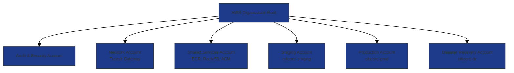
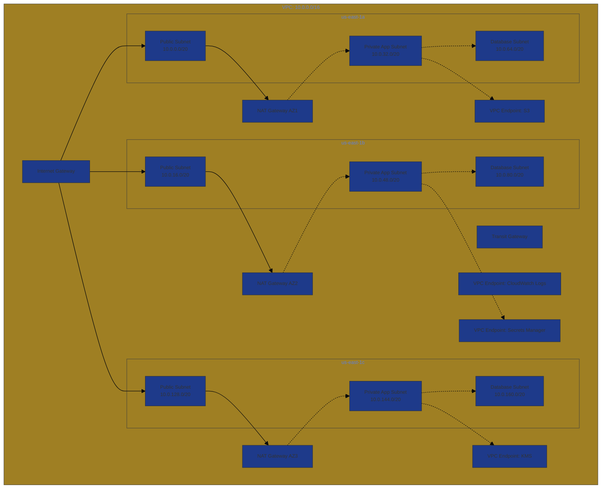
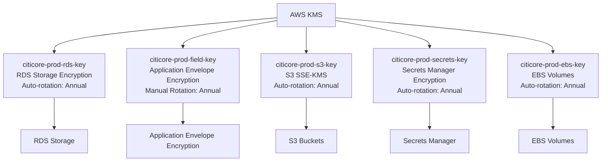
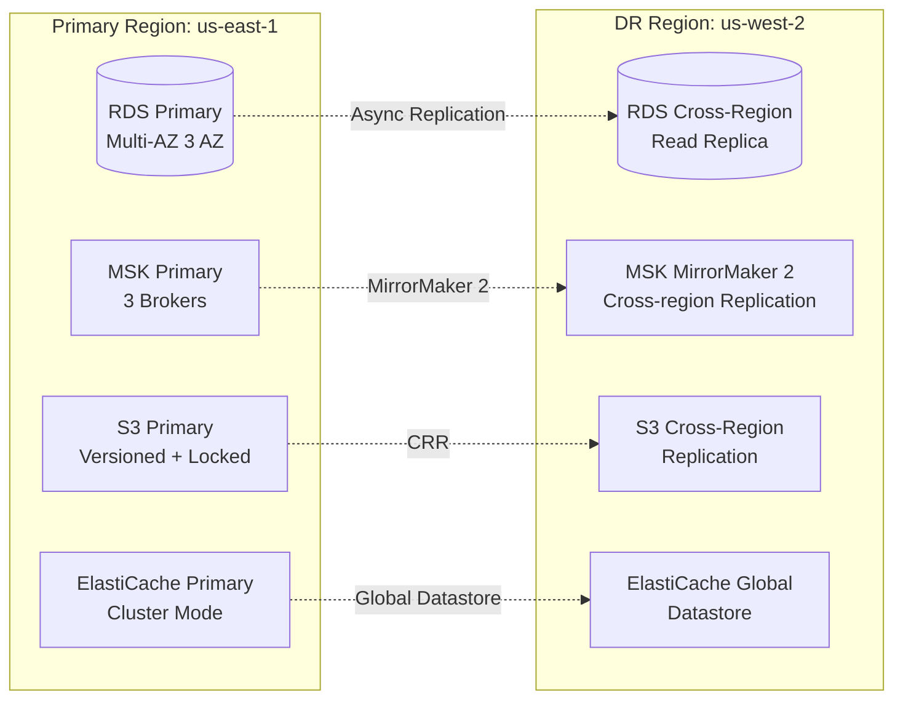

# CitiCore Banking Platform - Production Infrastructure Architecture

## Document Information

| Field | Value |
|-------|-------|
| **Document Title** | CitiCore Production Infrastructure Architecture |
| **Version** | 1.0 |
| **Status** | Draft for Review |
| **Classification** | Internal - Confidential |
| **Author** | Architecture Team |
| **Reviewers** | Engineering Lead, Security Lead, Platform Team, DevOps Lead, Compliance Officer |
| **Last Updated** | 2026-11-19 |

---

## Table of Contents

1. [Overview](#1-overview)
2. [AWS Account Structure](#2-aws-account-structure)
3. [Network Architecture](#3-network-architecture)
4. [Compute (EKS)](#4-compute-eks)
5. [Database (RDS)](#5-database-rds)
6. [Messaging (MSK)](#6-messaging-msk)
7. [Caching (ElastiCache)](#7-caching-elasticache)
8. [Object Storage (S3)](#8-object-storage-s3)
9. [Secrets & Encryption](#9-secrets--encryption)
10. [Email (SES)](#10-email-ses)
11. [Observability](#11-observability)
12. [Security & Compliance](#12-security--compliance)
13. [Disaster Recovery](#13-disaster-recovery)
14. [Cost Optimization](#14-cost-optimization)
15. [Operational Procedures](#15-operational-procedures)

---

## 1. Overview

This document defines the production infrastructure architecture for the CitiCore Banking Platform on AWS. It implements the approved target-state architecture and ADR decisions:

- **DEC-001**: Single RDS with Separate Schemas
- **DEC-002**: Hybrid Saga Pattern
- **DEC-010**: ClamAV Malware Scanning
- **DEC-011**: RDS KMS + Application-Level Envelope Encryption
- **DEC-012**: AWS Secrets Manager
- **DEC-013**: Mandatory TLS for RDS
- **DEC-014**: Kubernetes DNS (Production) / Eureka (Local)
- **DEC-015**: KYC Vendor Integration (Mock Provider Initially)

### 1.1 Production Requirements

| Requirement | Specification |
|-------------|---------------|
| **Availability** | 99.9% (Multi-AZ, 3 AZs) |
| **RPO** | 15 minutes (RDS PITR) |
| **RTO** | 2 hours |
| **Data Residency** | US-East-1 (configurable) |
| **Compliance** | PCI-DSS SAQ-A, SOX, RBI Guidelines |
| **Scalability** | Horizontal (HPA + Cluster Autoscaler) |
| **Security** | Zero Trust, Private Subnets, WAF, Shield |

---

## 2. AWS Account Structure

### 2.1 Account Organization



### 2.2 Production Account Details

| Aspect | Specification |
|--------|---------------|
| **Account Name** | citicore-prod |
| **Account ID** | [Assigned at creation] |
| **Email** | prod-infrastructure@citicore.io |
| **Alternate Contacts** | Security, Billing, Operations |
| **SCP** | Restrictive (deny risky services) |
| **Budget Alerts** | Monthly > $50K alert |

### 2.3 Cross-Account Access

| From | To | Purpose | Method |
|------|-----|---------|--------|
| Prod | Shared | Pull ECR images | Cross-account ECR policy |
| Prod | Network | Transit Gateway attachment | Resource share |
| Prod | DR | RDS/MSK replication | Cross-account IAM roles |
| Security | Prod | CloudTrail/Config/GuardDuty | Service-linked roles |

---

## 3. Network Architecture

### 3.1 VPC Design



### 3.2 Subnet Allocation

| Subnet Type | CIDR Range | Purpose | AZs |
|-------------|------------|---------|-----|
| **Public** | 10.0.0.0/20, 10.0.16.0/20, 10.0.128.0/20 | ALB, NAT Gateway | 3 |
| **Private App** | 10.0.32.0/20, 10.0.48.0/20, 10.0.144.0/20 | EKS Nodes | 3 |
| **Database** | 10.0.64.0/20, 10.0.80.0/20, 10.0.160.0/20 | RDS, MSK, ElastiCache | 3 |
| **Reserved** | 10.0.176.0/20 | Future expansion | - |

### 3.3 Security Groups

| Security Group | Source | Protocol/Port | Description |
|----------------|--------|---------------|-------------|
| **ALB External** | 0.0.0.0/0 | HTTPS 443 | Public API ingress |
| **ALB Internal** | ALB External SG | HTTPS 443 | Internal service traffic |
| **EKS Nodes** | ALB Internal SG | HTTPS 443 | Service ingress |
| **EKS Nodes** | EKS Nodes SG | All | Service-to-service |
| **RDS** | EKS Nodes SG | MySQL 3306 | Database access |
| **MSK** | EKS Nodes SG | TLS 9098 | Kafka access |
| **ElastiCache** | EKS Nodes SG | Redis 6379 | Cache access |
| **S3 VPC Endpoint** | EKS Nodes SG | HTTPS 443 | S3 private access |

### 3.4 Network ACLs

| Subnet Tier | Inbound | Outbound |
|-------------|---------|----------|
| **Public** | HTTPS 443 (ALB) | Ephemeral (1024-65535) |
| **Private App** | HTTPS 443 (ALB Internal), Service ports | HTTPS 443 (AWS APIs), DB ports, Kafka, Redis |
| **Database** | MySQL 3306, Kafka 9098, Redis 6379 | Ephemeral |

### 3.5 DNS Configuration

| Zone | Type | Records |
|------|------|---------|
| **Public** | Route 53 Public | `api.citicore.io` → ALB (ALIAS) |
| **Private** | Route 53 Private | `*.citicore-prod.internal` → Internal ALB |
| **Service Discovery** | K8s CoreDNS | `svc.cluster.local` |

---

## 4. Compute (EKS)

### 4.1 Cluster Specification

| Aspect | Specification |
|--------|---------------|
| **Cluster Name** | citicore-prod |
| **Kubernetes Version** | 1.28+ (EKS Managed) |
| **Control Plane** | EKS Managed (AWS) |
| **Endpoint** | Private + Public (restricted) |
| **Logging** | All control plane logs → CloudWatch |
| **Encryption** | Secrets encryption with KMS |
| **IAM** | IRSA enabled; OIDC provider configured |

### 4.2 Node Groups

| Node Group | Instance Type | Capacity | Purpose | Labels/Taints |
|------------|---------------|----------|---------|---------------|
| **system** | m6i.xlarge | 3-6 (2 per AZ) | System pods, operators | `workload=system` |
| **general** | m6i.2xlarge | 3-12 (1-4 per AZ) | General services | `workload=general` |
| **memory** | r6i.2xlarge | 3-9 (1-3 per AZ) | Memory-intensive (Account, TXN) | `workload=memory` |
| **spot** | m6i.xlarge (Spot) | 0-6 | Batch/async workloads | `workload=spot` + `spot=true:NoSchedule` |

### 4.3 Autoscaling

```yaml
# Cluster Autoscaler Configuration
autoScalingGroups:
  - name: citicore-prod-general
    minSize: 3
    maxSize: 12
    desiredCapacity: 6
  - name: citicore-prod-memory
    minSize: 3
    maxSize: 9
    desiredCapacity: 3
  - name: citicore-prod-spot
    minSize: 0
    maxSize: 6
    desiredCapacity: 0

# Scale-up: Pod pending > 30s
# Scale-down: Node utilization < 50% for 10min
```

### 4.4 Add-ons & Operators

| Add-on | Version | Purpose |
|--------|---------|---------|
| **VPC CNI** | Latest | Pod networking |
| **CoreDNS** | Latest | Service discovery |
| **kube-proxy** | Latest | Service load balancing |
| **AWS LB Controller** | Latest | ALB/NLB provisioning |
| **EBS CSI Driver** | Latest | Persistent volumes |
| **EFS CSI Driver** | Latest | Shared storage (future) |
| **External Secrets Operator** | Latest | Secrets Manager → K8s Secrets |
| **cert-manager** | Latest | TLS certificates |
| **CloudWatch Agent** | Latest | Metrics/logs to CloudWatch |
| **Istio** | 1.20+ | Service mesh (Phase 2) |

### 4.5 IRSA Roles

| Service Account | IAM Role | Permissions |
|-----------------|----------|-------------|
| `auth-service` | `citicore-prod-auth-service` | Secrets Manager (auth/*), RDS authdb |
| `user-service` | `citicore-prod-user-service` | Secrets Manager (user/*), S3, RDS userdb |
| `kyc-workflow-service` | `citicore-prod-kyc-service` | Secrets Manager (kyc/*), S3, RDS kyc db |
| `account-service` | `citicore-prod-account-service` | Secrets Manager (account/*), RDS account, ElastiCache |
| `transaction-service` | `citicore-prod-txn-service` | Secrets Manager (txn/*), RDS txn db |
| `kyc-workflow-service` | `citicore-prod-kyc-service` | S3 (KYC buckets) |
| `ledger-service` | `citicore-prod-ledger-service` | RDS ledger db |
| `compliance-service` | `citicore-prod-compliance-service` | RDS compliance db |
| `monitoring` | `citicore-prod-monitoring` | CloudWatch, X-Ray |

---

## 5. Database (RDS)

### 5.1 Instance Specification

| Aspect | Specification |
|--------|---------------|
| **Engine** | MySQL 8.0.35+ |
| **Instance Class** | db.r6g.2xlarge (8 vCPU, 64 GB RAM) |
| **Storage** | 500 GB GP3 (auto-scaling to 2 TB) |
| **Multi-AZ** | Yes (3 AZ deployment) |
| **Backup** | Daily snapshots, 35-day retention |
| **PITR** | Enabled (15-min RPO) |
| **Cross-Region Replica** | DR account (us-west-2) |
| **Encryption** | AWS KMS (customer-managed key) |
| **TLS** | `require_secure_transport=ON` |
| **Parameter Group** | Custom (see below) |
| **Maintenance Window** | Sun 03:00-04:00 UTC |

### 5.2 Parameter Group

```ini
[mysqld]
# Security
require_secure_transport=ON
ssl_ca=/etc/mysql/certs/ca.pem
ssl_cert=/etc/mysql/certs/server-cert.pem
ssl_key=/etc/mysql/certs/server-key.pem

# Performance
innodb_buffer_pool_size=48G
innodb_log_file_size=2G
innodb_flush_log_at_trx_commit=1
innodb_flush_method=O_DIRECT
innodb_file_per_table=ON

# Connections
max_connections=5000
max_connect_errors=100000
connect_timeout=10
wait_timeout=300
interactive_timeout=300

# Logging
slow_query_log=1
long_query_time=1
log_queries_not_using_indexes=1
log_slow_admin_statements=1

# Replication
binlog_format=ROW
binlog_expire_logs_seconds=2592000
max_binlog_size=1G
sync_binlog=1

# SQL Mode
sql_mode=STRICT_TRANS_TABLES,NO_ENGINE_SUBSTITUTION,NO_ZERO_DATE,NO_ZERO_IN_DATE,ERROR_FOR_DIVISION_BY_ZERO
```

### 5.3 Schema & User Management

```sql
-- Schemas (DEC-001)
CREATE DATABASE citicore_authdb;
CREATE DATABASE citicore_kycdb;
CREATE DATABASE citicore_userdb;
CREATE DATABASE citicore_account;
CREATE DATABASE citicore_transactiondb;
CREATE DATABASE citicore_ledgerdb;
CREATE DATABASE citicore_compliancedb;

-- Service Users (Schema-scoped GRANTs)
CREATE USER 'auth_svc_user'@'%' IDENTIFIED BY '<from-secrets-manager>';
GRANT SELECT, INSERT, UPDATE, DELETE, EXECUTE ON citicore_authdb.* TO 'auth_svc_user'@'%';

CREATE USER 'kyc_svc_user'@'%' IDENTIFIED BY '<from-secrets-manager>';
GRANT SELECT, INSERT, UPDATE, DELETE, EXECUTE ON citicore_kycdb.* TO 'kyc_svc_user'@'%';

CREATE USER 'user_svc_user'@'%' IDENTIFIED BY '<from-secrets-manager>';
GRANT SELECT, INSERT, UPDATE, DELETE, EXECUTE ON citicore_userdb.* TO 'user_svc_user'@'%';

CREATE USER 'account_svc_user'@'%' IDENTIFIED BY '<from-secrets-manager>';
GRANT SELECT, INSERT, UPDATE, DELETE, EXECUTE ON citicore_account.* TO 'account_svc_user'@'%';

CREATE USER 'txn_svc_user'@'%' IDENTIFIED BY '<from-secrets-manager>';
GRANT SELECT, INSERT, UPDATE, DELETE, EXECUTE ON citicore_transactiondb.* TO 'txn_svc_user'@'%';

CREATE USER 'ledger_svc_user'@'%' IDENTIFIED BY '<from-secrets-manager>';
GRANT SELECT, INSERT, UPDATE, DELETE, EXECUTE ON citicore_ledgerdb.* TO 'ledger_svc_user'@'%';

CREATE USER 'compliance_svc_user'@'%' IDENTIFIED BY '<from-secrets-manager>';
GRANT SELECT, INSERT, UPDATE, DELETE, EXECUTE ON citicore_compliancedb.* TO 'compliance_svc_user'@'%';

-- Read-only user for reporting
CREATE USER 'reporting_user'@'%' IDENTIFIED BY '<from-secrets-manager>';
GRANT SELECT ON citicore_.* TO 'reporting_user'@'%';

FLUSH PRIVILEGES;
```

### 5.4 Monitoring & Alerting

| Metric | Warning | Critical |
|--------|---------|----------|
| **CPU Utilization** | > 70% | > 85% |
| **Free Storage** | < 20% | < 10% |
| **Read Replica Lag** | > 30s | > 60s |
| **Connections** | > 80% max | > 95% max |
| **Slow Queries** | > 10/min | > 50/min |
| **Backup Failed** | Any | - |

---

## 6. Messaging (MSK)

### 6.1 Cluster Specification

| Aspect | Specification |
|--------|---------------|
| **Cluster Name** | citicore-prod-kafka |
| **Kafka Version** | 3.8+ |
| **Broker Count** | 3 (1 per AZ) |
| **Broker Type** | m5.2xlarge (8 vCPU, 32 GB RAM) |
| **Storage** | 2 TB GP3 per broker |
| **AZs** | 3 (us-east-1a, 1b, 1c) |
| **Encryption** | TLS 1.2+ (in-transit), KMS (at-rest) |
| **Authentication** | SASL_SSL + AWS_MSK_IAM |
| **Authorization** | IAM Policies |
| **Replication Factor** | 3 |
| **Min ISR** | 2 |
| **Monitoring** | Enhanced (Per-broker metrics) |

### 6.2 Topic Design

| Topic | Partitions | Retention | Cleanup | Purpose |
|-------|------------|-----------|---------|---------|
| `transfer-requested-topic` | 12 | 7 days | Delete | Transfer initiation |
| `debit-success-topic` | 12 | 7 days | Delete | Debit completion |
| `debit-failed-topic` | 12 | 7 days | Delete | Debit failure |
| `credit-success-topic` | 12 | 7 days | Delete | Credit completion |
| `credit-failed-topic` | 12 | 7 days | Delete | Credit failure |
| `reversal-topic` | 12 | 7 days | Delete | Reversal trigger |
| `reversal-success-topic` | 12 | 7 days | Delete | Reversal completion |
| `account-events-topic` | 12 | 7 days | Delete | Account lifecycle |
| `kyc-case-topic` | 12 | 30 days | Delete | KYC lifecycle |
| `kyc-notification-topic` | 12 | 30 days | Delete | KYC notifications |
| `kyc-submission-topic` | 6 | 7 days | Delete | KYC submission |
| `kyc-document-topic` | 6 | 7 days | Delete | Document upload |
| `otp-verification-topic` | 6 | 24 hours | Delete | Email OTP |
| `user-created-topic` | 6 | 7 days | Delete | User registration |
| `*.dlq` | 6 | 30 days | Delete | Dead letters |

### 6.3 IAM Authentication Policies

```json
{
  "Version": "2012-10-17",
  "Statement": [
    {
      "Sid": "AllowProduceConsume",
      "Effect": "Allow",
      "Action": [
        "kafka-cluster:Connect",
        "kafka-cluster:AlterCluster",
        "kafka-cluster:DescribeCluster"
      ],
      "Resource": "arn:aws:kafka:us-east-1:ACCOUNT:cluster/citicore-prod-kafka/*"
    },
    {
      "Sid": "AllowTopicAccess",
      "Effect": "Allow",
      "Action": [
        "kafka-cluster:WriteData",
        "kafka-cluster:ReadData",
        "kafka-cluster:DescribeTopic"
      ],
      "Resource": "arn:aws:kafka:us-east-1:ACCOUNT:topic/citicore-prod-kafka/*"
    },
    {
      "Sid": "AllowGroupAccess",
      "Effect": "Allow",
      "Action": [
        "kafka-cluster:AlterGroup",
        "kafka-cluster:DescribeGroup"
      ],
      "Resource": "arn:aws:kafka:us-east-1:ACCOUNT:group/citicore-prod-kafka/*"
    }
  ]
}
```

### 6.4 Monitoring & Alerting

| Metric | Warning | Critical |
|--------|---------|----------|
| **Broker CPU** | > 70% | > 85% |
| **Disk Usage** | > 70% | > 85% |
| **Under-Replicated Partitions** | > 0 | > 5 |
| **Offline Partitions** | > 0 | > 0 |
| **Consumer Lag** | > 10,000 | > 50,000 |
| **Request Latency (p99)** | > 100ms | > 500ms |
| **Controller Election Rate** | > 0/hour | > 1/hour |

---

## 7. Caching (ElastiCache)

### 7.1 Cluster Specification

| Aspect | Specification |
|--------|---------------|
| **Engine** | Redis 7.1+ (Cluster Mode Enabled) |
| **Node Type** | cache.r6g.2xlarge (8 vCPU, 64 GB) |
| **Shards** | 3 (1 per AZ) |
| **Replicas per Shard** | 1 (Primary + 1 Replica) |
| **Multi-AZ** | Enabled (Auto-failover) |
| **Encryption** | In-transit (TLS 1.2+), At-rest (KMS) |
| **Authentication** | Redis AUTH (username/password in Secrets Manager) |
| **Parameter Group** | Custom (see below) |
| **Maintenance Window** | Mon 04:00-05:00 UTC |
| **Snapshot** | Daily, 14-day retention |

### 7.2 Parameter Group

```ini
# Memory
maxmemory-policy allkeys-lru
maxmemory 58GB

# Persistence
save 900 1
save 300 10
save 60 10000
appendonly yes
appendfsync everysec

# Network
timeout 300
tcp-keepalive 60

# Security
requirepass <from-secrets-manager>
rename-command FLUSHDB ""
rename-command FLUSHALL ""
rename-command DEBUG ""
rename-command CONFIG ""
```

### 7.3 Usage Patterns

| Service | Usage | TTL | Pattern |
|---------|-------|-----|---------|
| **Account Balance** | Read-heavy | 5 min | Cache-aside |
| **Session Store** | Read/Write | 30 min | Direct |
| **Rate Limiting** | Write-heavy | 1 min | Sliding window |
| **KYC Assignments** | Read-heavy | 5 min | Cache-aside |
| **Permissions Cache** | Read-heavy | 15 min | Cache-aside |

---

## 8. Object Storage (S3)

### 8.1 Bucket Configuration

| Bucket | Purpose | Encryption | Versioning | Object Lock | Lifecycle |
|--------|---------|------------|------------|-------------|-----------|
| `citicore-prod-kyc-quarantine` | Unscanned uploads | SSE-KMS | Enabled | Compliance (7 yr) | Delete after scan |
| `citicore-prod-kyc-clean` | Scanned documents | SSE-KMS | Enabled | Compliance (7 yr) | Retain 7 years |
| `citicore-prod-audit-logs` | Audit trail | SSE-KMS | Enabled | Compliance (7 yr) | Retain 7 years |
| `citicore-prod-backups` | DB/Config backups | SSE-KMS | Enabled | Governance (1 yr) | Delete after 90 days |

### 8.2 Bucket Policies

```json
{
  "Version": "2012-10-17",
  "Statement": [
    {
      "Sid": "DenyInsecureConnections",
      "Effect": "Deny",
      "Principal": "*",
      "Action": "s3:*",
      "Resource": [
        "arn:aws:s3:::citicore-prod-*",
        "arn:aws:s3:::citicore-prod-*/*"
      ],
      "Condition": {
        "Bool": { "aws:SecureTransport": "false" }
      }
    },
    {
      "Sid": "EnforceKMSEncryption",
      "Effect": "Deny",
      "Principal": "*",
      "Action": "s3:PutObject",
      "Resource": "arn:aws:s3:::citicore-prod-*/*",
      "Condition": {
        "StringNotEquals": { "s3:x-amz-server-side-encryption": "aws:kms" }
      }
    },
    {
      "Sid": "DenyPublicAccess",
      "Effect": "Deny",
      "Principal": "*",
      "Action": "s3:*",
      "Resource": [
        "arn:aws:s3:::citicore-prod-*",
        "arn:aws:s3:::citicore-prod-*/*"
      ],
      "Condition": {
        "StringEquals": { "s3:x-amz-acl": "public-read" }
      }
    }
  ]
}
```

### 8.3 Access Patterns

| Service | Bucket | Access Pattern | Presigned URL |
|---------|--------|----------------|---------------|
| **User Service** | Quarantine | Upload only | No |
| **User Service** | Clean | Read (after scan) | Yes (15 min) |
| **KYC Workflow** | Clean | Read | Yes (15 min) |
| **Compliance** | Both | Read (audit) | No |
| **Backup Job** | Audit/Backup | Write | No |

### 8.3 Presigned URL Configuration

```java
// 15-minute expiry, single-use
GeneratePresignedUrlRequest request = GeneratePresignedUrlRequest.builder()
    .bucket(bucket)
    .key(key)
    .method(HttpMethod.GET)
    .expiration(Instant.now().plusMinutes(15))
    .build();
```

---

## 9. Secrets & Encryption

### 9.1 Secrets Manager Structure

```
citicore/
├── prod/
│   ├── auth/
│   │   ├── db-credentials (username, password, host, port, dbname)
│   │   ├── jwt-secret (256-bit HS256 key)
│   │   └── mail-credentials
│   ├── user/
│   │   ├── db-credentials
│   │   ├── s3-credentials (access-key, secret-key)
│   │   └── jwt-secret
│   ├── kyc/
│   │   ├── db-credentials
│   │   ├── s3-credentials
│   │   ├── clamav-credentials
│   │   └── jwt-secret
│   ├── account/
│   │   ├── db-credentials
│   │   ├── redis-credentials
│   │   └── jwt-secret
│   ├── transaction/
│   │   ├── db-credentials
│   │   └── jwt-secret
│   ├── ledger/
│   │   └── db-credentials
│   ├── compliance/
│   │   └── db-credentials
│   ├── kafka/
│   │   └── sasl-credentials (if not IAM)
│   ├── redis/
│   │   └── credentials (username, password)
│   ├── smtp/
│   │   └── ses-credentials
│   ├── kms/
│   │   ├── rds-key-id
│   │   └── field-encryption-key-id
│   └── monitoring/
│       └── grafana-credentials
```

### 9.2 Secret Rotation

| Secret Type | Rotation Frequency | Mechanism |
|-------------|-------------------|-----------|
| **Database Credentials** | 90 days | Lambda: Generate → Update RDS → Update Secret → Rolling restart |
| **JWT Secret** | 180 days | Manual: Generate → Update Secret → Rolling restart all |
| **Redis Credentials** | 90 days | Lambda + Rolling restart |
| **Kafka SASL** | 90 days | Lambda + Rolling restart |
| **API Keys (SendGrid, etc.)** | Per vendor | Manual update |

### 9.3 KMS Key Hierarchy



### 9.4 Application-Level Envelope Encryption (DEC-011)

```java
@Component
public class FieldEncryptionService {
    
    private final KmsClient kmsClient;
    private final String fieldKeyId; // citicore-prod-field-key
    
    public String encryptField(String plaintext) {
        // 1. Generate data key
        GenerateDataKeyResponse keyResp = kmsClient.generateDataKey(
            GenerateDataKeyRequest.builder()
                .keyId(fieldKeyId)
                .keySpec(DataKeySpec.AES_256)
                .build());
        
        // 2. Encrypt with AES-256-GCM
        byte[] ciphertext = aesGcmEncrypt(
            keyResp.plaintext().asByteArray(),
            plaintext.getBytes(StandardCharsets.UTF_8));
        
        // 3. Package: [key_len:4][encrypted_key][ciphertext]
        return Base64.getEncoder().encodeToString(
            ByteBuffer.allocate(4 + keyResp.ciphertextBlob().asByteArray().length + ciphertext.length)
                .putInt(keyResp.ciphertextBlob().asByteArray().length)
                .put(keyResp.ciphertextBlob().asByteArray())
                .put(ciphertext)
                .array());
    }
    
    public String decryptField(String encryptedPackage) {
        ByteBuffer buf = ByteBuffer.wrap(Base64.getDecoder().decode(encryptedPackage));
        int keyLen = buf.getInt();
        byte[] encryptedKey = new byte[keyLen];
        buf.get(encryptedKey);
        byte[] ciphertext = new byte[buf.remaining()];
        buf.get(ciphertext);
        
        DecryptResponse keyResp = kmsClient.decrypt(DecryptRequest.builder()
            .ciphertextBlob(SdkBytes.fromByteArray(encryptedKey))
            .build());
        
        return new String(aesGcmDecrypt(keyResp.plaintext().asByteArray(), ciphertext), StandardCharsets.UTF_8);
    }
}
```

### 9.5 Encrypted Fields

| Field | Table | Schema | Key |
|-------|-------|--------|-----|
| `pan_number` | `kyc_documents` / `kyc_document_refs` | `citicore_userdb` / `citicore_kycdb` | `citicore-prod-field-key` |
| `aadhaar_number` (masked) | `kyc_documents` / `kyc_document_refs` | `citicore_userdb` / `citicore_kycdb` | `citicore-prod-field-key` |
| `passport_number` | `kyc_documents` / `kyc_document_refs` | `citicore_userdb` / `citicore_kycdb` | `citicore-prod-field-key` |
| `account_number` (if exposed) | `accounts` | `citicore_account` | `citicore-prod-field-key` |
| `nominee_name` | `accounts` | `citicore_account` | `citicore-prod-field-key` |

---

## 10. Email (SES)

### 10.1 Configuration

| Aspect | Specification |
|--------|---------------|
| **Service** | Amazon SES (Production mode) |
| **Region** | us-east-1 |
| **Sending Limits** | Dedicated IP pool (warmup required) |
| **Reputation** | Monitor bounce/complaint rates |
| **Authentication** | DKIM, DMARC, SPF configured |
| **Configuration Set** | `citicore-prod-emails` (tracking) |
| **Suppression List** | Enabled (auto-suppress bounces/complaints) |

### 10.2 Email Templates

| Template | Trigger | Channel |
|----------|---------|---------|
| **Welcome** | Registration | SES |
| **Email Verification** | OTP | SES |
| **KYC Submitted** | KYC Submit | SES |
| **KYC Approved** | Manager Approve | SES |
| **KYC Rejected** | Manager Reject | SES |
| **KYC Info Requested** | Officer Request | SES |
| **Transfer Success** | Credit Success | SES |
| **Transfer Failed** | Credit Failed | SES |
| **Transfer Reversed** | Reversal Success | SES |
| **Account Created** | Account Open | SES |
| **Statement Ready** | Monthly | SES |

### 10.3 Rate Limits & Monitoring

| Metric | Limit | Alert |
|---------|-------|-------|
| **Sending Rate** | 50/sec (warmed) | > 80% quota |
| **Bounce Rate** | < 2% | > 5% |
| **Complaint Rate** | < 0.1% | > 0.5% |
| **Delivery Delay** | < 1 min | > 5 min |

---

## 11. Observability

### 11.1 Metrics (CloudWatch + Prometheus)

| Layer | Tool | Metrics |
|-------|------|---------|
| **Infrastructure** | CloudWatch | CPU, Memory, Disk, Network, RDS, MSK, ElastiCache |
| **Kubernetes** | Prometheus (Operator) | Node, Pod, Container, kube-state-metrics |
| **Application** | Prometheus (Spring Actuator) | RED, JVM, Business, Saga, KYC |
| **Business** | Custom | Transfers, Accounts, KYC throughput |

### 11.2 Logging (CloudWatch + Loki)

| Source | Destination | Retention |
|--------|-------------|-----------|
| **EKS Control Plane** | CloudWatch Logs | 90 days |
| **Application Pods** | Loki (via Promtail) | 30 days |
| **ALB Access Logs** | S3 + Athena | 1 year |
| **CloudTrail** | CloudWatch Logs + S3 | 1 year |
| **VPC Flow Logs** | CloudWatch Logs | 90 days |
| **WAF Logs** | CloudWatch Logs | 90 days |

### 11.3 Distributed Tracing (X-Ray + Tempo)

| Component | Tool | Sampling |
|-----------|------|----------|
| **AWS Services** | X-Ray | 10% (adaptive) |
| **Application** | Tempo (via OTel) | 100% (errors), 10% (success) |
| **Correlation** | Trace ID propagation | W3C TraceContext |

### 11.4 Dashboards (Grafana)

| Dashboard | Panels | Refresh |
|-----------|--------|---------|
| **System Overview** | Request rate, Error rate, Latency (p50/p95/p99), Saturation | 30s |
| **Service Deep Dive** | Per-service RED, JVM, DB pool, Cache hit rate | 30s |
| **Business KPIs** | Transfers/day, Success rate, Avg latency, Active accounts | 1m |
| **KYC Workflow** | Cases submitted/approved/rejected, SLA, Officer workload | 1m |
| **Saga Monitor** | In-flight, Step duration, Failure rate, Compensation rate | 30s |
| **Security** | Auth success/fail, Lockouts, MFA, RBAC denials, SoD violations | 1m |
| **Kafka** | Consumer lag, Producer throughput, Under-replicated | 30s |
| **Database** | Query latency, Connections, Replication lag, Locks | 30s |

### 11.5 Alerting (AlertManager → PagerDuty/Slack/Email)

| Alert | Condition | Severity | Runbook |
|-------|-----------|----------|---------|
| `ServiceDown` | `up{job=~".*-service"} == 0` for 2m | Critical | Check pod logs, restart |
| `HighErrorRate` | `rate(http_requests_total{status=~"5.."}[5m]) > 0.05` | Critical | Check dependencies |
| `HighLatency` | `histogram_quantile(0.99, rate(http_request_duration_seconds_bucket[5m])) > 2` | Warning | Check DB, Kafka |
| `KafkaConsumerLag` | `kafka_consumer_lag > 10000` | Warning | Scale consumers |
| `RDSStorageLow` | `FreeStorageSpace < 20%` | Critical | Enable auto-scaling |
| `KycSlaBreach` | `kyc_sla_breach > 0` | Critical | Review officer workload |
| `SoDViolation` | `rbac_sod_violations > 0` | Critical | Audit trail review |
| `CertExpiry` | `ssl_cert_expiry_days < 30` | Warning | Renew certificate |

---

## 12. Security & Compliance

### 12.1 Network Security

| Control | Implementation |
|---------|----------------|
| **Network Segmentation** | 3-tier (Public/Private/Database) + 3 AZs |
| **Security Groups** | Service-level, least privilege |
| **Network ACLs** | Subnet-level defense in depth |
| **VPC Endpoints** | S3, Secrets Manager, KMS, CloudWatch Logs (no NAT) |
| **Transit Gateway** | Hybrid/on-prem connectivity (future) |
| **WAF** | Managed rules (OWASP Top 10) + Rate limiting |
| **Shield** | Shield Advanced (DDoS protection) |

### 12.2 Data Protection

| Data State | Protection |
|-------------|------------|
| **At Rest (RDS)** | AWS KMS (customer-managed key) |
| **At Rest (S3)** | SSE-KMS + Object Lock (Compliance mode) |
| **At Rest (ElastiCache)** | KMS encryption |
| **At Rest (EBS)** | KMS encryption |
| **At Rest (App Fields)** | Envelope encryption (AES-256-GCM + KMS) |
| **In Transit (RDS)** | TLS 1.2+ (`require_secure_transport=ON`) |
| **In Transit (MSK)** | TLS 1.2+ + IAM Auth |
| **In Transit (ElastiCache)** | TLS 1.2+ |
| **In Transit (ALB)** | TLS 1.2+ (ACM cert) |
| **In Transit (Service-to-Service)** | mTLS (Istio, Phase 2) |

### 12.3 Identity & Access

| Control | Implementation |
|---------|----------------|
| **Service Identity** | IRSA (no static keys) |
| **Human Access** | SSO → IAM Role (least privilege) |
| **Emergency Access** | Break-glass role (audited, time-limited) |
| **Key Rotation** | KMS auto-rotation (annual) + Manual (field key) |
| **Certificate Management** | ACM + cert-manager (auto-renewal) |

### 12.4 Compliance Mapping

| Regulation | Controls |
|------------|----------|
| **PCI-DSS SAQ-A** | SAQ-A eligible (no card data); encryption, access control, monitoring |
| **SOX** | Immutable audit trail (hash-chained), change control, access review |
| **RBI** | Data residency (India future), KYC/AML, encryption, audit trail |
| **GDPR/PDPB** | Right to erasure, portability, consent, DPIA, DPO |
| **Data Residency** | us-east-1 (configurable for multi-region) |

### 12.5 Audit & Monitoring

| Tool | Purpose |
|------|---------|
| **CloudTrail** | All API activity (all regions, 1-year retention) |
| **AWS Config** | Resource compliance, drift detection |
| **Security Hub** | Centralized findings (GuardDuty, Inspector, etc.) |
| **GuardDuty** | Threat detection (all regions) |
| **Inspector** | Vulnerability scanning (EC2, ECR, Lambda) |
| **Audit Trail (App)** | Hash-chained immutable logs (7-year retention) |

---

## 13. Disaster Recovery

### 13.1 DR Strategy

| Aspect | Specification |
|--------|---------------|
| **DR Region** | us-west-2 (Oregon) |
| **RPO** | 15 minutes (RDS PITR) |
| **RTO** | 2 hours |
| **DR Pattern** | Pilot Light (core infra ready) |
| **Failover** | Manual (runbook-driven) |
| **Testing** | Quarterly DR drills |

### 13.2 Replication Architecture



### 13.3 Failover Procedures

| Scenario | Trigger | Procedure | Owner |
|----------|---------|-----------|-------|
| **AZ Failure** | RDS/MSK/ElastiCache AZ impaired | Automatic (Multi-AZ) | AWS |
| **Region Failure** | us-east-1 unavailable | Manual: Promote DR read replica, update DNS | Platform Team |
| **Data Corruption** | PITR needed | Restore to PITR point | DBA |
| **Ransomware** | Object Lock prevents deletion | Restore from S3/Backups | Security + DBA |

### 13.4 Backup Strategy

| Resource | Frequency | Retention | Cross-Region |
|----------|-----------|-----------|--------------|
| **RDS** | Daily snapshot + Continuous PITR | 35 days | Yes (us-west-2) |
| **MSK** | MirrorMaker 2 | Continuous | Yes |
| **S3** | Versioning + CRR | Continuous | Yes |
| **ElastiCache** | Daily snapshot + AOF | 14 days | Global Datastore |
| **EKS (etcd)** | Velero | Daily | Yes |
| **Secrets Manager** | Native replication | N/A | Yes |

---

## 14. Cost Optimization

### 14.1 Cost Allocation Tags

```yaml
# Required tags on all resources
Environment: prod
Application: citicore
Service: <service-name>
Team: platform
CostCenter: engineering
```

### 14.2 Savings Strategies

| Strategy | Implementation |
|----------|----------------|
| **Compute Savings Plans** | 1-year/3-year for baseline EKS nodes |
| **RDS Reserved Instances** | 1-year for db.r6g.2xlarge |
| **MSK Reserved Brokers** | 1-year for m5.2xlarge |
| **ElastiCache Reserved** | 1-year for cache.r6g.2xlarge |
| **S3 Intelligent Tiering** | Audit logs, backups |
| **S3 Lifecycle** | Audit logs → Glacier after 90 days |
| **Spot Instances** | Batch/async workloads (up to 30%) |
| **Right-sizing** | Quarterly review (Compute Optimizer) |

### 14.3 Budget & Alerting

| Budget | Amount | Alert Threshold |
|--------|--------|-----------------|
| **Monthly Total** | $150,000 | 80% |
| **Compute (EKS)** | $40,000 | 80% |
| **Database (RDS)** | $25,000 | 80% |
| **Messaging (MSK)** | $20,000 | 80% |
| **Storage (S3/EBS)** | $15,000 | 80% |
| **Data Transfer** | $10,000 | 80% |

---

## 15. Operational Procedures

### 15.1 Routine Operations

| Task | Frequency | Owner | Runbook |
|------|-----------|-------|---------|
| **Health Check** | Continuous (automated) | Platform | RUNBOOK-HEALTH-001 |
| **Log Review** | Daily | Platform | RUNBOOK-LOGS-001 |
| **Metric Review** | Daily | Platform | RUNBOOK-METRICS-001 |
| **Alert Triage** | Continuous | On-call | RUNBOOK-ALERTS-001 |
| **Backup Verification** | Weekly | DBA | RUNBOOK-BACKUP-001 |
| **Patch Management** | Monthly (OS), Quarterly (K8s) | Platform | RUNBOOK-PATCH-001 |
| **Certificate Renewal** | Auto (cert-manager) | Platform | RUNBOOK-CERT-001 |
| **Key Rotation** | Annual (manual) | Security | RUNBOOK-KEYROT-001 |
| **DR Drill** | Quarterly | Platform + Security | RUNBOOK-DR-001 |
| **Capacity Review** | Monthly | Platform | RUNBOOK-CAPACITY-001 |

### 15.2 Incident Response

| Severity | Response Time | Escalation |
|----------|---------------|------------|
| **SEV-1 (Critical)** | 15 min | Platform Lead → Engineering Director |
| **SEV-2 (High)** | 1 hour | Platform Lead |
| **SEV-3 (Medium)** | 4 hours | Platform Engineer |
| **SEV-4 (Low)** | 24 hours | Platform Engineer |

### 15.3 Change Management

| Change Type | Approval | Window |
|-------------|----------|--------|
| **Emergency** | Platform Lead + Security | Any time |
| **Standard (Pre-approved)** | Platform Lead | Business hours |
| **Major (Schema, Infra)** | CAB (Platform + Security + Engineering) | Maintenance window (Sun 02-06 UTC) |

---

## Document Control

| Version | Date | Author | Changes |
|---------|------|--------|---------|
| 1.0 | 2026-11-19 | Architecture Team | Initial Production Infrastructure Architecture |

---

**END OF DOCUMENT**