# CitiCore Banking Platform - Target State Architecture Documentation

## Document Information

| Field | Value |
|-------|-------|
| **Document Title** | CitiCore Banking Platform - Target State Architecture |
| **Version** | 1.0 |
| **Status** | Draft for Review |
| **Classification** | Internal - Confidential |
| **Author** | Architecture Team |
| **Reviewers** | Engineering Lead, Security Lead, Platform Team |
| **Last Updated** | 2026-11-17 |

---

## Table of Contents

1. [Product Overview](#1-product-overview)
2. [Functional Modules](#2-functional-modules)
3. [User Roles & Access Matrix](#3-user-roles--access-matrix)
4. [Microservices Architecture](#4-microservices-architecture)
5. [Database Architecture](#5-database-architecture)
6. [Service Communication Patterns](#6-service-communication-patterns)
7. [Event-Driven Architecture](#7-event-driven-architecture)
8. [Financial Transaction Processing](#8-financial-transaction-processing)
9. [Double-Entry Ledger Architecture](#9-double-entry-ledger-architecture)
10. [Security Architecture](#10-security-architecture)
11. [Infrastructure & Deployment](#11-infrastructure--deployment)
12. [Monitoring & Observability](#12-monitoring--observability)
13. [End-to-End Workflows](#13-end-to-end-workflows)
14. [Architecture Review Observations](#14-architecture-review-observations)

---

## 1. Product Overview

### 1.1 Purpose
CitiCore is a **microservices-based digital banking platform** designed to deliver core banking functionality including customer onboarding, account management, fund transfers, and financial ledger operations. The platform follows a cloud-native architecture built on Spring Boot 3.2.4, Java 17, and Spring Cloud 2023.0.3.

### 1.2 Scope
- **In Scope**: Customer registration & KYC, Account lifecycle (Savings/Current), Internal fund transfers, Double-entry general ledger, Notification services, API Gateway with resilience patterns
- **Out of Scope**: External payment rail integrations (NEFT/RTGS/IMPS/UPI), Card management, Loan origination, Wealth management, International banking

### 1.3 Key Architectural Principles
| Principle | Description |
|-----------|-------------|
| **Domain-Driven Design** | Services aligned to business capabilities (Auth, User, Account, Transaction, Notification) |
| **Database per Service** | Each microservice owns its data; no shared databases |
| **Event-Driven** | Kafka for async communication; transactional outbox for reliability |
| **Saga Pattern** | Choreography-based distributed transactions for fund transfers |
| **Security First** | Zero-trust, JWT-based authentication, RBAC, rate limiting |
| **Observability** | Structured logging, metrics, distributed tracing, health checks |
| **Infrastructure as Code** | Docker, Kubernetes, Helm, GitOps |

### 1.4 Technology Stack Summary

| Layer | Technology | Version |
|-------|------------|---------|
| **Language** | Java | 17 |
| **Framework** | Spring Boot | 3.2.4 |
| **Cloud** | Spring Cloud | 2023.0.3 |
| **Security** | Spring Security, JWT (jjwt) | 0.12.5 |
| **Data** | Spring Data JPA, Hibernate | 6.4.5 |
| **Database** | MySQL | 8.0 |
| **Cache** | Redis | 7 |
| **Messaging** | Apache Kafka | 3.8 |
| **Service Discovery** | Netflix Eureka | - |
| **Config** | Spring Cloud Config | - |
| **Gateway** | Spring Cloud Gateway (WebFlux) | - |
| **Resilience** | Resilience4j | - |
| **HTTP Client** | OpenFeign | - |
| **Observability** | Micrometer, Prometheus, Zipkin (Brave) | - |
| **Build** | Maven | - |
| **Container** | Docker, Docker Compose | - |
| **Email** | Spring Mail, SendGrid | - |
| **Cloud Storage** | AWS S3 SDK v2 | - |
| **OCR** | Google Cloud Vision | - |

---

## 2. Functional Modules

### 2.1 Module Overview

```
┌─────────────────────────────────────────────────────────────────────────────┐
│                        CITICORE FUNCTIONAL MODULES                          │
├─────────────────────┬─────────────────────┬─────────────────────────────────┤
│   CUSTOMER DOMAIN   │   ACCOUNT DOMAIN    │   TRANSACTION DOMAIN            │
├─────────────────────┼─────────────────────┼─────────────────────────────────┤
│  ┌───────────────┐  │  ┌───────────────┐  │  ┌─────────────────────────┐   │
│  │ Auth Service  │  │  │Account Service│  │  │  Transaction Service    │   │
│  │               │  │  │               │  │  │                         │   │
│  │ • Registration│  │  │ • CRUD        │  │  │ • Transfer Initiation   │   │
│  │ • Login/JWT   │  │  │ • Deposit/    │  │  │ • Saga Orchestration    │   │
│  │ • Token Mgmt  │  │  │   Withdraw    │  │  │ • Daily Limits          │   │
│  │ • Email Verify│  │  │ • Balance     │  │  │ • Idempotency           │   │
│  │ • MFA (TOTP)  │  │  │ • Statements  │  │  │ • History/Status        │   │
│  └───────────────┘  │  │ • Auth Holds  │  │  └─────────────────────────┘   │
│                     │  │ • Interest    │  │                                 │
│  ┌───────────────┐  │  │ • Closure     │  │  ┌─────────────────────────┐   │
│  │ User Service  │  │  │ • PDF Stmts   │  │  │  Notification Service   │   │
│  │               │  │  └───────────────┘  │  │                         │   │
│  │ • Profile Mgmt│  │                     │  │ • Email (SMTP/SendGrid) │   │
│  │ • KYC Upload  │  │  ┌───────────────┐  │  │ • SMS (Planned)         │   │
│  │ • KYC Review  │  │  │  Ledger Svc   │  │  │ • In-App (Planned)      │   │
│  │ • Documents   │  │  │  (Planned)    │  │  │ • Templates             │   │
│  │ • S3 Storage  │  │  │               │  │  │ • Preferences           │   │
│  │ • OCR         │  │  │ • GL Accounts │  │  └─────────────────────────┘   │
│  └───────────────┘  │  │ • Journal Ent │  │                                 │
│                     │  │ • Trial Bal   │  │  ┌─────────────────────────┐   │
│                     │  │ • Reconcile   │  │  │   Platform Services     │   │
│                     │  │ • Audit Trail │  │  │                         │   │
│                     │  └───────────────┘  │  │ • API Gateway           │   │
└─────────────────────┴─────────────────────┴──│ • Config Server         │───┘
                                               │ • Eureka Discovery      │
                                               │ • Kafka Event Bus       │
                                               └─────────────────────────┘
```

### 2.2 Module Responsibilities

| Module | Service | Core Responsibility | Key APIs |
|--------|---------|---------------------|----------|
| **Customer** | Auth Service | Identity & access management | `/api/v1/auth/*` |
| **Customer** | User Service | Profile, KYC, documents | `/api/v1/users/*` |
| **Account** | Account Service | Account lifecycle, balances, ledger posting | `/api/v1/accounts/*` |
| **Transaction** | Transaction Service | Fund transfers, saga orchestration | `/api/v1/transactions/*` |
| **Notification** | Notification Service | Multi-channel notifications | Internal (Kafka) |
| **Ledger** | Ledger Service (Planned) | Double-entry GL, compliance | `/api/v1/ledger/*` |
| **Platform** | API Gateway | Routing, auth, rate limiting, resilience | `/` (all traffic) |
| **Platform** | Config Server | Centralized configuration | `/config/*` |
| **Platform** | Eureka Server | Service discovery | `/eureka/*` |

---

## 3. User Roles & Access Matrix

### 3.1 Role Definitions

| Role | Description | Default Assignment |
|------|-------------|-------------------|
| **ROLE_CUSTOMER** | Retail banking customer | Assigned on registration |
| **ROLE_ADMIN** | Platform administrator | Assigned by super-admin |
| **ROLE_SUPPORT** | Customer support agent | Assigned by admin |
| **ROLE_AUDITOR** | Read-only audit access | Assigned by admin |
| **ROLE_SERVICE** | Service-to-service communication | Internal (Feign clients) |

### 3.2 Access Control Matrix

| Endpoint Pattern | CUSTOMER | ADMIN | SUPPORT | AUDITOR | SERVICE |
|------------------|----------|-------|---------|---------|---------|
| `POST /auth/register` | ✅ | ✅ | ✅ | ❌ | ❌ |
| `POST /auth/login` | ✅ | ✅ | ✅ | ❌ | ❌ |
| `POST /auth/refresh` | ✅ | ✅ | ✅ | ❌ | ❌ |
| `GET /users/profile` | Own | All | All | All | ❌ |
| `PUT /users/profile` | Own | All | ❌ | ❌ | ❌ |
| `POST /users/kyc/*` | Own | All | ❌ | ❌ | ❌ |
| `GET /users/admin/*` | ❌ | ✅ | ❌ | ✅ | ❌ |
| `POST /accounts/create` | ✅ | ✅ | ❌ | ❌ | ❌ |
| `GET /accounts/balance/*` | Own | All | Own | All | ❌ |
| `POST /accounts/deposit` | Own | ✅ | ❌ | ❌ | ✅ |
| `POST /accounts/withdraw` | Own | ✅ | ❌ | ❌ | ❌ |
| `POST /accounts/transfer` | Own | ✅ | ❌ | ❌ | ❌ |
| `GET /accounts/statement/*` | Own | All | Own | All | ❌ |
| `POST /transactions/transfer` | ✅ | ✅ | ❌ | ❌ | ❌ |
| `GET /transactions/*` | Own | All | Own | All | ❌ |
| `GET /actuator/health` | ❌ | ✅ | ✅ | ✅ | ✅ |
| `GET /actuator/*` | ❌ | ✅ | ❌ | ✅ | ❌ |

---

## 4. Microservices Architecture

### 4.1 Service Topology

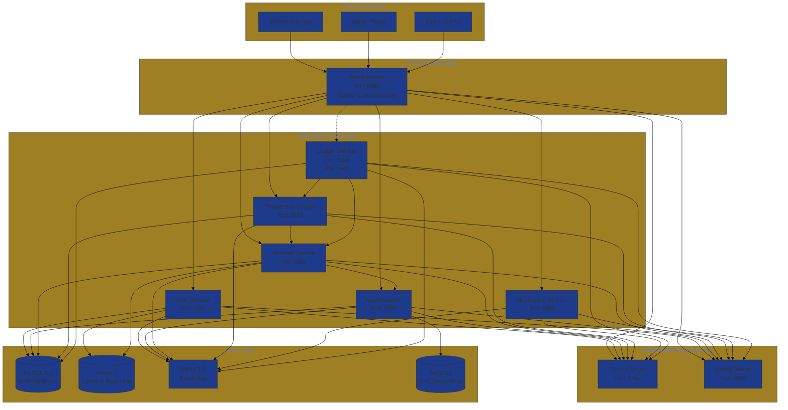

### 4.2 Service Specifications

#### 4.2.1 Auth Service (Port 8081)
| Aspect | Detail |
|--------|--------|
| **Database** | `citicore_authdb` |
| **Primary Entities** | User, Role, RefreshToken |
| **Key Functions** | Registration, Login, JWT issuance, Refresh rotation, Email verification, Password reset, MFA (TOTP) |
| **Published Events** | `otp-verification-topic` → VerificationOtpEvent |
| **Security** | BCrypt, JWT HS256 (15min access, 7day refresh), Rate limiting (5 req/min login) |

#### 4.2.2 User Service (Port 8082)
| Aspect | Detail |
|--------|--------|
| **Database** | `citicore_userdb` |
| **Primary Entities** | UserProfile, KycDocument |
| **Key Functions** | Profile CRUD, KYC document upload (S3), KYC status workflow, Admin KYC review, OCR integration |
| **Published Events** | `kyc-topic` → KycEvent (SUBMITTED/APPROVED/REJECTED) |
| **Feign Exposes** | `GET /api/v1/users/kyc-status/{userId}` → boolean |

#### 4.2.3 Account Service (Port 8083)
| Aspect | Detail |
|--------|--------|
| **Database** | `citicore_account` (Primary/Replica) |
| **Primary Entities** | Account, AccountStatement, AccountOutboxEvent, AccountSequence |
| **Key Functions** | Account CRUD (SAVINGS/CURRENT), Deposit/Withdraw, Balance queries (Redis cache), Statements, Transfer validation, Auth holds, Interest accrual, PDF statements, Double-entry ledger posting |
| **Database Routing** | Primary: Writes | Replica: Reads | Redis: Balance cache (5min TTL) |
| **Kafka Consumers** | `transfer-requested-topic` (DebitConsumer), `debit-success-topic` (CreditConsumer), `reversal-topic` (ReversalConsumer) |
| **Published Events** | `account-events-topic`, `debit-success-topic`, `debit-failed-topic`, `credit-success-topic`, `credit-failed-topic`, `reversal-success-topic` |
| **Feign Client** | UserClient → KYC status check |

#### 4.2.4 Transaction Service (Port 8084)
| Aspect | Detail |
|--------|--------|
| **Database** | `citicore_transactiondb` |
| **Primary Entities** | Transaction, OutboxEvent, IdempotencyKey |
| **Key Functions** | Transfer initiation, Saga orchestration, Daily limits, Idempotency, History & status |
| **Saga Flow** | INITIATED → DEBIT_SUCCESS → CREDIT_SUCCESS / FAILED → REVERSED |
| **Feign Client** | AccountFeignClient → validateTransfer |
| **Kafka Consumers** | `credit-success-topic`, `credit-failed-topic`, `reversal-success-topic` |

#### 4.2.5 Notification Service (Port 8085)
| Aspect | Detail |
|--------|--------|
| **Database** | None (stateless) |
| **Key Functions** | Email delivery (SMTP/SendGrid), HTML templates, Multi-event consumption |
| **Kafka Consumers** | `credit-success-topic`, `credit-failed-topic`, `reversal-success-topic`, `kyc-topic`, `otp-verification-topic` |

#### 4.2.6 Ledger Service (Port 8086) - Planned
| Aspect | Detail |
|--------|--------|
| **Database** | `citicore_ledgerdb` |
| **Primary Entities** | LedgerAccount, JournalEntry, JournalLine, LedgerBalance |
| **Key Functions** | Chart of Accounts, Double-entry posting, Trial balance, Period-end close, GL reconciliation, Regulatory reporting, Immutable audit trail |

#### 4.2.7 Platform Services
| Service | Port | Purpose |
|---------|------|---------|
| **API Gateway** | 8080 | Reactive routing, JWT validation, Rate limiting, Circuit breakers, Resilience4j |
| **Config Server** | 8888 | Centralized config (native profile), Spring Cloud Bus Kafka refresh |
| **Eureka Server** | 8761 | Service registry & discovery |

---

## 5. Database Architecture

### 5.1 Database Topology

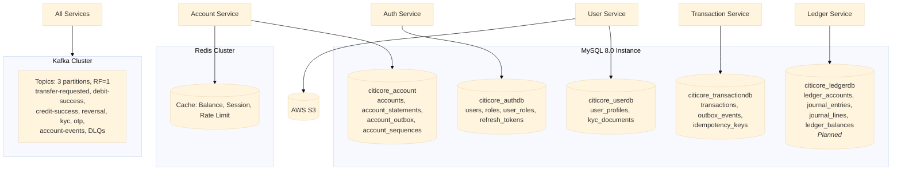

### 5.2 Schema Ownership

| Database | Owner Service | Tables | Key Constraints |
|----------|---------------|--------|-----------------|
| `citicore_authdb` | Auth Service | users, roles, user_roles, refresh_tokens | PK, FK (user_roles), Unique (email, token) |
| `citicore_userdb` | User Service | user_profiles, kyc_documents | PK, FK (kyc_documents→user_profiles), Unique (auth_user_id, email, phone) |
| `citicore_account` | Account Service | accounts, account_statements, account_outbox, account_sequences | PK, Unique (account_number, txn_ref per account), Check (balance >= 0, min_balance) |
| `citicore_transactiondb` | Transaction Service | transactions, outbox_events, idempotency_keys | PK, Unique (txn_ref, idempotency_key per user), FK (planned) |
| `citicore_ledgerdb` | Ledger Service | ledger_accounts, journal_entries, journal_lines, ledger_balances | PK, FK (journal_lines→journal_entries, ledger_accounts), Check (balanced journal, one-side) |

### 5.3 Cross-Service Referential Integrity

> **Note:** MySQL does not support cross-database foreign keys. The platform uses **application-level integrity** with reconciliation jobs.

| Child Reference | Parent Reference | Integrity Mechanism |
|-----------------|------------------|---------------------|
| `accounts.auth_user_id` | `auth.users.id` | Feign validation on create; Daily reconciliation job |
| `account_statements.account_number` | `accounts.account_number` | Application check; DB index |
| `transactions.auth_user_id` | `auth.users.id` | Feign validation; Reconciliation job |
| `transactions.from_account` | `accounts.account_number` | Feign validateTransfer; Reconciliation job |
| `transactions.to_account` | `accounts.account_number` | Feign validateTransfer; Reconciliation job |
| `user_profiles.auth_user_id` | `auth.users.id` | Auth service user creation event; Reconciliation job |
| `idempotency_keys.auth_user_id` | `auth.users.id` | Auth service validation |

### 5.4 Primary/Replica Routing (Account Service)

```mermaid
%%{init: {'theme': 'base'}}%%
graph LR
    subgraph ACCOUNT_SERVICE ["Account Service"]
        APP[Application Layer]
        ROUTING[RoutingDataSource<br/>@PrimaryRead / @ReadOnly]
    end
    
    subgraph MYSQL_PRIMARY ["Primary (Writer)"]
        PRIMARY[(accounts<br/>account_statements<br/>account_outbox<br/>account_sequences)]
    end
    
    subgraph MYSQL_REPLICA ["Replica (Reader)"]
        REPLICA[(accounts<br/>account_statements<br/>account_outbox<br/>account_sequences)]
    end
    
    subgraph REDIS_CACHE ["Redis Cache"]
        CACHE[(Balance Cache<br/>TTL: 5 min)]
    end

    APP --> ROUTING
    ROUTING -->|@PrimaryRead<br/>@Transactional| PRIMARY
    ROUTING -->|@ReadOnly<br/>Default| REPLICA
    APP -->|getBalance()| CACHE
    CACHE -.->|Miss| REPLICA
    PRIMARY -.->|Async Replication| REPLICA
```

---

## 6. Service Communication Patterns

### 6.1 Communication Matrix

| From \ To | Auth | User | Account | Transaction | Notification | Ledger | Gateway |
|-----------|------|------|---------|-------------|--------------|--------|---------|
| **Client** | HTTPS | HTTPS | HTTPS | HTTPS | - | HTTPS | HTTPS |
| **Gateway** | Feign | Feign | Feign | Feign | - | Feign | - |
| **Auth** | - | - | - | - | Kafka | - | - |
| **User** | - | - | - | - | Kafka | - | - |
| **Account** | - | Feign | - | Kafka | Kafka | Kafka | - |
| **Transaction** | - | - | Feign | - | Kafka | Kafka | - |
| **Notification** | - | - | - | - | - | - | - |
| **Ledger** | - | - | Feign | Feign | Kafka | - | - |

### 6.2 Synchronous Communication (Feign/REST)

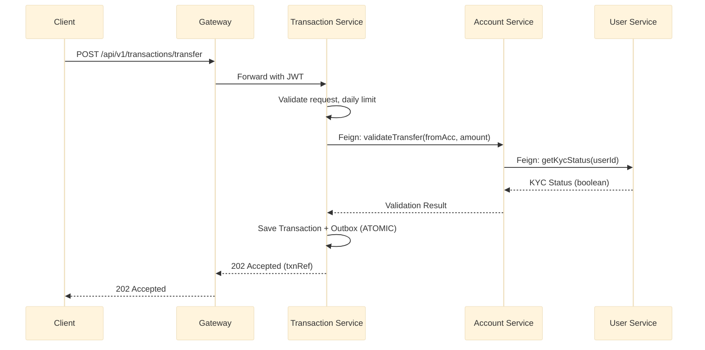

### 6.3 Asynchronous Communication (Kafka Events)

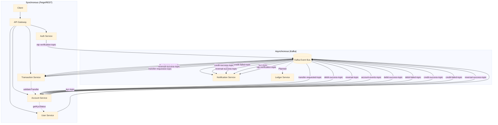

---

## 7. Event-Driven Architecture

### 7.1 Kafka Topic Design

| Topic | Partitions | Retention | Key | Producers | Consumers | Purpose |
|-------|------------|-----------|-----|-----------|-----------|---------|
| `transfer-requested-topic` | 3 | 7 days | txnRef | Transaction Service | Account Service (DebitConsumer) | Initiate transfer saga |
| `debit-success-topic` | 3 | 7 days | txnRef | Account Service | Account Service (CreditConsumer), Transaction Service | Debit completed |
| `debit-failed-topic` | 3 | 7 days | txnRef | Account Service | Transaction Service | Debit failed |
| `credit-success-topic` | 3 | 7 days | txnRef | Account Service | Transaction Service, Notification Service | Credit completed |
| `credit-failed-topic` | 3 | 7 days | txnRef | Account Service | Transaction Service, Notification Service | Credit failed |
| `reversal-topic` | 3 | 7 days | txnRef | Transaction Service | Account Service (ReversalConsumer) | Trigger reversal |
| `reversal-success-topic` | 3 | 7 days | txnRef | Account Service | Transaction Service, Notification Service | Reversal completed |
| `account-events-topic` | 3 | 7 days | accountNumber | Account Service | Ledger Service (Planned) | Account lifecycle events |
| `kyc-topic` | 3 | 7 days | authUserId | User Service | Notification Service | KYC status changes |
| `otp-verification-topic` | 3 | 24 hours | email | Auth Service | Notification Service | Email OTP delivery |
| `*.dlq` | 3 | 30 days | eventId | All (via DLQ config) | Dead Letter Processor | Failed message handling |

### 7.2 Event Payloads (Key Events)

```json
// TransferRequestedEvent
{
  "eventId": "uuid",
  "txnRef": "TXN-20261117-001",
  "fromAccount": "CITI123456789012",
  "toAccount": "CITI987654321098",
  "amount": 5000.00,
  "authUserId": 12345,
  "idempotencyKey": "client-provided-key",
  "timestamp": "2026-11-17T10:30:00Z"
}

// DebitSuccessEvent
{
  "eventId": "uuid",
  "txnRef": "TXN-20261117-001",
  "fromAccount": "CITI123456789012",
  "amount": 5000.00,
  "balanceAfter": 15000.00,
  "timestamp": "2026-11-17T10:30:01Z"
}

// KycEvent
{
  "eventId": "uuid",
  "authUserId": 12345,
  "eventType": "KYC_APPROVED",
  "previousStatus": "UNDER_REVIEW",
  "newStatus": "APPROVED",
  "reviewedBy": "admin@citicore.com",
  "timestamp": "2026-11-17T10:30:00Z"
}
```

### 7.3 Transactional Outbox Pattern

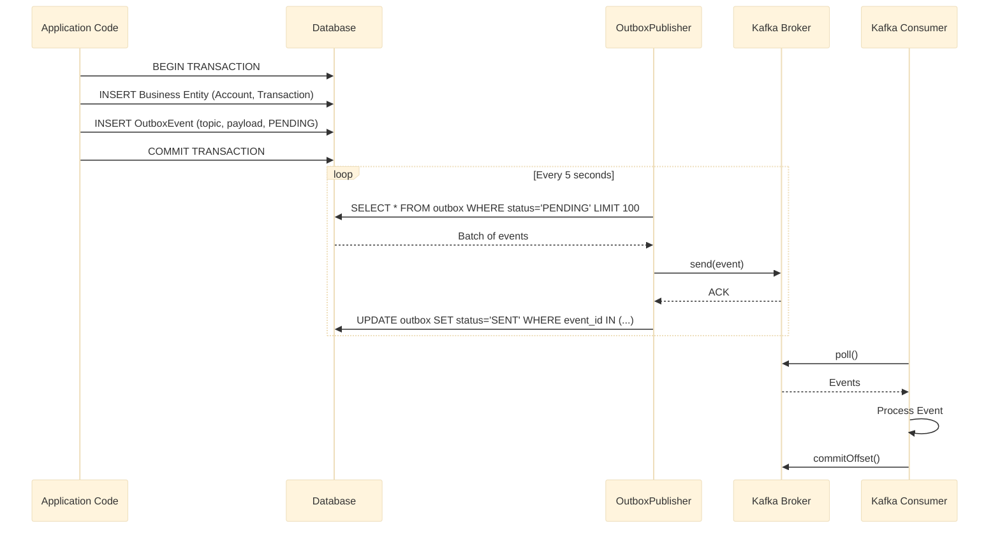

### 7.4 Outbox Configuration

| Parameter | Value | Description |
|-----------|-------|-------------|
| Poll Interval | 5 seconds | Frequency of outbox polling |
| Batch Size | 100 | Max events per poll |
| Serializer | StringSerializer | Avoids double JSON encoding |
| Retry Policy | Exponential backoff (3 retries) | On Kafka send failure |
| DLQ | Enabled | Failed messages after max retries |

---

## 8. Financial Transaction Processing

### 8.1 Fund Transfer Saga (Choreography-Based)

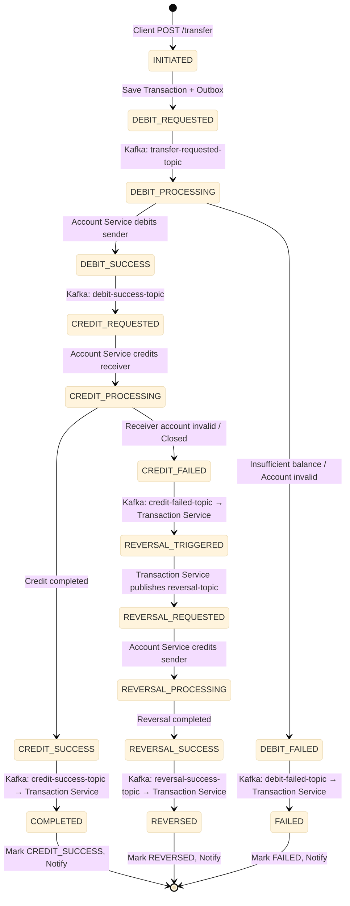

### 8.2 Detailed Sequence Diagram

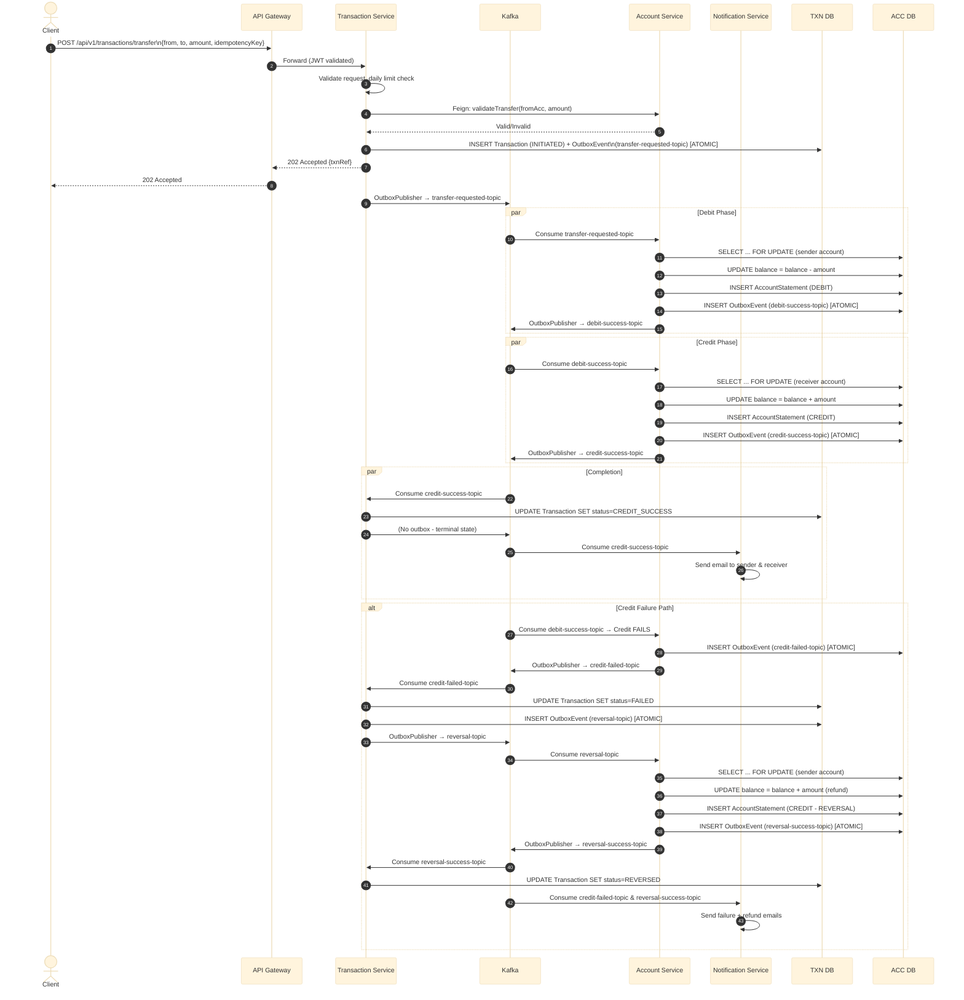

### 8.3 Idempotency Strategy

| Level | Mechanism | Scope |
|-------|-----------|-------|
| **Client** | Idempotency-Key header | Per user per request |
| **Transaction Service** | IdempotencyKey entity (user-scoped unique) | Prevents duplicate initiation |
| **Account Service** | txnRef suffix deduplication in AccountStatement | Prevents duplicate posting |
| **Kafka Consumers** | Status checks before processing | Prevents duplicate consumption |
| **Consumer Groups** | Stable group IDs + exactly-once semantics | At-least-once delivery |

---

## 9. Double-Entry Ledger Architecture

### 9.1 Current State vs Target State

| Aspect | Current (Account Statement) | Target (General Ledger) |
|--------|----------------------------|-------------------------|
| **Model** | Single-entry per account | Double-entry (balanced journals) |
| **Balance** | Single `balance` column | `ledgerBalance` + `availableBalance` |
| **Posting** | Direct balance update | Journal entries with debit/credit lines |
| **Verification** | None | Trial balance, GL reconciliation |
| **Audit** | AccountStatement only | Immutable journal + audit trail |
| **Control Accounts** | None | Customer deposits, Cash, Income, Expense |

### 9.2 Chart of Accounts (Sample)

```mermaid
%%{init: {'theme': 'base'}}%%
graph TB
    subgraph ASSET ["ASSET (1xxx)"]
        A1[1000 - Cash & Cash Equivalents]
        A2[1100 - Central Bank Deposits]
        A3[1200 - Loans & Advances]
        A4[1300 - Investments]
        A5[1400 - Fixed Assets]
    end
    
    subgraph LIABILITY ["LIABILITY (2xxx)"]
        L1[2000 - Customer Deposits (Control)]
        L2[2100 - Interbank Borrowings]
        L3[2200 - Other Liabilities]
    end
    
    subgraph EQUITY ["EQUITY (3xxx)"]
        E1[3000 - Share Capital]
        E2[3100 - Reserves & Surplus]
        E3[3200 - Retained Earnings]
    end
    
    subgraph INCOME ["INCOME (4xxx)"]
        I1[4000 - Interest Income]
        I2[4100 - Fee & Commission Income]
        I3[4200 - Other Income]
    end
    
    subgraph EXPENSE ["EXPENSE (5xxx)"]
        X1[5000 - Interest Expense]
        X2[5100 - Operating Expenses]
        X3[5200 - Provisions]
    end
    
    subgraph CUSTOMER ["Customer Sub-Ledger (2000-xxxx)"]
        C1[2000-123456789012 - John Doe]
        C2[2000-987654321098 - Jane Smith]
    end

    L1 --> C1
    L1 --> C2
```

### 9.3 Posting Rules

| Business Event | Debit Account | Credit Account | Description |
|----------------|---------------|----------------|-------------|
| Customer Deposit (Cash) | 1000 - Cash | 2000-{account} - Customer Deposits | Cash received |
| Customer Withdrawal (Cash) | 2000-{account} - Customer Deposits | 1000 - Cash | Cash paid out |
| Internal Transfer (A→B) | 2000-{A} - Customer Deposits | 2000-{B} - Customer Deposits | Liability transfer |
| Loan Disbursement | 1200 - Loans Receivable | 2000-{account} - Customer Deposits | Asset created, liability increased |
| Interest Accrual | 2000-{account} - Customer Deposits | 4000 - Interest Income | Expense to bank, income recognized |
| Fee Collection | 2000-{account} - Customer Deposits | 4100 - Fee Income | Liability reduced, income recognized |

### 9.4 Journal Entry Structure

```mermaid
%%{init: {'theme': 'base'}}%%
erDiagram
    JOURNAL_ENTRY ||--o{ JOURNAL_LINE : contains
    JOURNAL_ENTRY {
        BIGINT id PK
        VARCHAR txnRef UK
        DATETIME entryDate
        VARCHAR description
        ENUM status "POSTED, REVERSED"
        DATETIME createdAt
    }
    JOURNAL_LINE {
        BIGINT id PK
        BIGINT journalId FK
        VARCHAR accountCode FK
        DECIMAL debit ">= 0"
        DECIMAL credit ">= 0"
        CHECK "(debit>0 AND credit=0) OR (debit=0 AND credit>0)"
    }
    LEDGER_ACCOUNT ||--o{ JOURNAL_LINE : referenced_by
    LEDGER_ACCOUNT {
        VARCHAR code PK "1000, 2000-12345..."
        VARCHAR name
        ENUM type "ASSET, LIABILITY, EQUITY, INCOME, EXPENSE"
        CHAR currency "INR"
        BOOLEAN isControlAccount
        VARCHAR parentCode FK
    }
    LEDGER_BALANCE {
        BIGINT id PK
        VARCHAR accountCode FK
        DATE asOfDate
        DECIMAL openingBalance
        DECIMAL totalDebits
        DECIMAL totalCredits
        DECIMAL closingBalance "opening + debits - credits"
    }
```

### 9.5 Invariants (Database Constraints)

```sql
-- Journal entry must balance (enforced by trigger)
CREATE TRIGGER trg_journal_balance
BEFORE INSERT ON journal_entries
FOR EACH ROW
BEGIN
    DECLARE v_debit DECIMAL(19,4);
    DECLARE v_credit DECIMAL(19,4);
    SELECT COALESCE(SUM(debit),0), COALESCE(SUM(credit),0) 
    INTO v_debit, v_credit
    FROM journal_lines WHERE journal_id = NEW.id;
    IF v_debit != v_credit THEN
        SIGNAL SQLSTATE '45000' SET MESSAGE_TEXT = 'Journal entry must balance';
    END IF;
END;

-- Journal line: exactly one side
ALTER TABLE journal_lines ADD CONSTRAINT chk_one_side 
CHECK ((debit > 0 AND credit = 0) OR (debit = 0 AND credit > 0));

-- No negative amounts
ALTER TABLE journal_lines ADD CONSTRAINT chk_positive 
CHECK (debit >= 0 AND credit >= 0);

-- Account balance consistency (reconciliation view)
CREATE VIEW v_balance_reconciliation AS
SELECT 
    a.account_number,
    a.balance as account_balance,
    COALESCE(SUM(CASE WHEN s.transaction_type='CREDIT' THEN s.amount ELSE -s.amount END),0) as statement_balance,
    COALESCE(SUM(CASE WHEN jl.account_code=CONCAT('2000-',a.account_number) THEN jl.debit - jl.credit END),0) as ledger_balance
FROM accounts a
LEFT JOIN account_statements s ON a.account_number = s.account_number
LEFT JOIN journal_lines jl ON jl.account_code = CONCAT('2000-', a.account_number)
GROUP BY a.account_number, a.balance;
```

---

## 10. Security Architecture

### 10.1 Authentication Flow

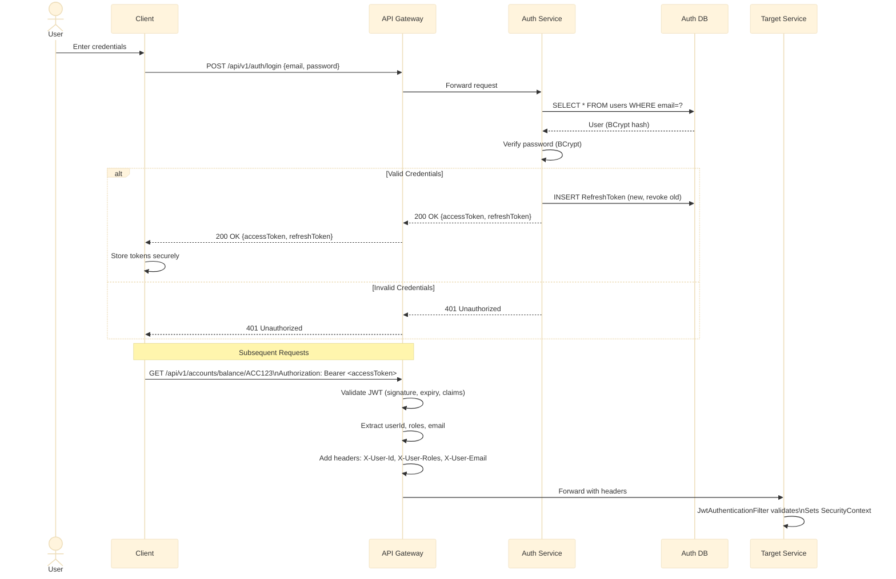

### 10.2 Token Specification

| Token | Algorithm | Expiry | Claims | Storage |
|-------|-----------|--------|--------|---------|
| **Access Token** | HS256 | 15 minutes | userId, email, roles, iat, exp | Client memory (not localStorage) |
| **Refresh Token** | Opaque (UUID) | 7 days | userId, token, expiryDate, revoked | Database (citicore_authdb.refresh_tokens) |

### 10.3 Refresh Token Rotation

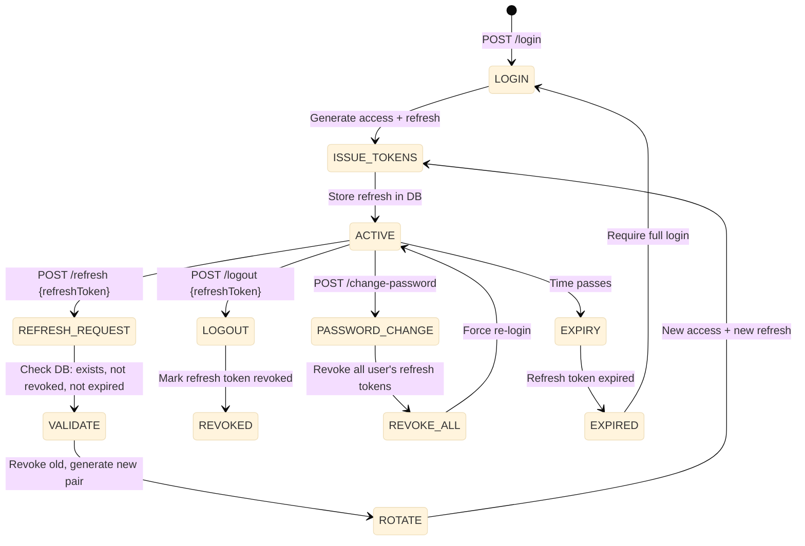

### 10.4 Authorization Model

```mermaid
%%{init: {'theme': 'base'}}%%
graph TB
    subgraph RBAC ["Role-Based Access Control"]
        ROLES[Roles: CUSTOMER, ADMIN, SUPPORT, AUDITOR, SERVICE]
        PERMISSIONS[Permissions: READ, WRITE, ADMIN, AUDIT]
    end
    
    subgraph ABAC ["Attribute-Based (Planned)"]
        ATTRS[Attributes: userId, accountOwnership, kycStatus, riskScore]
        POLICIES[Policies: Ownership, KYC Required, Daily Limits]
    end
    
    subgraph ENFORCEMENT ["Enforcement Points"]
        GATEWAY[API Gateway: JWT validation, Rate limiting]
        FILTER[JwtAuthenticationFilter: Token validation, SecurityContext]
        ANNOTATION[@PreAuthorize: Method-level security]
        SERVICE[Service Logic: Ownership checks, Business rules]
    end
    
    ROLES --> PERMISSIONS
    ATTRS --> POLICIES
    GATEWAY --> FILTER
    FILTER --> ANNOTATION
    ANNOTATION --> SERVICE
```

### 10.5 Service-to-Service Security

| Communication | Mechanism | Details |
|---------------|-----------|---------|
| **Gateway → Services** | JWT Propagation | Gateway validates, forwards claims via headers (X-User-Id, X-User-Roles, X-User-Email) |
| **Feign Clients** | Request Interceptor | Adds `Authorization: Bearer <service-token>` or propagates user JWT |
| **Service Validation** | Independent | Each service validates JWT using own JwtUtils (no shared secret) |
| **Internal Service Calls** | Service Role | `ROLE_SERVICE` for Feign-only endpoints (e.g., `/accounts/validate-transfer`) |

### 10.6 Security Controls Summary

| Control | Implementation | Status |
|---------|----------------|--------|
| **Password Hashing** | BCrypt (cost 10) | ✅ |
| **JWT Signing** | HS256 (32+ char secret) | ✅ |
| **Rate Limiting (Auth)** | Resilience4j/Bucket4j (5 req/min login) | ⚠️ Planned (P0) |
| **Rate Limiting (API)** | Redis Token Bucket (Gateway) | ✅ |
| **Account Lockout** | Failed attempt tracking (5/15min) | ⚠️ Planned (P1) |
| **MFA/TOTP** | RFC 6238 + Backup codes | ⚠️ Planned (P1) |
| **Password Reset** | Secure token (15min, single-use) | ⚠️ Planned (P0) |
| **RBAC** | Spring @EnableMethodSecurity + @PreAuthorize | ⚠️ Partial (Planned) |
| **Input Validation** | Bean Validation (@Positive, @Max, @Pattern) | ⚠️ Partial (Planned) |
| **Error Handling** | Generic client messages, detailed server logs | ⚠️ Planned |
| **Audit Logging** | Immutable audit trail (Planned Ledger) | ⚠️ Planned |
| **Encryption at Rest** | MySQL TDE (Planned) | ❌ |
| **Encryption in Transit** | TLS 1.2+ (Planned) | ❌ |
| **Secrets Management** | HashiCorp Vault (Planned) | ❌ |
| **Container Security** | Non-root user, read-only FS, dropped caps | ⚠️ Planned |

---

## 11. Infrastructure & Deployment

### 11.1 Docker Compose (Local Development)

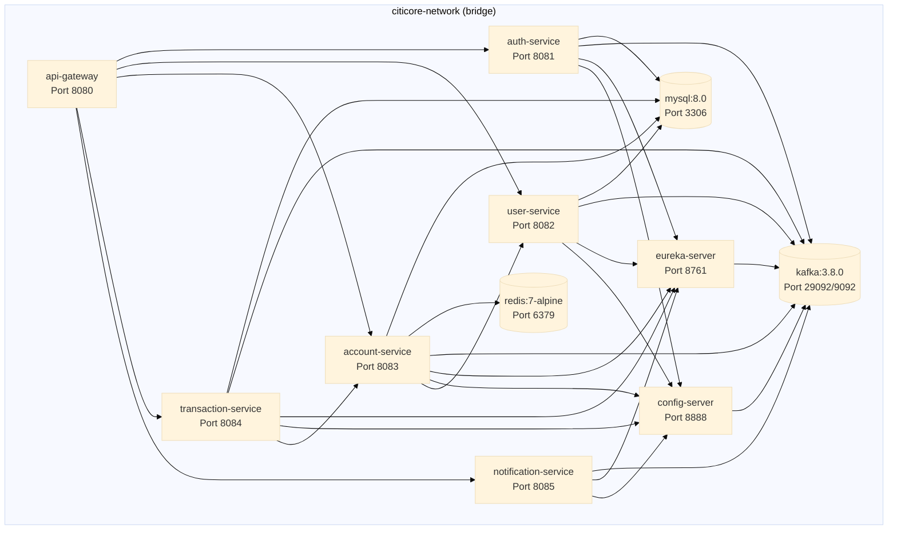

### 11.2 Kubernetes Deployment Architecture (Target)

```mermaid
%%{init: {'theme': 'base'}}%%
graph TB
    subgraph EXTERNAL ["External"]
        LB[Load Balancer\nAWS ALB / CloudFlare]
        USERS[Users]
        ADMINS[Admins]
    end
    
    subgraph INGRESS ["Ingress Layer"]
        ING[NGINX Ingress Controller\nTLS Termination\nWAF Rules]
    end
    
    subgraph NAMESPACE_CITICORE ["Namespace: citicore-prod"]
        subgraph GATEWAY_NS ["Gateway"]
            GW_DEP[Deployment: api-gateway\nReplicas: 3\nHPA: CPU 70%]
            GW_SVC[Service: api-gateway\nClusterIP]
        end
        
        subgraph CORE_NS ["Core Services"]
            AUTH_DEP[Deployment: auth-service\nReplicas: 3\nHPA: CPU 70%]
            USER_DEP[Deployment: user-service\nReplicas: 3\nHPA: CPU 70%]
            ACC_DEP[Deployment: account-service\nReplicas: 5\nHPA: CPU 70%\nPDB: minAvailable 2]
            TXN_DEP[Deployment: transaction-service\nReplicas: 3\nHPA: CPU 70%]
            NOTIF_DEP[Deployment: notification-service\nReplicas: 2\nHPA: CPU 70%]
            LEDGER_DEP[Deployment: ledger-service\nReplicas: 2\nHPA: CPU 70%]
        end
        
        subgraph PLATFORM_NS ["Platform"]
            EUREKA_DEP[Deployment: eureka-server\nReplicas: 2]
            CONFIG_DEP[Deployment: config-server\nReplicas: 2]
        end
    end
    
    subgraph NAMESPACE_DATA ["Namespace: data-layer"]
        MYSQL_PRIMARY[(MySQL Primary\nStatefulSet: 1\nReplicas: 2)\nPVC: 500Gi]
        MYSQL_REPLICA[(MySQL Replica\nStatefulSet: 2)\nRead-Only]
        REDIS_CLUSTER[(Redis Cluster\n6 Nodes: 3M/3R)\nPVC: 50Gi]
        KAFKA_CLUSTER[(Kafka Cluster\nStrimzi Operator\n3 Brokers, RF=3)\nPVC: 200Gi/broker]
    end
    
    subgraph NAMESPACE_OBS ["Namespace: observability"]
        PROM[Prometheus Operator\nServiceMonitors]
        GRAF[Grafana]
        LOKI[Loki + Promtail]
        ZIPKIN[Zipkin/Jaeger]
        ALERT[Alertmanager]
    end
    
    subgraph NAMESPACE_SEC ["Namespace: security"]
        VAULT[HashiCorp Vault\nHA Mode\nAuto-unseal]
        CERT[cert-manager\nLet's Encrypt / Internal CA]
    end
    
    USERS --> LB
    ADMINS --> LB
    LB --> ING
    ING --> GW_SVC
    GW_SVC --> GW_DEP
    GW_DEP --> AUTH_DEP
    GW_DEP --> USER_DEP
    GW_DEP --> ACC_DEP
    GW_DEP --> TXN_DEP
    GW_DEP --> NOTIF_DEP
    GW_DEP --> LEDGER_DEP
    
    AUTH_DEP --> MYSQL_PRIMARY
    USER_DEP --> MYSQL_PRIMARY
    ACC_DEP --> MYSQL_PRIMARY
    ACC_DEP --> MYSQL_REPLICA
    ACC_DEP --> REDIS_CLUSTER
    TXN_DEP --> MYSQL_PRIMARY
    LEDGER_DEP --> MYSQL_PRIMARY
    ALL_DEP[All Services] --> KAFKA_CLUSTER
    ALL_DEP --> EUREKA_DEP
    ALL_DEP --> CONFIG_DEP
    ALL_DEP --> VAULT
    ALL_DEP --> PROM
    ALL_DEP --> LOKI
    ALL_DEP --> ZIPKIN
```

### 11.3 Kubernetes Resources per Service

| Service | Replicas | CPU Request/Limit | Memory Request/Limit | HPA | PDB | Probes |
|---------|----------|-------------------|----------------------|-----|-----|--------|
| api-gateway | 3 | 250m/1000m | 512Mi/1Gi | CPU 70% | minAvailable 2 | Liveness: /health/liveness, Readiness: /health/readiness |
| auth-service | 3 | 250m/1000m | 512Mi/1Gi | CPU 70% | minAvailable 2 | Same |
| user-service | 3 | 250m/1000m | 512Mi/1Gi | CPU 70% | minAvailable 2 | Same |
| account-service | 5 | 500m/2000m | 1Gi/2Gi | CPU 70%, Mem 80% | minAvailable 3 | Same + Business health |
| transaction-service | 3 | 250m/1000m | 512Mi/1Gi | CPU 70% | minAvailable 2 | Same |
| notification-service | 2 | 100m/500m | 256Mi/512Mi | CPU 70% | minAvailable 1 | Same |
| ledger-service | 2 | 250m/1000m | 512Mi/1Gi | CPU 70% | minAvailable 1 | Same |
| eureka-server | 2 | 100m/500m | 256Mi/512Mi | - | minAvailable 1 | Same |
| config-server | 2 | 100m/500m | 256Mi/512Mi | - | minAvailable 1 | Same |

### 11.4 Network Policies (Zero Trust)

```yaml
# Example: Account Service NetworkPolicy
apiVersion: networking.k8s.io/v1
kind: NetworkPolicy
metadata:
  name: account-service-netpol
  namespace: citicore-prod
spec:
  podSelector:
    matchLabels:
      app: account-service
  policyTypes:
  - Ingress
  - Egress
  ingress:
  - from:
    - namespaceSelector:
        matchLabels:
          name: citicore-prod
    - podSelector:
        matchLabels:
          app: api-gateway
    - podSelector:
        matchLabels:
          app: transaction-service
    ports:
    - protocol: TCP
      port: 8083
  egress:
  - to:
    - podSelector:
        matchLabels:
          app: mysql-primary
    ports:
    - protocol: TCP
      port: 3306
  - to:
    - podSelector:
        matchLabels:
          app: mysql-replica
    ports:
    - protocol: TCP
      port: 3306
  - to:
    - podSelector:
        matchLabels:
          app: redis
    ports:
    - protocol: TCP
      port: 6379
  - to:
    - podSelector:
        matchLabels:
          app: kafka
    ports:
    - protocol: TCP
      port: 9092
  - to:
    - podSelector:
        matchLabels:
          app: user-service
    ports:
    - protocol: TCP
      port: 8082
  - to:
    - namespaceSelector:
        matchLabels:
          name: kube-system
    ports:
    - protocol: UDP
      port: 53  # DNS
```

### 11.5 CI/CD Pipeline

```mermaid
%%{init: {'theme': 'base'}}%%
graph LR
    subgraph CI ["Continuous Integration"]
        PUSH[Push to Main/Develop]
        CHECKOUT[Checkout Code]
        SETUP[Setup JDK 17, Maven, Docker]
        CACHE[Cache Maven Deps]
        LINT[Checkstyle + SpotBugs + PMD]
        TEST[Unit + Integration Tests\nTestcontainers]
        COVERAGE[JaCoCo Coverage\n>80%]
        SAST[CodeQL Analysis]
        SCA[Dependency Check\nOWASP]
        BUILD[Multi-stage Docker Build\nNon-root user]
        SCAN[Trivy Container Scan]
        PUSH_IMG[Push to GHCR/ECR\nTag: git-sha]
    end
    
    subgraph CD ["Continuous Deployment"]
        DEPLOY_STAGING[Helm Deploy to Staging\nNamespace: citicore-staging]
        SMOKE[Smoke Tests\nPostman/Newman]
        INTEGRATION[Integration Tests\nFull API Suite]
        PERF[Performance Tests\nk6/JMeter]
        APPROVE[Manual Approval\nProduction Gate]
        DEPLOY_PROD[Helm Deploy to Production\nBlue-Green / Canary]
        HEALTH[Health Verification\nRollback on Failure]
        NOTIFY[Slack/Teams Notification]
    end
    
    PUSH --> CHECKOUT --> SETUP --> CACHE
    CACHE --> LINT --> TEST --> COVERAGE
    COVERAGE --> SAST --> SCA --> BUILD
    BUILD --> SCAN --> PUSH_IMG
    PUSH_IMG --> DEPLOY_STAGING
    DEPLOY_STAGING --> SMOKE --> INTEGRATION
    INTEGRATION --> PERF --> APPROVE
    APPROVE --> DEPLOY_PROD
    DEPLOY_PROD --> HEALTH --> NOTIFY
```

---

## 12. Monitoring & Observability

### 12.1 Observability Stack

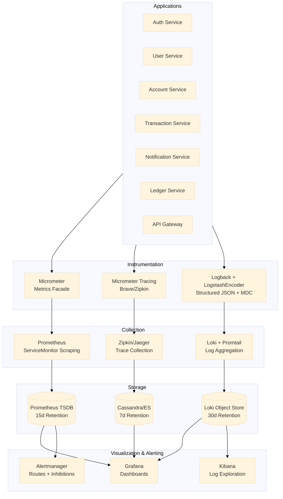

### 12.2 Key Metrics (RED + USE + Business)

| Category | Metrics | Source |
|----------|---------|--------|
| **RED (Request/Error/Duration)** | `http_server_requests_seconds_count`, `http_server_requests_seconds_sum`, `http_server_requests_seconds_bucket` | Micrometer (Spring MVC) |
| **JVM** | `jvm_memory_used_bytes`, `jvm_gc_pause_seconds`, `jvm_threads_live` | Micrometer (JVM) |
| **Database** | `hikaricp_connections_active`, `hikaricp_connections_idle`, `hikaricp_connections_pending` | Micrometer (HikariCP) |
| **Cache** | `cache_gets_total`, `cache_puts_total`, `cache_evictions_total` | Micrometer (Redis) |
| **Kafka** | `kafka_consumer_fetch_manager_records_lag_max`, `kafka_producer_record_send_rate` | Micrometer (Kafka) |
| **Business** | `banking.transfers.initiated`, `banking.transfers.completed`, `banking.transfers.failed`, `banking.transfers.reversed`, `banking.accounts.active`, `banking.balance.total` | Custom `BankingMetrics` |
| **Saga** | `saga.step.duration`, `saga.step.success`, `saga.step.failure`, `saga.compensation.triggered` | Custom |
| **Outbox** | `outbox.events.pending`, `outbox.events.published`, `outbox.events.failed`, `outbox.poll.duration` | Custom |

### 12.3 Distributed Tracing Context Propagation

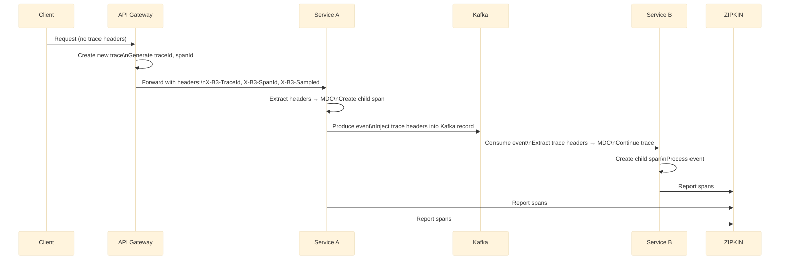

### 12.4 Health Checks

| Probe | Endpoint | Checks | Failure Action |
|-------|----------|--------|----------------|
| **Liveness** | `/actuator/health/liveness` | Process alive, no deadlock | Kubernetes restarts pod |
| **Readiness** | `/actuator/health/readiness` | DB connectivity, Kafka, Redis, Feign targets, Business (outbox lag < 10k, replica lag < 30s) | Kubernetes removes from Service |
| **Startup** | `/actuator/health/startup` | All readiness checks + migrations complete | Kubernetes waits (up to 5 min) |

### 12.5 Key Dashboards

| Dashboard | Panels | Purpose |
|-----------|--------|---------|
| **System Overview** | Request rate, Error rate, Latency (p50/p95/p99), Saturation (CPU, Mem, DB pool) | Golden signals |
| **Service Deep Dive** | Per-service RED, JVM, DB pool, Cache hit rate | Troubleshooting |
| **Business KPIs** | Transfers/day, Success rate, Avg transfer time, Active accounts, Total balances | Business monitoring |
| **Saga Monitor** | Saga in-flight, Step durations, Failure rates, Compensation rate | Transaction flow |
| **Kafka Monitor** | Consumer lag, Producer throughput, Under-replicated partitions | Event bus health |
| **Database Monitor** | Query latency, Connections, Replication lag, Lock waits | Data layer health |

### 12.6 Alerting Rules (Critical)

| Alert | Condition | Severity | Runbook |
|-------|-----------|----------|---------|
| `ServiceDown` | `up{job=~".*-service"} == 0` for 2m | Critical | Check pod logs, restart |
| `HighErrorRate` | `rate(http_server_requests_seconds_count{status=~"5.."}[5m]) > 0.05` | Critical | Check dependencies, circuit breakers |
| `HighLatency` | `histogram_quantile(0.99, rate(http_server_requests_seconds_bucket[5m])) > 2` | Warning | Check DB, Kafka, external calls |
| `KafkaConsumerLag` | `kafka_consumer_fetch_manager_records_lag_max > 10000` | Warning | Scale consumers, check processing |
| `OutboxLag` | `outbox_events_pending > 10000` | Critical | Check publisher, Kafka connectivity |
| `ReplicaLag` | `mysql_replica_lag_seconds > 30` | Warning | Check replication, network |
| `DiskSpace` | `disk_usage_percent > 85` | Warning | Cleanup, expand volume |
| `CertExpiry` | `ssl_cert_expiry_days < 30` | Warning | Renew certificate |

---

## 13. End-to-End Workflows

### 13.1 Customer Onboarding Workflow

```mermaid
%%{init: {'theme': 'base'}}%%
flowchart TD
    START([Customer Visits App]) --> REGISTER[POST /auth/register\n{email, password, phone}]
    REGISTER --> VALIDATE{Valid Input?}
    VALIDATE -->|No| ERROR1[Return 400 Validation Error]
    VALIDATE -->|Yes| SAVE_USER[Save User (PENDING, unverified)]
    SAVE_USER --> GEN_OTP[Generate 8-char OTP]
    GEN_OTP --> SAVE_OTP[Save OTP to User (expires 10min)]
    SAVE_OTP --> PUBLISH_OTP[Publish to otp-verification-topic]
    PUBLISH_OTP --> EMAIL_OTP[Notification Service: Send Email]
    EMAIL_OTP --> RETURN[Return 201: Registration initiated]
    RETURN --> VERIFY_UI[Customer Enters OTP]
    VERIFY_UI --> VERIFY_API[POST /auth/verify {email, code}]
    VERIFY_API --> CHECK_OTP{OTP Valid & Not Expired?}
    CHECK_OTP -->|No| ERROR2[Return 400: Invalid/Expired OTP]
    CHECK_OTP -->|Yes| ACTIVATE[Update User: ACTIVE, emailVerified=true]
    ACTIVATE --> ISSUE_TOKENS[Generate JWT Access + Refresh]
    ISSUE_TOKENS --> RETURN_TOKENS[Return Tokens]
    RETURN_TOKENS --> PROFILE[Customer Completes Profile\nPOST /users/profile]
    PROFILE --> KYC[Customer Uploads KYC Docs\nPOST /users/kyc/upload]
    KYC --> KYC_PENDING[KYC Status: PENDING]
    KYC_PENDING --> ADMIN_REVIEW[Admin Reviews KYC\nGET/PUT /users/admin/kyc/*]
    ADMIN_REVIEW --> APPROVE{KYC Approved?}
    APPROVE -->|No| REJECT[Status: REJECTED, Notify]
    APPROVE -->|Yes| APPROVED[Status: APPROVED, Notify]
    APPROVED --> CREATE_ACCOUNT[Customer Creates Account\nPOST /accounts/create]
    CREATE_ACCOUNT --> KYC_CHECK[Account Service: Feign KYC Status]
    KYC_CHECK -->|Not Approved| ERROR3[Return 400: KYC Required]
    KYC_CHECK -->|Approved| CREATE_ACC_DB[Create Account (SAVINGS/CURRENT)]
    CREATE_ACC_DB --> PUBLISH_ACC[Publish ACCOUNT_CREATED Event]
    PUBLISH_ACC --> LEDGER_POST[Ledger: Post Journal Entry\nDebit: Cash / Credit: Customer Deposits]
    LEDGER_POST --> SUCCESS[Account Created Successfully]
    SUCCESS --> END([Onboarding Complete])
```

### 13.2 Account Management Workflow

```mermaid
%%{init: {'theme': 'base'}}%%
flowchart TD
    START([Authenticated Customer]) --> ACTION{Action?}
    
    ACTION -->|View Balance| BALANCE[GET /accounts/balance/{accNo}]
    BALANCE --> CACHE_HIT{Redis Hit?}
    CACHE_HIT -->|Yes| RETURN_CACHE[Return Cached Balance]
    CACHE_HIT -->|No| QUERY_REPLICA[Query Replica DB]
    QUERY_REPLICA --> CACHE_PUT[Update Redis Cache (5min TTL)]
    CACHE_PUT --> RETURN_BALANCE[Return Balance]
    
    ACTION -->|Deposit| DEPOSIT[POST /accounts/deposit\n{account, amount, description}]
    DEPOSIT --> VALIDATE_DEP{Valid Amount > 0?}
    VALIDATE_DEP -->|No| ERR_DEP[400 Invalid Amount]
    VALIDATE_DEP -->|Yes| LOCK_ACC_DEP[SELECT FOR UPDATE Account]
    LOCK_ACC_DEP --> UPDATE_BAL_DEP[balance = balance + amount]
    UPDATE_BAL_DEP --> STMT_DEP[Insert AccountStatement (CREDIT)]
    STMT_DEP --> OUTBOX_DEP[Insert Outbox: account-events-topic]
    OUTBOX_DEP --> LEDGER_DEP[Ledger: Post Journal\nDebit: Cash / Credit: Customer Deposits]
    LEDGER_DEP --> COMMIT_DEP[Commit Transaction]
    COMMIT_DEP --> NOTIFY_DEP[Kafka → Notification: Deposit Email]
    NOTIFY_DEP --> RET_DEP[Return Success]
    
    ACTION -->|Withdraw| WITHDRAW[POST /accounts/withdraw\n{account, amount, description}]
    WITHDRAW --> VALIDATE_WD{Valid Amount > 0?}
    VALIDATE_WD -->|No| ERR_WD[400 Invalid Amount]
    VALIDATE_WD -->|Yes| LOCK_ACC_WD[SELECT FOR UPDATE Account]
    LOCK_ACC_WD --> CHECK_BAL{balance >= amount + minBalance?}
    CHECK_BAL -->|No| ERR_INSUFF[400 Insufficient Balance]
    CHECK_BAL -->|Yes| UPDATE_BAL_WD[balance = balance - amount]
    UPDATE_BAL_WD --> STMT_WD[Insert AccountStatement (DEBIT)]
    STMT_WD --> OUTBOX_WD[Insert Outbox: account-events-topic]
    OUTBOX_WD --> LEDGER_WD[Ledger: Post Journal\nDebit: Customer Deposits / Credit: Cash]
    LEDGER_WD --> COMMIT_WD[Commit Transaction]
    COMMIT_WD --> NOTIFY_WD[Kafka → Notification: Withdrawal Email]
    NOTIFY_WD --> RET_WD[Return Success]
    
    ACTION -->|Statement| STMT[GET /accounts/statement/{accNo}\n{page, size, fromDate, toDate}]
    STMT --> QUERY_STMT[Query Replica DB with Pagination]
    QUERY_STMT --> RET_STMT[Return Paginated Statements]
    
    ACTION -->|Close Account| CLOSE[POST /accounts/{accNo}/close]
    CLOSE --> CHECK_ZERO{balance == 0?}
    CHECK_ZERO -->|No| ERR_BAL[400: Transfer Balance First]
    CHECK_ZERO -->|Yes| CHECK_HOLDS{No Regulatory Holds?}
    CHECK_HOLDS -->|No| ERR_HOLD[400: Regulatory Hold]
    CHECK_HOLDS -->|Yes| UPDATE_STATUS[status = CLOSED]
    UPDATE_STATUS --> LEDGER_CLOSE[Ledger: Close Sub-Ledger Account]
    LEDGER_CLOSE --> RET_CLOSE[Return Success]
    
    RETURN_CACHE --> END
    RETURN_BALANCE --> END
    RET_DEP --> END
    RET_WD --> END
    RET_STMT --> END
    RET_CLOSE --> END
    ERR_DEP --> END
    ERR_WD --> END
    ERR_INSUFF --> END
    ERR_BAL --> END
    ERR_HOLD --> END
```

### 13.3 Fund Transfer Workflow (Detailed)

```mermaid
%%{init: {'theme': 'base'}}%%
flowchart TD
    START([Customer Initiates Transfer]) --> REQUEST[POST /transactions/transfer\n{fromAccount, toAccount, amount, idempotencyKey}]
    REQUEST --> GW[API Gateway: JWT Validation, Rate Limit]
    GW --> TXN_SVC[Transaction Service]
    TXN_SVC --> VALIDATE_REQ{Valid Request?}
    VALIDATE_REQ -->|No| ERR_VALID[400: Validation Error]
    VALIDATE_REQ -->|Yes| CHECK_IDEMP{Idempotency Key Exists?}
    CHECK_IDEMP -->|Yes| RETURN_EXISTING[Return Existing txnRef]
    CHECK_IDEMP -->|No| CHECK_LIMIT{Daily Limit OK?}
    CHECK_LIMIT -->|No| ERR_LIMIT[400: Daily Limit Exceeded]
    CHECK_LIMIT -->|Yes| FEIGN_VALIDATE[Feign: AccountService.validateTransfer]
    FEIGN_VALIDATE --> VALIDATE_RES{Valid?}
    VALIDATE_RES -->|No| ERR_VALIDATE[400: Invalid Transfer]
    VALIDATE_RES -->|Yes| SAVE_TXN[INSERT Transaction (INITIATED)\n+ OutboxEvent (transfer-requested)]
    SAVE_TXN --> SAVE_IDEMP[INSERT IdempotencyKey (user-scoped)]
    SAVE_IDEMP --> RETURN_202[Return 202 Accepted {txnRef}]
    RETURN_202 --> OUTBOX_PUB[OutboxPublisher → Kafka: transfer-requested-topic]
    
    OUTBOX_PUB --> DEBIT_CONSUMER[Account Service: DebitConsumer]
    DEBIT_CONSUMER --> LOCK_SENDER[SELECT FOR UPDATE Sender Account]
    LOCK_SENDER --> CHECK_SENDER{Active, Sufficient Balance?}
    CHECK_SENDER -->|No| DEBIT_FAIL[Save DebitFailedEvent → Outbox]
    CHECK_SENDER -->|Yes| DEBIT_UPDATE[balance -= amount]
    DEBIT_UPDATE --> STMT_DEBIT[AccountStatement (DEBIT)]
    STMT_DEBIT --> OUTBOX_DEBIT[Outbox: debit-success-topic]
    OUTBOX_DEBIT --> COMMIT_DEBIT[Commit]
    COMMIT_DEBIT --> KAFKA_DEBIT[OutboxPublisher → debit-success-topic]
    
    KAFKA_DEBIT --> CREDIT_CONSUMER[Account Service: CreditConsumer]
    CREDIT_CONSUMER --> LOCK_RECEIVER[SELECT FOR UPDATE Receiver Account]
    LOCK_RECEIVER --> CHECK_RECEIVER{Active, Not Closed?}
    CHECK_RECEIVER -->|No| CREDIT_FAIL[Save CreditFailedEvent → Outbox]
    CHECK_RECEIVER -->|Yes| CREDIT_UPDATE[balance += amount]
    CREDIT_UPDATE --> STMT_CREDIT[AccountStatement (CREDIT)]
    STMT_CREDIT --> OUTBOX_CREDIT[Outbox: credit-success-topic]
    OUTBOX_CREDIT --> COMMIT_CREDIT[Commit]
    COMMIT_CREDIT --> KAFKA_CREDIT[OutboxPublisher → credit-success-topic]
    
    KAFKA_CREDIT --> TXN_SUCCESS[Transaction Service: TransactionEventConsumer]
    TXN_SUCCESS --> UPDATE_TXN_SUCCESS[UPDATE Transaction: CREDIT_SUCCESS]
    UPDATE_TXN_SUCCESS --> NOTIFY_SUCCESS[Kafka → Notification: Success Email]
    NOTIFY_SUCCESS --> LEDGER_TXN[Ledger: Post Journal\nDebit: Customer Deposits (Sender)\nCredit: Customer Deposits (Receiver)]
    LEDGER_TXN --> END_SUCCESS([Transfer Complete])
    
    DEBIT_FAIL --> KAFKA_DEBIT_FAIL[OutboxPublisher → debit-failed-topic]
    KAFKA_DEBIT_FAIL --> TXN_DEBIT_FAIL[Transaction Service: TransactionFailureConsumer]
    TXN_DEBIT_FAIL --> UPDATE_TXN_FAIL[UPDATE Transaction: FAILED]
    UPDATE_TXN_FAIL --> NOTIFY_DEBIT_FAIL[Kafka → Notification: Failed Email]
    NOTIFY_DEBIT_FAIL --> END_FAIL([Transfer Failed])
    
    CREDIT_FAIL --> KAFKA_CREDIT_FAIL[OutboxPublisher → credit-failed-topic]
    KAFKA_CREDIT_FAIL --> TXN_CREDIT_FAIL[Transaction Service: TransactionFailureConsumer]
    TXN_CREDIT_FAIL --> UPDATE_TXN_CF[UPDATE Transaction: FAILED]
    UPDATE_TXN_CF --> OUTBOX_REVERSAL[Outbox: reversal-topic]
    OUTBOX_REVERSAL --> KAFKA_REVERSAL[OutboxPublisher → reversal-topic]
    
    KAFKA_REVERSAL --> REVERSAL_CONSUMER[Account Service: ReversalConsumer]
    REVERSAL_CONSUMER --> LOCK_SENDER_REV[SELECT FOR UPDATE Sender Account]
    LOCK_SENDER_REV --> REFUND[balance += amount]
    REFUND --> STMT_REV[AccountStatement (CREDIT - REVERSAL)]
    STMT_REV --> OUTBOX_REV_SUCCESS[Outbox: reversal-success-topic]
    OUTBOX_REV_SUCCESS --> COMMIT_REV[Commit]
    COMMIT_REV --> KAFKA_REV_SUCCESS[OutboxPublisher → reversal-success-topic]
    
    KAFKA_REV_SUCCESS --> TXN_REV[Transaction Service: TransactionEventConsumer]
    TXN_REV --> UPDATE_TXN_REV[UPDATE Transaction: REVERSED]
    UPDATE_TXN_REV --> NOTIFY_REV[Kafka → Notification: Reversal Email]
    NOTIFY_REV --> LEDGER_REV[Ledger: Reversal Journal Entry]
    LEDGER_REV --> END_REV([Transfer Reversed])
    
    ERR_VALID --> END_FAIL
    RETURN_EXISTING --> END_SUCCESS
    ERR_LIMIT --> END_FAIL
    ERR_VALIDATE --> END_FAIL
```

---

## 14. Architecture Review Observations

> **IMPORTANT:** The following observations are documented for review and approval. **Do not implement changes without explicit approval.**

### 14.1 Critical Gaps Requiring Decision

| ID | Observation | Impact | Recommended Action | Status |
|----|-------------|--------|-------------------|--------|
| **OBS-001** | **No Double-Entry General Ledger Implemented** - Current AccountStatement is single-entry; no Chart of Accounts, Journal Entries, or Trial Balance. This is a **fundamental banking requirement** for regulatory compliance (SOX, IFRS, RBI). | **CRITICAL** - Cannot operate as licensed bank without GL. Financial statements impossible. Audit trail incomplete. | Implement Ledger Service with: Chart of Accounts, Journal Entry posting, Balanced journal validation (DB trigger), Trial balance generation, GL reconciliation jobs, Sub-ledger to GL mapping. | **Documented - Awaiting Approval** |
| **OBS-002** | **Cross-Database Referential Integrity Not Enforced** - MySQL doesn't support cross-database FKs. Current design relies on application-level checks + reconciliation jobs. | **HIGH** - Data inconsistency risk. Orphaned records possible. Audit failures. | **Option A:** Single database with schemas (preferred for integrity)<br>**Option B:** Application-level validation + scheduled reconciliation (current)<br>**Option C:** Database links (not recommended) | **Documented - Awaiting Decision** |
| **OBS-003** | **Available vs Ledger Balance Not Implemented** - Single `balance` column used. No support for authorization holds (card auth, pending transfers). | **HIGH** - Cannot support card payments, auth holds, or proper available balance display. | Add `available_balance` column. Implement hold/release API. Modify debit/credit to affect available first, then ledger on settlement. | **Documented - Awaiting Approval** |
| **OBS-004** | **Authentication Security Gaps (P0)** - No rate limiting on auth endpoints, 6-digit OTP, no account lockout, no password policy, no password reset, no MFA. | **CRITICAL** - OWASP Top 10 violations. Brute force, credential stuffing, account takeover risk. | Implement: Rate limiting (5 req/min login), 8-char alphanumeric OTP, Failed attempt tracking (5/15min), Password policy (12+ chars, complexity), Password reset flow, TOTP MFA. | **Documented - Approved for Phase 0** |
| **OBS-005** | **Authorization Gaps (P0)** - Account Service and User Service have `.permitAll()` on all endpoints. No ownership checks on credit(). No RBAC enforcement. | **CRITICAL** - BOLA/BFLA vulnerabilities. Unauthenticated access to financial operations. | Fix SecurityConfig: require authentication. Add ownership validation. Implement @PreAuthorize on admin endpoints. | **Documented - Approved for Phase 0** |
| **OBS-006** | **No Dead Letter Queue Configuration** - Kafka consumers have no DLQ. Failed messages may be lost or block processing. | **HIGH** - Message loss, processing stalls, no visibility into failures. | Configure DLQ for all topics. Add retry with exponential backoff (max 3). Add DLQ monitoring/alerting. | **Documented - Approved for Phase 0** |
| **OBS-007** | **Idempotency Key Not User-Scoped** - Global unique constraint allows cross-user collision. | **HIGH** - User A's idempotency key could reveal User B's transaction. | Add `auth_user_id` to IdempotencyKey. Unique constraint on `(auth_user_id, idempotency_key)`. | **Documented - Approved for Phase 0** |
| **OBS-008** | **Single Kafka Broker (No HA)** - Docker Compose uses single broker. No replication factor > 1. | **HIGH** - Single point of failure. Message loss on restart. | Production: 3-broker cluster, RF=3, min.insync.replicas=2. | **Documented - Infrastructure Decision** |
| **OBS-009** | **No Database Backup/Recovery Strategy** - Only Docker volume persistence. No PITR, no tested restores. | **CRITICAL** - Data loss risk. RPO/RTO undefined. | Implement: Percona XtraBackup daily + 15min binlog. PITR tested quarterly. Cross-region replication. | **Documented - Awaiting Approval** |
| **OBS-010** | **No Secrets Management** - JWT secret, DB passwords in env vars/docker-compose. | **HIGH** - Secrets in git history, CI logs, container inspect. | Integrate HashiCorp Vault or AWS Secrets Manager. | **Documented - Awaiting Approval** |
| **OBS-011** | **No Network Segmentation** - Single Docker network for all services. | **MEDIUM** - Lateral movement risk if one service compromised. | Kubernetes: NetworkPolicies per tier (ingress, services, data). | **Documented - K8s Implementation** |
| **OBS-012** | **Docker Images Run as Root** - No USER directive in Dockerfiles. | **HIGH** - Container escape → host compromise. | Add non-root user (UID 1000) to all Dockerfiles. | **Documented - Approved for Phase 0** |
| **OBS-013** | **No TLS Configuration for Database** - MySQL connections unencrypted. | **MEDIUM** - Credentials and data in transit exposed. | Enable MySQL TLS: `useSSL=true&requireSSL=true&verifyServerCertificate=true` | **Documented - Awaiting Approval** |
| **OBS-014** | **No Encryption at Rest for PII** - Email, phone, address, KYC docs stored in plaintext. | **HIGH** - GDPR/PDPB non-compliance. Data breach impact. | MySQL TDE for tablespace encryption. Column-level encryption for PII. S3 SSE-KMS for KYC docs. | **Documented - Awaiting Approval** |
| **OBS-015** | **Transaction Isolation TOCTOU Risk** - `validateTransfer` uses non-locking read; balance may change before debit. | **MEDIUM** - Race condition could allow overdraft. | Option A: Remove pre-validation (rely on debit locking). Option B: Make validateTransfer locking (adds latency). | **Documented - Awaiting Decision** |
| **OBS-016** | **No Fee/Commission Engine** - No support for transaction fees, interchange, service charges. | **MEDIUM** - Revenue leakage. Cannot implement pricing tiers. | Implement Fee Engine: configurable rules, per-transaction assessment, ledger posting to income accounts. | **Documented - Future Enhancement** |
| **OBS-017** | **No Interest Accrual Engine** - Savings accounts don't accrue interest. | **HIGH** - Regulatory requirement. Customer expectation. | Daily accrual job. Monthly capitalization. Configurable rates per tier. TDS withholding. | **Documented - Phase 2** |
| **OBS-018** | **Beneficiary Management Missing** - No payee registry, no penny drop verification. | **HIGH** - Cannot do repeat transfers securely. User experience gap. | Implement Beneficiary entity + CRUD. Penny drop (₹1) verification. Beneficiary limits. | **Documented - Phase 2** |
| **OBS-019** | **Account Statement `txn_ref` Global Unique** - Prevents same txnRef across accounts (legitimate for transfers). | **MEDIUM** - BUG-019: Transfer creates two statements with same txnRef (debit + credit). | Change to composite unique: `(account_number, txn_ref)`. | **Documented - Approved for Phase 0** |
| **OBS-020** | **No Circuit Breakers on Feign Clients** - Transaction→Account and Account→User calls unprotected. | **HIGH** - Cascade failures. Service down → entire transfer flow breaks. | Add Resilience4j circuit breakers with fallbacks. Fail-closed for KYC (no account without KYC). | **Documented - Phase 3** |

### 14.2 Design Decisions Requiring Confirmation

| ID | Decision Point | Options | Current Choice | Recommendation |
|----|----------------|---------|----------------|----------------|
| **DEC-001** | **Saga Orchestration vs Choreography** | Orchestration (central coordinator) vs Choreography (event-driven) | Choreography (current) | Keep choreography for simplicity; add saga state persistence for observability |
| **DEC-002** | **Database per Service vs Single Database** | Separate DBs (current) vs Single DB with schemas | Separate DBs | **Recommend: Single DB with schemas** for referential integrity, simpler transactions, easier reporting |
| **DEC-003** | **Primary/Replica on Same Host** | Same host (current) vs Separate AZ | Same host | **Must change for production**: Replica in different AZ for HA |
| **DEC-004** | **Kafka Replication Factor** | RF=1 (current) vs RF=3 | RF=1 | **Must change for production**: RF=3, min.insync.replicas=2 |
| **DEC-005** | **Service-to-Service Auth** | Propagate user JWT vs Service tokens | Propagate user JWT | Keep user JWT propagation; add `ROLE_SERVICE` for internal-only endpoints |
| **DEC-006** | **Account Number Format** | `CITI` + 12 digits (current) vs IBAN vs Custom | `CITI` + 12 digits | Keep current; ensure uniqueness via sequence/Redis |
| **DEC-007** | **Currency Support** | INR only (current) vs Multi-currency | INR only | Design for multi-currency: add `currency` column, exchange rate service |
| **DEC-008** | **Audit Log Storage** | Database table vs Append-only file vs Immutable ledger | None (planned) | **Recommend: Immutable ledger** (append-only table + crypto verification) |

### 14.3 Technical Debt Items

| ID | Component | Debt Description | Effort | Priority |
|----|-----------|------------------|--------|----------|
| **TD-001** | All Services | `ddl-auto: update` in production config | Low | P0 (Must change to `validate`) |
| **TD-002** | All Services | No Flyway migrations | Medium | P0 |
| **TD-003** | Auth Service | `System.out.println` debug logging | Low | P0 |
| **TD-004** | All Services | Plain text logging (no JSON, no correlation IDs) | Medium | P1 |
| **TD-005** | Account Service | `RoutingDataSource` with AOP - complex, hard to test | Medium | P2 (Refactor) |
| **TD-006** | Transaction Service | Saga state not persisted (only in Kafka) | High | P1 (Add saga state machine) |
| **TD-007** | Kafka Events | Shared library `kafka-events` - versioning coupling | Medium | P2 (Schema registry) |
| **TD-008** | Config Server | Native profile only - no Git backend for prod | Low | P1 |
| **TD-009** | All Services | No API versioning strategy beyond `/v1/` | Low | P2 |
| **TD-010** | Account Service | Balance query forces primary for consistency (bypasses replica) | Low | P2 (Optimize) |

---

## Appendix A: Glossary

| Term | Definition |
|------|------------|
| **Saga** | Distributed transaction pattern using choreography/orchestration |
| **Outbox Pattern** | Reliable event publishing via database table + poller |
| **Double-Entry** | Accounting where every transaction affects two accounts (debit/credit) |
| **GL** | General Ledger - master record of all financial transactions |
| **Sub-Ledger** | Detailed ledger for specific domain (customer deposits, loans) |
| **Control Account** | GL account that summarizes sub-ledger balances |
| **TOCTOU** | Time-of-Check-Time-of-Use race condition |
| **BOLA** | Broken Object Level Authorization (OWASP API1) |
| **BFLA** | Broken Function Level Authorization (OWASP API5) |
| **RPO** | Recovery Point Objective - max data loss tolerance |
| **RTO** | Recovery Time Objective - max downtime tolerance |
| **PITR** | Point-in-Time Recovery |
| **TDE** | Transparent Data Encryption |

---

## Appendix B: Related Documents

| Document | Purpose |
|----------|---------|
| `PROJECT_ARCHITECTURE.md` | Original architecture documentation |
| `SECURITY_AUDIT.md` | Security vulnerability assessment |
| `DATABASE_AUDIT.md` | Database design & consistency audit |
| `BANKING_FUNCTIONALITY_GAP_ANALYSIS.md` | Functional coverage vs banking requirements |
| `IMPLEMENTATION_ROADMAP.md` | Phased implementation plan |
| `PRODUCTION_READINESS.md` | Production deployment readiness assessment |

---

## Document Control

| Version | Date | Author | Changes |
|---------|------|--------|---------|
| 1.0 | 2026-11-17 | Architecture Team | Initial target state architecture documentation |

---

**END OF DOCUMENT**