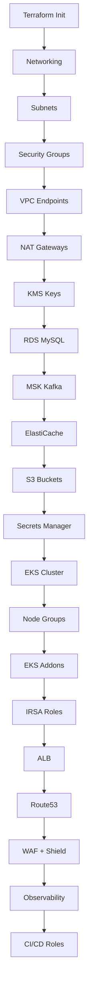

# CitiCore Banking Platform - Terraform Infrastructure Design

## Document Information

| Field | Value |
|-------|-------|
| **Document Title** | CitiCore Terraform Infrastructure Design |
| **Version** | 1.0 |
| **Status** | Draft for Review |
| **Classification** | Internal - Confidential |
| **Author** | Architecture Team |
| **Reviewers** | DevOps Lead, Platform Team, Security Lead |
| **Last Updated** | 2026-11-19 |

---

## Table of Contents

1. [Overview](#1-overview)
2. [Terraform Structure](#2-terraform-structure)
3. [Module Design](#3-module-design)
4. [Environment Configurations](#4-environment-configurations)
5. [State Management](#5-state-management)
6. [Provider Configuration](#6-provider-configuration)
7. [Module Catalog](#7-module-catalog)
8. [Deployment Pipeline](#8-deployment-pipeline)
9. [Security & Compliance](#9-security--compliance)
10. [Cost Management](#10-cost-management)

---

## 1. Overview

This document defines the Terraform infrastructure-as-code design for the CitiCore Banking Platform, implementing the approved production architecture across staging and production environments.

### 1.1 Design Principles

| Principle | Implementation |
|-----------|----------------|
| **Modularity** | Reusable modules with clear interfaces |
| **Environment Parity** | Same modules, different parameters per environment |
| **State Isolation** | Separate state files per environment |
| **Least Privilege** | Module-specific IAM permissions |
| **Drift Prevention** | Automated drift detection |
| **Immutable Infrastructure** | Replace, don't mutate |

### 1.2 Supported Environments

| Environment | AWS Account | Terraform Workspace | State Backend |
|-------------|-------------|---------------------|---------------|
| **Staging** | citicore-staging | `staging` | S3 + DynamoDB (staging) |
| **Production** | citicore-prod | `production` | S3 + DynamoDB (production) |
| **Disaster Recovery** | citicore-dr | `dr` | S3 + DynamoDB (DR) |

---

## 2. Terraform Structure

### 2.1 Repository Layout

```
terraform/
├── modules/
│   ├── networking/
│   │   ├── vpc/
│   │   ├── subnets/
│   │   ├── security-groups/
│   │   ├── vpc-endpoints/
│   │   ├── nat-gateway/
│   │   └── transit-gateway/
│   ├── compute/
│   │   ├── eks/
│   │   ├── eks-node-groups/
│   │   ├── eks-addons/
│   │   └── eks-irsa/
│   ├── database/
│   │   ├── rds-mysql/
│   │   ├── rds-parameter-group/
│   │   ├── rds-replica/
│   │   └── rds-backup/
│   ├── messaging/
│   │   ├── msk/
│   │   ├── msk-topics/
│   │   └── msk-iam-policies/
│   ├── cache/
│   │   ├── elasticache-redis/
│   │   └── elasticache-parameter-group/
│   ├── storage/
│   │   ├── s3-buckets/
│   │   ├── s3-bucket-policies/
│   │   └── s3-replication/
│   ├── security/
│   │   ├── kms-keys/
│   │   ├── secrets-manager/
│   │   ├── iam-roles/
│   │   ├── iam-policies/
│   │   ├── waf/
│   │   └── shield/
│   ├── observability/
│   │   ├── cloudwatch/
│   │   ├── grafana/
│   │   ├── xray/
│   │   └── alerting/
│   ├── networking/
│   │   ├── route53/
│   │   ├── acm/
│   │   └── alb/
│   └── cicd/
│       ├── github-oidc/
│       ├── ecr/
│       └── codebuild/
├── environments/
│   ├── staging/
│   │   ├── main.tf
│   │   ├── variables.tf
│   │   ├── outputs.tf
│   │   ├── backend.hcl
│   │   └── terraform.tfvars
│   ├── production/
│   │   ├── main.tf
│   │   ├── variables.tf
│   │   ├── outputs.tf
│   ├── backend.hcl
│   │   └── terraform.tfvars
│   └── dr/
│       ├── main.tf
│       ├── variables.tf
│       ├── outputs.tf
│       ├── backend.hcl
│       └── terraform.tfvars
├── shared/
│   ├── providers.tf
│   ├── locals.tf
│   └── tags.tf
└── scripts/
    ├── deploy.sh
    ├── validate.sh
    └── plan.sh
```

---

## 3. Module Design

### 3.1 Module Standards

```hcl
# Every module follows this structure
module/
├── main.tf           # Main resources
├── variables.tf      # Input variables with validation
├── outputs.tf        # Output values
├── versions.tf       # Provider versions
├── locals.tf         # Computed values
├── data.tf           # Data sources
├── README.md         # Module documentation
├── examples/
│   └── basic/
│       ├── main.tf
│       ├── variables.tf
│       └── outputs.tf
└── tests/
    └── unit/
```

### 3.2 Variable Standards

```hcl
# Variable with validation
variable "vpc_cidr" {
  description = "CIDR block for VPC"
  type        = string
  default     = "10.0.0.0/16"
  
  validation {
    condition     = can(cidrhost(var.vpc_cidr, 1))
    error_message = "VPC CIDR must be a valid CIDR block."
  }
}

variable "availability_zones" {
  description = "List of availability zones"
  type        = list(string)
  default     = ["us-east-1a", "us-east-1b", "us-east-1c"]
  
  validation {
    condition     = length(var.availability_zones) >= 2
    error_message = "At least 2 availability zones required."
  }
}

variable "tags" {
  description = "Common tags for all resources"
  type        = map(string)
  default     = {}
  
  validation {
    condition     = contains(keys(var.tags), "Environment")
    error_message = "Environment tag is required."
  }
}
```

### 3.3 Output Standards

```hcl
output "vpc_id" {
  description = "ID of the VPC"
  value       = aws_vpc.main.id
}

output "private_subnet_ids" {
  description = "List of private subnet IDs"
  value       = aws_subnet.private[*].id
}

output "database_subnet_group_name" {
  description = "DB subnet group name for RDS"
  value       = aws_db_subnet_group.main.name
}
```

---

## 4. Environment Configurations

### 4.1 Staging Environment

```hcl
# environments/staging/main.tf
terraform {
  required_version = ">= 1.6.0"
  
  backend "s3" {
    bucket         = "citicore-terraform-state-staging"
    key            = "staging/terraform.tfstate"
    region         = "us-east-1"
    encrypt        = true
    dynamodb_table = "terraform-state-lock-staging"
  }
  
  required_providers {
    aws = {
      source  = "hashicorp/aws"
      version = "~> 5.0"
    }
    kubernetes = {
      source  = "hashicorp/kubernetes"
      version = "~> 2.23"
    }
    helm = {
      source  = "hashicorp/helm"
      version = "~> 2.10"
    }
  }
}

provider "aws" {
  region = var.aws_region
  
  default_tags {
    tags = local.common_tags
  }
}

# Data sources
data "aws_availability_zones" "available" {
  state = "available"
}

# Locals
locals {
  common_tags = {
    Environment   = "staging"
    Application   = "citicore"
    ManagedBy     = "terraform"
    Repository    = "github.com/org/citicore-infra"
  }
  
  availability_zones = slice(data.aws_availability_zones.available.names, 0, 2)
}

# Modules
module "networking" {
  source = "../../modules/networking/vpc"
  
  vpc_cidr            = var.vpc_cidr
  availability_zones  = local.availability_zones
  enable_dns_hostnames = true
  enable_dns_support   = true
  tags                = local.common_tags
}

module "subnets" {
  source = "../../modules/networking/subnets"
  
  vpc_id              = module.networking.vpc_id
  vpc_cidr            = var.vpc_cidr
  availability_zones  = local.availability_zones
  public_subnet_bits  = 4
  private_app_bits    = 4
  private_data_bits   = 4
  tags                = local.common_tags
}

module "security_groups" {
  source = "../../modules/networking/security-groups"
  
  vpc_id             = module.networking.vpc_id
  environment        = "staging"
  allowed_cidr_blocks = var.allowed_cidr_blocks
  tags               = local.common_tags
}

module "vpc_endpoints" {
  source = "../../modules/networking/vpc-endpoints"
  
  vpc_id            = module.networking.vpc_id
  private_subnet_ids = module.subnets.private_subnet_ids
  security_group_ids = module.security_groups.vpc_endpoint_sg_id
  services          = ["s3", "secretsmanager", "kms", "logs", "ecr.api", "ecr.dkr"]
  tags              = local.common_tags
}

module "nat_gateway" {
  source = "../../modules/networking/nat-gateway"
  
  vpc_id             = module.networking.vpc_id
  public_subnet_ids  = module.subnets.public_subnet_ids
  private_subnet_ids = module.subnets.private_subnet_ids
  tags               = local.common_tags
}

module "eks" {
  source = "../../modules/compute/eks"
  
  cluster_name    = "citicore-staging"
  cluster_version = "1.28"
  vpc_id          = module.networking.vpc_id
  private_subnet_ids = module.subnets.private_subnet_ids
  cluster_endpoint_public_access = true
  cluster_endpoint_private_access = true
  cluster_log_types = ["api", "audit", "authenticator", "controllerManager", "scheduler"]
  tags            = local.common_tags
}

module "eks_node_groups" {
  source = "../../modules/compute/eks-node-groups"
  
  cluster_name    = module.eks.cluster_name
  cluster_arn     = module.eks.cluster_arn
  
  node_groups = {
    system = {
      instance_types = ["m6i.xlarge"]
      capacity_type  = "ON_DEMAND"
      min_size       = 2
      max_size       = 6
      desired_size   = 3
      labels = {
        workload = "system"
      }
    }
    general = {
      instance_types = ["m6i.2xlarge"]
      capacity_type  = "ON_DEMAND"
      min_size       = 2
      max_size       = 8
      desired_size   = 4
      labels = {
        workload = "general"
      }
    }
    memory = {
      instance_types = ["r6i.2xlarge"]
      capacity_type  = "ON_DEMAND"
      min_size       = 2
      max_size       = 6
      desired_size   = 2
      labels = {
        workload = "memory"
      }
    }
  }
  tags = local.common_tags
}

module "rds" {
  source = "../../modules/database/rds-mysql"
  
  identifier           = "citicore-staging-db"
  engine               = "mysql"
  engine_version       = "8.0.35"
  instance_class       = "db.r6g.xlarge"
  allocated_storage    = 200
  max_allocated_storage = 500
  storage_encrypted    = true
  kms_key_id           = module.kms.rds_key_arn
  db_subnet_group_name = module.subnets.db_subnet_group_name
  vpc_security_group_ids = [module.security_groups.rds_sg_id]
  multi_az             = true
  availability_zones   = local.availability_zones
  backup_retention_period = 35
  deletion_protection  = true
  tags                 = local.common_tags
}

module "msk" {
  source = "../../modules/messaging/msk"
  
  cluster_name           = "citicore-staging-kafka"
  kafka_version          = "3.8"
  number_of_broker_nodes = 3
  broker_node_group_info = {
    instance_type   = "m5.large"
    client_subnets  = module.subnets.private_subnet_ids
    security_groups = [module.security_groups.msk_sg_id]
    storage_info = {
      ebs_storage_info = {
        volume_size = 1000
      }
    }
  }
  encryption_info = {
    encryption_at_rest_kms_key_arn = module.kms.msk_key_arn
  }
  client_authentication = {
    sasl = {
      iam = true
    }
  }
  tags = local.common_tags
}

module "elasticache" {
  source = "../../modules/cache/elasticache-redis"
  
  cluster_id           = "citicore-staging-cache"
  engine               = "redis"
  engine_version       = "7.1"
  node_type            = "cache.r6g.xlarge"
  num_cache_nodes      = 2
  parameter_group_name = module.cache_parameter_group.name
  subnet_group_name    = module.subnets.elasticache_subnet_group_name
  security_group_ids   = [module.security_groups.elasticache_sg_id]
  at_rest_encryption_enabled = true
  transit_encryption_enabled = true
  auth_token_enabled   = true
  automatic_failover_enabled = true
  tags                 = local.common_tags
}

module "s3" {
  source = "../../modules/storage/s3-buckets"
  
  buckets = {
    kyc_quarantine = {
      bucket = "citicore-staging-kyc-quarantine"
      versioning = true
      encryption = "aws:kms"
      kms_key_id = module.kms.s3_key_arn
      object_lock_enabled = true
      object_lock_mode = "COMPLIANCE"
      object_lock_days = 2555
    }
    kyc_clean = {
      bucket = "citicore-staging-kyc-clean"
      versioning = true
      encryption = "aws:kms"
      kms_key_id = module.kms.s3_key_arn
      object_lock_enabled = true
      object_lock_mode = "COMPLIANCE"
      object_lock_days = 2555
    }
  }
  tags = local.common_tags
}

module "kms" {
  source = "../../modules/security/kms-keys"
  
  keys = {
    rds = {
      description = "RDS encryption key"
      deletion_window_in_days = 30
      enable_key_rotation = true
    }
    msk = {
      description = "MSK encryption key"
      deletion_window_in_days = 30
      enable_key_rotation = true
    }
    s3 = {
      description = "S3 encryption key"
      deletion_window_in_days = 30
      enable_key_rotation = true
    }
  }
  tags = local.common_tags
}

module "secrets_manager" {
  source = "../../modules/security/secrets-manager"
  
  secrets = {
    "citicore/staging/auth/db-credentials" = {
      description = "Auth Service DB Credentials"
      generate_string = {
        password_length = 32
        exclude_characters = "\"@/\\"
      }
    }
    "citicore/staging/auth/jwt-secret" = {
      description = "Auth Service JWT Secret"
      generate_string = {
        password_length = 64
        exclude_characters = "\"@/\\"
      }
    }
    # ... other secrets
  }
  tags = local.common_tags
}

module "alb" {
  source = "../../modules/networking/alb"
  
  name               = "citicore-staging-alb"
  vpc_id             = module.networking.vpc_id
  subnets            = module.subnets.public_subnet_ids
  security_groups    = [module.security_groups.alb_sg_id]
  certificate_arn    = var.acm_certificate_arn
  enable_deletion_protection = true
  tags               = local.common_tags
}

module "route53" {
  source = "../../modules/networking/route53"
  
  zone_name         = "staging.citicore.io"
  records = {
    api = {
      name = "api"
      type = "A"
      alias = {
        target = module.alb.alb_dns_name
        zone_id = module.alb.alb_zone_id
      }
    }
  }
  tags = local.common_tags
}
```

### 4.2 Production Environment

```hcl
# environments/production/main.tf
terraform {
  required_version = ">= 1.6.0"
  
  backend "s3" {
    bucket         = "citicore-terraform-state-prod"
    key            = "production/terraform.tfstate"
    region         = "us-east-1"
    encrypt        = true
    dynamodb_table = "terraform-state-lock-prod"
  }
  
  required_providers {
    aws = {
      source  = "hashicorp/aws"
      version = "~> 5.0"
    }
    kubernetes = {
      source  = "hashicorp/kubernetes"
      version = "~> 2.23"
    }
    helm = {
      source  = "hashicorp/helm"
      version = "~> 2.10"
    }
  }
}

provider "aws" {
  region = var.aws_region
  
  default_tags {
    tags = local.common_tags
  }
}

data "aws_availability_zones" "available" {
  state = "available"
}

locals {
  common_tags = {
    Environment   = "production"
    Application   = "citicore"
    ManagedBy     = "terraform"
    Repository    = "github.com/org/citicore-infra"
  }
  
  availability_zones = data.aws_availability_zones.available.names
}

# Same modules as staging but with production configs
module "networking" {
  source = "../../modules/networking/vpc"
  
  vpc_cidr            = var.vpc_cidr
  availability_zones  = local.availability_zones
  enable_dns_hostnames = true
  enable_dns_support   = true
  tags                = local.common_tags
}

# ... all modules with production-specific parameters
# Key differences from staging:
# - 3 AZs instead of 2
# - Larger instance types (db.r6g.2xlarge, m5.2xlarge, cache.r6g.2xlarge)
# - Multi-AZ RDS (3 AZs)
# - MSK 3 brokers in 3 AZs
# - ElastiCache 3 shards, Multi-AZ
# - RDS db.r6g.2xlarge
# - WAF + Shield on ALB
# - Shield Advanced
# - Cross-region replication for DR
```

### 4.3 DR Environment

```hcl
# environments/dr/main.tf
# Minimal DR infrastructure - cross-region replicas only
# - RDS Cross-Region Read Replica
# - MSK MirrorMaker 2
# - S3 Cross-Region Replication
# - ElastiCache Global Datastore
# - Minimal EKS for emergency workloads
```

---

## 5. State Management

### 5.1 Backend Configuration

```hcl
# backend.hcl (staging)
bucket         = "citicore-terraform-state-staging"
key            = "staging/terraform.tfstate"
region         = "us-east-1"
encrypt        = true
dynamodb_table = "terraform-state-lock-staging"

# backend.hcl (production)
bucket         = "citicore-terraform-state-prod"
key            = "production/terraform.tfstate"
region         = "us-east-1"
encrypt        = true
dynamodb_table = "terraform-state-lock-prod"
```

### 5.2 State Locking

| Component | Purpose |
|-----------|---------|
| **S3 Bucket** | State file storage with versioning |
| **DynamoDB Table** | State locking (prevent concurrent operations) |
| **Encryption** | SSE-S3 for state files |
| **Access Control** | Bucket policies + IAM policies |

### 5.3 State Operations

```bash
# Initialize with backend config
terraform init -backend-config=environments/staging/backend.hcl

# Plan
terraform plan -var-file=environments/staging/terraform.tfvars

# Apply
terraform apply -var-file=environments/staging/terraform.tfvars

# Import existing resource
terraform import aws_vpc.main vpc-12345

# Refresh state
terraform refresh

# List resources
terraform state list

# Show specific resource
terraform state show aws_vpc.main
```

---

## 6. Provider Configuration

### 6.1 Provider Versions

```hcl
# shared/providers.tf
terraform {
  required_version = ">= 1.6.0"
  
  required_providers {
    aws = {
      source  = "hashicorp/aws"
      version = "~> 5.0"
      configuration_aliases = [aws.dr]
    }
    kubernetes = {
      source  = "hashicorp/kubernetes"
      version = "~> 2.23"
    }
    helm = {
      source  = "hashicorp/helm"
      version = "~> 2.10"
    }
    tls = {
      source  = "hashicorp/tls"
      version = "~> 4.0"
    }
    random = {
      source  = "hashicorp/random"
      version = "~> 3.6"
    }
    time = {
      source  = "hashicorp/time"
      version = "~> 0.9"
    }
  }
}

# DR provider alias
provider "aws" {
  alias  = "dr"
  region = "us-west-2"
}
```

### 6.2 Provider Assumptions

| Provider | Configuration |
|----------|---------------|
| **AWS** | Region from variable; tags from locals |
| **Kubernetes** | Uses kubeconfig from EKS module output |
| **Helm** | Uses kubeconfig from EKS module output |
| **TLS** | For self-signed certificates (dev) |
| **Random** | For generating passwords, suffixes |
| **Time** | For time-based resources (rotation schedules) |

---

## 7. Module Catalog

### 7.1 Networking Modules

| Module | Description | Key Resources |
|--------|-------------|---------------|
| `vpc` | VPC with DNS support | `aws_vpc`, `aws_internet_gateway` |
| `subnets` | Public/Private/Database subnets | `aws_subnet`, `aws_route_table`, `aws_route` |
| `security-groups` | Tiered security groups | `aws_security_group`, `aws_security_group_rule` |
| `vpc-endpoints` | Gateway/Interface endpoints | `aws_vpc_endpoint` |
| `nat-gateway` | NAT Gateways per AZ | `aws_nat_gateway`, `aws_eip` |
| `transit-gateway` | Cross-account connectivity | `aws_ec2_transit_gateway` |
| `route53` | DNS zones and records | `aws_route53_zone`, `aws_route53_record` |
| `acm` | Certificate management | `aws_acm_certificate`, `aws_acm_certificate_validation` |
| `alb` | Application Load Balancer | `aws_lb`, `aws_lb_target_group`, `aws_lb_listener` |

### 7.2 Compute Modules

| Module | Description | Key Resources |
|--------|-------------|---------------|
| `eks` | EKS cluster | `aws_eks_cluster`, `aws_eks_addon` |
| `eks-node-groups` | Managed node groups | `aws_eks_node_group` |
| `eks-addons` | VPC CNI, CoreDNS, kube-proxy | `aws_eks_addon` |
| `eks-irsa` | IAM Roles for Service Accounts | `aws_iam_role`, `aws_iam_policy` |

### 7.3 Database Modules

| Module | Description | Key Resources |
|--------|-------------|---------------|
| `rds-mysql` | RDS MySQL instance | `aws_db_instance`, `aws_db_subnet_group` |
| `rds-parameter-group` | Custom parameter group | `aws_db_parameter_group` |
| `rds-replica` | Cross-region read replica | `aws_db_instance` (replica) |
| `rds-backup` | Backup configuration | `aws_db_instance` settings |

### 7.4 Messaging Modules

| Module | Description | Key Resources |
|--------|-------------|---------------|
| `msk` | MSK Kafka cluster | `aws_msk_cluster`, `aws_msk_configuration` |
| `msk-topics` | Topic management | `aws_msk_topic` (via Kafka provider) |
| `msk-iam-policies` | IAM policies for MSK | `aws_iam_policy`, `aws_iam_role_policy` |

### 7.5 Cache Modules

| Module | Description | Key Resources |
|--------|-------------|---------------|
| `elasticache-redis` | Redis cluster | `aws_elasticache_replication_group` |
| `elasticache-parameter-group` | Custom parameters | `aws_elasticache_parameter_group` |

### 7.6 Storage Modules

| Module | Description | Key Resources |
|--------|-------------|---------------|
| `s3-buckets` | S3 buckets with policies | `aws_s3_bucket`, `aws_s3_bucket_policy` |
| `s3-bucket-policies` | Bucket policies | `aws_s3_bucket_policy` |
| `s3-replication` | Cross-region replication | `aws_s3_bucket_replication_configuration` |

### 7.7 Security Modules

| Module | Description | Key Resources |
|--------|-------------|---------------|
| `kms-keys` | KMS keys for all services | `aws_kms_key`, `aws_kms_alias` |
| `secrets-manager` | Secrets Manager secrets | `aws_secretsmanager_secret`, `aws_secretsmanager_secret_version` |
| `iam-roles` | IAM roles for services | `aws_iam_role`, `aws_iam_policy` |
| `iam-policies` | Custom IAM policies | `aws_iam_policy` |
| `waf` | WAF Web ACL | `aws_wafv2_web_acl`, `aws_wafv2_rule_group` |
| `shield` | Shield Advanced | `aws_shield_protection` |

### 7.8 Observability Modules

| Module | Description | Key Resources |
|--------|-------------|---------------|
| `cloudwatch` | Dashboards, alarms | `aws_cloudwatch_dashboard`, `aws_cloudwatch_metric_alarm` |
| `grafana` | Grafana workspace | `aws_grafana_workspace` |
| `xray` | X-Ray tracing | `aws_xray_sampling_rule` |
| `alerting` | AlertManager, SNS topics | `aws_sns_topic`, `aws_sns_topic_subscription` |

### 7.9 CI/CD Modules

| Module | Description | Key Resources |
|--------|-------------|---------------|
| `github-oidc` | OIDC provider + roles | `aws_iam_openid_connect_provider`, `aws_iam_role` |
| `ecr` | Container registries | `aws_ecr_repository`, `aws_ecr_lifecycle_policy` |
| `codebuild` | Build projects | `aws_codebuild_project` |

---

## 8. Deployment Pipeline

### 8.1 Terraform in CI/CD

```yaml
# .github/workflows/terraform.yml
name: Terraform

on:
  push:
    branches: [main]
    paths:
      - 'terraform/**'
  pull_request:
    paths:
      - 'terraform/**'
  workflow_dispatch:
    inputs:
      environment:
        description: 'Environment'
        required: true
        type: choice
        options: [staging, production]
      action:
        description: 'Action'
        required: true
        type: choice
        options: [plan, apply]

jobs:
  terraform:
    name: Terraform ${{ github.event.inputs.action || 'plan' }}
    runs-on: ubuntu-latest
    permissions:
      id-token: write
      contents: read
    env:
      TF_VERSION: "1.6.0"
    steps:
      - uses: actions/checkout@v4
      
      - name: Setup Terraform
        uses: hashicorp/setup-terraform@v3
        with:
          terraform_version: ${{ env.TF_VERSION }}
      
      - name: Configure AWS Credentials
        uses: aws-actions/configure-aws-credentials@v4
        with:
          role-to-assume: ${{ secrets.TERRAFORM_ROLE_ARN }}
          aws-region: us-east-1
      
      - name: Setup Terraform Backend
        run: |
          cd terraform/environments/${{ github.event.inputs.environment || 'staging' }}
          terraform init -backend-config=backend.hcl
      
      - name: Terraform Format
        run: terraform fmt -check -recursive
      
      - name: Terraform Validate
        run: terraform validate
      
      - name: Terraform Plan
        if: github.event.inputs.action != 'apply'
        run: |
          terraform plan -var-file=terraform.tfvars -out=tfplan
      
      - name: Terraform Apply
        if: github.event.inputs.action == 'apply' && github.ref == 'refs/heads/main'
        run: |
          terraform apply -auto-approve tfplan
```

### 8.2 Deployment Order



---

## 9. Security & Compliance

### 9.1 Security Controls in Terraform

```hcl
# Enforced via Sentinel policies or OPA
# Example: Enforce encryption on all resources

# S3 buckets must have encryption
resource "aws_s3_bucket" "example" {
  # ...
  server_side_encryption_configuration {
    rule {
      apply_server_side_encryption_by_default {
        sse_algorithm = "aws:kms"
      }
    }
  }
}

# RDS must have encryption
resource "aws_db_instance" "example" {
  storage_encrypted = true
  kms_key_id        = var.kms_key_id
}

# S3 buckets must block public access
resource "aws_s3_bucket_public_access_block" "example" {
  bucket = aws_s3_bucket.example.id
  
  block_public_acls       = true
  block_public_policy     = true
  ignore_public_acls      = true
  restrict_public_buckets = true
}
```

### 9.2 Compliance Checks

```hcl
# Terraform validate with custom rules
# Using OPA/Rego policies

# Example: Ensure all S3 buckets have versioning
package terraform.compliance

deny[msg] {
  resource := input.planned_values.root_module.resources[_]
  resource.type == "aws_s3_bucket"
  not resource.values.versioning.enabled
  msg := sprintf("S3 bucket %s must have versioning enabled", [resource.address])
}

# Ensure RDS has deletion protection
deny[msg] {
  resource := input.planned_values.root_module.resources[_]
  resource.type == "aws_db_instance"
  not resource.values.deletion_protection
  msg := sprintf("RDS instance %s must have deletion protection", [resource.address])
}
```

---

## 10. Cost Management

### 10.1 Cost Tags

```hcl
# All resources tagged for cost allocation
locals {
  common_tags = {
    Environment   = var.environment
    Application   = "citicore"
    ManagedBy     = "terraform"
    Team          = "platform"
    CostCenter    = "engineering"
    Owner         = "platform-team"
  }
}

# Applied via default_tags in provider
provider "aws" {
  default_tags {
    tags = local.common_tags
  }
}
```

### 10.2 Cost Estimation

```hcl
# Infracost integration for PR comments
# .github/workflows/infracost.yml

- name: Infracost Breakdown
  uses: infracost/actions/setup@v3
  with:
    api-key: ${{ secrets.INFRACOST_API_KEY }}

- name: Generate Infracost diff
  run: |
    infracost breakdown --path=terraform/environments/staging \
      --format=json --out-file=/tmp/infracost.json
    
    infracost comment github --path=/tmp/infracost.json \
      --repo=$GITHUB_REPOSITORY \
      --pull-request=$PR_NUMBER \
      --github-token=$GITHUB_TOKEN
```

### 10.3 Cost Optimization Tags

```hcl
# Resources tagged for cost optimization
resource "aws_instance" "example" {
  # ...
  
  tags = merge(local.common_tags, {
    "CostOptimization" = "eligible"
    "Schedule"         = "business-hours"
    "Environment"      = var.environment
  })
}

# For non-production, enable scheduling
resource "aws_autoscaling_schedule" "scale_down_night" {
  scheduled_action_name  = "scale-down-night"
  min_size               = 0
  max_size               = 0
  desired_capacity       = 0
  recurrence             = "0 22 * * *"
  autoscaling_group_name = aws_autoscaling_group.example.name
}
```

---

## Document Control

| Version | Date | Author | Changes |
|---------|------|--------|---------|
| 1.0 | 2026-11-19 | Architecture Team | Initial Terraform Design |

---

**END OF DOCUMENT**