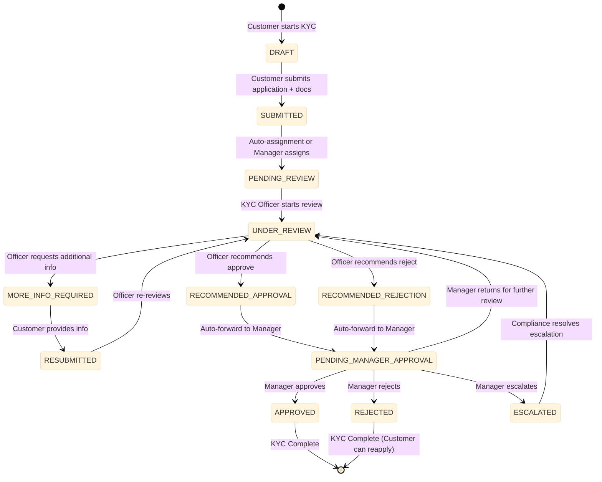
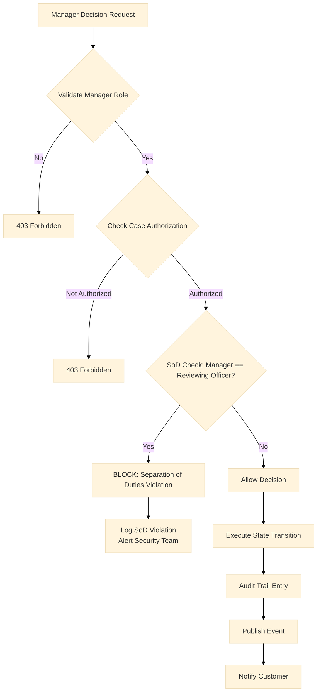
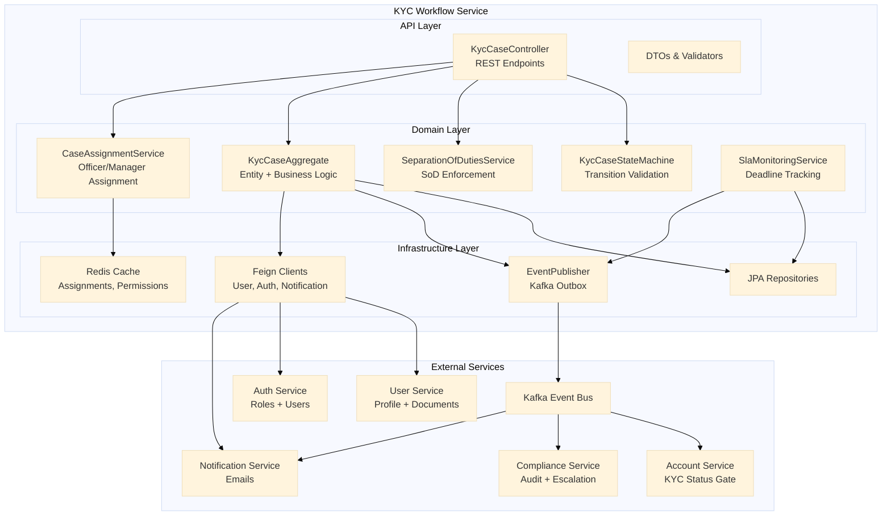
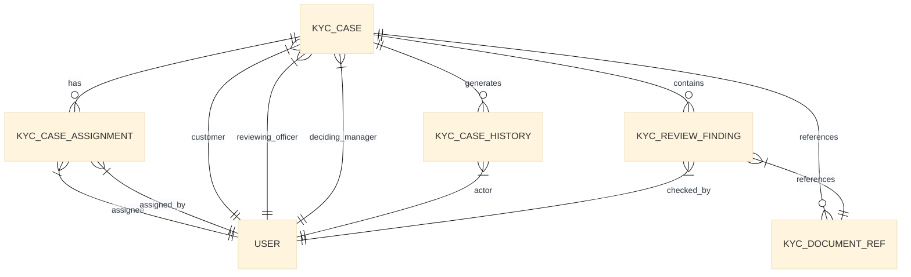
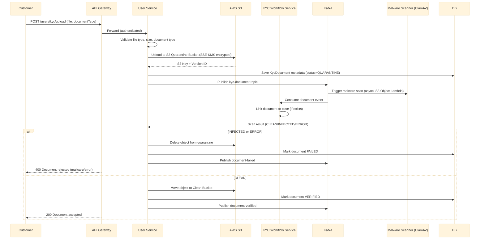

# CitiCore Banking Platform - KYC Architecture Documentation

## Document Information

| Field | Value |
|-------|-------|
| **Document Title** | CitiCore KYC Architecture - Maker-Checker Workflow |
| **Version** | 2.0 |
| **Status** | Draft for Review |
| **Classification** | Internal - Confidential |
| **Author** | Architecture Team |
| **Reviewers** | Engineering Lead, Security Lead, Compliance Officer, KYC Operations Lead |
| **Last Updated** | 2026-11-18 |

---

## Table of Contents

1. [Overview](#1-overview)
2. [Business Roles & Responsibilities](#2-business-roles--responsibilities)
3. [KYC Lifecycle & State Model](#3-kyc-lifecycle--state-model)
4. [State Transitions & Authorization](#4-state-transitions--authorization)
5. [Separation of Duties Enforcement](#5-separation-of-duties-enforcement)
6. [KYC Workflow Service Architecture](#6-kyc-workflow-service-architecture)
7. [Data Model](#7-data-model)
8. [Event-Driven Communication](#8-event-driven-communication)
9. [Document Management & Security](#9-document-management--security)
10. [Audit Trail](#10-audit-trail)
11. [SLA & Escalation](#11-sla--escalation)
12. [Integration Points](#12-integration-points)
13. [Security & Compliance](#13-security--compliance)
14. [Operational Procedures](#14-operational-procedures)

---

## 1. Overview

### 1.1 Purpose
This document defines the complete KYC (Know Your Customer) architecture for the CitiCore Banking Platform, including the maker-checker workflow, state machine, data model, security controls, and integration points.

### 1.2 Scope
- **In Scope**: Customer KYC submission, officer review, manager approval, case management, audit trail, document management, notifications, malware scanning, mock KYC verification provider
- **Out of Scope**: External KYC vendor integrations (Jumio, Onfido) - interface defined only, sanctions/PEP screening (Compliance Service), identity verification APIs

### 1.3 Key Principles
| Principle | Implementation |
|-----------|----------------|
| **Maker-Checker** | Officer reviews & recommends; Manager approves/rejects; Officer ≠ Manager |
| **Complete Traceability** | Every transition logged with actor, role, timestamp, reason |
| **Data Isolation** | Officers see only assigned cases; Managers see only authorized cases |
| **Regulatory Compliance** | Meets PMLA, RBI KYC Master Direction, FATF recommendations |
| **SLA-Driven** | Case deadlines, breach alerts, automatic escalation |
| **Audit First** | Immutable audit trail for every action |
| **Security by Default** | Malware scanning on all uploads; quarantine until clean; fail-closed |
| **Vendor Abstraction** | Mock provider initially; pluggable interface for future real vendors |

---

## 2. Business Roles & Responsibilities

### 2.1 Customer
| Responsibility | Description | System Action |
|----------------|-------------|---------------|
| **Register & Submit KYC** | Complete profile, upload documents, submit application | `POST /users/kyc/submit` |
| **Upload Documents** | Identity (PAN, Aadhaar, Passport) + Address (Utility Bill, Bank Statement) | `POST /users/kyc/upload` |
| **View Status** | Track application progress | `GET /kyc/cases/{caseId}` |
| **Respond to Info Requests** | Provide additional documents/info when requested | `POST /kyc/cases/{caseId}/resubmit` |
| **View Decision** | See approval/rejection with reasons | `GET /kyc/cases/{caseId}` |

### 2.2 KYC Officer (Maker)
| Responsibility | Description | System Action |
|----------------|-------------|---------------|
| **Access Assigned Cases** | View only cases assigned to them | `GET /kyc/cases/assigned` |
| **Review Customer Info** | Profile, documents, risk indicators | `GET /kyc/cases/{caseId}` |
| **Perform Verification Checks** | Document authenticity, OCR match, face match, sanctions screening | `POST /kyc/cases/{caseId}/findings` |
| **Record Findings** | Per-document verification status + remarks | `POST /kyc/cases/{caseId}/findings` |
| **Request Additional Info** | Ask customer for missing/clarification documents | `POST /kyc/cases/{caseId}/request-info` |
| **Recommend Decision** | Approve or Reject with justification | `POST /kyc/cases/{caseId}/recommend` |
| **Constraint** | **CANNOT approve own recommendation** | Enforced by workflow engine |

### 2.3 KYC Manager (Checker)
| Responsibility | Description | System Action |
|----------------|-------------|---------------|
| **View Authorized Cases** | Cases ready for decision (not own reviews) | `GET /kyc/cases/pending-approval` |
| **Review Officer Findings** | Complete review package with all findings | `GET /kyc/cases/{caseId}/review` |
| **Approve Application** | Final approval with reason | `POST /kyc/cases/{caseId}/approve` |
| **Reject Application** | Final rejection with permitted reasons | `POST /kyc/cases/{caseId}/reject` |
| **Return for Review** | Send back to officer for more work | `POST /kyc/cases/{caseId}/return` |
| **Escalate** | Forward to compliance for exceptional cases | `POST /kyc/cases/{caseId}/escalate` |
| **Assign Cases** | Distribute workload to officers | `POST /kyc/cases/{caseId}/assign` |
| **Constraint** | **CANNOT decide on cases they reviewed** | Enforced by workflow engine |

### 2.4 Compliance Officer
| Responsibility | Description | System Action |
|----------------|-------------|---------------|
| **Full KYC Audit Access** | All cases, all history, all findings | `GET /kyc/audit/**` |
| **Resolve Escalations** | Review and resolve escalated cases | `POST /kyc/cases/{caseId}/resolve-escalation` |
| **Regulatory Reporting** | Generate KYC compliance reports | `GET /kyc/reports/compliance` |
| **Policy Configuration** | Define verification rules, SLA, permitted rejection reasons | Admin config |

### 2.5 KYC Vendor Integration (Mock Provider)
| Aspect | Detail |
|--------|--------|
| **Interface** | `KycVerificationProvider` with `verify(identityDocuments)` method |
| **Initial Implementation** | Mock provider returning deterministic responses for testing |
| **Future** | Pluggable adapter for real vendors (Jumio, Onfido, etc.) |
| **Test Data** | Synthetic PAN/Aadhaar patterns only; no real identity data |
| **Configuration** | Provider selection via Spring profiles (`mock`, `jumio`, `onfido`) |
| **India Market** | PAN Card + Aadhaar Card primary documents; face match with selfie |
| **Mock Behavior** | Returns `VERIFIED` for valid synthetic patterns; `FAILED` for invalid; deterministic per test case |
| **Future Real Provider** | Separate authorization, consent, security, legal/regulatory review required |

---

## 3. KYC Lifecycle & State Model

### 3.1 Complete State Diagram



### 3.2 State Definitions

| State | Code | Description | Who Can Enter | Next Possible States |
|-------|------|-------------|---------------|---------------------|
| **DRAFT** | `DRAFT` | Customer filling application, not yet submitted | CUSTOMER | `SUBMITTED` |
| **SUBMITTED** | `SUBMITTED` | Application submitted, awaiting assignment | CUSTOMER (submit) | `PENDING_REVIEW` |
| **PENDING_REVIEW** | `PENDING_REVIEW` | Case created, officer assigned, review not started | SYSTEM (auto-assign) / KYC_MANAGER | `UNDER_REVIEW` |
| **UNDER_REVIEW** | `UNDER_REVIEW` | Officer actively reviewing case | KYC_OFFICER (claim/start) | `MORE_INFO_REQUIRED`, `RECOMMENDED_APPROVAL`, `RECOMMENDED_REJECTION` |
| **MORE_INFO_REQUIRED** | `MORE_INFO_REQUIRED` | Officer needs additional documents/info from customer | KYC_OFFICER | `RESUBMITTED` |
| **RESUBMITTED** | `RESUBMITTED` | Customer provided requested info, awaiting re-review | CUSTOMER | `UNDER_REVIEW` |
| **RECOMMENDED_APPROVAL** | `RECOMMENDED_APPROVAL` | Officer recommends approval | KYC_OFFICER | `PENDING_MANAGER_APPROVAL` |
| **RECOMMENDED_REJECTION** | `RECOMMENDED_REJECTION` | Officer recommends rejection | KYC_OFFICER | `PENDING_MANAGER_APPROVAL` |
| **PENDING_MANAGER_APPROVAL** | `PENDING_MANAGER_APPROVAL` | Awaiting Manager decision | SYSTEM (auto-forward) | `APPROVED`, `REJECTED`, `UNDER_REVIEW`, `ESCALATED` |
| **APPROVED** | `APPROVED` | KYC approved - customer can open accounts | KYC_MANAGER | Terminal |
| **REJECTED** | `REJECTED` | KYC rejected - customer can reapply | KYC_MANAGER | Terminal |
| **ESCALATED** | `ESCALATED` | Exceptional case escalated to compliance | KYC_MANAGER | `UNDER_REVIEW` (after resolution) |

### 3.3 State Metadata

```java
public enum KycCaseStatus {
    DRAFT("Draft", "Customer drafting application", false, false),
    SUBMITTED("Submitted", "Application submitted", false, false),
    PENDING_REVIEW("Pending Review", "Awaiting officer assignment", false, false),
    UNDER_REVIEW("Under Review", "Officer reviewing case", true, false),
    MORE_INFO_REQUIRED("More Info Required", "Customer action needed", true, true),
    RESUBMITTED("Resubmitted", "Customer responded, awaiting re-review", false, false),
    RECOMMENDED_APPROVAL("Recommended Approval", "Officer recommends approve", false, false),
    RECOMMENDED_REJECTION("Recommended Rejection", "Officer recommends reject", false, false),
    PENDING_MANAGER_APPROVAL("Pending Manager Approval", "Awaiting manager decision", false, false),
    APPROVED("Approved", "KYC approved", false, true),
    REJECTED("Rejected", "KYC rejected", false, true),
    ESCALATED("Escalated", "Escalated to compliance", true, false);
    
    private final String displayName;
    private final String description;
    private final boolean isActive; // Requires action
    private final boolean isTerminal; // Final state
}
```

---

## 4. State Transitions & Authorization

### 4.1 Transition Matrix

| From State | To State | Trigger Action | Authorized Role | Preconditions | Post-Actions |
|------------|----------|----------------|-----------------|---------------|--------------|
| `DRAFT` | `SUBMITTED` | Customer submits | CUSTOMER (owner) | All required docs uploaded | Create KycCase, publish `kyc-submission-topic`, assign SLA |
| `SUBMITTED` | `PENDING_REVIEW` | Auto-assignment | SYSTEM | Officer available | Create KycCaseAssignment, notify officer |
| `SUBMITTED` | `PENDING_REVIEW` | Manual assign | KYC_MANAGER | Manager has `KYC_CASE_ASSIGN` | Create KycCaseAssignment, notify officer |
| `PENDING_REVIEW` | `UNDER_REVIEW` | Officer starts review | KYC_OFFICER (assigned) | Case assigned to officer | Update assignment.acknowledgedAt, set SLA deadline |
| `UNDER_REVIEW` | `MORE_INFO_REQUIRED` | Request info | KYC_OFFICER (assigned) | Specific docs/info identified | Record requested items, notify customer |
| `MORE_INFO_REQUIRED` | `RESUBMITTED` | Customer responds | CUSTOMER (owner) | All requested items provided | Reset to officer for re-review |
| `RESUBMITTED` | `UNDER_REVIEW` | Auto-transition | SYSTEM | Customer resubmitted | Notify officer |
| `UNDER_REVIEW` | `RECOMMENDED_APPROVAL` | Recommend approve | KYC_OFFICER (assigned) | All checks passed, findings recorded | Set recommendation=APPROVE, forward to manager |
| `UNDER_REVIEW` | `RECOMMENDED_REJECTION` | Recommend reject | KYC_OFFICER (assigned) | Deficiency found, findings recorded | Set recommendation=REJECT, forward to manager |
| `RECOMMENDED_APPROVAL` | `PENDING_MANAGER_APPROVAL` | Auto-forward | SYSTEM | Recommendation recorded | Notify authorized managers |
| `RECOMMENDED_REJECTION` | `PENDING_MANAGER_APPROVAL` | Auto-forward | SYSTEM | Recommendation recorded | Notify authorized managers |
| `PENDING_MANAGER_APPROVAL` | `APPROVED` | Manager approves | KYC_MANAGER (authorized, ≠ reviewer) | Reviews findings, records reason | Set status=APPROVED, publish KYC_APPROVED event |
| `PENDING_MANAGER_APPROVAL` | `REJECTED` | Manager rejects | KYC_MANAGER (authorized, ≠ reviewer) | Records rejection reason | Set status=REJECTED, publish KYC_REJECTED event |
| `PENDING_MANAGER_APPROVAL` | `UNDER_REVIEW` | Manager returns | KYC_MANAGER (authorized) | Incomplete, needs more work | Set status=UNDER_REVIEW, notify officer |
| `PENDING_MANAGER_APPROVAL` | `ESCALATED` | Manager escalates | KYC_MANAGER (authorized) | Exceptional case | Set status=ESCALATED, notify compliance |
| `ESCALATED` | `UNDER_REVIEW` | Compliance resolves | COMPLIANCE_OFFICER | Escalation resolved | Set status=UNDER_REVIEW, notify officer |

### 4.2 Transition Validation Rules

```java
public class KycCaseStateMachine {
    
    public boolean canTransition(KycCaseStatus from, KycCaseStatus to, 
                                  Set<String> actorRoles, Long actorId, KycCase kycCase) {
        
        // Terminal states cannot transition
        if (from.isTerminal()) return false;
        
        // Role-based transition rules
        return switch (from) {
            case DRAFT -> to == SUBMITTED && actorRoles.contains("ROLE_CUSTOMER") 
                && kycCase.getAuthUserId().equals(actorId);
            
            case SUBMITTED -> to == PENDING_REVIEW 
                && (actorRoles.contains("ROLE_SYSTEM") || actorRoles.contains("ROLE_KYC_MANAGER"));
            
            case PENDING_REVIEW -> to == UNDER_REVIEW 
                && actorRoles.contains("ROLE_KYC_OFFICER")
                && kycCase.getAssignedOfficerId().equals(actorId);
            
            case UNDER_REVIEW -> {
                if (actorRoles.contains("ROLE_KYC_OFFICER") 
                    && !kycCase.getAssignedOfficerId().equals(actorId)) {
                    yield false; // Only assigned officer
                }
                yield switch (to) {
                    case MORE_INFO_REQUIRED -> true; // Officer requests info
                    case RECOMMENDED_APPROVAL, RECOMMENDED_REJECTION -> 
                        hasCompleteFindings(kycCase); // All checks done
                    default -> false;
                };
            }
            
            case MORE_INFO_REQUIRED -> to == RESUBMITTED 
                && actorRoles.contains("ROLE_CUSTOMER")
                && kycCase.getAuthUserId().equals(actorId)
                && hasProvidedAllRequestedInfo(kycCase, actorId);
            
            case RESUBMITTED -> to == UNDER_REVIEW; // Auto
            
            case RECOMMENDED_APPROVAL, RECOMMENDED_REJECTION -> 
                to == PENDING_MANAGER_APPROVAL; // Auto-forward
            
            case PENDING_MANAGER_APPROVAL -> {
                if (!actorRoles.contains("ROLE_KYC_MANAGER")) yield false;
                if (!kycCase.isAuthorizedForManager(actorId)) yield false;
                // SEPARATION OF DUTIES - CRITICAL
                if (kycCase.getReviewingOfficerId() != null 
                    && kycCase.getReviewingOfficerId().equals(actorId)) {
                    yield false; // Cannot decide on own review
                }
                yield switch (to) {
                    case APPROVED, REJECTED -> hasValidDecisionReason(kycCase, to);
                    case UNDER_REVIEW -> hasReturnReason(kycCase);
                    case ESCALATED -> hasEscalationReason(kycCase);
                    default -> false;
                };
            }
            
            case ESCALATED -> to == UNDER_REVIEW 
                && actorRoles.contains("ROLE_COMPLIANCE_OFFICER");
            
            default -> false;
        };
    }
}
```

---

## 5. Separation of Duties Enforcement

### 5.1 SoD Rules

| Rule | Description | Enforcement Point |
|------|-------------|-------------------|
| **Officer ≠ Manager** | The officer who reviews/recommends cannot be the manager who approves/rejects | KYC Workflow Service: `approve()`, `reject()`, `return()` methods |
| **No Self-Assignment** | Officer cannot assign cases to themselves | KYC Workflow Service: `assign()` method |
| **Manager Authorization** | Manager must be explicitly authorized for the case | Case authorization matrix |
| **Compliance Independence** | Compliance officer resolving escalation cannot be involved in original review | Escalation resolution logic |

### 5.2 SoD Enforcement Flow



### 5.3 SoD Violation Handling

```java
@Service
public class SeparationOfDutiesService {
    
    public void validateManagerDecision(Long caseId, Long managerId, String action) {
        KycCase kycCase = caseRepository.findByCaseNumber(caseId)
            .orElseThrow(() -> new KycCaseNotFoundException(caseId));
        
        Long reviewingOfficerId = kycCase.getReviewingOfficerId();
        
        if (reviewingOfficerId != null && reviewingOfficerId.equals(managerId)) {
            // LOG VIOLATION
            auditLogService.logSecurityEvent(SecurityEvent.builder()
                .eventType("SEPARATION_OF_DUTIES_VIOLATION")
                .actorId(managerId)
                .resourceType("KYC_CASE")
                .resourceId(caseId)
                .action(action)
                .details("Manager attempted to " + action + " case they reviewed")
                .severity(CRITICAL)
                .build());
            
            // ALERT
            alertService.sendAlert(Alert.builder()
                .type("SOD_VIOLATION")
                .title("KYC SoD Violation Attempt")
                .message("Manager " + managerId + " attempted to " + action + " case " + caseId + " which they reviewed")
                .recipients(securityTeamEmails)
                .build());
            
            throw new SeparationOfDutiesViolationException(
                "Manager cannot " + action + " a case they personally reviewed. " +
                "Case was reviewed by Officer ID: " + reviewingOfficerId);
        }
        
        // Additional check: manager must be authorized for this case
        if (!kycCase.isAuthorizedForManager(managerId)) {
            throw new AccessDeniedException("Manager not authorized for this case");
        }
    }
}
```

---

## 6. KYC Workflow Service Architecture

### 6.1 Service Overview

| Aspect | Detail |
|--------|--------|
| **Service Name** | kyc-workflow-service |
| **Port** | 8087 |
| **Database** | `citicore_kycdb` |
| **Framework** | Spring Boot 3.2.4, Java 17 |
| **Key Patterns** | State Machine, Event Sourcing (audit), CQRS (read models) |

### 6.2 Component Diagram



### 6.3 Key Domain Services

#### 6.3.1 KycCaseAggregate (Root Entity)
```java
@Entity
@Table(name = "kyc_cases")
public class KycCase {
    @Id
    @GeneratedValue(strategy = GenerationType.IDENTITY)
    private Long id;
    
    @Column(name = "case_number", unique = true, nullable = false)
    private String caseNumber; // KYC-YYYYMMDD-XXXX
    
    @Column(name = "auth_user_id", nullable = false)
    private Long authUserId; // Customer
    
    @Enumerated(EnumType.STRING)
    @Column(name = "status", nullable = false)
    private KycCaseStatus status;
    
    @Column(name = "assigned_officer_id")
    private Long assignedOfficerId;
    
    @Column(name = "reviewing_officer_id")
    private Long reviewingOfficerId;
    
    @Column(name = "deciding_manager_id")
    private Long decidingManagerId;
    
    @Column(name = "authorized_manager_id")
    private Long authorizedManagerId;
    
    @Enumerated(EnumType.STRING)
    @Column(name = "recommendation")
    private KycRecommendation recommendation; // APPROVE, REJECT
    
    @Column(name = "rejection_reason")
    private String rejectionReason;
    
    @Column(name = "escalation_reason")
    private String escalationReason;
    
    @Column(name = "sla_deadline")
    private LocalDateTime slaDeadline;
    
    @Column(name = "created_at", nullable = false)
    private LocalDateTime createdAt;
    
    @Column(name = "updated_at", nullable = false)
    private LocalDateTime updatedAt;
    
    @Column(name = "completed_at")
    private LocalDateTime completedAt;
    
    // Business methods
    public void startReview(Long officerId) { ... }
    public void recordFindings(List<KycReviewFinding> findings) { ... }
    public void requestInfo(InfoRequest request) { ... }
    public void recommend(KycRecommendation rec, String remarks) { ... }
    public void approve(Long managerId, String reason) { ... }
    public void reject(Long managerId, String reason) { ... }
    public void returnToOfficer(Long managerId, String reason) { ... }
    public void escalate(Long managerId, String reason) { ... }
}
```

#### 6.3.2 CaseAssignmentService
```java
@Service
@RequiredArgsConstructor
public class CaseAssignmentService {
    
    private final KycCaseAssignmentRepository assignmentRepository;
    private final KycCaseRepository caseRepository;
    private final UserClient userClient;
    private final RedisTemplate<String, Object> redisTemplate;
    private final EventPublisher eventPublisher;
    
    @Transactional
    public KycCaseAssignment assignCase(String caseNumber, Long officerId, Long assignedById, AssignmentType type) {
        // 1. Validate officer has KYC_OFFICER role
        UserPrincipal officer = userClient.getUser(officerId);
        if (!officer.hasRole("ROLE_KYC_OFFICER")) {
            throw new InvalidAssignmentException("User is not a KYC Officer");
        }
        
        // 2. Validate assigner has permission
        UserPrincipal assigner = userClient.getUser(assignedById);
        if (!assigner.hasPermission("KYC_CASE_ASSIGN")) {
            throw new AccessDeniedException("Not authorized to assign cases");
        }
        
        // 3. Get case
        KycCase kycCase = caseRepository.findByCaseNumber(caseNumber)
            .orElseThrow(() -> new KycCaseNotFoundException(caseNumber));
        
        // 4. Create assignment
        KycCaseAssignment assignment = KycCaseAssignment.builder()
            .caseId(kycCase.getId())
            .assigneeId(officerId)
            .assignedById(assignedById)
            .type(type)
            .assignedAt(LocalDateTime.now())
            .build();
        
        assignmentRepository.save(assignment);
        
        // 5. Update case
        kycCase.setAssignedOfficerId(officerId);
        kycCase.setStatus(KycCaseStatus.PENDING_REVIEW);
        kycCase.setSlaDeadline(calculateSlaDeadline());
        caseRepository.save(kycCase);
        
        // 6. Invalidate cache
        invalidateAssignmentCache(kycCase.getId());
        
        // 7. Publish event
        eventPublisher.publishCaseAssigned(kycCase, officerId, assignedById);
        
        return assignment;
    }
    
    @Transactional
    public void autoAssignPendingCases() {
        List<KycCase> pendingCases = caseRepository.findByStatus(KycCaseStatus.SUBMITTED);
        List<Long> availableOfficers = userClient.getOfficersWithCapacity();
        
        for (int i = 0; i < pendingCases.size(); i++) {
            Long officerId = availableOfficers.get(i % availableOfficers.size());
            assignCase(pendingCases.get(i).getCaseNumber(), officerId, SYSTEM_USER_ID, AssignmentType.AUTO);
        }
    }
}
```

#### 6.3.3 SlaMonitoringService
```java
@Service
@RequiredArgsConstructor
public class SlaMonitoringService {
    
    private final KycCaseRepository caseRepository;
    private final EventPublisher eventPublisher;
    private final AlertService alertService;
    
    @Scheduled(fixedRate = 300000) // Every 5 minutes
    @Transactional
    public void checkSlaBreaches() {
        List<KycCase> activeCases = caseRepository.findActiveCasesWithSla();
        
        for (KycCase kycCase : activeCases) {
            if (kycCase.getSlaDeadline().isBefore(LocalDateTime.now())) {
                handleSlaBreach(kycCase);
            } else if (kycCase.getSlaDeadline().minusHours(2).isBefore(LocalDateTime.now())) {
                sendSlaWarning(kycCase);
            }
        }
    }
    
    private void handleSlaBreach(KycCase kycCase) {
        // 1. Log breach
        auditLogService.log("SLA_BREACH", kycCase.getId(), 
            "Case " + kycCase.getCaseNumber() + " breached SLA");
        
        // 2. Alert manager
        alertService.sendAlert(Alert.builder()
            .type("SLA_BREACH")
            .title("KYC Case SLA Breached")
            .message("Case " + kycCase.getCaseNumber() + " overdue")
            .recipients(List.of(kycCase.getAuthorizedManagerId()))
            .build());
        
        // 3. Auto-escalate if configured
        if (kycCase.getStatus() == KycCaseStatus.UNDER_REVIEW) {
            // Reassign to another officer
            reassignCase(kycCase);
        }
    }
}
```

---

## 7. Data Model

### 7.1 Entity Relationship Diagram



### 7.2 Table Definitions

#### 7.2.1 kyc_cases
```sql
CREATE TABLE kyc_cases (
    id BIGINT PRIMARY KEY AUTO_INCREMENT,
    case_number VARCHAR(50) UNIQUE NOT NULL, -- KYC-YYYYMMDD-XXXX
    auth_user_id BIGINT NOT NULL, -- Customer
    status VARCHAR(30) NOT NULL, -- DRAFT, SUBMITTED, PENDING_REVIEW, etc.
    assigned_officer_id BIGINT NULL,
    reviewing_officer_id BIGINT NULL,
    deciding_manager_id BIGINT NULL,
    authorized_manager_id BIGINT NULL,
    recommendation VARCHAR(20) NULL, -- APPROVE, REJECT
    rejection_reason VARCHAR(500) NULL,
    escalation_reason VARCHAR(500) NULL,
    sla_deadline DATETIME NULL,
    created_at DATETIME NOT NULL DEFAULT CURRENT_TIMESTAMP,
    updated_at DATETIME NOT NULL DEFAULT CURRENT_TIMESTAMP ON UPDATE CURRENT_TIMESTAMP,
    completed_at DATETIME NULL,
    
    INDEX idx_customer (auth_user_id),
    INDEX idx_status (status),
    INDEX idx_assigned_officer (assigned_officer_id),
    INDEX idx_authorized_manager (authorized_manager_id),
    INDEX idx_sla_deadline (sla_deadline),
    INDEX idx_created_at (created_at)
);
```

#### 7.2.2 kyc_case_assignments
```sql
CREATE TABLE kyc_case_assignments (
    id BIGINT PRIMARY KEY AUTO_INCREMENT,
    case_id BIGINT NOT NULL,
    assignee_id BIGINT NOT NULL, -- KYC_OFFICER
    assigned_by_id BIGINT NOT NULL, -- KYC_MANAGER or SYSTEM
    assignment_type VARCHAR(20) NOT NULL, -- INITIAL, REASSIGN, ESCALATION
    assigned_at DATETIME NOT NULL DEFAULT CURRENT_TIMESTAMP,
    acknowledged_at DATETIME NULL,
    completed_at DATETIME NULL,
    
    FOREIGN KEY (case_id) REFERENCES kyc_cases(id),
    INDEX idx_case (case_id),
    INDEX idx_assignee (assignee_id),
    INDEX idx_assigned_by (assigned_by_id)
);
```

#### 7.2.3 kyc_case_history (Audit Trail)
```sql
CREATE TABLE kyc_case_history (
    id BIGINT PRIMARY KEY AUTO_INCREMENT,
    case_id BIGINT NOT NULL,
    actor_id BIGINT NOT NULL,
    actor_role VARCHAR(30) NOT NULL, -- CUSTOMER, KYC_OFFICER, KYC_MANAGER, etc.
    action VARCHAR(30) NOT NULL, -- SUBMITTED, ASSIGNED, REVIEWED, RECOMMENDED, APPROVED, REJECTED, RETURNED, ESCALATED, INFO_REQUESTED, RESUBMITTED
    previous_status VARCHAR(30) NOT NULL,
    new_status VARCHAR(30) NOT NULL,
    reason TEXT NULL,
    metadata JSON NULL, -- Additional context
    timestamp DATETIME NOT NULL DEFAULT CURRENT_TIMESTAMP,
    
    FOREIGN KEY (case_id) REFERENCES kyc_cases(id),
    INDEX idx_case (case_id),
    INDEX idx_actor (actor_id),
    INDEX idx_timestamp (timestamp),
    INDEX idx_action (action)
);
```

#### 7.2.4 kyc_review_findings
```sql
CREATE TABLE kyc_review_findings (
    id BIGINT PRIMARY KEY AUTO_INCREMENT,
    case_id BIGINT NOT NULL,
    document_type VARCHAR(30) NOT NULL, -- PAN_CARD, AADHAAR, PASSPORT, UTILITY_BILL, etc.
    document_ref_id BIGINT NULL,
    verification_status VARCHAR(20) NOT NULL, -- VERIFIED, FAILED, PENDING_MANUAL, NOT_PROVIDED
    remarks TEXT NULL,
    checked_by_id BIGINT NOT NULL,
    checked_at DATETIME NOT NULL DEFAULT CURRENT_TIMESTAMP,
    ocr_confidence DECIMAL(5,2) NULL,
    face_match_score DECIMAL(5,2) NULL,
    
    FOREIGN KEY (case_id) REFERENCES kyc_cases(id),
    FOREIGN KEY (document_ref_id) REFERENCES kyc_document_refs(id),
    INDEX idx_case (case_id),
    INDEX idx_document_type (document_type),
    INDEX idx_status (verification_status)
);
```

#### 7.2.5 kyc_document_refs
```sql
CREATE TABLE kyc_document_refs (
    id BIGINT PRIMARY KEY AUTO_INCREMENT,
    case_id BIGINT NOT NULL,
    auth_user_id BIGINT NOT NULL,
    document_type VARCHAR(30) NOT NULL,
    s3_key VARCHAR(500) NOT NULL,
    file_name VARCHAR(255) NOT NULL,
    content_type VARCHAR(100) NOT NULL,
    file_size BIGINT NOT NULL,
    uploaded_at DATETIME NOT NULL DEFAULT CURRENT_TIMESTAMP,
    uploaded_by BIGINT NOT NULL,
    
    FOREIGN KEY (case_id) REFERENCES kyc_cases(id),
    INDEX idx_case (case_id),
    INDEX idx_customer (auth_user_id)
);
```

---

## 8. Event-Driven Communication

### 8.1 KYC Events Published

| Event Type | Topic | Key | Consumers | Purpose |
|------------|-------|-----|-----------|---------|
| `KYC_CASE_CREATED` | `kyc-case-topic` | caseId | Notification, Compliance | New case created |
| `KYC_CASE_ASSIGNED` | `kyc-case-topic` | caseId | Notification | Officer assigned |
| `KYC_CASE_REVIEWED` | `kyc-case-topic` | caseId | Notification, Compliance | Review completed |
| `KYC_CASE_RECOMMENDED` | `kyc-case-topic` | caseId | Notification, Compliance | Recommendation made |
| `KYC_CASE_APPROVED` | `kyc-case-topic` | caseId | Notification, Account Service, Compliance | Final approval |
| `KYC_CASE_REJECTED` | `kyc-case-topic` | caseId | Notification, Compliance | Final rejection |
| `KYC_CASE_RETURNED` | `kyc-case-topic` | caseId | Notification, Compliance | Returned for review |
| `KYC_CASE_ESCALATED` | `kyc-case-topic` | caseId | Notification, Compliance | Escalated |
| `KYC_INFO_REQUESTED` | `kyc-notification-topic` | caseId | Notification | Customer action needed |
| `KYC_RESUBMITTED` | `kyc-case-topic` | caseId | Notification | Customer responded |

### 8.2 Event Payloads

```json
// KycCaseEvent (kyc-case-topic)
{
  "eventId": "uuid",
  "caseId": "KYC-20261118-001",
  "caseNumber": "KYC-20261118-001",
  "authUserId": 12345,
  "eventType": "KYC_CASE_APPROVED",
  "previousStatus": "PENDING_MANAGER_APPROVAL",
  "newStatus": "APPROVED",
  "actorId": 54321,
  "actorRole": "KYC_MANAGER",
  "recommendation": "APPROVE",
  "findings": [
    {"documentType": "PAN_CARD", "status": "VERIFIED", "remarks": "Valid PAN"},
    {"documentType": "AADHAAR", "status": "VERIFIED", "remarks": "OCR matched, face match 98%"}
  ],
  "rejectionReason": null,
  "requestedInfo": null,
  "processingTimeMs": 125000,
  "timestamp": "2026-11-18T10:30:00Z"
}
```

```json
// KycNotificationEvent (kyc-notification-topic)
{
  "eventId": "uuid",
  "caseId": "KYC-20261118-001",
  "recipientUserId": 12345,
  "recipientRole": "CUSTOMER",
  "notificationType": "CASE_STATUS_CHANGE",
  "title": "KYC Application Approved",
  "message": "Your KYC application has been approved. You can now open a bank account.",
  "actionRequired": false,
  "actionUrl": "/kyc/status/KYC-20261118-001",
  "timestamp": "2026-11-18T10:30:00Z"
}
```

```json
// KycInfoRequestedEvent (kyc-notification-topic)
{
  "eventId": "uuid",
  "caseId": "KYC-20261118-001",
  "recipientUserId": 12345,
  "recipientRole": "CUSTOMER",
  "notificationType": "INFO_REQUESTED",
  "title": "Additional Information Required",
  "message": "The KYC officer has requested additional documents: [Utility Bill (recent)]",
  "actionRequired": true,
  "actionUrl": "/kyc/cases/KYC-20261118-001/respond",
  "requestedItems": [
    {"documentType": "UTILITY_BILL", "reason": "Address proof older than 3 months", "mandatory": true}
  ],
  "deadline": "2026-11-25T10:30:00Z",
  "timestamp": "2026-11-18T10:30:00Z"
}
```

### 8.3 Events Consumed

| Event | Topic | Source | Handler | Action |
|-------|-------|--------|---------|--------|
| `kyc-submission-topic` | User Service | `KycSubmissionConsumer` | Create KycCase, auto-assign |
| `kyc-document-topic` | User Service | `KycDocumentConsumer` | Link document to case |
| `user-created-topic` | Auth Service | `UserCreatedConsumer` | Initialize customer KYC profile |

---

## 9. Document Management & Security

### 9.1 Document Types

| Type | Code | Description | Required | Max Size | Retention |
|------|------|-------------|----------|----------|-----------|
| PAN Card | `PAN_CARD` | Permanent Account Number | Yes | 10 MB | 7 years |
| Aadhaar Card | `AADHAAR` | UIDAI Aadhaar (masked) | Yes | 10 MB | 7 years |
| Passport | `PASSPORT` | Valid passport | No | 10 MB | 7 years |
| Voter ID | `VOTER_ID` | Election commission ID | No | 10 MB | 7 years |
| Driving License | `DRIVING_LICENSE` | Valid DL | No | 10 MB | 7 years |
| Utility Bill | `UTILITY_BILL` | Electricity/Water/Gas (≤3 months) | Yes | 10 MB | 7 years |
| Bank Statement | `BANK_STATEMENT` | Recent bank statement (≤3 months) | No | 10 MB | 7 years |
| Selfie | `SELFIE` | Live photo for face match | Yes | 5 MB | 7 years |

### 9.2 Document Upload Flow



### 9.3 Document Access Control

| Access | Customer | KYC_OFFICER (Assigned) | KYC_MANAGER (Authorized) | SUPPORT | OPERATIONS | COMPLIANCE | ADMIN |
|--------|:--------:|:----------------------:|:------------------------:|:-------:|:----------:|:----------:|:-----:|
| **View Metadata** | ✅ Own | ✅ Assigned | ✅ Authorized | ✅ All | ✅ All | ✅ All | ✅ All |
| **Download Document** | ✅ Own | ✅ Assigned | ✅ Authorized | ❌ | ✅ All | ✅ All | ✅ All |
| **Upload Document** | ✅ Own | ❌ | ❌ | ❌ | ❌ | ❌ | ✅ |
| **Delete Document** | ❌ | ❌ | ❌ | ❌ | ❌ | ❌ | ✅ |
| **Pre-signed URL TTL** | 15 min | 15 min | 15 min | N/A | 15 min | 15 min | 15 min |

### 9.4 Security Controls

1. **Encryption at Rest**: S3 SSE-KMS (AWS managed keys with automatic rotation)
2. **Encryption in Transit**: TLS 1.2+ for all S3 API calls
3. **Access via Pre-signed URLs**: 15-minute expiry, single-use tokens
4. **Malware Scanning**: S3 Object Lambda + ClamAV on every upload; quarantine until clean; fail-closed on scanner unavailable
5. **Audit Logging**: Every document access logged in `KycCaseHistory`
6. **No Direct S3 Access**: All access mediated through KYC Workflow Service
7. **Aadhaar Masking**: Aadhaar numbers masked in storage and display (last 4 digits only)

---

## 10. Audit Trail

### 10.1 Audited Events

| Event | Actor | Details Captured |
|-------|-------|------------------|
| Case Created | SYSTEM | caseNumber, customerId, initialStatus |
| Case Assigned | KYC_MANAGER/SYSTEM | caseId, officerId, assignedBy, type |
| Review Started | KYC_OFFICER | caseId, officerId, timestamp |
| Findings Recorded | KYC_OFFICER | caseId, officerId, findings[], timestamp |
| Info Requested | KYC_OFFICER | caseId, officerId, requestedItems[], deadline |
| Customer Responded | CUSTOMER | caseId, customerId, providedItems[] |
| Recommendation Made | KYC_OFFICER | caseId, officerId, recommendation, remarks |
| Manager Decision | KYC_MANAGER | caseId, managerId, decision, reason, SoD check passed |
| Case Returned | KYC_MANAGER | caseId, managerId, returnReason |
| Case Escalated | KYC_MANAGER | caseId, managerId, escalationReason |
| Escalation Resolved | COMPLIANCE | caseId, complianceId, resolution |
| Document Accessed | ANY | caseId, actorId, documentId, action (VIEW/DOWNLOAD) |

### 10.2 Audit Log Integrity

```java
@Entity
@Table(name = "kyc_case_history")
public class KycCaseHistory {
    @Id
    @GeneratedValue(strategy = GenerationType.IDENTITY)
    private Long id;
    
    @Column(name = "case_id", nullable = false)
    private Long caseId;
    
    @Column(name = "actor_id", nullable = false)
    private Long actorId;
    
    @Column(name = "actor_role", nullable = false)
    private String actorRole;
    
    @Enumerated(EnumType.STRING)
    @Column(name = "action", nullable = false)
    private KycCaseAction action;
    
    @Enumerated(EnumType.STRING)
    @Column(name = "previous_status", nullable = false)
    private KycCaseStatus previousStatus;
    
    @Enumerated(EnumType.STRING)
    @Column(name = "new_status", nullable = false)
    private KycCaseStatus newStatus;
    
    @Column(name = "reason", columnDefinition = "TEXT")
    private String reason;
    
    @Column(name = "metadata", columnDefinition = "JSON")
    private String metadata;
    
    @Column(name = "timestamp", nullable = false)
    private LocalDateTime timestamp;
    
    // Integrity fields
    @Column(name = "previous_hash", length = 64)
    private String previousHash; // SHA-256 of previous record
    
    @Column(name = "record_hash", length = 64)
    private String recordHash; // SHA-256 of this record
}
```

### 10.3 Hash Chaining Verification

```java
@Service
public class AuditIntegrityService {
    
    public void verifyIntegrity() {
        List<KycCaseHistory> allRecords = historyRepository.findAllByOrderByTimestampAsc();
        String previousHash = "GENESIS";
        
        for (KycCaseHistory record : allRecords) {
            String computedPrevious = record.getPreviousHash();
            if (!previousHash.equals(computedPrevious)) {
                throw new AuditIntegrityException(
                    "Hash chain broken at record " + record.getId() + 
                    ". Expected: " + previousHash + ", Found: " + computedPrevious);
            }
            
            String computedRecord = computeHash(record);
            if (!record.getRecordHash().equals(computedRecord)) {
                throw new AuditIntegrityException(
                    "Record hash mismatch at " + record.getId());
            }
            
            previousHash = computedRecord;
        }
    }
    
    private String computeHash(KycCaseHistory record) {
        String input = record.getCaseId() + "|" + record.getActorId() + "|" + 
                      record.getAction() + "|" + record.getPreviousStatus() + "|" +
                      record.getNewStatus() + "|" + record.getReason() + "|" +
                      record.getMetadata() + "|" + record.getTimestamp() + "|" +
                      record.getPreviousHash();
        return DigestUtils.sha256Hex(input);
    }
}
```

---

## 11. SLA & Escalation

### 11.1 SLA Definitions

| Stage | SLA | Breach Action | Escalation |
|-------|-----|---------------|------------|
| Assignment | 1 hour | Auto-reassign | Alert Manager |
| First Review | 24 hours | Warning to Officer + Manager | Reassign |
| Info Request Response | 7 days (customer) | Reminder at 3 days, 1 day | Auto-close if no response |
| Re-review after Info | 24 hours | Warning to Officer | Reassign |
| Manager Decision | 48 hours | Warning to Manager | Escalate to Compliance |
| Escalation Resolution | 5 business days | Daily reminders | Senior Compliance Review |

### 11.2 Escalation Matrix

| Escalation Level | Trigger | Recipient | Action |
|------------------|---------|-----------|--------|
| **Level 1** | SLA Warning (2h before breach) | Officer + Manager | Email + In-app notification |
| **Level 2** | SLA Breached | Manager + Compliance | Auto-reassign + Alert |
| **Level 3** | Manager Decision Breach | Compliance Officer | Escalate to Compliance |
| **Level 4** | Compliance Resolution Breach | Head of Compliance | Senior Review |
| **Level 5** | Regulatory Deadline Risk | CRO + CEO | Executive Escalation |

---

## 12. Integration Points

### 12.1 User Service Integration

| Integration | Pattern | Details |
|-------------|---------|---------|
| **Customer Profile** | Feign (Sync) | `GET /api/v1/users/profile/{userId}` |
| **KYC Documents** | Feign (Sync) | `GET /api/v1/users/kyc/documents/{userId}` |
| **KYC Submission** | Kafka (Async) | `kyc-submission-topic` → Create case |
| **Document Upload** | Kafka (Async) | `kyc-document-topic` → Link document |

### 12.2 Auth Service Integration

| Integration | Pattern | Details |
|-------------|---------|---------|
| **User Roles** | Feign (Sync) | `GET /api/v1/auth/users/{userId}/roles` |
| **User Validation** | Feign (Sync) | `GET /api/v1/auth/users/{userId}` |

### 12.3 Account Service Integration

| Integration | Pattern | Details |
|-------------|---------|---------|
| **KYC Status Gate** | Kafka (Async) | `kyc-case-topic` (APPROVED) → Enable account creation |
| **KYC Status Check** | Feign (Sync) | `GET /api/v1/kyc/status/{userId}` |

### 12.4 Notification Service Integration

| Integration | Pattern | Details |
|-------------|---------|---------|
| **Customer Notifications** | Kafka (Async) | `kyc-notification-topic` |
| **Officer/Manager Notifications** | Kafka (Async) | `kyc-case-topic` |

### 12.5 Compliance Service Integration

| Integration | Pattern | Details |
|-------------|---------|---------|
| **Audit Trail** | Kafka (Async) | `kyc-case-topic` (all events) |
| **Escalations** | Kafka (Async) | `kyc-case-topic` (ESCALATED) |

---

## 13. Security & Compliance

### 13.1 Regulatory Alignment

| Regulation | Requirement | Implementation |
|------------|-------------|----------------|
| **PMLA 2002** | KYC for all customers | Mandatory KYC before account opening |
| **RBI Master Direction** | Risk-based KYC | Risk scoring, enhanced due diligence for high-risk |
| **FATF Recommendations** | CDD, Enhanced CDD | Document verification, PEP screening (Compliance Service) |
| **GDPR/PDPB** | Data protection, right to erasure | Encryption, access controls, retention policies |
| **SOX** | Audit trail integrity | Immutable audit log with hash chaining |

### 13.2 Data Protection

| Control | Implementation |
|---------|----------------|
| **Encryption at Rest** | MySQL TDE (planned), S3 SSE-KMS |
| **Encryption in Transit** | TLS 1.2+ for all service communication |
| **PII Minimization** | Only required fields stored; Aadhaar masked |
| **Access Logging** | Every document/data access logged |
| **Retention** | 7 years post-relationship end (regulatory) |
| **Deletion** | Secure deletion on regulatory request (right to erasure) |

### 13.3 Security Controls

| Control | Implementation |
|---------|----------------|
| **Authentication** | JWT + MFA for all staff roles |
| **Authorization** | RBAC + ABAC + SoD (Section 4, 5) |
| **Input Validation** | Bean Validation on all DTOs |
| **Rate Limiting** | API Gateway: 100 req/min per user |
| **Audit Logging** | All state transitions, decisions, access |
| **Vulnerability Scanning** | SAST/DAST in CI/CD |
| **Penetration Testing** | Annual third-party assessment |

---

## 14. Operational Procedures

### 14.1 Daily Operations

| Procedure | Frequency | Owner | Tools |
|-----------|-----------|-------|-------|
| **SLA Dashboard Review** | Daily 9 AM | KYC Manager | Grafana Dashboard |
| **Officer Workload Balancing** | Daily 10 AM | KYC Manager | Assignment API |
| **Breach Alert Review** | Real-time | KYC Manager + Compliance | AlertManager |
| **Audit Log Integrity Check** | Daily 2 AM | Compliance | AuditIntegrityService |
| **Document Scan Results** | Real-time | Security | ClamAV Dashboard |

### 14.2 Weekly Operations

| Procedure | Frequency | Owner | Tools |
|-----------|-----------|-------|-------|
| **KYC Metrics Review** | Weekly Monday | KYC Manager + Compliance | Business KPI Dashboard |
| **Officer Performance** | Weekly | KYC Manager | Case completion rates, quality scores |
| **Rejection Reason Analysis** | Weekly | Compliance | Rejection category reports |
| **Escalation Review** | Weekly | Head of Compliance | Escalation tracker |

### 14.3 Monthly Operations

| Procedure | Frequency | Owner | Tools |
|-----------|-----------|-------|-------|
| **Regulatory Report Generation** | Monthly 1st | Compliance | Reporting Service |
| **Access Certification** | Monthly | Security + HR | IAM System |
| **SLA Performance Report** | Monthly | KYC Manager | Grafana + Custom Reports |
| **Policy Review** | Monthly | Compliance | Policy Document |

### 14.4 Incident Response

| Incident Type | Response Time | Escalation | Runbook |
|---------------|---------------|------------|---------|
| **SoD Violation** | Immediate | Security Lead + CRO | `RUNBOOK-SOD-001` |
| **SLA Breach Storm** | 1 hour | KYC Manager + Compliance | `RUNBOOK-SLA-001` |
| **Document Malware** | Immediate | Security Lead | `RUNBOOK-MALWARE-001` |
| **Data Breach** | Immediate | CRO + Legal + CISO | `RUNBOOK-BREACH-001` |
| **Audit Integrity Failure** | Immediate | Compliance + Security | `RUNBOOK-AUDIT-001` |

---

## Appendix A: Permitted Rejection Reasons

| Category | Code | Description | Requires Evidence |
|----------|------|-------------|-------------------|
| **Document Issues** | `DOC_EXPIRED` | Document expired | Yes |
| | `DOC_INVALID` | Document appears forged/tampered | Yes |
| | `DOC_ILLEGIBLE` | Document not readable | Yes |
| | `DOC_MISMATCH` | Document data doesn't match application | Yes |
| | `DOC_MISSING` | Required document not provided | Yes |
| **Identity Issues** | `IDENTITY_MISMATCH` | Face match failed | Yes |
| | `PEP_MATCH` | Politically Exposed Person match | Yes (Compliance) |
| | `SANCTIONS_MATCH` | Sanctions list match | Yes (Compliance) |
| **Address Issues** | `ADDRESS_MISMATCH` | Address proof doesn't match | Yes |
| | `ADDRESS_STALE` | Address proof > 3 months old | Yes |
| **Application Issues** | `INFO_INCOMPLETE` | Application missing required fields | No |
| | `INFO_INCONSISTENT` | Contradictory information in application | Yes |
| | `CUSTOMER_UNREACHABLE` | Customer didn't respond to info request | No |
| **Risk Issues** | `HIGH_RISK` | Customer risk score exceeds threshold | Yes |
| | `BUSINESS_RISK` | Business activity high risk | Yes |

---

## Appendix B: KYC Case Number Format

```
KYC-YYYYMMDD-XXXX
   │       │    │
   │       │    └── Sequential number (0001-9999)
   │       └─────── Date of case creation
   └─────────────── Prefix
```

Examples:
- `KYC-20261118-0001` - First case on 2026-11-18
- `KYC-20261118-0042` - 42nd case on 2026-11-18

---

## Document Control

| Version | Date | Author | Changes |
|---------|------|--------|---------|
| 1.0 | 2026-11-17 | Architecture Team | Initial KYC documentation |
| 2.0 | 2026-11-18 | Architecture Team | **Major Update**: Maker-checker workflow, 13-state model, SoD enforcement, KYC Workflow Service, complete data model, event-driven communication, document security, audit trail with hash chaining, SLA/escalation, operational procedures |

---

**END OF DOCUMENT**