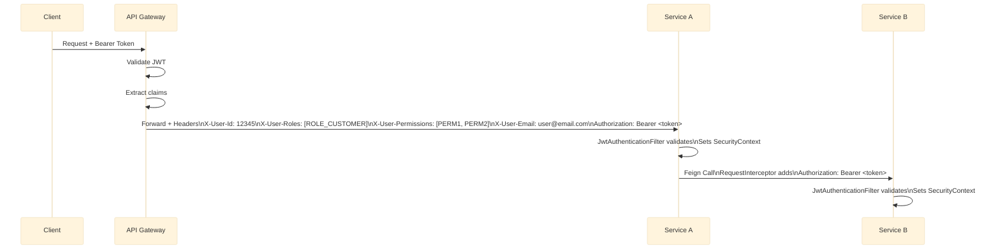

# CitiCore Banking Platform - RBAC Architecture Documentation

## Document Information

| Field | Value |
|-------|-------|
| **Document Title** | CitiCore RBAC Architecture |
| **Version** | 2.0 |
| **Status** | Draft for Review |
| **Classification** | Internal - Confidential |
| **Author** | Architecture Team |
| **Reviewers** | Engineering Lead, Security Lead, Compliance Officer |
| **Last Updated** | 2026-11-18 |

---

## Table of Contents

1. [Overview](#1-overview)
2. [Role Definitions](#2-role-definitions)
3. [Permission Catalog](#3-permission-catalog)
4. [Role-Permission Matrix](#4-role-permission-matrix)
5. [Resource Ownership & Access Scopes](#5-resource-ownership--access-scopes)
6. [User-to-Role Assignment](#6-user-to-role-assignment)
7. [Authorization Enforcement](#7-authorization-enforcement)
8. [JWT Identity & Authorization Claims](#8-jwt-identity--authorization-claims)
9. [Role & Permission Revocation Strategy](#9-role--permission-revocation-strategy)
10. [Default-Deny & Least-Privilege Principles](#10-default-deny--least-privilege-principles)
11. [Administrative Access Controls](#11-administrative-access-controls)
12. [Security Audit Logging](#12-security-audit-logging)
13. [API Endpoint Access Matrix](#13-api-endpoint-access-matrix)
14. [Implementation Guidelines](#14-implementation-guidelines)

---

## 1. Overview

### 1.1 Purpose
This document defines the comprehensive Role-Based Access Control (RBAC) architecture for the CitiCore Banking Platform. It establishes the roles, permissions, mappings, and enforcement mechanisms required to secure all banking operations while supporting regulatory requirements including separation of duties for KYC workflows.

### 1.2 Principles
| Principle | Implementation |
|-----------|----------------|
| **Default Deny** | All access denied unless explicitly granted via role-permission mapping |
| **Least Privilege** | Users receive minimum permissions necessary for their role |
| **Separation of Duties** | Critical workflows (KYC approval) require two distinct roles |
| **Defense in Depth** | Authorization enforced at Gateway, Service, and Data layers |
| **Auditability** | All authorization decisions and changes logged immutably |
| **Revocation** | Near-real-time permission revocation (≤15 minutes) |

### 1.3 Scope
- **In Scope**: All CitiCore microservices, APIs, data access, administrative functions
- **Out of Scope**: Infrastructure-level access (Kubernetes, database, network), third-party integrations

---

## 2. Role Definitions

### 2.1 Business Roles (9 Roles)

| Role Code | Display Name | Description | Business Context |
|-----------|--------------|-------------|------------------|
| `ROLE_CUSTOMER` | Retail Customer | Individual banking customer | Self-service banking |
| `ROLE_KYC_OFFICER` | KYC Officer | Reviews KYC cases (Maker) | Back-office KYC review |
| `ROLE_KYC_MANAGER` | KYC Manager | Approves KYC cases (Checker) | KYC decision authority |
| `ROLE_SUPPORT_AGENT` | Support Agent | Customer support representative | Front-line support |
| `ROLE_OPERATIONS_OFFICER` | Operations Officer | Banking operations staff | Back-office operations |
| `ROLE_COMPLIANCE_OFFICER` | Compliance Officer | AML/Compliance specialist | Regulatory compliance |
| `ROLE_ADMIN` | System Administrator | Platform administrator | Platform management |
| `ROLE_AUDITOR` | Auditor | Read-only audit access | Internal/external audit |
| `ROLE_SERVICE` | Service Account | Service-to-service communication | Internal microservices |

### 2.2 Role Hierarchy

```
ROLE_ADMIN (Super Role)
    ├── ROLE_COMPLIANCE_OFFICER
    ├── ROLE_KYC_MANAGER
    │       └── ROLE_KYC_OFFICER
    ├── ROLE_OPERATIONS_OFFICER
    ├── ROLE_SUPPORT_AGENT
    └── ROLE_AUDITOR

ROLE_CUSTOMER (Independent - no inheritance)
ROLE_SERVICE (Independent - system only)
```

> **Note:** Role hierarchy is for permission inheritance only. Separation of duties (e.g., KYC_OFFICER ≠ KYC_MANAGER for same case) is enforced at the workflow engine level, not through role hierarchy.

### 2.3 Role Assignment Rules

| Role | Assignment Method | Assigned By | Prerequisites |
|------|-------------------|-------------|---------------|
| `ROLE_CUSTOMER` | Automatic on registration | System | Email verification complete |
| `ROLE_KYC_OFFICER` | Admin assignment | ADMIN | Background check, training complete |
| `ROLE_KYC_MANAGER` | Admin assignment | ADMIN | KYC_OFFICER experience, approval authority |
| `ROLE_SUPPORT_AGENT` | Admin assignment | ADMIN | Support training, system access |
| `ROLE_OPERATIONS_OFFICER` | Admin assignment | ADMIN | Operations training, clearance |
| `ROLE_COMPLIANCE_OFFICER` | Admin assignment | ADMIN | Compliance certification, background check |
| `ROLE_ADMIN` | Super-admin assignment | SUPER_ADMIN | Security clearance, MFA enforced |
| `ROLE_AUDITOR` | Admin assignment | ADMIN | Audit charter, read-only acknowledgment |
| `ROLE_SERVICE` | Service registration | DevOps/Platform | Service identity, certificate |

---

## 3. Permission Catalog

### 3.1 Permission Naming Convention
Format: `{RESOURCE}_{ACTION}` or `{RESOURCE}_{ACTION}_{SCOPE}`

Examples:
- `CUSTOMER_PROFILE_READ` - Read customer profile
- `KYC_CASE_APPROVE` - Approve KYC case
- `ACCOUNT_TRANSFER_INITIATE` - Initiate fund transfer

### 3.2 Complete Permission List (25 Permissions)

| # | Permission Code | Description | Resource | Action | Default Scope |
|---|-----------------|-------------|----------|--------|---------------|
| 1 | `CUSTOMER_PROFILE_READ` | Read own profile | Customer Profile | READ | Own |
| 2 | `CUSTOMER_PROFILE_WRITE` | Update own profile | Customer Profile | WRITE | Own |
| 3 | `CUSTOMER_PROFILE_READ_ALL` | Read any customer profile | Customer Profile | READ | All (Staff) |
| 4 | `KYC_DOCUMENT_UPLOAD` | Upload KYC documents | KYC Document | CREATE | Own |
| 5 | `KYC_DOCUMENT_READ` | Read KYC documents | KYC Document | READ | Own/Assigned |
| 6 | `KYC_CASE_ASSIGN` | Assign KYC case to officer | KYC Case | ASSIGN | Manager/Admin |
| 7 | `KYC_CASE_REVIEW` | Review KYC case (Maker) | KYC Case | REVIEW | Assigned Officer |
| 8 | `KYC_CASE_RECOMMEND` | Recommend approve/reject | KYC Case | RECOMMEND | Assigned Officer |
| 9 | `KYC_CASE_REQUEST_INFO` | Request additional info | KYC Case | REQUEST_INFO | Assigned Officer |
| 10 | `KYC_CASE_APPROVE` | Approve KYC case (Checker) | KYC Case | APPROVE | Authorized Manager |
| 11 | `KYC_CASE_REJECT` | Reject KYC case (Checker) | KYC Case | REJECT | Authorized Manager |
| 12 | `KYC_CASE_RETURN` | Return case for review | KYC Case | RETURN | Authorized Manager |
| 13 | `KYC_CASE_ESCALATE` | Escalate exceptional case | KYC Case | ESCALATE | Manager/Compliance |
| 14 | `KYC_AUDIT_READ` | Read KYC audit trail | KYC Audit | READ | Compliance/Auditor/Admin |
| 15 | `ACCOUNT_CREATE` | Create new account | Account | CREATE | Customer/Operations |
| 16 | `ACCOUNT_READ` | Read account details | Account | READ | Own/Role-based |
| 16 | `ACCOUNT_DEPOSIT` | Deposit funds | Account | DEPOSIT | Own/Operations |
| 17 | `ACCOUNT_WITHDRAW` | Withdraw funds | Account | WITHDRAW | Own |
| 18 | `ACCOUNT_TRANSFER` | Transfer funds | Account | TRANSFER | Own |
| 19 | `ACCOUNT_STATEMENT` | View account statements | Account | STATEMENT | Own/Staff |
| 20 | `ACCOUNT_CLOSE` | Close account | Account | CLOSE | Own/Admin |
| 21 | `TRANSFER_INITIATE` | Initiate fund transfer | Transfer | INITIATE | Own |
| 22 | `TRANSFER_HISTORY` | View transfer history | Transfer | HISTORY | Own/Staff |
| 23 | `TRANSFER_MONITOR` | Monitor all transfers | Transfer | MONITOR | Operations/Compliance |
| 24 | `ADMIN_USER_MANAGE` | Manage users | Admin | USER_MGMT | Admin |
| 25 | `ADMIN_ROLE_ASSIGN` | Assign/revoke roles | Admin | ROLE_MGMT | Admin |
| 26 | `ADMIN_CONFIG_MANAGE` | Manage platform config | Admin | CONFIG_MGMT | Admin |
| 27 | `AUDIT_TRAIL_READ` | Read audit logs | Audit Trail | READ | Auditor/Admin/Compliance |
| 28 | `SERVICE_INTERNAL` | Internal service calls | Internal API | CALL | Service-to-Service |

---

## 4. Role-Permission Matrix

### 4.1 Complete Matrix

| Permission | CUSTOMER | KYC_OFFICER | KYC_MANAGER | SUPPORT_AGENT | OPERATIONS_OFFICER | COMPLIANCE_OFFICER | ADMIN | AUDITOR | SERVICE |
|------------|:--------:|:-----------:|:-----------:|:-------------:|:------------------:|:------------------:|:-----:|:-------:|:-------:|
| `CUSTOMER_PROFILE_READ` | ✅ Own | ✅ Assigned | ✅ All | ✅ All | ✅ All | ✅ All | ✅ All | ✅ All | ❌ |
| `CUSTOMER_PROFILE_WRITE` | ✅ Own | ❌ | ❌ | ❌ | ❌ | ❌ | ✅ All | ❌ | ❌ |
| `CUSTOMER_PROFILE_READ_ALL` | ❌ | ✅ Assigned | ✅ All | ✅ All | ✅ All | ✅ All | ✅ All | ✅ All | ❌ |
| `KYC_DOCUMENT_UPLOAD` | ✅ Own | ❌ | ❌ | ❌ | ❌ | ❌ | ✅ All | ❌ | ❌ |
| `KYC_DOCUMENT_READ` | ✅ Own | ✅ Assigned | ✅ Authorized | ✅ Limited* | ✅ All | ✅ All | ✅ All | ✅ All | ❌ |
| `KYC_CASE_ASSIGN` | ❌ | ❌ | ✅ | ❌ | ❌ | ❌ | ✅ | ❌ | ❌ |
| `KYC_CASE_REVIEW` | ❌ | ✅ Assigned | ✅ Authorized | ❌ | ❌ | ✅ All | ✅ All | ❌ | ❌ |
| `KYC_CASE_RECOMMEND` | ❌ | ✅ Assigned | ❌ | ❌ | ❌ | ❌ | ❌ | ❌ | ❌ |
| `KYC_CASE_REQUEST_INFO` | ❌ | ✅ Assigned | ❌ | ❌ | ❌ | ❌ | ✅ | ❌ | ❌ |
| `KYC_CASE_APPROVE` | ❌ | ❌ | ✅ Authorized† | ❌ | ❌ | ❌ | ✅ | ❌ | ❌ |
| `KYC_CASE_REJECT` | ❌ | ❌ | ✅ Authorized† | ❌ | ❌ | ✅ | ✅ | ❌ | ❌ |
| `KYC_CASE_RETURN` | ❌ | ❌ | ✅ Authorized† | ❌ | ❌ | ✅ | ✅ | ❌ | ❌ |
| `KYC_CASE_ESCALATE` | ❌ | ❌ | ✅ | ❌ | ❌ | ✅ | ✅ | ❌ | ❌ |
| `KYC_AUDIT_READ` | ❌ | ❌ | ❌ | ❌ | ❌ | ✅ | ✅ | ✅ | ❌ |
| `ACCOUNT_CREATE` | ✅ Own | ❌ | ❌ | ❌ | ✅ All | ❌ | ✅ All | ❌ | ❌ |
| `ACCOUNT_READ` | ✅ Own | ✅ Assigned | ✅ Authorized | ✅ All | ✅ All | ✅ All | ✅ All | ✅ All | ❌ |
| `ACCOUNT_DEPOSIT` | ✅ Own | ❌ | ❌ | ❌ | ✅ All | ❌ | ✅ All | ❌ | ✅ |
| `ACCOUNT_WITHDRAW` | ✅ Own | ❌ | ❌ | ❌ | ❌ | ❌ | ✅ All | ❌ | ❌ |
| `ACCOUNT_TRANSFER` | ✅ Own | ❌ | ❌ | ❌ | ❌ | ❌ | ✅ All | ❌ | ❌ |
| `ACCOUNT_STATEMENT` | ✅ Own | ✅ Assigned | ✅ Authorized | ✅ All | ✅ All | ✅ All | ✅ All | ✅ All | ❌ |
| `ACCOUNT_CLOSE` | ✅ Own | ❌ | ❌ | ❌ | ❌ | ❌ | ✅ | ❌ | ❌ |
| `TRANSFER_INITIATE` | ✅ Own | ❌ | ❌ | ❌ | ❌ | ❌ | ✅ All | ❌ | ❌ |
| `TRANSFER_HISTORY` | ✅ Own | ✅ Assigned | ✅ Authorized | ✅ All | ✅ All | ✅ All | ✅ All | ✅ All | ❌ |
| `TRANSFER_MONITOR` | ❌ | ❌ | ❌ | ❌ | ✅ All | ✅ All | ✅ All | ✅ All | ❌ |
| `ADMIN_USER_MANAGE` | ❌ | ❌ | ❌ | ❌ | ❌ | ❌ | ✅ | ❌ | ❌ |
| `ADMIN_ROLE_ASSIGN` | ❌ | ❌ | ❌ | ❌ | ❌ | ❌ | ✅ | ❌ | ❌ |
| `ADMIN_CONFIG_MANAGE` | ❌ | ❌ | ❌ | ❌ | ❌ | ❌ | ✅ | ❌ | ❌ |
| `AUDIT_TRAIL_READ` | ❌ | ❌ | ❌ | ❌ | ❌ | ✅ | ✅ | ✅ | ❌ |
| `SERVICE_INTERNAL` | ❌ | ❌ | ❌ | ❌ | ❌ | ❌ | ❌ | ❌ | ✅ |

> **Legend:**
> - ✅ = Granted
> - ❌ = Denied
> - **Own** = Only own resources
> - **Assigned** = Only cases assigned to this officer
> - **Authorized** = Cases this manager is authorized for (not own reviews)
> - **All** = All resources
> - **Limited*** = SUPPORT_AGENT: Verification status only, not document content
> - **Authorized†** = KYC_MANAGER cannot approve/reject/return cases they reviewed (SoD)

### 4.2 Permission Categories by Role

#### CUSTOMER (8 permissions)
- CUSTOMER_PROFILE_READ (Own)
- CUSTOMER_PROFILE_WRITE (Own)
- KYC_DOCUMENT_UPLOAD (Own)
- KYC_DOCUMENT_READ (Own)
- ACCOUNT_CREATE (Own)
- ACCOUNT_READ (Own)
- ACCOUNT_DEPOSIT (Own)
- ACCOUNT_WITHDRAW (Own)
- ACCOUNT_TRANSFER (Own)
- ACCOUNT_STATEMENT (Own)
- ACCOUNT_CLOSE (Own)
- TRANSFER_INITIATE (Own)
- TRANSFER_HISTORY (Own)

#### KYC_OFFICER (8 permissions)
- CUSTOMER_PROFILE_READ_ALL (Assigned)
- KYC_DOCUMENT_READ (Assigned)
- KYC_CASE_REVIEW (Assigned)
- KYC_CASE_RECOMMEND (Assigned)
- KYC_CASE_REQUEST_INFO (Assigned)
- ACCOUNT_READ (Assigned)
- ACCOUNT_STATEMENT (Assigned)
- TRANSFER_HISTORY (Assigned)

#### KYC_MANAGER (11 permissions)
- CUSTOMER_PROFILE_READ_ALL (Authorized)
- KYC_DOCUMENT_READ (Authorized)
- KYC_CASE_ASSIGN
- KYC_CASE_REVIEW (Authorized)
- KYC_CASE_APPROVE (Authorized†)
- KYC_CASE_REJECT (Authorized†)
- KYC_CASE_RETURN (Authorized†)
- KYC_CASE_ESCALATE
- ACCOUNT_READ (Authorized)
- ACCOUNT_STATEMENT (Authorized)
- TRANSFER_HISTORY (Authorized)

#### SUPPORT_AGENT (6 permissions)
- CUSTOMER_PROFILE_READ_ALL
- KYC_DOCUMENT_READ (Limited*)
- ACCOUNT_READ (All)
- ACCOUNT_STATEMENT (All)
- TRANSFER_HISTORY (All)

#### OPERATIONS_OFFICER (10 permissions)
- CUSTOMER_PROFILE_READ_ALL
- KYC_DOCUMENT_READ (All)
- ACCOUNT_CREATE (All)
- ACCOUNT_READ (All)
- ACCOUNT_DEPOSIT (All)
- ACCOUNT_STATEMENT (All)
- TRANSFER_HISTORY (All)
- TRANSFER_MONITOR (All)

#### COMPLIANCE_OFFICER (12 permissions)
- CUSTOMER_PROFILE_READ_ALL
- KYC_DOCUMENT_READ (All)
- KYC_CASE_REVIEW (All)
- KYC_CASE_REJECT
- KYC_CASE_RETURN
- KYC_CASE_ESCALATE
- KYC_AUDIT_READ
- ACCOUNT_READ (All)
- ACCOUNT_STATEMENT (All)
- TRANSFER_HISTORY (All)
- TRANSFER_MONITOR (All)
- AUDIT_TRAIL_READ

#### ADMIN (28 permissions - ALL)
- All permissions granted

#### AUDITOR (5 permissions)
- CUSTOMER_PROFILE_READ_ALL
- KYC_DOCUMENT_READ (All)
- KYC_AUDIT_READ
- ACCOUNT_READ (All)
- ACCOUNT_STATEMENT (All)
- TRANSFER_HISTORY (All)
- AUDIT_TRAIL_READ

#### SERVICE (1 permission)
- SERVICE_INTERNAL

---

## 5. Resource Ownership & Access Scopes

### 5.1 Ownership Model

| Resource | Owner Attribute | Ownership Rule |
|----------|-----------------|----------------|
| `User` | `id` (auth_user_id) | Self-owned |
| `UserProfile` | `auth_user_id` | Owned by User |
| `KycDocument` | `auth_user_id` | Owned by Customer |
| `KycCase` | `auth_user_id` (customer) | Owned by Customer; Assigned to Officer |
| `Account` | `auth_user_id` | Owned by Customer |
| `Transaction` | `auth_user_id` | Owned by Customer (sender) |
| `AuditLog` | System | System-owned |

### 5.2 Access Scope Definitions

| Scope | Description | Applicable Roles |
|-------|-------------|------------------|
| **Own** | Resources where `resource.ownerId == currentUser.id` | CUSTOMER |
| **Assigned** | KYC Cases where `case.assignedOfficerId == currentUser.id` | KYC_OFFICER |
| **Authorized** | KYC Cases where `case.authorizedManagerId == currentUser.id` AND `case.reviewingOfficerId != currentUser.id` | KYC_MANAGER |
| **Limited** | KYC Document metadata only (status, type) not content | SUPPORT_AGENT |
| **All** | No ownership restriction (subject to role permissions) | Staff roles, ADMIN |
| **None** | No access | Default for unlisted role-resource combinations |

### 5.3 Scope Enforcement Rules

1. **Customer Data Isolation**: Customers can ONLY access resources where they are the owner (`auth_user_id` match)
2. **Officer Case Isolation**: KYC Officers can ONLY access cases explicitly assigned to them
3. **Manager Authorization**: KYC Managers can ONLY access cases they are authorized for, and NEVER cases they personally reviewed
4. **Staff Broad Access**: Support/Operations/Compliance have broad access per their role permissions
5. **Admin Full Access**: ADMIN bypasses all scope checks (audited)
6. **Service Internal**: SERVICE role for Feign/internal calls only, no direct customer access

---

## 6. User-to-Role Assignment

### 6.1 Assignment Mechanisms

```mermaid
%%{init: {'theme': 'base'}}%%
flowchart TD
    A[User Registration] --> B{Registration Type}
    B -->|Customer Self-Registration| C[Auto-assign ROLE_CUSTOMER]
    B -->|Admin Creates Staff User| D[Admin Assigns Roles]
    D --> E[POST /admin/users/{id}/roles]
    E --> F[Validate Role Assignment Rules]
    F --> G{Valid?}
    G -->|Yes| H[Persist UserRole]
    G -->|No| I[Return 400]
    H --> J[Invalidate User Permission Cache]
    J --> K[Publish RoleAssignmentEvent]
    K --> L[Services Refresh Permissions]
    
    M[KYC Case Assignment] --> N[Manager Assigns Officer]
    N --> O[POST /kyc/cases/{id}/assign]
    O --> P[Validate Manager Role + Officer Role]
    P --> Q[Persist KycCaseAssignment]
    Q --> R[Invalidate Case Assignment Cache]
    R --> S[Notify Officer]
```

### 6.2 Assignment Validation Rules

| Assignment | Validator | Rule |
|------------|-----------|------|
| `ROLE_CUSTOMER` | System | Auto on email verification; cannot be manually assigned/revoked |
| Staff Roles | ADMIN | Assignee must exist; assigner must have ADMIN_ROLE_ASSIGN; no self-assignment |
| KYC_OFFICER → Case | KYC_MANAGER/ADMIN | Officer must have ROLE_KYC_OFFICER; Manager must have KYC_CASE_ASSIGN |
| KYC_MANAGER → Case | ADMIN | Manager must have ROLE_KYC_MANAGER; cannot assign to self as officer |
| ROLE_ADMIN | SUPER_ADMIN | Requires MFA; audit logged; second admin approval for production |

### 6.3 Role Revocation

| Trigger | Action | Timing |
|---------|--------|--------|
| Admin revokes role | Delete UserRole; Invalidate cache; Revoke refresh tokens | Immediate |
| User suspension | Mark User.status=SUSPENDED; Revoke all tokens | Immediate |
| KYC Case unassignment | Delete KycCaseAssignment; Invalidate cache | Immediate |
| Password change | Revoke all refresh tokens; Invalidate cache | Immediate |
| MFA enable/disable | Invalidate cache | Next token refresh (≤15min) |

---

## 7. Authorization Enforcement

### 7.1 Enforcement Layers (Defense in Depth)

```mermaid
%%{init: {'theme': 'base'}}%%
graph TB
    subgraph L1 ["Layer 1: API Gateway"]
        GW[Spring Cloud Gateway\nJWT Validation + Coarse RBAC]
    end
    
    subgraph L2 ["Layer 2: Service Filter"]
        FILTER[JwtAuthenticationFilter\nToken Validation + SecurityContext]
    end
    
    subgraph L3 ["Layer 3: Method Security"]
        ANNOTATION[@PreAuthorize\nSpEL Expressions + PermissionEvaluator]
    end
    
    subgraph L4 ["Layer 4: Service Logic"]
        LOGIC[Business Logic\nOwnership Checks + ABAC + SoD]
    end
    
    subgraph L5 ["Layer 5: Data Layer"]
        DATA[Repository/Query\nRow-Level Security + Scopes]
    end
    
    GW --> FILTER
    FILTER --> ANNOTATION
    ANNOTATION --> LOGIC
    LOGIC --> DATA
```

### 7.2 Layer Details

#### Layer 1: API Gateway (Coarse-Grained)
- Validates JWT signature, expiry, claims
- Extracts roles, permissions, userId
- **Coarse RBAC**: Checks if role has ANY permission for endpoint pattern
- Rate limiting per user/IP
- Adds headers: `X-User-Id`, `X-User-Roles`, `X-User-Permissions`, `X-User-Email`

#### Layer 2: Service Filter (Authentication)
- `JwtAuthenticationFilter` in each service
- Validates JWT independently (no shared secret)
- Sets `SecurityContext` with `Authentication` principal
- Extracts permissions into `PermissionPrincipal`

#### Layer 3: Method Security (Fine-Grained RBAC)
- `@EnableMethodSecurity` with custom `PermissionEvaluator`
- `@PreAuthorize` on controller/service methods
- SpEL expressions: `hasPermission('KYC_CASE', 'APPROVE')`, `hasRole('KYC_MANAGER')`
- PermissionEvaluator checks JWT permissions + resource scope

#### Layer 4: Service Logic (ABAC + Business Rules)
- Ownership validation: `if (!account.getAuthUserId().equals(currentUserId)) throw...`
- KYC Case scope: `kycCaseService.canAccess(caseId, currentUserId, currentRoles)`
- Separation of Duties: `if (case.reviewingOfficerId.equals(managerId)) throw SoDViolationException`
- State machine validation: `kycCaseStateMachine.canTransition(currentStatus, newStatus, currentRole)`

#### Layer 5: Data Layer (Row-Level Security)
- Repository methods scoped: `findByAuthUserId(userId)`, `findAssignedCases(officerId)`
- Query-level filtering prevents cross-tenant data access
- Soft-delete for audit trail preservation

### 7.3 Custom PermissionEvaluator

```java
@Component
public class CitiCorePermissionEvaluator implements PermissionEvaluator {
    
    @Override
    public boolean hasPermission(Authentication auth, Object targetDomain, Object permission) {
        String permissionCode = (String) permission;
        PermissionPrincipal principal = (PermissionPrincipal) auth.getPrincipal();
        
        // 1. Check if permission exists in JWT
        if (!principal.getPermissions().contains(permissionCode)) {
            return false;
        }
        
        // 2. Check resource-specific scope
        if (targetDomain instanceof KycCaseAccessTarget) {
            return checkKycCaseScope(principal, (KycCaseAccessTarget) targetDomain, permissionCode);
        }
        if (targetDomain instanceof AccountAccessTarget) {
            return checkAccountScope(principal, (AccountAccessTarget) targetDomain, permissionCode);
        }
        if (targetDomain instanceof CustomerProfileAccessTarget) {
            return checkProfileScope(principal, (CustomerProfileAccessTarget) targetDomain, permissionCode);
        }
        
        // 3. Default: permission granted if in JWT (for non-scoped resources)
        return true;
    }
    
    private boolean checkKycCaseScope(PermissionPrincipal principal, KycCaseAccessTarget target, String permission) {
        Long caseId = target.getCaseId();
        Long userId = principal.getUserId();
        Set<String> roles = principal.getRoles();
        
        // CUSTOMER: own case only
        if (roles.contains("ROLE_CUSTOMER")) {
            return kycCaseService.isCustomerOwner(caseId, userId);
        }
        
        // KYC_OFFICER: assigned cases only
        if (roles.contains("ROLE_KYC_OFFICER")) {
            return switch (permission) {
                case "KYC_CASE_REVIEW", "KYC_CASE_RECOMMEND", "KYC_CASE_REQUEST_INFO" ->
                    kycCaseService.isAssignedOfficer(caseId, userId);
                case "KYC_DOCUMENT_READ" -> kycCaseService.isAssignedOfficer(caseId, userId);
                default -> false;
            };
        }
        
        // KYC_MANAGER: authorized cases, NOT own reviews
        if (roles.contains("ROLE_KYC_MANAGER")) {
            return switch (permission) {
                case "KYC_CASE_APPROVE", "KYC_CASE_REJECT", "KYC_CASE_RETURN" ->
                    kycCaseService.isAuthorizedManager(caseId, userId) 
                    && !kycCaseService.isReviewingOfficer(caseId, userId); // SoD
                case "KYC_CASE_ASSIGN" -> kycCaseService.isAuthorizedManager(caseId, userId);
                case "KYC_DOCUMENT_READ", "KYC_CASE_REVIEW" -> 
                    kycCaseService.isAuthorizedManager(caseId, userId);
                default -> false;
            };
        }
        
        // COMPLIANCE/ADMIN/AUDITOR: all cases
        return roles.contains("ROLE_COMPLIANCE_OFFICER") 
            || roles.contains("ROLE_ADMIN") 
            || roles.contains("ROLE_AUDITOR");
    }
}
```

---

## 8. JWT Identity & Authorization Claims

### 8.1 Access Token Claims

```json
{
  "iss": "citicore-auth",
  "sub": "12345",
  "email": "customer@example.com",
  "roles": ["ROLE_CUSTOMER"],
  "permissions": [
    "CUSTOMER_PROFILE_READ",
    "CUSTOMER_PROFILE_WRITE",
    "KYC_DOCUMENT_UPLOAD",
    "KYC_DOCUMENT_READ",
    "ACCOUNT_CREATE",
    "ACCOUNT_READ",
    "ACCOUNT_DEPOSIT",
    "ACCOUNT_WITHDRAW",
    "ACCOUNT_TRANSFER",
    "ACCOUNT_STATEMENT",
    "ACCOUNT_CLOSE",
    "TRANSFER_INITIATE",
    "TRANSFER_HISTORY"
  ],
  "kycStatus": "APPROVED",
  "riskScore": 15,
  "assignedCases": [],
  "authorizedCases": [],
  "iat": 1731923400,
  "exp": 1731924300,
  "jti": "uuid-token-id"
}
```

### 8.2 KYC Officer Token Claims

```json
{
  "iss": "citicore-auth",
  "sub": "67890",
  "email": "kyc.officer@citicore.com",
  "roles": ["ROLE_KYC_OFFICER"],
  "permissions": [
    "CUSTOMER_PROFILE_READ_ALL",
    "KYC_DOCUMENT_READ",
    "KYC_CASE_REVIEW",
    "KYC_CASE_RECOMMEND",
    "KYC_CASE_REQUEST_INFO",
    "ACCOUNT_READ",
    "ACCOUNT_STATEMENT",
    "TRANSFER_HISTORY"
  ],
  "kycStatus": "N/A",
  "riskScore": 0,
  "assignedCases": ["KYC-20261118-001", "KYC-20261118-002"],
  "authorizedCases": [],
  "iat": 1731923400,
  "exp": 1731924300,
  "jti": "uuid-token-id"
}
```

### 8.3 KYC Manager Token Claims

```json
{
  "iss": "citicore-auth",
  "sub": "54321",
  "email": "kyc.manager@citicore.com",
  "roles": ["ROLE_KYC_MANAGER"],
  "permissions": [
    "CUSTOMER_PROFILE_READ_ALL",
    "KYC_DOCUMENT_READ",
    "KYC_CASE_ASSIGN",
    "KYC_CASE_APPROVE",
    "KYC_CASE_REJECT",
    "KYC_CASE_RETURN",
    "KYC_CASE_ESCALATE",
    "KYC_AUDIT_READ",
    "ACCOUNT_READ",
    "ACCOUNT_STATEMENT",
    "TRANSFER_HISTORY"
  ],
  "kycStatus": "N/A",
  "riskScore": 0,
  "assignedCases": [],
  "authorizedCases": ["KYC-20261118-001", "KYC-20261118-003"],
  "iat": 1731923400,
  "exp": 1731924300,
  "jti": "uuid-token-id"
}
```

### 8.4 Token Generation Rules

| Claim | Source | Refresh Frequency |
|-------|--------|-------------------|
| `sub`, `email` | User entity | On login |
| `roles` | UserRole table | On login + role change (cache eviction) |
| `permissions` | Role-Permission matrix | Computed at token generation |
| `kycStatus` | KycCase latest status | On login + KYC status change |
| `riskScore` | Customer risk profile | On login + daily recalculation |
| `assignedCases` | KycCaseAssignment (officer) | On login + assignment change |
| `authorizedCases` | KycCaseAuthorization (manager) | On login + authorization change |

### 8.5 Token Propagation



---

## 9. Role & Permission Revocation Strategy

### 9.1 Revocation Mechanisms

| Mechanism | Scope | Latency | Use Case |
|-----------|-------|---------|----------|
| **JWT Short Expiry** | All permissions | ≤15 minutes | Baseline revocation |
| **Refresh Token Revocation** | All permissions | Immediate | Logout, password change, suspension |
| **Redis Permission Cache Eviction** | Cached permissions | Immediate (pub/sub) | Role change, case reassignment |
| **User Status Change** | All access | Immediate | Suspension, termination |
| **Emergency Blocklist** | All access | Immediate | Security incident |

### 9.2 Revocation Flow

```mermaid
%%{init: {'theme': 'base'}}%%
flowchart TD
    A[Revocation Trigger] --> B{Trigger Type}
    B -->|Admin Revokes Role| C[Delete UserRole]
    B -->|Password Change| D[Revoke All Refresh Tokens]
    B -->|User Suspension| E[Update User Status=SUSPENDED]
    B -->|Case Reassignment| F[Update KycCaseAssignment]
    B -->|Emergency Lockout| G[Add to Redis Blocklist]
    
    C --> H[Publish RoleRevokedEvent]
    D --> H
    E --> H
    F --> I[Publish CaseReassignedEvent]
    G --> J[Add to Blocklist Set]
    
    H --> K[Redis: Invalidate User Permission Cache]
    I --> L[Redis: Invalidate Case Assignment Cache]
    K --> M[Services: Next Request → Cache Miss → Recompute]
    L --> M
    J --> N[Gateway: Check Blocklist on Every Request]
    
    M --> O[New JWT on Refresh\n(≤15 min) or Re-login]
    N --> P[Immediate 403 on Blocklisted]
```

### 9.3 Cache Invalidation Strategy

| Cache | Key Pattern | Invalidation Trigger | TTL |
|-------|-------------|---------------------|-----|
| User Permissions | `perm:user:{userId}` | Role change, status change | 15 min |
| Case Assignments | `kyc:assign:{caseId}` | Assignment change | 5 min |
| Manager Authorizations | `kyc:auth:{managerId}` | Authorization change | 5 min |
| KYC Case Status | `kyc:status:{caseId}` | Status transition | 1 min |
| Role-Permission Matrix | `rbac:matrix` | Admin config change | 1 hour |

---

## 10. Default-Deny & Least-Privilege Principles

### 10.1 Default-Deny Implementation

1. **Spring Security Config**: `.anyRequest().denyAll()` as default
2. **Explicit Permits**: Only explicitly permitted endpoints/patterns allowed
3. **Method Security**: `@PreAuthorize` required on all business methods
4. **Repository Queries**: Scoped queries only (`findByAuthUserId`, `findAssignedCases`)
5. **Gateway Routes**: No catch-all routes; explicit path configuration

### 10.2 Least-Privilege Enforcement

| Principle | Implementation |
|-----------|----------------|
| **Minimal Role Permissions** | Each role has only permissions needed for its function |
| **Scope Restriction** | Permissions scoped to owned/assigned/authorized resources |
| **Time-Bounded Access** | JWT 15min expiry; case assignments have SLA deadlines |
| **Just-in-Time Elevation** | No permanent elevated roles; emergency access via break-glass (audited) |
| **Regular Review** | Quarterly access certification (planned) |

### 10.3 Violation Detection

```java
// Example: Detecting excessive permissions
@Scheduled(cron = "0 0 2 * * ?") // Daily 2 AM
public void auditExcessivePermissions() {
    List<UserRole> allRoles = userRoleRepository.findAll();
    for (UserRole ur : allRoles) {
        Set<String> granted = permissionService.getEffectivePermissions(ur.getUserId());
        Set<String> required = permissionService.getRequiredPermissions(ur.getRole());
        Set<String> excess = Sets.difference(granted, required);
        if (!excess.isEmpty()) {
            auditLogService.log("EXCESSIVE_PERMISSIONS", ur.getUserId(), excess);
            alertService.notifySecurityTeam("User " + ur.getUserId() + " has excess permissions: " + excess);
        }
    }
}
```

---

## 11. Administrative Access Controls

### 11.1 Admin Capabilities

| Capability | Endpoint | Permission Required | Audit Level |
|------------|----------|---------------------|-------------|
| View all users | `GET /admin/users` | `ADMIN_USER_MANAGE` | HIGH |
| Assign role | `POST /admin/users/{id}/roles` | `ADMIN_ROLE_ASSIGN` | CRITICAL |
| Revoke role | `DELETE /admin/users/{id}/roles/{role}` | `ADMIN_ROLE_ASSIGN` | CRITICAL |
| View audit logs | `GET /admin/audit` | `AUDIT_TRAIL_READ` | HIGH |
| Platform config | `GET/PUT /admin/config` | `ADMIN_CONFIG_MANAGE` | CRITICAL |
| Impersonate user | `POST /admin/impersonate/{id}` | `ADMIN_USER_MANAGE` + MFA | CRITICAL |

### 11.2 Admin Action Requirements

1. **MFA Required**: All admin actions require MFA verification (TOTP)
2. **Dual Approval**: Critical actions (role assignment, config change) require second admin approval in production
3. **Audit Logging**: Every admin action logged with actor, target, timestamp, reason
4. **Session Recording**: Admin sessions recorded for compliance (planned)
5. **Break-Glass Access**: Emergency access procedure with automatic alerts and time-limited elevation

### 11.3 Super-Admin

- Separate from `ROLE_ADMIN`
- Assigned only during bootstrap
- Can create first admin
- Cannot be assigned via API
- Stored in secure configuration (Vault)

---

## 12. Security Audit Logging

### 12.1 Audited Events

| Event Category | Events | Retention |
|----------------|--------|-----------|
| **Authentication** | Login, logout, MFA, password change, lockout, token refresh | 7 years |
| **Authorization** | Permission granted/denied, role assignment/revocation, SoD violations | 7 years |
| **KYC Workflow** | Case transitions, assignments, reviews, approvals, rejections, escalations | 7 years |
| **Financial** | Account create/close, transfers, deposits, withdrawals, balance changes | 7 years |
| **Administrative** | Config changes, user management, role management, impersonation | 7 years |
| **Data Access** | Profile views, document access, statement downloads, report generation | 3 years |

### 12.2 Audit Log Structure

```json
{
  "auditId": "uuid",
  "timestamp": "2026-11-18T10:30:00.123Z",
  "actor": {
    "userId": 12345,
    "email": "actor@citicore.com",
    "roles": ["ROLE_KYC_MANAGER"],
    "ipAddress": "192.168.1.100",
    "userAgent": "Mozilla/5.0...",
    "sessionId": "session-uuid"
  },
  "action": "KYC_CASE_APPROVE",
  "resource": {
    "type": "KYC_CASE",
    "id": "KYC-20261118-001",
    "ownerId": 67890
  },
  "details": {
    "previousStatus": "PENDING_MANAGER_APPROVAL",
    "newStatus": "APPROVED",
    "reason": "All documents verified, risk score acceptable",
    "metadata": {
      "reviewingOfficerId": 54321,
      "processingTimeMs": 45000
    }
  },
  "outcome": "SUCCESS",
  "riskLevel": "LOW",
  "correlationId": "trace-uuid"
}
```

### 12.3 Immutable Storage

- **Primary**: Append-only database table (`audit_logs`) with no UPDATE/DELETE permissions
- **Secondary**: Write-once object storage (S3 with Object Lock) for tamper evidence
- **Integrity**: Cryptographic hash chaining (each log references previous hash)
- **Verification**: Periodic integrity verification job

---

## 13. API Endpoint Access Matrix

### 13.1 Auth Service (`/api/v1/auth/**`)

| Endpoint | Method | CUSTOMER | KYC_OFFICER | KYC_MANAGER | SUPPORT | OPERATIONS | COMPLIANCE | ADMIN | AUDITOR | SERVICE |
|----------|--------|:--------:|:-----------:|:-----------:|:-------:|:----------:|:----------:|:-----:|:-------:|:-------:|
| `/register` | POST | ✅ | ✅ | ✅ | ✅ | ✅ | ✅ | ✅ | ❌ | ❌ |
| `/login` | POST | ✅ | ✅ | ✅ | ✅ | ✅ | ✅ | ✅ | ❌ | ❌ |
| `/refresh` | POST | ✅ | ✅ | ✅ | ✅ | ✅ | ✅ | ✅ | ❌ | ❌ |
| `/verify` | POST | ✅ | ✅ | ✅ | ✅ | ✅ | ✅ | ✅ | ❌ | ❌ |
| `/mfa/enroll` | POST | ✅ | ✅ | ✅ | ✅ | ✅ | ✅ | ✅ | ❌ | ❌ |
| `/mfa/verify` | POST | ✅ | ✅ | ✅ | ✅ | ✅ | ✅ | ✅ | ❌ | ❌ |
| `/mfa/disable` | POST | ✅ | ✅ | ✅ | ✅ | ✅ | ✅ | ✅ | ❌ | ❌ |
| `/forgot-password` | POST | ✅ | ✅ | ✅ | ✅ | ✅ | ✅ | ✅ | ❌ | ❌ |
| `/reset-password` | POST | ✅ | ✅ | ✅ | ✅ | ✅ | ✅ | ✅ | ❌ | ❌ |
| `/change-password` | POST | ✅ | ✅ | ✅ | ✅ | ✅ | ✅ | ✅ | ❌ | ❌ |
| `/logout` | POST | ✅ | ✅ | ✅ | ✅ | ✅ | ✅ | ✅ | ❌ | ❌ |

### 13.2 User Service (`/api/v1/users/**`)

| Endpoint | Method | CUSTOMER | KYC_OFFICER | KYC_MANAGER | SUPPORT | OPERATIONS | COMPLIANCE | ADMIN | AUDITOR | SERVICE |
|----------|--------|:--------:|:-----------:|:-----------:|:-------:|:----------:|:----------:|:-----:|:-------:|:-------:|
| `/profile` | GET | Own | Assigned | Authorized | All | All | All | All | All | ❌ |
| `/profile` | PUT | Own | ❌ | ❌ | ❌ | ❌ | ❌ | All | ❌ | ❌ |
| `/kyc/upload` | POST | Own | ❌ | ❌ | ❌ | ❌ | ❌ | All | ❌ | ❌ |
| `/kyc/submit` | POST | Own | ❌ | ❌ | ❌ | ❌ | ❌ | All | ❌ | ❌ |
| `/kyc/documents/{id}` | GET | Own | Assigned | Authorized | Limited | All | All | All | All | ❌ |
| `/kyc/status/{userId}` | GET | Own | Assigned | Authorized | All | All | All | All | All | ✅ |
| `/admin/**` | * | ❌ | ❌ | ❌ | ❌ | ❌ | ❌ | ✅ | ❌ | ❌ |

### 13.3 KYC Workflow Service (`/api/v1/kyc/**`)

| Endpoint | Method | CUSTOMER | KYC_OFFICER | KYC_MANAGER | SUPPORT | OPERATIONS | COMPLIANCE | ADMIN | AUDITOR | SERVICE |
|----------|--------|:--------:|:-----------:|:-----------:|:-------:|:----------:|:----------:|:-----:|:-------:|:-------:|
| `/cases` | GET | Own | Assigned | Authorized | Limited | All | All | All | All | ❌ |
| `/cases/{id}` | GET | Own | Assigned | Authorized | Limited | All | All | All | All | ❌ |
| `/cases/{id}/assign` | POST | ❌ | ❌ | ✅ | ❌ | ❌ | ❌ | ✅ | ❌ | ❌ |
| `/cases/{id}/review` | POST | ❌ | Assigned | ❌ | ❌ | ❌ | All | All | ❌ | ❌ |
| `/cases/{id}/findings` | POST | ❌ | Assigned | ❌ | ❌ | ❌ | All | All | ❌ | ❌ |
| `/cases/{id}/request-info` | POST | ❌ | Assigned | ❌ | ❌ | ❌ | ❌ | ✅ | ❌ | ❌ |
| `/cases/{id}/recommend` | POST | ❌ | Assigned | ❌ | ❌ | ❌ | ❌ | ❌ | ❌ | ❌ |
| `/cases/{id}/approve` | POST | ❌ | ❌ | Authorized† | ❌ | ❌ | ❌ | ✅ | ❌ | ❌ |
| `/cases/{id}/reject` | POST | ❌ | ❌ | Authorized† | ❌ | ❌ | ✅ | ✅ | ❌ | ❌ |
| `/cases/{id}/return` | POST | ❌ | ❌ | Authorized† | ❌ | ❌ | ✅ | ✅ | ❌ | ❌ |
| `/cases/{id}/escalate` | POST | ❌ | ❌ | ✅ | ❌ | ❌ | ✅ | ✅ | ❌ | ❌ |
| `/cases/assigned` | GET | ❌ | ✅ | ❌ | ❌ | ❌ | ✅ | All | ❌ | ❌ |
| `/cases/pending-approval` | GET | ❌ | ❌ | ✅ | ❌ | ❌ | ✅ | All | ❌ | ❌ |
| `/audit/**` | GET | ❌ | ❌ | ❌ | ❌ | ❌ | ✅ | ✅ | ✅ | ❌ |

### 13.4 Account Service (`/api/v1/accounts/**`)

| Endpoint | Method | CUSTOMER | KYC_OFFICER | KYC_MANAGER | SUPPORT | OPERATIONS | COMPLIANCE | ADMIN | AUDITOR | SERVICE |
|----------|--------|:--------:|:-----------:|:-----------:|:-------:|:----------:|:----------:|:-----:|:-------:|:-------:|
| `/create` | POST | ✅ | ❌ | ❌ | ❌ | ✅ | ❌ | ✅ | ❌ | ❌ |
| `/balance/{accNo}` | GET | Own | Assigned | Authorized | Own | All | All | All | All | ❌ |
| `/deposit` | POST | Own | ❌ | ❌ | ❌ | ✅ | ❌ | ✅ | ❌ | ✅ |
| `/withdraw` | POST | Own | ❌ | ❌ | ❌ | ❌ | ❌ | ✅ | ❌ | ❌ |
| `/transfer` | POST | Own | ❌ | ❌ | ❌ | ❌ | ❌ | ✅ | ❌ | ❌ |
| `/statement/{accNo}` | GET | Own | Assigned | Authorized | Own | All | All | All | All | ❌ |
| `/{accNo}/close` | POST | Own | ❌ | ❌ | ❌ | ❌ | ❌ | ✅ | ❌ | ❌ |
| `/my-accounts` | GET | ✅ | Assigned | Authorized | All | All | All | All | All | ❌ |
| `/validate-transfer` | POST | ❌ | ❌ | ❌ | ❌ | ❌ | ❌ | ❌ | ❌ | ✅ |

### 13.5 Transaction Service (`/api/v1/transactions/**`)

| Endpoint | Method | CUSTOMER | KYC_OFFICER | KYC_MANAGER | SUPPORT | OPERATIONS | COMPLIANCE | ADMIN | AUDITOR | SERVICE |
|----------|--------|:--------:|:-----------:|:-----------:|:-------:|:----------:|:----------:|:-----:|:-------:|:-------:|
| `/transfer` | POST | ✅ | ❌ | ❌ | ❌ | ❌ | ❌ | ✅ | ❌ | ❌ |
| `/{txnRef}` | GET | Own | Assigned | Authorized | Own | All | All | All | All | ❌ |
| `/history` | GET | Own | Assigned | Authorized | Own | All | All | All | All | ❌ |
| `/monitor` | GET | ❌ | ❌ | ❌ | ❌ | ✅ | ✅ | ✅ | ✅ | ❌ |

### 13.6 Admin Endpoints (`/api/v1/admin/**`)

| Endpoint | Method | CUSTOMER | KYC_OFFICER | KYC_MANAGER | SUPPORT | OPERATIONS | COMPLIANCE | ADMIN | AUDITOR | SERVICE |
|----------|--------|:--------:|:-----------:|:-----------:|:-------:|:----------:|:----------:|:-----:|:-------:|:-------:|
| `/users` | GET | ❌ | ❌ | ❌ | ❌ | ❌ | ❌ | ✅ | ❌ | ❌ |
| `/users/{id}/roles` | POST/DELETE | ❌ | ❌ | ❌ | ❌ | ❌ | ❌ | ✅ | ❌ | ❌ |
| `/config` | GET/PUT | ❌ | ❌ | ❌ | ❌ | ❌ | ❌ | ✅ | ❌ | ❌ |
| `/audit` | GET | ❌ | ❌ | ❌ | ❌ | ❌ | ✅ | ✅ | ✅ | ❌ |
| `/impersonate/{id}` | POST | ❌ | ❌ | ❌ | ❌ | ❌ | ❌ | ✅* | ❌ | ❌ |

> *Requires MFA + dual approval in production

---

## 14. Implementation Guidelines

### 14.1 Controller-Level Security

```java
@RestController
@RequestMapping("/api/v1/kyc/cases")
@RequiredArgsConstructor
public class KycCaseController {
    
    private final KycCaseService kycCaseService;
    
    @GetMapping
    @PreAuthorize("hasAnyRole('CUSTOMER', 'KYC_OFFICER', 'KYC_MANAGER', 'SUPPORT_AGENT', 'OPERATIONS_OFFICER', 'COMPLIANCE_OFFICER', 'ADMIN', 'AUDITOR')")
    public Page<KycCaseDto> getCases(
            @RequestParam(defaultValue = "0") @Max(1000) int page,
            @RequestParam(defaultValue = "20") @Max(100) int size) {
        return kycCaseService.getAccessibleCases(getCurrentUser(), page, size);
    }
    
    @GetMapping("/{caseId}")
    @PreAuthorize("hasPermission(#caseId, 'KYC_CASE', 'READ')")
    public KycCaseDto getCase(@PathVariable String caseId) {
        return kycCaseService.getCaseDto(caseId, getCurrentUser());
    }
    
    @PostMapping("/{caseId}/recommend")
    @PreAuthorize("hasPermission(#caseId, 'KYC_CASE', 'RECOMMEND')")
    public KycCaseDto recommend(@PathVariable String caseId, @Valid @RequestBody KycRecommendationRequest request) {
        return kycCaseService.recommend(caseId, request, getCurrentUser());
    }
    
    @PostMapping("/{caseId}/approve")
    @PreAuthorize("hasPermission(#caseId, 'KYC_CASE', 'APPROVE')")
    public KycCaseDto approve(@PathVariable String caseId, @Valid @RequestBody KycApprovalRequest request) {
        return kycCaseService.approve(caseId, request, getCurrentUser());
    }
}
```

### 14.2 Service-Level Ownership Checks

```java
@Service
@RequiredArgsConstructor
@Transactional
public class KycCaseService {
    
    private final KycCaseRepository caseRepository;
    private final KycCaseAssignmentRepository assignmentRepository;
    private final KycCaseHistoryRepository historyRepository;
    private final PermissionEvaluator permissionEvaluator;
    
    public KycCaseDto approve(String caseId, KycApprovalRequest request, UserPrincipal principal) {
        KycCase kycCase = caseRepository.findByCaseNumber(caseId)
            .orElseThrow(() -> new KycCaseNotFoundException(caseId));
        
        // 1. State machine validation
        if (!kycCase.getStatus().canTransitionTo(KycCaseStatus.APPROVED, principal.getRoles())) {
            throw new InvalidStateTransitionException(kycCase.getStatus(), KycCaseStatus.APPROVED);
        }
        
        // 2. Separation of Duties - CRITICAL
        if (kycCase.getReviewingOfficerId() != null 
            && kycCase.getReviewingOfficerId().equals(principal.getUserId())) {
            auditLogService.logSoDViolation(principal.getUserId(), caseId, "SELF_APPROVAL_ATTEMPT");
            throw new SeparationOfDutiesViolationException(
                "KYC Manager cannot approve a case they reviewed");
        }
        
        // 3. Authorization scope
        if (!isAuthorizedManager(caseId, principal.getUserId())) {
            throw new AccessDeniedException("Not authorized for this case");
        }
        
        // 4. Execute transition
        KycCaseStatus previousStatus = kycCase.getStatus();
        kycCase.setStatus(KycCaseStatus.APPROVED);
        kycCase.setDecidingManagerId(principal.getUserId());
        kycCase.setCompletedAt(LocalDateTime.now());
        kycCase.setRejectionReason(null);
        caseRepository.save(kycCase);
        
        // 5. Audit trail
        historyRepository.save(KycCaseHistory.builder()
            .caseId(kycCase.getId())
            .actorId(principal.getUserId())
            .actorRole(principal.getHighestRole())
            .action(KycCaseAction.APPROVED)
            .previousStatus(previousStatus)
            .newStatus(KycCaseStatus.APPROVED)
            .reason(request.getApprovalReason())
            .timestamp(LocalDateTime.now())
            .build());
        
        // 6. Publish event
        eventPublisher.publishKycCaseEvent(kycCase, KycCaseEventType.APPROVED, principal);
        
        return toDto(kycCase);
    }
}
```

### 14.3 Repository Scoping

```java
@Repository
public interface KycCaseRepository extends JpaRepository<KycCase, Long> {
    
    // Customer: own cases only
    Page<KycCase> findByAuthUserId(Long authUserId, Pageable pageable);
    
    // Officer: assigned cases only
    Page<KycCase> findByAssignedOfficerId(Long officerId, Pageable pageable);
    
    // Manager: authorized cases (not own reviews)
    @Query("SELECT c FROM KycCase c WHERE c.authorizedManagerId = :managerId " +
           "AND c.reviewingOfficerId != :managerId")
    Page<KycCase> findAuthorizedCases(Long managerId, Pageable pageable);
    
    // Support/Operations/Compliance: all cases with status filter
    Page<KycCase> findByStatusIn(List<KycCaseStatus> statuses, Pageable pageable);
}
```

### 14.4 Gateway Configuration

```yaml
# api-gateway application.yml
spring:
  cloud:
    gateway:
      routes:
        - id: kyc-workflow
          uri: lb://kyc-workflow-service
          predicates:
            - Path=/api/v1/kyc/**
          filters:
            - name: JwtAuthentication
            - name: RbacAuthorization
              args:
                requiredPermissions: 
                  - KYC_CASE_REVIEW
                  - KYC_CASE_APPROVE
                  - KYC_DOCUMENT_READ
            - name: RateLimit
              args:
                keyResolver: userIdKeyResolver
                requestsPerMinute: 100
```

---

## Appendix A: Role-Permission Assignment Scripts

### A.1 Default Role-Permission Seed Data

```sql
-- Role definitions
INSERT INTO roles (name, description, is_system) VALUES 
('ROLE_CUSTOMER', 'Retail banking customer', true),
('ROLE_KYC_OFFICER', 'KYC case reviewer (Maker)', false),
('ROLE_KYC_MANAGER', 'KYC case approver (Checker)', false),
('ROLE_SUPPORT_AGENT', 'Customer support agent', false),
('ROLE_OPERATIONS_OFFICER', 'Banking operations staff', false),
('ROLE_COMPLIANCE_OFFICER', 'Compliance & AML officer', false),
('ROLE_ADMIN', 'Platform administrator', false),
('ROLE_AUDITOR', 'Read-only audit access', false),
('ROLE_SERVICE', 'Service-to-service communication', true);

-- Permission definitions
INSERT INTO permissions (code, description, resource, action, default_scope) VALUES
('CUSTOMER_PROFILE_READ', 'Read own profile', 'CUSTOMER_PROFILE', 'READ', 'OWN'),
('CUSTOMER_PROFILE_WRITE', 'Update own profile', 'CUSTOMER_PROFILE', 'WRITE', 'OWN'),
('CUSTOMER_PROFILE_READ_ALL', 'Read any customer profile', 'CUSTOMER_PROFILE', 'READ', 'ALL'),
-- ... (all 28 permissions)

-- Role-Permission mappings
INSERT INTO role_permissions (role_id, permission_id) 
SELECT r.id, p.id FROM roles r, permissions p
WHERE (r.name, p.code) IN (
    -- CUSTOMER
    ('ROLE_CUSTOMER', 'CUSTOMER_PROFILE_READ'),
    ('ROLE_CUSTOMER', 'CUSTOMER_PROFILE_WRITE'),
    ('ROLE_CUSTOMER', 'KYC_DOCUMENT_UPLOAD'),
    ('ROLE_CUSTOMER', 'KYC_DOCUMENT_READ'),
    ('ROLE_CUSTOMER', 'ACCOUNT_CREATE'),
    ('ROLE_CUSTOMER', 'ACCOUNT_READ'),
    ('ROLE_CUSTOMER', 'ACCOUNT_DEPOSIT'),
    ('ROLE_CUSTOMER', 'ACCOUNT_WITHDRAW'),
    ('ROLE_CUSTOMER', 'ACCOUNT_TRANSFER'),
    ('ROLE_CUSTOMER', 'ACCOUNT_STATEMENT'),
    ('ROLE_CUSTOMER', 'ACCOUNT_CLOSE'),
    ('ROLE_CUSTOMER', 'TRANSFER_INITIATE'),
    ('ROLE_CUSTOMER', 'TRANSFER_HISTORY'),
    -- KYC_OFFICER
    ('ROLE_KYC_OFFICER', 'CUSTOMER_PROFILE_READ_ALL'),
    ('ROLE_KYC_OFFICER', 'KYC_DOCUMENT_READ'),
    ('ROLE_KYC_OFFICER', 'KYC_CASE_REVIEW'),
    ('ROLE_KYC_OFFICER', 'KYC_CASE_RECOMMEND'),
    ('ROLE_KYC_OFFICER', 'KYC_CASE_REQUEST_INFO'),
    ('ROLE_KYC_OFFICER', 'ACCOUNT_READ'),
    ('ROLE_KYC_OFFICER', 'ACCOUNT_STATEMENT'),
    ('ROLE_KYC_OFFICER', 'TRANSFER_HISTORY'),
    -- KYC_MANAGER
    ('ROLE_KYC_MANAGER', 'CUSTOMER_PROFILE_READ_ALL'),
    ('ROLE_KYC_MANAGER', 'KYC_DOCUMENT_READ'),
    ('ROLE_KYC_MANAGER', 'KYC_CASE_ASSIGN'),
    ('ROLE_KYC_MANAGER', 'KYC_CASE_REVIEW'),
    ('ROLE_KYC_MANAGER', 'KYC_CASE_APPROVE'),
    ('ROLE_KYC_MANAGER', 'KYC_CASE_REJECT'),
    ('ROLE_KYC_MANAGER', 'KYC_CASE_RETURN'),
    ('ROLE_KYC_MANAGER', 'KYC_CASE_ESCALATE'),
    ('ROLE_KYC_MANAGER', 'ACCOUNT_READ'),
    ('ROLE_KYC_MANAGER', 'ACCOUNT_STATEMENT'),
    ('ROLE_KYC_MANAGER', 'TRANSFER_HISTORY'),
    -- ... (all other roles)
);
```

---

## Document Control

| Version | Date | Author | Changes |
|---------|------|--------|---------|
| 1.0 | 2026-11-17 | Architecture Team | Initial RBAC documentation (5 roles) |
| 2.0 | 2026-11-18 | Architecture Team | **Major Update**: 9 roles, 28 permissions, comprehensive matrix, KYC SoD enforcement, JWT claims, revocation strategy, audit logging, implementation guidelines |

---

**END OF DOCUMENT**