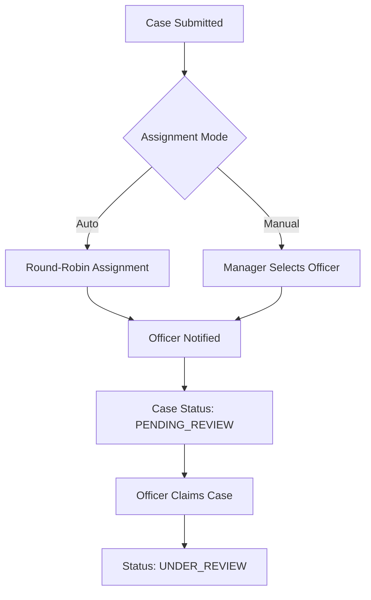

# ADR-004: Case Assignment — Hybrid Auto-Assign with Manager Override

## Status
✅ **APPROVED** (2026-11-18)

## Context

KYC cases need to be assigned to KYC Officers for review. The assignment mechanism must balance automation (for efficiency) with managerial control (for workload balancing and expertise matching).

**Requirements:**
- Cases must be assigned to KYC Officers promptly after submission
- Managers must be able to override automatic assignments
- Workload should be balanced across officers
- Officers should only access assigned cases
- Reassignment must be supported for escalations or workload balancing

## Decision

**Use a hybrid case assignment model: automatic round-robin assignment with manager override capability.**

### Assignment Mechanisms

| Mechanism | Trigger | Description |
|-----------|---------|-------------|
| **Auto-Assignment** | Case creation (SUBMITTED → PENDING_REVIEW) | Round-robin among available KYC Officers with capacity |
| **Manual Assignment** | Manager action via UI | Manager selects specific officer for a case |
| **Reassignment** | Manager action or SLA breach | Transfer case to different officer |

### Assignment Rules

| Rule | Specification |
|------|---------------|
| **Eligibility** | Only users with `ROLE_KYC_OFFICER` can be assigned |
| **Capacity Check** | Auto-assign skips officers at max capacity (configurable, default 20 cases) |
| **Round-Robin** | Next officer in rotation gets next case |
| **Manager Override** | Manager can assign to any eligible officer, bypassing round-robin |
| **Reassignment** | Creates new `KycCaseAssignment` with type `REASSIGN` or `ESCALATION` |
| **Self-Assignment Prevention** | Officers cannot assign cases to themselves (SoD) |

### Assignment Flow



### Data Model

```java
@Entity
@Table(name = "kyc_case_assignments")
public class KycCaseAssignment {
    @Id @GeneratedValue
    private Long id;
    
    @Column(name = "case_id", nullable = false)
    private Long caseId;
    
    @Column(name = "assignee_id", nullable = false)
    private Long assigneeId; // KYC_OFFICER
    
    @Column(name = "assigned_by_id", nullable = false)
    private Long assignedById; // KYC_MANAGER or SYSTEM
    
    @Enumerated(EnumType.STRING)
    @Column(name = "assignment_type", nullable = false)
    private AssignmentType type; // INITIAL, REASSIGN, ESCALATION
    
    @Column(name = "assigned_at", nullable = false)
    private LocalDateTime assignedAt;
    
    @Column(name = "acknowledged_at")
    private LocalDateTime acknowledgedAt;
    
    @Column(name = "completed_at")
    private LocalDateTime completedAt;
}

public enum AssignmentType {
    INITIAL,      // First assignment (auto or manual)
    REASSIGN,     // Reassigned to different officer
    ESCALATION    // Escalated to senior officer/compliance
}
```

## Alternatives Considered

| Option | Description | Pros | Cons | Verdict |
|--------|-------------|------|------|---------|
| **A) Pure Auto-Assignment** | Pure round-robin, no manual override | Simple, fair | No flexibility for expertise/urgency | ❌ Rejected |
| **B) Pure Manual Assignment** | Manager assigns every case | Full control | Bottleneck at high volume | ❌ Rejected |
| **C) Hybrid (Selected)** | Auto-assign with manager override | Balance of efficiency and control | Slightly more complex | ✅ **Selected** |

## Consequences & Trade-offs

### Positive
- **Efficiency**: Auto-assignment handles routine cases without manager intervention
- **Flexibility**: Manager can override for complex cases or expertise matching
- **Fairness**: Round-robin prevents workload imbalance
- **Audit Trail**: Every assignment tracked with type, timestamp, assigner

### Negative
- **Complexity**: Two assignment paths to maintain
- **Race Condition Risk**: Concurrent auto-assign and manual assign (mitigated by DB locking)

## Implementation Considerations

1. **Capacity Tracking**: Redis cache for officer case counts, updated on assignment/completion
2. **Notification**: Kafka events for `KYC_CASE_ASSIGNED` → Notification Service
3. **Audit Trail**: Every assignment logged in `kyc_case_history` with actor, type, timestamp
4. **Reassignment**: Creates new `KycCaseAssignment` with type `REASSIGN` or `ESCALATION`
4. **SLA Monitoring**: Assignment timestamp starts SLA clock; breach alerts at 50%/80%/100%

## Dependencies

- **DEC-003**: KYC Service Ownership (assignment logic in KYC Workflow Service)
- **DEC-005**: SoD Enforcement (officer cannot be assigned if they reviewed)
- **DEC-015**: KYC Vendor Integration (vendor result available before assignment)

## Future Considerations

| Phase | Enhancement |
|-------|-------------|
| **Phase 2** | Skill-based routing (match officer expertise to document types) |
| **Phase 3** | ML-based workload prediction |
| **Phase 3** | Cross-region assignment for multi-region deployment |

---

## Document Control

| Version | Date | Author | Changes |
|---------|------|--------|---------|
| 1.0 | 2026-11-18 | Architecture Team | Initial ADR |

---

**END OF ADR**