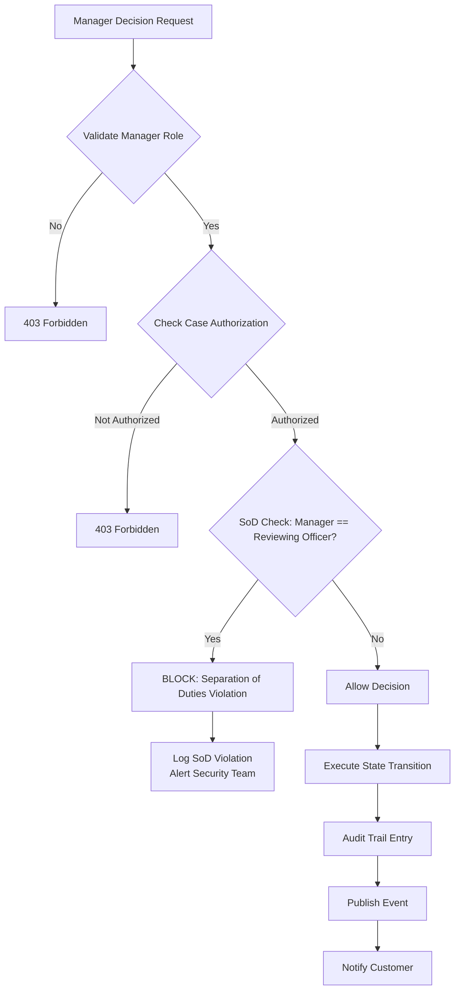

# ADR-005: Separation of Duties Enforcement Location — KYC Workflow Service + Gateway

## Status
✅ **APPROVED** (2026-11-18)

## Context

The KYC maker-checker workflow requires strict Separation of Duties (SoD): the KYC Officer who reviews and recommends on a case MUST NOT be the same person who approves/rejects it as KYC Manager. This is a fundamental regulatory requirement for KYC/AML compliance.

**Requirements:**
- Enforce Officer ≠ Manager for the same KYC case
- Enforce at the point of decision (approve/reject/return)
- Prevent self-assignment by officers
- Audit all SoD violations
- Enforce at both API Gateway (coarse) and Service level (fine-grained)

## Decision

**Enforce Separation of Duties at two layers:**
1. **KYC Workflow Service (Business Logic Layer)** - Primary enforcement, fine-grained
2. **API Gateway (Gateway Layer)** - Coarse-grained, defense in depth

### Enforcement Points

| Layer | Mechanism | Scope |
|-------|-----------|-------|
| **KYC Workflow Service** | Business logic in `approve()`, `reject()`, `return()` methods | Primary enforcement; checks `managerId != reviewingOfficerId` |
| **API Gateway** | Coarse RBAC filter on `/kyc/cases/{id}/approve\|reject\|return` | Coarse check; rejects if user has both roles for same case |

### Enforcement Flow



### Implementation Details

#### KYC Workflow Service (Primary Enforcement)

```java
@Service
public class KycCaseService {
    
    public KycCaseDto approve(String caseId, KycApprovalRequest request, UserPrincipal principal) {
        KycCase kycCase = caseRepository.findByCaseNumber(caseId)
            .orElseThrow(() -> new KycCaseNotFoundException(caseId));
        
        // 1. State machine validation
        if (!kycCase.getStatus().canTransitionTo(KycCaseStatus.APPROVED, principal.getRoles())) {
            throw new InvalidStateTransitionException(kycCase.getStatus(), KycCaseStatus.APPROVED);
        }
        
        // 2. Separation of Duties - CRITICAL
        if (kycCase.getReviewingOfficerId() != null 
            && kycCase.getReviewingOfficerId().equals(principal.getUserId())) {
            auditLogService.logSoDViolation(principal.getUserId(), caseId, "SELF_APPROVAL_ATTEMPT");
            throw new SeparationOfDutiesViolationException(
                "KYC Manager cannot approve a case they reviewed");
        }
        
        // 3. Authorization scope
        if (!isAuthorizedManager(caseId, principal.getUserId())) {
            throw new AccessDeniedException("Not authorized for this case");
        }
        
        // 4. Execute transition
        // ... implementation continues
    }
}
```

#### API Gateway (Coarse-Grained)

```yaml
# api-gateway application.yml
spring:
  cloud:
    gateway:
      routes:
        - id: kyc-workflow
          uri: lb://kyc-workflow-service
          predicates:
            - Path=/api/v1/kyc/**
          filters:
            - name: JwtAuthentication
            - name: RbacAuthorization
              args:
                requiredPermissions: 
                  - KYC_CASE_REVIEW
                  - KYC_CASE_APPROVE
                  - KYC_DOCUMENT_READ
            - name: SeparationOfDutiesFilter
              args:
                protectedPaths:
                  - /api/v1/kyc/cases/**/approve
                  - /api/v1/kyc/cases/**/reject
                  - /api/v1/kyc/cases/**/return
            - name: RateLimit
              args:
                keyResolver: userIdKeyResolver
                requestsPerMinute: 100
```

### SoD Violation Handling

```java
@Service
public class SeparationOfDutiesService {
    
    public void validateManagerDecision(Long caseId, Long managerId, String action) {
        KycCase kycCase = caseRepository.findByCaseNumber(caseId)
            .orElseThrow(() -> new KycCaseNotFoundException(caseId));
        
        Long reviewingOfficerId = kycCase.getReviewingOfficerId();
        
        if (reviewingOfficerId != null && reviewingOfficerId.equals(managerId)) {
            // LOG VIOLATION
            auditLogService.logSecurityEvent(SecurityEvent.builder()
                .eventType("SEPARATION_OF_DUTIES_VIOLATION")
                .actorId(managerId)
                .resourceType("KYC_CASE")
                .resourceId(caseId)
                .action(action)
                .details("Manager attempted to " + action + " case they reviewed")
                .severity(CRITICAL)
                .build());
            
            // ALERT
            alertService.sendAlert(Alert.builder()
                .type("SOD_VIOLATION")
                .title("KYC SoD Violation Attempt")
                .message("Manager " + managerId + " attempted to " + action + " case " + caseId + " which they reviewed")
                .recipients(securityTeamEmails)
                .build());
            
            throw new SeparationOfDutiesViolationException(
                "Manager cannot " + action + " a case they personally reviewed. " +
                "Case was reviewed by Officer ID: " + reviewingOfficerId);
        }
    }
}
```

### SoD Rules Summary

| Rule | Description | Enforcement Point |
|------|-------------|-------------------|
| **Officer ≠ Manager** | The officer who reviews/recommends cannot be the manager who approves/rejects | KYC Workflow Service: `approve()`, `reject()`, `return()` methods |
| **No Self-Assignment** | Officer cannot assign cases to themselves | KYC Workflow Service: `assign()` method |
| **Manager Authorization** | Manager must be explicitly authorized for the case | Case authorization matrix |
| **Compliance Independence** | Compliance officer resolving escalation cannot be involved in original review | Escalation resolution logic |

### Audit Trail

Every SoD check (pass or fail) is logged immutably:

```json
{
  "auditId": "uuid",
  "timestamp": "2026-11-18T10:30:00.123Z",
  "actor": {
    "userId": 54321,
    "email": "manager@citicore.com",
    "roles": ["ROLE_KYC_MANAGER"]
  },
  "action": "KYC_CASE_APPROVE",
  "resource": {
    "type": "KYC_CASE",
    "id": "KYC-20261118-001"
  },
  "details": {
    "sodCheck": "PASSED",
    "reviewingOfficerId": 67890,
    "decidingManagerId": 54321
  },
  "outcome": "SUCCESS"
}
```

For violations:

```json
{
  "auditId": "uuid",
  "timestamp": "2026-11-18T10:30:00.123Z",
  "actor": {
    "userId": 67890,
    "email": "officer@citicore.com",
    "roles": ["ROLE_KYC_OFFICER", "ROLE_KYC_MANAGER"]
  },
  "action": "KYC_CASE_APPROVE",
  "resource": {
    "type": "KYC_CASE",
    "id": "KYC-20261118-001"
  },
  "details": {
    "sodCheck": "FAILED",
    "violation": "SELF_APPROVAL_ATTEMPT",
    "reviewingOfficerId": 67890,
    "decidingManagerId": 67890
  },
  "outcome": "BLOCKED",
  "riskLevel": "CRITICAL"
}
```

### Enforcement Matrix

| Action | Gateway Check | Service Check | Audit |
|--------|---------------|---------------|-------|
| `POST /kyc/cases/{id}/approve` | Role: KYC_MANAGER + Permission: KYC_CASE_APPROVE | SoD: managerId != reviewingOfficerId | ✅ |
| `POST /kyc/cases/{id}/reject` | Role: KYC_MANAGER + Permission: KYC_CASE_REJECT | SoD: managerId != reviewingOfficerId | ✅ |
| `POST /kyc/cases/{id}/return` | Role: KYC_MANAGER + Permission: KYC_CASE_RETURN | SoD: managerId != reviewingOfficerId | ✅ |
| `POST /kyc/cases/{id}/assign` | Role: KYC_MANAGER + Permission: KYC_CASE_ASSIGN | Assignee != assigner | ✅ |

## Alternatives Considered

| Option | Description | Pros | Cons | Verdict |
|--------|-------------|------|------|---------|
| **A) Gateway Only** | Enforce SoD only at Gateway | Simple, single point | Bypassable if service called directly | ❌ Rejected |
| **B) Service Only** | Enforce SoD only in KYC Workflow Service | Business logic close to data | Gateway bypass possible | ❌ Rejected |
| **C) Both (Selected)** | Gateway (coarse) + Service (fine-grained) | Defense in depth; defense in depth | Slight complexity | ✅ **Selected** |

## Consequences & Trade-offs

### Positive
- **Defense in Depth**: Two independent enforcement layers
- **Regulatory Compliance**: Meets PMLA/RBI SoD requirements
- **Auditability**: Every decision (allow/block) logged with full context
- **Flexibility**: Gateway handles coarse RBAC; Service handles business logic SoD

### Negative
- **Complexity**: Two enforcement points to maintain
- **Latency**: Additional check at Gateway (minimal, <1ms)
- **Consistency**: Must keep both layers in sync for rule changes

## Implementation Considerations

1. **Gateway Filter**: Custom `SeparationOfDutiesFilter` checking JWT claims for case assignments
2. **Service Logic**: Core SoD logic in `KycCaseService` methods
3. **Cache**: Redis cache for case assignments (5-min TTL) to avoid DB lookups
4. **Testing**: Contract tests for both Gateway filter and Service methods

## Dependencies

- **DEC-002**: Saga Pattern (SoD events published via Kafka)
- **DEC-003**: KYC Service Ownership (enforcement in KYC Workflow Service)
- **DEC-004**: Case Assignment (assignment logic respects SoD)
- **DEC-006**: JWT Claims Size (case assignments in JWT claims)

## Future Considerations

| Phase | Enhancement |
|-------|-------------|
| **Phase 2** | Dynamic SoD policies (configurable rules engine) |
| **Phase 3** | Cross-service SoD (e.g., Account opening + KYC approval) |
| **Phase 4** | ML-based SoD anomaly detection |

---

## Document Control

| Version | Date | Author | Changes |
|---------|------|--------|---------|
| 1.0 | 2026-11-18 | Architecture Team | Initial ADR |

---

**END OF ADR**