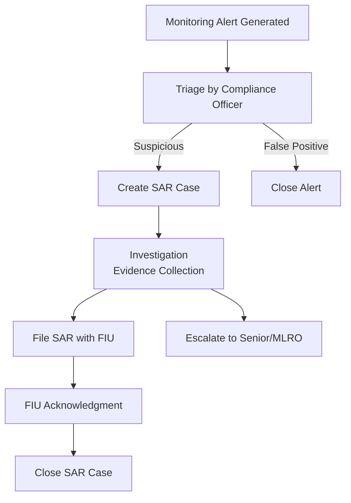

# ADR-008: Compliance Service — Build Abstraction; Integrate Vendor APIs

## Status
✅ **APPROVED** (2026-11-18)

## Context

The CitiCore platform requires compliance capabilities for regulatory compliance:
- Sanctions/PEP screening
- Transaction monitoring (AML)
- SAR (Suspicious Activity Report) filing
- Regulatory report generation

These capabilities require integration with external vendors and data sources. The platform must maintain flexibility to switch vendors and support different regulatory jurisdictions.

**Requirements:**
- Vendor abstraction for sanctions/PEP screening
- Transaction monitoring engine for AML
- SAR filing workflow
- Regulatory report generation
- Vendor-agnostic design for future integrations
- Audit trail for all compliance activities

## Decision

**Build a Compliance Service abstraction layer with pluggable vendor adapters for external integrations.**

### Service Responsibilities

| Responsibility | Description |
|----------------|-------------|
| **Sanctions/PEP Screening** | Real-time screening against sanctions lists (OFAC, UN, EU) and PEP databases |
| **Transaction Monitoring** | AML rule engine for suspicious pattern detection |
| **SAR Filing** | Workflow for Suspicious Activity Report creation and submission |
| **Regulatory Reporting** | Automated generation of regulatory reports (CTR, STR, etc.) |
| **Vendor Abstraction** | Pluggable adapters for vendor integrations (Dow Jones, Refinitiv, ComplyAdvantage, etc.) |

### Service Boundaries

| Service | Responsibility |
|---------|----------------|
| **Compliance Service** | Central compliance engine, rule engine, workflow orchestration |
| **Vendor Adapters** | Pluggable adapters per vendor (DowJonesAdapter, RefinitivAdapter, etc.) |
| **Transaction Service** | Publishes transaction events for monitoring |
| **KYC Workflow Service** | Provides KYC case data for enhanced screening |
| **Account Service** | Provides account/customer data for screening |

### Vendor Abstraction Interface

```java
public interface SanctionsScreeningProvider {
    
    /**
     * Screen customer/entity against sanctions and PEP lists.
     * @param request Screening request with entity details
     * @return Screening result with matches and risk score
     * @throws ProviderUnavailableException if provider unavailable
     */
    ScreeningResult screen(ScreeningRequest request) throws ProviderUnavailableException;
    
    /**
     * Get provider metadata.
     */
    ProviderInfo getProviderInfo();
    
    /**
     * Check if provider is healthy.
     */
    boolean isHealthy();
}

public record ScreeningRequest(
    String customerId,
    String entityName,
    String entityType, // INDIVIDUAL, ENTITY, VESSEL, AIRCRAFT
    Map<String, String> attributes, // DOB, nationality, addresses, IDs
    String caseId // Optional KYC case ID for context
) {}

public record ScreeningResult(
    String providerReferenceId,
    ScreeningStatus overallStatus, // CLEAR, POTENTIAL_MATCH, CONFIRMED_MATCH
    List<SanctionMatch> matches,
    RiskSignals riskSignals,
    Instant screenedAt,
    Map<String, String> metadata
) {}

public record SanctionMatch(
    String listName, // OFAC_SDN, UN_CONSOLIDATED, EU_CONSOLIDATED, PEP
    String matchedName,
    double confidenceScore, // 0.0 - 1.0
    List<String> matchingFields,
    String listUrl
) {}

public record RiskSignals(
    boolean pepMatch,
    boolean sanctionsMatch,
    boolean adverseMediaMatch,
    List<String> riskCategories
) {}
```

### Transaction Monitoring

```java
public interface TransactionMonitoringEngine {
    
    /**
     * Evaluate transaction against AML rules.
     * @param transaction Transaction to evaluate
     * @return Monitoring result with alerts
     */
    MonitoringResult evaluate(TransactionEvent transaction);
    
    /**
     * Get active rules.
     */
    List<MonitoringRule> getActiveRules();
    
    /**
     * Add/update rule.
     */
    void upsertRule(MonitoringRule rule);
}

public record MonitoringRule(
    String ruleId,
    String name,
    String description,
    RuleType type, // VELOCITY, THRESHOLD, PATTERN, GEOGRAPHIC, COUNTERPARTY
    Map<String, Object> parameters, // Rule-specific parameters
    AlertSeverity severity, // LOW, MEDIUM, HIGH, CRITICAL
    boolean enabled,
    String createdBy,
    LocalDateTime createdAt
) {}

public enum RuleType {
    VELOCITY,           // Transaction frequency/volume
    THRESHOLD,          // Amount thresholds
    PATTERN,            // Structuring, layering patterns
    GEOGRAPHIC,         // High-risk jurisdictions
    COUNTERPARTY,       // Sanctioned/PEP counterparties
    BEHAVIORAL          // Deviation from customer profile
}
```

### Vendor Adapter Implementations

| Vendor | Adapter Class | Key Features | Compliance |
|--------|---------------|--------------|------------|
| **Dow Jones** | `DowJonesSanctionsAdapter` | Risk & Compliance, Factiva | SOC2, ISO27001; requires DPA |
| **Refinitiv** | `RefinitivScreeningAdapter` | World-Check One | SOC2, ISO27001; EU data residency |
| **ComplyAdvantage** | `ComplyAdvantageAdapter` | Real-time AML, PEP, sanctions | SOC2, ISO27001; UK FCA |
| **Custom/Internal** | `InternalScreeningAdapter` | Custom lists, internal watchlists | Full control |

### Integration with KYC Workflow

```java
@Service
public class ComplianceIntegrationService {
    
    private final SanctionsScreeningProvider screeningProvider;
    private final KycCaseRepository caseRepository;
    
    @EventListener
    public void handleKycCaseCreated(KycCaseCreatedEvent event) {
        KycCase kycCase = caseRepository.findByCaseNumber(event.getCaseNumber())
            .orElseThrow(() -> new KycCaseNotFoundException(event.getCaseNumber()));
        
        // Build screening request from KYC data
        ScreeningRequest request = buildScreeningRequest(kycCase);
        
        // Call provider (async)
        CompletableFuture.supplyAsync(() -> screeningProvider.verify(request))
            .thenAccept(result -> handleScreeningResult(kycCase.getCaseNumber(), result))
            .exceptionally(ex -> handleScreeningError(kycCase.getCaseNumber(), ex));
    }
}
```

### SAR Filing Workflow



## Alternatives Considered

| Option | Description | Pros | Cons | Verdict |
|--------|-------------|------|------|---------|
| **A) Build Abstraction + Vendor Adapters (Selected)** | Internal compliance engine + pluggable vendor adapters | Full control; vendor flexibility; testable | Development effort | ✅ **Selected** |
| **B) Direct Vendor Integration** | Direct integration with one vendor | Faster initial delivery | Vendor lock-in; no fallback | ❌ Rejected |
| **C) Fully Managed Service** | Use fully managed compliance SaaS | Zero ops | Cost; data residency; customization limits | ❌ Rejected |
| **C) Open Source Only** | Build on open source (e.g., OpenAML) | No vendor cost | Maturity; support; maintenance burden | ❌ Rejected |

## Consequences & Trade-offs

### Positive
- **Vendor Flexibility**: Switch vendors without changing business logic
- **Testability**: Mock provider for unit/integration tests
- **Cost Control**: Negotiate with multiple vendors; switch for cost
- **Regulatory Agility**: Adapt to new regulations via rule engine
- **Data Sovereignty**: Keep sensitive data in-house; only send required fields to vendors

### Negative
- **Development Effort**: Build abstraction layer + adapters
- **Maintenance**: Keep adapters updated with vendor API changes
- **Vendor Onboarding**: Each new vendor requires adapter development

## Implementation Considerations

1. **Provider Selection**: Spring profile determines active provider (`mock`, `dowjones`, `refinitiv`, `complyadvantage`)
2. **Circuit Breaker**: Resilience4j on provider calls; fallback to `MANUAL_REVIEW`
3. **Idempotency**: Screening requests idempotent via `customerId + requestHash`
4. **Monitoring**: Metrics for provider latency, verdict distribution, error rate
5. **Testing**: Contract tests for provider interface; mock in unit tests

## Dependencies

- **DEC-003**: KYC Service Ownership (KYC data feeds compliance)
- **DEC-008**: Compliance Service Ownership (this ADR)
- **DEC-015**: KYC Vendor Integration (mock provider for testing)
- **DEC-002**: Saga Pattern (transaction events feed monitoring)
- **DEC-015**: KYC Vendor Integration (mock provider for testing)

## Future Migration Considerations

| Trigger | Action |
|---------|--------|
| **Regulatory Mandate** | Real vendor integration via approved ADR |
| **Scale/Accuracy Needs** | Evaluate vendor POC; select based on India market accuracy |
| **Cost Optimization** | Negotiate volume discounts; consider hybrid (mock for low-risk, vendor for high-risk) |
| **Multi-Country** | Add country-specific vendor adapters (e.g., SE Asia, ME) |

---

## Document Control

| Version | Date | Author | Changes |
|---------|------|--------|---------|
| 1.0 | 2026-11-18 | Architecture Team | Initial ADR |

---

**END OF ADR**