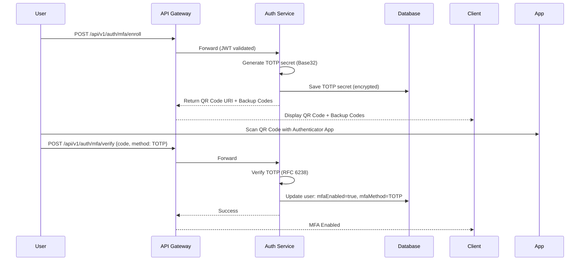
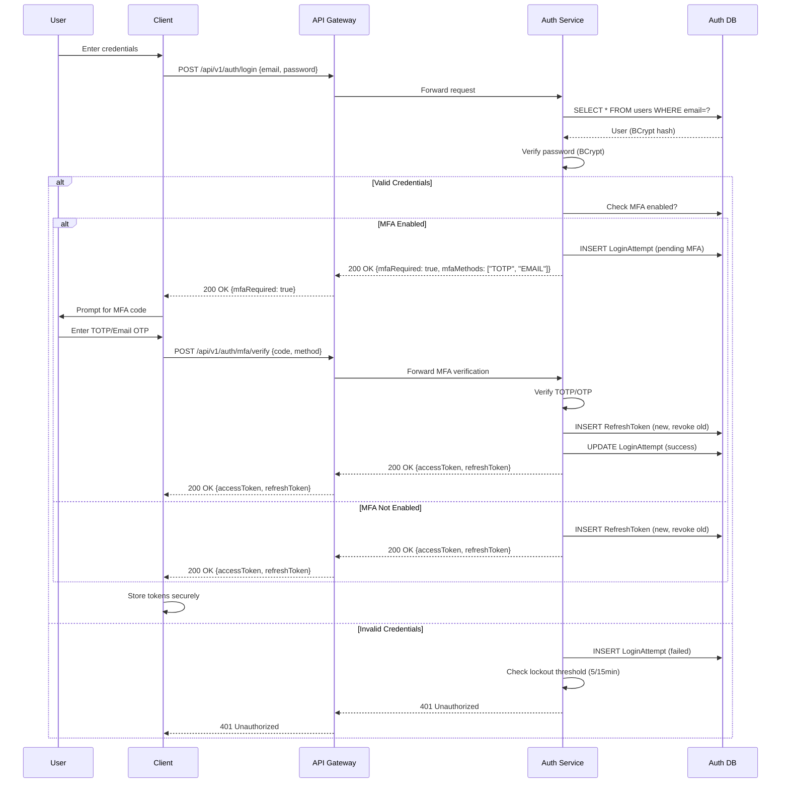

# ADR-009: MFA Methods — TOTP Primary, Email OTP Fallback

## Status
✅ **APPROVED** (2026-11-18)

## Context

The CitiCore platform requires Multi-Factor Authentication (MFA) for enhanced security, particularly for staff roles (KYC_OFFICER, KYC_MANAGER, ADMIN, etc.) and high-value customer transactions.

**Requirements:**
- Strong second factor for staff roles (regulatory requirement)
- Customer-friendly fallback for broader accessibility
- Support for account recovery if primary MFA method lost
- Compliance with RBI/PCI-DSS guidelines

## Decision

**Use TOTP (RFC 6238) as primary MFA method with Email OTP as fallback.**

### MFA Methods

| Method | Role | Type | Description |
|--------|------|------|-------------|
| **TOTP (RFC 6238)** | Primary | Authenticator App | Google Authenticator, Microsoft Authenticator, Authy compatible |
| **Email OTP** | Fallback | Email | 8-char alphanumeric code, 10-min expiry |
| **Backup Codes** | Recovery | One-time codes | 10 codes generated at enrollment, single-use |

### Supported Authenticator Apps

| App | Platform | Notes |
|-----|----------|-------|
| Google Authenticator | iOS, Android | Most common |
| Microsoft Authenticator | iOS, Android | Cloud backup option |
| Authy | iOS, Android, Desktop | Multi-device sync |
| 1Password | iOS, Android, Desktop, Browser | Password manager integration |
| Bitwarden | iOS, Android, Desktop, Browser | Open source |

### Enrollment Flow



### Authentication Flow (with MFA)



### TOTP Implementation

```java
@Component
public class TotpService {
    
    private static final int CODE_DIGITS = 6;
    private static final int TIME_STEP_SECONDS = 30;
    private static final String ALGORITHM = "HmacSHA1";
    
    public String generateSecret() {
        byte[] secret = new byte[20]; // 160 bits
        new SecureRandom().nextBytes(secret);
        return Base32.encodeToString(secret); // Base32 for QR codes
    }
    
    public String generateQrCodeUri(String email, String secret) {
        return String.format("otpauth://totp/CitiCore:%s?secret=%s&issuer=CitiCore&algorithm=SHA1&digits=6&period=30",
            URLEncoder.encode(email, StandardCharsets.UTF_8), secret);
    }
    
    public boolean verifyCode(String secret, String code) {
        long timeWindow = System.currentTimeMillis() / 1000 / 30;
        String expectedCode = generateCode(secret, timeWindow);
        if (constantTimeEquals(code, expectedCode)) return true;
        
        // Check adjacent windows (±1) for clock skew
        String prevCode = generateCode(secret, timeWindow - 1);
        if (constantTimeEquals(code, prevCode)) return true;
        
        String nextCode = generateCode(secret, timeWindow + 1);
        return constantTimeEquals(code, nextCode);
    }
    
    private String generateCode(String secret, long timeWindow) {
        byte[] key = Base32.decode(secret);
        byte[] timeBytes = ByteBuffer.allocate(8).putLong(timeWindow).array();
        try {
            Mac mac = Mac.getInstance(ALGORITHM);
            mac.init(new SecretKeySpec(key, ALGORITHM));
            byte[] hash = mac.doFinal(timeBytes);
            int offset = hash[hash.length - 1] & 0xF;
            int binary = ((hash[offset] & 0x7F) << 24) |
                         ((hash[offset + 1] & 0xFF) << 16) |
                         ((hash[offset + 2] & 0xFF) << 8) |
                         (hash[offset + 3] & 0xFF);
            int otp = binary % (int) Math.pow(10, CODE_DIGITS);
            return String.format("%0" + CODE_DIGITS + "d", otp);
        } catch (Exception e) {
            throw new RuntimeException("TOTP generation failed", e);
        }
    }
    
    private boolean constantTimeEquals(String a, String b) {
        if (a.length() != b.length()) return false;
        int result = 0;
        for (int i = 0; i < a.length(); i++) {
            result |= a.charAt(i) ^ b.charAt(i);
        }
        return result == 0;
    }
}
```

### Email OTP Fallback

```java
@Service
public class EmailOtpService {
    
    private static final int OTP_LENGTH = 8;
    private static final int EXPIRY_MINUTES = 10;
    
    public String generateOtp() {
        String chars = "ABCDEFGHJKLMNPQRSTUVWXYZ23456789"; // No confusing chars
        SecureRandom random = new SecureRandom();
        StringBuilder sb = new StringBuilder(OTP_LENGTH);
        for (int i = 0; i < OTP_LENGTH; i++) {
            sb.append(chars.charAt(random.nextInt(chars.length())));
        }
        return sb.toString();
    }
    
    public void sendOtp(String email, String otp) {
        // Send via Notification Service (SES/Mailpit)
        notificationClient.sendEmail(EmailRequest.builder()
            .to(email)
            .subject("Your CitiCore Verification Code")
            .template("otp-email")
            .variables(Map.of("otp", otp, "expiryMinutes", EXPIRY_MINUTES))
            .build());
    }
}
```

### Backup Codes

```java
@Component
public class BackupCodeService {
    
    private static final int BACKUP_CODE_COUNT = 10;
    private static final int CODE_LENGTH = 8;
    
    public List<String> generateBackupCodes() {
        Set<String> codes = new HashSet<>();
        SecureRandom random = new SecureRandom();
        String chars = "ABCDEFGHJKLMNPQRSTUVWXYZ23456789";
        
        while (codes.size() < BACKUP_CODE_COUNT) {
            StringBuilder sb = new StringBuilder(CODE_LENGTH);
            for (int i = 0; i < CODE_LENGTH; i++) {
                sb.append(chars.charAt(random.nextInt(chars.length())));
            }
            codes.add(sb.toString());
        }
        return new ArrayList<>(codes);
    }
    
    @Transactional
    public void saveBackupCodes(Long userId, List<String> codes) {
        // Store hashed (BCrypt)
        List<BackupCode> entities = codes.stream()
            .map(code -> BackupCode.builder()
                .userId(userId)
                .codeHash(BCrypt.hashpw(code, BCrypt.gensalt()))
                .used(false)
                .build())
            .toList();
        backupCodeRepository.saveAll(entities);
    }
    
    @Transactional
    public boolean verifyAndConsume(Long userId, String code) {
        List<BackupCode> codes = backupCodeRepository.findByUserIdAndUsedFalse(userId);
        for (BackupCode bc : codes) {
            if (BCrypt.checkpw(code, bc.getCodeHash())) {
                bc.setUsed(true);
                bc.setUsedAt(Instant.now());
                backupCodeRepository.save(bc);
                return true;
            }
        }
        return false;
    }
}
```

### Enrollment & Recovery

| Scenario | Flow |
|----------|------|
| **First Enrollment** | User scans QR → Enters TOTP → Backup codes generated & shown |
| **Lost Device** | User clicks "Lost Device" → Email OTP sent → New TOTP enrolled → New backup codes |
| **Forgot Password + MFA** | Password reset → MFA re-enrollment required |
| **Admin Reset** | Admin triggers MFA reset → User re-enrolls |

### MFA Methods Comparison

| Method | Security | Usability | Recovery | Cost |
|--------|----------|-----------|----------|------|
| **TOTP (Primary)** | High (RFC 6238, time-based) | Good (scan once) | Backup codes | Free |
| **Email OTP (Fallback)** | Medium (email compromise risk) | Universal | N/A | Free |
| **SMS OTP** | Low (SIM swap risk) | Universal | N/A | Cost per SMS |
| **Push Notification** | High (device-bound) | Good (one-tap) | Device recovery | Infrastructure cost |
| **Hardware Key (FIDO2)** | Highest (phishing-resistant) | Extra hardware | Backup key | Hardware cost |

### Configuration

```yaml
# application.yml
mfa:
  totp:
    enabled: true
    issuer: "CitiCore"
    digits: 6
    period: 30
    algorithm: HmacSHA1
  email-otp:
    enabled: true
    length: 8
    expiry-minutes: 10
  backup-codes:
    count: 10
    length: 8
  enforcement:
    staff-roles: [ROLE_KYC_OFFICER, ROLE_KYC_MANAGER, ROLE_ADMIN, ROLE_COMPLIANCE_OFFICER, ROLE_OPERATIONS_OFFICER, ROLE_SUPPORT_AGENT]
    customer-optional: true
```

### JWT Claims for MFA

```json
{
  "sub": "67890",
  "email": "kyc.officer@citicore.com",
  "roles": ["ROLE_KYC_OFFICER"],
  "permissions": [...],
  "mfaEnabled": true,
  "mfaMethod": "TOTP",
  "iat": 1731923400,
  "exp": 1731924300
}
```

### API Endpoints

| Endpoint | Method | Description |
|----------|--------|-------------|
| `/api/v1/auth/mfa/enroll` | POST | Initiate MFA enrollment (returns QR + backup codes) |
| `/api/v1/auth/mfa/verify` | POST | Verify TOTP/Email OTP during login |
| `/api/v1/auth/mfa/disable` | POST | Disable MFA (requires current MFA code) |
| `/api/v1/auth/mfa/backup-codes` | GET | Get remaining backup codes (requires MFA) |
| `/api/v1/auth/mfa/backup-codes/regenerate` | POST | Regenerate backup codes (requires MFA) |
| `/api/v1/auth/mfa/lost-device` | POST | Initiate lost device recovery (Email OTP) |

### Security Considerations

1. **TOTP Secret Storage**: Encrypted at rest (AES-256-GCM) in database
2. **Rate Limiting**: 5 attempts per 15 min on `/mfa/verify`
3. **Clock Skew Tolerance**: ±1 time step (30 seconds)
4. **Backup Codes**: Single-use, BCrypt hashed, consumed on use
5. **Clock Drift**: Server time synced via NTP; client clock drift handled by ±1 window
6. **Phishing Resistance**: TOTP resistant to phishing (time-based); Email OTP less so

---

## Document Control

| Version | Date | Author | Changes |
|---------|------|--------|---------|
| 1.0 | 2026-11-18 | Architecture Team | Initial ADR |

---

**END OF ADR**