# CitiCore Banking Platform - Target State Architecture Documentation

## Document Information

| Field | Value |
|-------|-------|
| **Document Title** | CitiCore Banking Platform - Target State Architecture |
| **Version** | 3.0 |
| **Status** | Approved |
| **Classification** | Internal - Confidential |
| **Author** | Architecture Team |
| **Reviewers** | Engineering Lead, Security Lead, Platform Team, Compliance Officer |
| **Last Updated** | 2026-11-18 |

---

## Table of Contents

1. [Product Overview](#1-product-overview)
2. [Functional Modules](#2-functional-modules)
3. [User Roles & Access Matrix (Updated - RBAC)](#3-user-roles--access-matrix)
4. [Microservices Architecture](#4-microservices-architecture)
5. [Database Architecture](#5-database-architecture)
6. [Service Communication Patterns](#6-service-communication-patterns)
7. [Event-Driven Architecture](#7-event-driven-architecture)
8. [Financial Transaction Processing](#8-financial-transaction-processing)
9. [Double-Entry Ledger Architecture](#9-double-entry-ledger-architecture)
10. [Security Architecture (Updated - RBAC)](#10-security-architecture)
11. [KYC Architecture (Updated - Maker-Checker Workflow)](#11-kyc-architecture)
12. [Infrastructure & Deployment](#12-infrastructure--deployment)
13. [Monitoring & Observability](#13-monitoring--observability)
14. [End-to-End Workflows](#14-end-to-end-workflows)
15. [Architecture Review Observations](#15-architecture-review-observations)

---

## 1. Product Overview

### 1.1 Purpose
CitiCore is a **microservices-based digital banking platform** designed to deliver core banking functionality including customer onboarding, account management, fund transfers, KYC maker-checker workflow, and financial ledger operations. The platform follows a cloud-native architecture built on Spring Boot 3.2.4, Java 17, and Spring Cloud 2023.0.3.

### 1.2 Scope
- **In Scope**: Customer registration & KYC with maker-checker workflow, Account lifecycle (Savings/Current), Internal fund transfers, Double-entry general ledger, Notification services, API Gateway with resilience patterns, Comprehensive RBAC
- **Out of Scope**: External payment rail integrations (NEFT/RTGS/IMPS/UPI), Card management, Loan origination, Wealth management, International banking

### 1.3 Key Architectural Principles

| Principle | Description |
|-----------|-------------|
| **Domain-Driven Design** | Services aligned to business capabilities (Auth, User, Account, Transaction, Notification, KYC) |
| **Schema per Service** | Each microservice owns its schema within a single RDS MySQL deployment; no shared schemas; separate credentials per service |
| **Event-Driven** | Kafka for async communication; transactional outbox for reliability |
| **Saga Pattern** | Hybrid: Orchestration for fund transfers; Choreography for notifications; Async event consumption for audit |
| **Security First** | Zero-trust, JWT-based authentication, Comprehensive RBAC, rate limiting |
| **Separation of Duties** | Maker-Checker enforced for KYC approvals; Officer cannot approve own case |
| **Encryption by Default** | AWS RDS KMS encryption at rest; TLS 1.2+ in transit; Selective application-level envelope encryption for sensitive PII |
| **Secrets Management** | AWS Secrets Manager for all credentials; IAM workload identity for EKS |
| **Observability** | Structured logging, metrics, distributed tracing, health checks |
| **Infrastructure as Code** | Docker, Kubernetes, Helm, GitOps |

### 1.4 Technology Stack Summary

| Layer | Technology | Version |
|-------|------------|---------|
| **Language** | Java | 17 |
| **Framework** | Spring Boot | 3.2.4 |
| **Cloud** | Spring Cloud | 2023.0.3 |
| **Security** | Spring Security, JWT (jjwt) | 0.12.5 |
| **Data** | Spring Data JPA, Hibernate | 6.4.5 |
| **Database** | AWS RDS for MySQL | 8.0 |
| **Cache** | Redis | 7 |
| **Messaging** | Apache Kafka | 3.8 |
| **Service Discovery** | Kubernetes DNS (Production) / Netflix Eureka (Local) | - |
| **Config** | Spring Cloud Config | - |
| **Gateway** | Spring Cloud Gateway (WebFlux) | - |
| **Resilience** | Resilience4j | - |
| **HTTP Client** | OpenFeign | - |
| **Observability** | Micrometer, Prometheus, Zipkin (Brave) | - |
| **Build** | Maven | - |
| **Container** | Docker, Docker Compose | - |
| **Email** | Spring Mail, SendGrid | - |
| **Cloud Storage** | AWS S3 SDK v2 | - |
| **OCR** | Google Cloud Vision | - |
| **Secrets Management** | AWS Secrets Manager | - |
| **Encryption** | AWS KMS (RDS storage encryption + application-level envelope encryption) | - |
| **Malware Scanning** | ClamAV (via S3 Object Lambda) | - |

---

## 2. Functional Modules

### 2.1 Module Overview

```
┌─────────────────────────────────────────────────────────────────────────────┐
│                        CITICORE FUNCTIONAL MODULES                          │
├─────────────────────┬─────────────────────┬─────────────────────────────────┤
│   CUSTOMER DOMAIN   │   ACCOUNT DOMAIN    │   TRANSACTION DOMAIN            │
├─────────────────────┼─────────────────────┼─────────────────────────────────┤
│  ┌───────────────┐  │  ┌───────────────┐  │  ┌─────────────────────────┐   │
│  │ Auth Service  │  │  │Account Service│  │  │  Transaction Service    │   │
│  │               │  │  │               │  │  │                         │   │
│  │ • Registration│  │  │ • CRUD        │  │  │ • Transfer Initiation   │   │
│  │ • Login/JWT   │  │  │ • Deposit/    │  │  │ • Saga Orchestration    │   │
│  │ • Token Mgmt  │  │  │   Withdraw    │  │  │ • Daily Limits          │   │
│  │ • Email Verify│  │  │ • Balance     │  │  │ • Idempotency           │   │
│  │ • MFA (Email OTP)  │  │  │ • Statements  │  │  │ • History/Status        │   │
│  └───────────────┘  │  │ • Auth Holds  │  │  └─────────────────────────┘   │
│                     │  │ • Interest    │  │                                 │
│  ┌───────────────┐  │  │ • Closure     │  │  ┌─────────────────────────┐   │
│  │ User Service  │  │  │ • PDF Stmts   │  │  │  Notification Service   │   │
│  │               │  │  └───────────────┘  │  │                         │   │
│  │ • Profile Mgmt│  │                     │  │ • Email (SMTP/SendGrid) │   │
│  │ • KYC Upload  │  │  ┌───────────────┐  │  │ • SMS (Planned)         │   │
│  │ • KYC Review  │  │  │  Ledger Svc   │  │  │ • In-App (Planned)      │   │
│  │ • Documents   │  │  │  (Planned)    │  │  │ • Templates             │   │
│  │ • S3 Storage  │  │  │               │  │  │ • Preferences           │   │
│  │ • OCR         │  │  │ • GL Accounts │  │  └─────────────────────────┘   │
│  └───────────────┘  │  │ • Journal Ent │  │                                 │
│                     │  │ • Trial Bal   │  │  ┌─────────────────────────┐   │
│  ┌───────────────┐  │  │ • Reconcile   │  │  │   KYC Workflow Svc      │   │
│  │ KYC Workflow  │  │  │ • Audit Trail │  │  │   (Maker-Checker)       │   │
│  │ Service       │  │  └───────────────┘  │  │                         │   │
│  │               │  │                     │  │ • Case Assignment       │   │
│  │ • Case Mgmt   │  │  ┌───────────────┐  │  │ • State Machine         │   │
│  │ • Review Flow │  │  │ Compliance    │  │  │ • Audit Trail           │   │
│  │ • Approval    │  │  │ Service       │  │  │ • Escalation            │   │
│  │ • Separation  │  │  │ (Planned)     │  │  └─────────────────────────┘   │
│  └───────────────┘  │  └───────────────┘  │                                 │
└─────────────────────┴─────────────────────┴─────────────────────────────────┘
                                               ┌─────────────────────────┐
                                               │   Platform Services     │
                                               │                         │
                                               │ • API Gateway           │
                                               │ • Config Server         │
                                               │ • Eureka Discovery      │
                                               │ • Kafka Event Bus       │
                                               └─────────────────────────┘
```

### 2.2 Module Responsibilities

| Module | Service | Core Responsibility | Key APIs |
|--------|---------|---------------------|----------|
| **Customer** | Auth Service | Identity & access management | `/api/v1/auth/*` |
| **Customer** | User Service | Profile, KYC documents | `/api/v1/users/*` |
| **KYC** | KYC Workflow Service | Maker-checker KYC workflow, case management, state transitions | `/api/v1/kyc/*` |
| **Account** | Account Service | Account lifecycle, balances, ledger posting | `/api/v1/accounts/*` |
| **Transaction** | Transaction Service | Fund transfers, saga orchestration | `/api/v1/transactions/*` |
| **Notification** | Notification Service | Multi-channel notifications | Internal (Kafka) |
| **Ledger** | Ledger Service (Planned) | Double-entry GL, compliance | `/api/v1/ledger/*` |
| **Compliance** | Compliance Service (Planned) | AML, sanctions, regulatory reporting | `/api/v1/compliance/*` |
| **Platform** | API Gateway | Routing, auth, rate limiting, resilience | `/` (all traffic) |
| **Platform** | Config Server | Centralized configuration | `/config/*` |
| **Platform** | Eureka Server | Service registry & discovery | `/eureka/*` |

---

## 3. User Roles & Access Matrix

### 3.1 Role Definitions (Updated - Comprehensive RBAC)

| Role | Description | Default Assignment | Business Context |
|------|-------------|-------------------|------------------|
| **ROLE_CUSTOMER** | Retail banking customer | Assigned on registration | Can access only own data |
| **ROLE_KYC_OFFICER** | KYC case reviewer (Maker) | Assigned by KYC_MANAGER or ADMIN | Reviews assigned KYC cases, recommends approval/rejection |
| **ROLE_KYC_MANAGER** | KYC case approver (Checker) | Assigned by ADMIN | Approves/rejects KYC cases reviewed by Officers |
| **ROLE_SUPPORT_AGENT** | Customer support agent | Assigned by ADMIN | Views customer profiles, accounts; limited KYC visibility |
| **ROLE_OPERATIONS_OFFICER** | Banking operations staff | Assigned by ADMIN | Account operations, transaction monitoring |
| **ROLE_COMPLIANCE_OFFICER** | Compliance & AML officer | Assigned by ADMIN | Full KYC audit access, regulatory reporting |
| **ROLE_ADMIN** | Platform administrator | Assigned by super-admin | Full platform access, user/role management |
| **ROLE_AUDITOR** | Read-only audit access | Assigned by ADMIN | Read-only access to all audit trails |
| **ROLE_SERVICE** | Service-to-service communication | Internal (Feign clients) | Internal API access only |

### 3.2 Role Hierarchy

```
ROLE_ADMIN
    ├── ROLE_COMPLIANCE_OFFICER
    ├── ROLE_KYC_MANAGER
    │       └── ROLE_KYC_OFFICER
    ├── ROLE_OPERATIONS_OFFICER
    ├── ROLE_SUPPORT_AGENT
    └── ROLE_AUDITOR

ROLE_CUSTOMER (no inheritance)
```

### 3.3 Permission Definitions (Granular Permissions)

| Permission | Description | Resource Scope |
|------------|-------------|----------------|
| `CUSTOMER_PROFILE_READ` | Read own profile | Own |
| `CUSTOMER_PROFILE_WRITE` | Update own profile | Own |
| `CUSTOMER_PROFILE_READ_ALL` | Read any customer profile | All (staff) |
| `KYC_DOCUMENT_UPLOAD` | Upload KYC documents | Own |
| `KYC_DOCUMENT_READ` | Read KYC documents | Own / Assigned cases (Officer/Manager) |
| `KYC_CASE_ASSIGN` | Assign KYC case to officer | Manager/Admin |
| `KYC_CASE_REVIEW` | Review KYC case (Maker) | Assigned cases (Officer) |
| `KYC_CASE_RECOMMEND` | Recommend approval/rejection | Assigned cases (Officer) |
| `KYC_CASE_REQUEST_INFO` | Request additional info | Assigned cases (Officer) |
| `KYC_CASE_APPROVE` | Approve KYC case (Checker) | Authorized cases (Manager) |
| `KYC_CASE_REJECT` | Reject KYC case (Checker) | Authorized cases (Manager) |
| `KYC_CASE_RETURN` | Return case for further review | Authorized cases (Manager) |
| `KYC_CASE_ESCALATE` | Escalate exceptional cases | Manager/Compliance |
| `KYC_AUDIT_READ` | Read KYC audit trail | All (Compliance/Auditor/Admin) |
| `ACCOUNT_CREATE` | Create new account | Own (Customer) / All (Operations) |
| `ACCOUNT_READ` | Read account details | Own / All (Staff) |
| `ACCOUNT_DEPOSIT` | Deposit funds | Own / All (Operations) |
| `ACCOUNT_WITHDRAW` | Withdraw funds | Own |
| `ACCOUNT_TRANSFER` | Transfer funds | Own |
| `ACCOUNT_STATEMENT` | View account statements | Own / All (Staff) |
| `ACCOUNT_CLOSE` | Close account | Own / Admin |
| `TRANSFER_INITIATE` | Initiate fund transfer | Own |
| `TRANSFER_HISTORY` | View transfer history | Own / All (Staff) |
| `TRANSFER_MONITOR` | Monitor all transfers | Operations/Compliance |
| `ADMIN_USER_MANAGE` | Manage users and roles | Admin |
| `ADMIN_ROLE_ASSIGN` | Assign/revoke roles | Admin |
| `ADMIN_CONFIG_MANAGE` | Manage platform configuration | Admin |
| `AUDIT_TRAIL_READ` | Read audit logs | Auditor/Admin/Compliance |
| `SERVICE_INTERNAL` | Internal service calls | Service-to-service |

### 3.4 Role-to-Permission Mapping Matrix

| Permission | CUSTOMER | KYC_OFFICER | KYC_MANAGER | SUPPORT_AGENT | OPERATIONS_OFFICER | COMPLIANCE_OFFICER | ADMIN | AUDITOR | SERVICE |
|------------|:--------:|:-----------:|:-----------:|:-------------:|:------------------:|:------------------:|:-----:|:-------:|:-------:|
| `CUSTOMER_PROFILE_READ` | ✅ Own | ✅ Assigned | ✅ All | ✅ All | ✅ All | ✅ All | ✅ All | ✅ All | ❌ |
| `CUSTOMER_PROFILE_WRITE` | ✅ Own | ❌ | ❌ | ❌ | ❌ | ❌ | ✅ All | ❌ | ❌ |
| `CUSTOMER_PROFILE_READ_ALL` | ❌ | ✅ Assigned | ✅ All | ✅ All | ✅ All | ✅ All | ✅ All | ✅ All | ❌ |
| `KYC_DOCUMENT_UPLOAD` | ✅ Own | ❌ | ❌ | ❌ | ❌ | ❌ | ✅ All | ❌ | ❌ |
| `KYC_DOCUMENT_READ` | ✅ Own | ✅ Assigned | ✅ Authorized | ✅ Limited | ✅ All | ✅ All | ✅ All | ✅ All | ❌ |
| `KYC_CASE_ASSIGN` | ❌ | ❌ | ✅ | ❌ | ❌ | ❌ | ✅ | ❌ | ❌ |
| `KYC_CASE_REVIEW` | ❌ | ✅ Assigned | ✅ Authorized | ❌ | ❌ | ✅ All | ✅ All | ❌ | ❌ |
| `KYC_CASE_RECOMMEND` | ❌ | ✅ Assigned | ❌ | ❌ | ❌ | ❌ | ❌ | ❌ | ❌ |
| `KYC_CASE_REQUEST_INFO` | ❌ | ✅ Assigned | ❌ | ❌ | ❌ | ❌ | ✅ | ❌ | ❌ |
| `KYC_CASE_APPROVE` | ❌ | ❌ | ✅ Authorized | ❌ | ❌ | ❌ | ✅ | ❌ | ❌ |
| `KYC_CASE_REJECT` | ❌ | ❌ | ✅ Authorized | ❌ | ❌ | ✅ | ✅ | ❌ | ❌ |
| `KYC_CASE_RETURN` | ❌ | ❌ | ✅ Authorized | ❌ | ❌ | ✅ | ✅ | ❌ | ❌ |
| `KYC_CASE_ESCALATE` | ❌ | ❌ | ✅ | ❌ | ❌ | ✅ | ✅ | ❌ | ❌ |
| `KYC_AUDIT_READ` | ❌ | ❌ | ❌ | ❌ | ❌ | ✅ | ✅ | ✅ | ❌ |
| `ACCOUNT_CREATE` | ✅ Own | ❌ | ❌ | ❌ | ✅ All | ❌ | ✅ All | ❌ | ❌ |
| `ACCOUNT_READ` | ✅ Own | ✅ Assigned | ✅ Authorized | ✅ All | ✅ All | ✅ All | ✅ All | ✅ All | ❌ |
| `ACCOUNT_DEPOSIT` | ✅ Own | ❌ | ❌ | ❌ | ✅ All | ❌ | ✅ All | ❌ | ✅ |
| `ACCOUNT_WITHDRAW` | ✅ Own | ❌ | ❌ | ❌ | ❌ | ❌ | ✅ All | ❌ | ❌ |
| `ACCOUNT_TRANSFER` | ✅ Own | ❌ | ❌ | ❌ | ❌ | ❌ | ✅ All | ❌ | ❌ |
| `ACCOUNT_STATEMENT` | ✅ Own | ✅ Assigned | ✅ Authorized | ✅ All | ✅ All | ✅ All | ✅ All | ✅ All | ❌ |
| `ACCOUNT_CLOSE` | ✅ Own | ❌ | ❌ | ❌ | ❌ | ❌ | ✅ | ❌ | ❌ |
| `TRANSFER_INITIATE` | ✅ Own | ❌ | ❌ | ❌ | ❌ | ❌ | ✅ All | ❌ | ❌ |
| `TRANSFER_HISTORY` | ✅ Own | ✅ Assigned | ✅ Authorized | ✅ All | ✅ All | ✅ All | ✅ All | ✅ All | ❌ |
| `TRANSFER_MONITOR` | ❌ | ❌ | ❌ | ❌ | ✅ All | ✅ All | ✅ All | ✅ All | ❌ |
| `ADMIN_USER_MANAGE` | ❌ | ❌ | ❌ | ❌ | ❌ | ❌ | ✅ | ❌ | ❌ |
| `ADMIN_ROLE_ASSIGN` | ❌ | ❌ | ❌ | ❌ | ❌ | ❌ | ✅ | ❌ | ❌ |
| `ADMIN_CONFIG_MANAGE` | ❌ | ❌ | ❌ | ❌ | ❌ | ❌ | ✅ | ❌ | ❌ |
| `AUDIT_TRAIL_READ` | ❌ | ❌ | ❌ | ❌ | ❌ | ✅ | ✅ | ✅ | ❌ |
| `SERVICE_INTERNAL` | ❌ | ❌ | ❌ | ❌ | ❌ | ❌ | ❌ | ❌ | ✅ |

### 3.5 Resource Ownership & Access Scopes

| Resource | Ownership Model | Access Scope Rules |
|----------|-----------------|-------------------|
| **Customer Profile** | Owned by Customer (auth_user_id) | Customer: Own only. KYC_OFFICER: Assigned cases only. KYC_MANAGER: Authorized cases. SUPPORT/OPERATIONS/COMPLIANCE: All. |
| **KYC Documents** | Owned by Customer (auth_user_id) | Customer: Own only. KYC_OFFICER: Assigned cases. KYC_MANAGER: Authorized cases. Others: Role-based. |
| **KYC Case** | Owned by Customer, Assigned to Officer | Customer: View own case status. KYC_OFFICER: Assigned cases only. KYC_MANAGER: Authorized cases (not own reviews). ADMIN/COMPLIANCE: All. |
| **Accounts** | Owned by Customer (auth_user_id) | Customer: Own accounts. Staff: Role-based access. |
| **Transactions** | Owned by Customer (auth_user_id) | Customer: Own transactions. Staff: Role-based access. |
| **Audit Trail** | System-owned | COMPLIANCE/AUDITOR/ADMIN: All. Others: None. |

### 3.6 Access Control Matrix (API Endpoint Level)

| Endpoint Pattern | CUSTOMER | KYC_OFFICER | KYC_MANAGER | SUPPORT_AGENT | OPERATIONS_OFFICER | COMPLIANCE_OFFICER | ADMIN | AUDITOR | SERVICE |
|------------------|:--------:|:-----------:|:-----------:|:-------------:|:------------------:|:------------------:|:-----:|:-------:|:-------:|
| `POST /auth/register` | ✅ | ✅ | ✅ | ✅ | ✅ | ✅ | ✅ | ❌ | ❌ |
| `POST /auth/login` | ✅ | ✅ | ✅ | ✅ | ✅ | ✅ | ✅ | ❌ | ❌ |
| `POST /auth/refresh` | ✅ | ✅ | ✅ | ✅ | ✅ | ✅ | ✅ | ❌ | ❌ |
| `POST /auth/mfa/*` | ✅ | ✅ | ✅ | ✅ | ✅ | ✅ | ✅ | ❌ | ❌ |
| `GET /users/profile` | Own | Assigned | Authorized | All | All | All | All | All | ❌ |
| `PUT /users/profile` | Own | ❌ | ❌ | ❌ | ❌ | ❌ | All | ❌ | ❌ |
| `POST /users/kyc/upload` | Own | ❌ | ❌ | ❌ | ❌ | ❌ | All | ❌ | ❌ |
| `GET /users/kyc/documents/*` | Own | Assigned | Authorized | Limited | All | All | All | All | ❌ |
| `GET /kyc/cases` | Own | Assigned | Authorized | Limited | All | All | All | All | ❌ |
| `GET /kyc/cases/{caseId}` | Own | Assigned | Authorized | Limited | All | All | All | All | ❌ |
| `POST /kyc/cases/{caseId}/assign` | ❌ | ❌ | ✅ | ❌ | ❌ | ❌ | ✅ | ❌ | ❌ |
| `POST /kyc/cases/{caseId}/review` | ❌ | Assigned | ❌ | ❌ | ❌ | All | All | ❌ | ❌ |
| `POST /kyc/cases/{caseId}/recommend` | ❌ | Assigned | ❌ | ❌ | ❌ | ❌ | ❌ | ❌ | ❌ |
| `POST /kyc/cases/{caseId}/request-info` | ❌ | Assigned | ❌ | ❌ | ❌ | ❌ | ✅ | ❌ | ❌ |
| `POST /kyc/cases/{caseId}/approve` | ❌ | ❌ | Authorized* | ❌ | ❌ | ❌ | ✅ | ❌ | ❌ |
| `POST /kyc/cases/{caseId}/reject` | ❌ | ❌ | Authorized* | ❌ | ❌ | ✅ | ✅ | ❌ | ❌ |
| `POST /kyc/cases/{caseId}/return` | ❌ | ❌ | Authorized* | ❌ | ❌ | ✅ | ✅ | ❌ | ❌ |
| `POST /kyc/cases/{caseId}/escalate` | ❌ | ❌ | ✅ | ❌ | ❌ | ✅ | ✅ | ❌ | ❌ |
| `GET /kyc/audit/*` | ❌ | ❌ | ❌ | ❌ | ❌ | ✅ | ✅ | ✅ | ❌ |
| `POST /accounts/create` | ✅ | ❌ | ❌ | ❌ | ✅ | ❌ | ✅ | ❌ | ❌ |
| `GET /accounts/balance/*` | Own | Assigned | Authorized | Own | All | All | All | All | ❌ |
| `POST /accounts/deposit` | Own | ❌ | ❌ | ❌ | ✅ | ❌ | ✅ | ❌ | ✅ |
| `POST /accounts/withdraw` | Own | ❌ | ❌ | ❌ | ❌ | ❌ | ✅ | ❌ | ❌ |
| `POST /accounts/transfer` | Own | ❌ | ❌ | ❌ | ❌ | ❌ | ✅ | ❌ | ❌ |
| `GET /accounts/statement/*` | Own | Assigned | Authorized | Own | All | All | All | All | ❌ |
| `POST /accounts/{accNo}/close` | Own | ❌ | ❌ | ❌ | ❌ | ❌ | ✅ | ❌ | ❌ |
| `POST /transactions/transfer` | ✅ | ❌ | ❌ | ❌ | ❌ | ❌ | ✅ | ❌ | ❌ |
| `GET /transactions/*` | Own | Assigned | Authorized | Own | All | All | All | All | ❌ |
| `GET /admin/**` | ❌ | ❌ | ❌ | ❌ | ❌ | ❌ | ✅ | ❌ | ❌ |
| `GET /actuator/health` | ❌ | ✅ | ✅ | ✅ | ✅ | ✅ | ✅ | ✅ | ✅ |
| `GET /actuator/**` | ❌ | ❌ | ❌ | ❌ | ❌ | ❌ | ✅ | ✅ | ❌ |

> **Note:** `Authorized*` means KYC_MANAGER can only approve/reject/return cases they did NOT review (enforced separation of duties).

### 3.7 User-to-Role Assignment

| Assignment Method | Roles | Description |
|-------------------|-------|-------------|
| **Self-registration** | CUSTOMER | Assigned automatically on successful registration and email verification |
| **Admin assignment** | KYC_OFFICER, KYC_MANAGER, SUPPORT_AGENT, OPERATIONS_OFFICER, COMPLIANCE_OFFICER | Assigned by ADMIN via `/admin/users/{userId}/roles` |
| **Manager assignment** | KYC_OFFICER | KYC_MANAGER can assign officers to cases (not roles directly) |
| **System assignment** | ROLE_SERVICE | Internal services via service accounts |

---

## 4. Microservices Architecture

### 4.1 Service Topology (Updated)

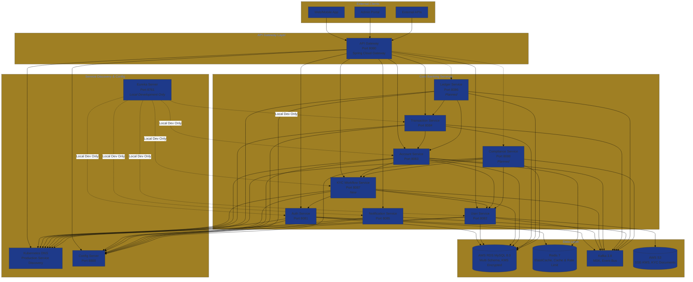

### 4.2 Service Specifications (Updated)

#### 4.2.1 Auth Service (Port 8081)
| Aspect | Detail |
|--------|--------|
| **Database** | `citicore_authdb` schema in AWS RDS MySQL |
| **Primary Entities** | User, Role, RefreshToken, UserRole, LoginAttempt |
| **Key Functions** | Registration, Login, JWT issuance, Refresh rotation, Email verification, Password reset, MFA (Email OTP), Account lockout, Rate limiting |
| **Published Events** | `otp-verification-topic` → VerificationOtpEvent, `user-created-topic` → UserCreatedEvent |
| **Security** | BCrypt, JWT HS256 (15min access, 7day refresh), Rate limiting (5 req/min login), Failed attempt tracking |
| **Service Discovery** | Kubernetes DNS (production); Eureka (local Docker Compose) |
| **Secrets** | DB credentials from AWS Secrets Manager |

#### 4.2.2 User Service (Port 8082)
| Aspect | Detail |
|--------|--------|
| **Database** | `citicore_userdb` schema in AWS RDS MySQL |
| **Primary Entities** | UserProfile, KycDocument |
| **Key Functions** | Profile CRUD, KYC document upload (S3), KYC status workflow, Admin KYC review, OCR integration |
| **Published Events** | `kyc-topic` → KycEvent (SUBMITTED/APPROVED/REJECTED) |
| **Feign Exposes** | `GET /api/v1/users/kyc-status/{userId}` → boolean, `GET /api/v1/users/profile/{userId}` → UserProfile |
| **Service Discovery** | Kubernetes DNS (production); Eureka (local Docker Compose) |
| **Secrets** | DB credentials from AWS Secrets Manager |

#### 4.2.3 KYC Workflow Service (Port 8087) - **NEW**
| Aspect | Detail |
|--------|--------|
| **Database** | `citicore_kycdb` schema in AWS RDS MySQL |
| **Primary Entities** | KycCase, KycCaseAssignment, KycCaseHistory, KycReviewFinding, KycDocumentRef |
| **Key Functions** | Case creation from submission, Case assignment to officers, Maker-checker workflow, State machine enforcement, Audit trail, Escalation, SLA monitoring |
| **Published Events** | `kyc-case-topic` → KycCaseEvent (CREATED, ASSIGNED, REVIEWED, RECOMMENDED, APPROVED, REJECTED, RETURNED, ESCALATED), `kyc-notification-topic` → KycNotificationEvent |
| **Feign Clients** | UserClient (profile, documents), AuthClient (user roles), NotificationClient (notifications) |
| **Kafka Consumers** | `kyc-submission-topic` (from User Service), `kyc-document-topic` (from User Service) |
| **Service Discovery** | Kubernetes DNS (production); Eureka (local Docker Compose) |
| **Secrets** | DB credentials from AWS Secrets Manager |

#### 4.2.4 Account Service (Port 8083)
| Aspect | Detail |
|--------|--------|
| **Database** | `citicore_account` schema in AWS RDS MySQL (Primary/Replica) |
| **Primary Entities** | Account, AccountStatement, AccountOutboxEvent, AccountSequence, AccountHold |
| **Key Functions** | Account CRUD (SAVINGS/CURRENT), Deposit/Withdraw, Balance queries (Redis cache), Statements, Transfer validation, Auth holds, Interest accrual, PDF statements, Dual balance (available/ledger), Double-entry ledger posting |
| **Database Routing** | Primary: Writes | Replica: Reads | Redis: Balance cache (5min TTL) |
| **Kafka Consumers** | `transfer-requested-topic` (DebitConsumer), `debit-success-topic` (CreditConsumer), `reversal-topic` (ReversalConsumer), `kyc-case-topic` (KYC_APPROVED → enable account creation) |
| **Published Events** | `account-events-topic`, `debit-success-topic`, `debit-failed-topic`, `credit-success-topic`, `credit-failed-topic`, `reversal-success-topic`, `balance-hold-topic` |
| **Feign Client** | UserClient → KYC status check, KYCWorkflowClient → case status |
| **Service Discovery** | Kubernetes DNS (production); Eureka (local Docker Compose) |
| **Secrets** | DB credentials from AWS Secrets Manager |

#### 4.2.5 Transaction Service (Port 8084)
| Aspect | Detail |
|--------|--------|
| **Database** | `citicore_transactiondb` schema in AWS RDS MySQL |
| **Primary Entities** | Transaction, OutboxEvent, IdempotencyKey, DailyLimit |
| **Key Functions** | Transfer initiation, Saga orchestration, Daily limits, Idempotency, History & status |
| **Saga Flow** | INITIATED → DEBIT_SUCCESS → CREDIT_SUCCESS / FAILED → REVERSED |
| **Feign Client** | AccountFeignClient → validateTransfer, KYCWorkflowClient → check KYC status |
| **Kafka Consumers** | `credit-success-topic`, `credit-failed-topic`, `reversal-success-topic` |
| **Service Discovery** | Kubernetes DNS (production); Eureka (local Docker Compose) |
| **Secrets** | DB credentials from AWS Secrets Manager |

#### 4.2.6 Notification Service (Port 8085)
| Aspect | Detail |
|--------|--------|
| **Database** | None (stateless) |
| **Key Functions** | Email delivery (SMTP/SendGrid), SMS (planned), HTML templates, Multi-event consumption, Notification preferences |
| **Kafka Consumers** | `credit-success-topic`, `credit-failed-topic`, `reversal-success-topic`, `kyc-topic`, `kyc-case-topic`, `otp-verification-topic`, `kyc-notification-topic` |
| **Service Discovery** | Kubernetes DNS (production); Eureka (local Docker Compose) |

#### 4.2.7 Ledger Service (Port 8086) - Planned
| Aspect | Detail |
|--------|--------|
| **Database** | `citicore_ledgerdb` schema in AWS RDS MySQL |
| **Primary Entities** | LedgerAccount, JournalEntry, JournalLine, LedgerBalance |
| **Key Functions** | Chart of Accounts, Double-entry posting, Trial balance, Period-end close, GL reconciliation, Regulatory reporting, Immutable audit trail |

#### 4.2.8 Compliance Service (Port 8088) - Planned
| Aspect | Detail |
|--------|--------|
| **Database** | `citicore_compliancedb` schema in AWS RDS MySQL |
| **Primary Entities** | SanctionsScreening, PEPCheck, TransactionMonitoring, SuspiciousActivityReport, RegulatoryReport |
| **Key Functions** | Real-time sanctions/PEP screening, Transaction monitoring (AML), SAR filing, Regulatory report generation |

#### 4.2.9 Platform Services
| Service | Port | Purpose |
|---------|------|---------|
| **API Gateway** | 8080 | Reactive routing, JWT validation, Rate limiting, Circuit breakers, Resilience4j, RBAC enforcement |
| **Config Server** | 8888 | Centralized config (native profile), Spring Cloud Bus Kafka refresh |
| **Eureka Server** | 8761 | Service registry & discovery (Local Development Only) |
| **Kubernetes DNS** | N/A | Production service discovery via CoreDNS |

---

## 5. Database Architecture

### 5.1 Database Topology (Updated)

```mermaid
%%{init: {'theme': 'base'}}%%
graph TB
    subgraph RDS_MYSQL ["AWS RDS for MySQL 8.0 (Single Deployment, KMS Encrypted)"]
        AUTH_SCHEMA[(citicore_authdb<br/>users, roles, user_roles, refresh_tokens, login_attempts)]
        KYC_SCHEMA[(citicore_kycdb<br/>kyc_cases, kyc_case_assignments,<br/>kyc_case_history, kyc_review_findings,<br/>kyc_document_refs)]
        ACC_SCHEMA[(citicore_account<br/>accounts, account_statements,<br/>account_outbox, account_sequences,<br/>account_holds)]
        TXN_SCHEMA[(citicore_transactiondb<br/>transactions, outbox_events,<br/>idempotency_keys, daily_limits)]
        USER_SCHEMA[(citicore_userdb<br/>user_profiles, kyc_documents)]
        LEDGER_SCHEMA[(citicore_ledgerdb<br/>ledger_accounts, journal_entries,<br/>journal_lines, ledger_balances<br/><i>Planned</i>)]
        COMPLIANCE_SCHEMA[(citicore_compliancedb<br/>sanctions, pep, monitoring,<br/>sar, reports<br/><i>Planned</i>)]
    end

    subgraph REDIS_CLUSTER ["Redis Cluster (ElastiCache)"]
        CACHE[(Cache: Balance, Session, Rate Limit,<br/>Case Assignments, User Permissions)]
    end

    subgraph KAFKA_CLUSTER ["Kafka Cluster (MSK)"]
        TOPICS[Topics: 3 partitions, RF=3<br/>transfer-requested, debit-success,<br/>credit-success, reversal, kyc, kyc-case,<br/>kyc-notification, otp, account-events, DLQs]
    end

    subgraph S3_STORAGE ["AWS S3 (SSE-KMS Encrypted)"]
        KYC_DOCS[(KYC Documents)]
    end

    AUTH_SVC[Auth Service] --> AUTH_SCHEMA
    USER_SVC[User Service] --> USER_SCHEMA
    KYC_SVC[KYC Workflow Service] --> KYC_SCHEMA
    KYC_SVC --> CACHE
    ACC_SVC[Account Service] --> ACC_SCHEMA
    ACC_SVC --> CACHE
    TXN_SVC[Transaction Service] --> TXN_SCHEMA
    LEDGER_SVC[Ledger Service] --> LEDGER_SCHEMA
    COMPLIANCE_SVC[Compliance Service] --> COMPLIANCE_SCHEMA
    ALL_SVC[All Services] --> KAFKA_CLUSTER
    USER_SVC --> KYC_DOCS
    KYC_SVC --> KYC_DOCS
```

### 5.2 Schema Ownership (Updated)

| Schema | Owner Service | Tables | Key Constraints |
|----------|---------------|--------|-----------------|
| `citicore_authdb` | Auth Service | users, roles, user_roles, refresh_tokens, login_attempts | PK, FK (user_roles), Unique (email, token), Index (email, status) |
| `citicore_kycdb` | KYC Workflow Service | kyc_cases, kyc_case_assignments, kyc_case_history, kyc_review_findings, kyc_document_refs | PK, FK (assignments→cases, history→cases, findings→cases), Unique (case_number), Index (status, assignee, customer) |
| `citicore_userdb` | User Service | user_profiles, kyc_documents | PK, FK (kyc_documents→user_profiles), Unique (auth_user_id, email, phone) |
| `citicore_account` | Account Service | accounts, account_statements, account_outbox, account_sequences, account_holds | PK, Unique (account_number, txn_ref per account), Check (balance >= 0, min_balance), FK (holds→accounts) |
| `citicore_transactiondb` | Transaction Service | transactions, outbox_events, idempotency_keys, daily_limits | PK, Unique (txn_ref, idempotency_key per user), FK (planned), Check (amount > 0) |
| `citicore_ledgerdb` | Ledger Service | ledger_accounts, journal_entries, journal_lines, ledger_balances | PK, FK (journal_lines→journal_entries, ledger_accounts), Check (balanced journal, one-side) |
| `citicore_compliancedb` | Compliance Service | sanctions_screening, pep_checks, transaction_monitoring, sar, regulatory_reports | PK, FK, Index (customer_id, screening_date, status) |

### 5.3 Database Security Configuration

| Security Control | Implementation |
|------------------|----------------|
| **Encryption at Rest** | AWS RDS storage encryption with customer-managed KMS key; covers backups and snapshots |
| **Encryption in Transit** | TLS 1.2+ mandatory; `require_secure_transport=ON` on RDS; certificate validation enabled |
| **Secrets Management** | Database credentials in AWS Secrets Manager; IAM workload identity for EKS pods |
| **Schema Isolation** | Separate database users per service; GRANT only on owned schema; no cross-schema permissions |
| **Application-Level Encryption** | Selective envelope encryption for sensitive PII fields (PAN, Aadhaar, etc.) using AWS KMS |
| **Key Rotation** | KMS automatic key rotation annually; manual rotation for application-level keys |

### 5.4 Cross-Service Referential Integrity (Updated)

> **Note:** Even within a single RDS instance, MySQL does not support cross-schema foreign keys with different owners. The platform uses **application-level integrity** with reconciliation jobs.

| Child Reference | Parent Reference | Integrity Mechanism |
|-----------------|------------------|---------------------|
| `citicore_account.accounts.auth_user_id` | `citicore_authdb.users.id` | Feign validation on create; Daily reconciliation job |
| `citicore_account.account_statements.account_number` | `citicore_account.accounts.account_number` | Application check; DB index |
| `citicore_transactiondb.transactions.auth_user_id` | `citicore_authdb.users.id` | Feign validation; Reconciliation job |
| `citicore_transactiondb.transactions.from_account` | `citicore_account.accounts.account_number` | Feign validateTransfer; Reconciliation job |
| `citicore_transactiondb.transactions.to_account` | `citicore_account.accounts.account_number` | Feign validateTransfer; Reconciliation job |
| `citicore_userdb.user_profiles.auth_user_id` | `citicore_authdb.users.id` | Auth service user creation event; Reconciliation job |
| `citicore_transactiondb.idempotency_keys.auth_user_id` | `citicore_authdb.users.id` | Auth service validation |
| `citicore_kycdb.kyc_cases.auth_user_id` | `citicore_authdb.users.id` | User service validation; Reconciliation job |
| `citicore_kycdb.kyc_case_assignments.assignee_id` | `citicore_authdb.users.id` | Auth service role check (KYC_OFFICER); Reconciliation job |
| `citicore_kycdb.kyc_case_assignments.reviewer_id` | `citicore_authdb.users.id` | Auth service role check (KYC_MANAGER); Reconciliation job |

### 5.5 Future Migration Path

| Phase | Trigger | Action |
|-------|---------|--------|
| **Phase 1 (Current)** | Initial deployment | Single RDS with separate schemas, separate credentials |
| **Phase 2** | Scale/Isolation needs | Split high-throughput schemas (e.g., transactiondb) to dedicated RDS instances |
| **Phase 3** | Regulatory/Compliance | Independent database deployments per service with dedicated VPC/subnet isolation |
| **Phase 4** | Multi-region | Cross-region read replicas; active-active for critical schemas |

Migration uses: Schema export/import, DNS switchover, dual-write period, CDC for sync.

### 5.4 Primary/Replica Routing (Account Service)

```mermaid
%%{init: {'theme': 'base'}}%%
graph LR
    subgraph ACCOUNT_SERVICE ["Account Service"]
        APP[Application Layer]
        ROUTING[RoutingDataSource<br/>@PrimaryRead / @ReadOnly]
    end
    
    subgraph MYSQL_PRIMARY ["Primary (Writer)"]
        PRIMARY[(accounts<br/>account_statements<br/>account_outbox<br/>account_sequences<br/>account_holds)]
    end
    
    subgraph MYSQL_REPLICA ["Replica (Reader)"]
        REPLICA[(accounts<br/>account_statements<br/>account_outbox<br/>account_sequences<br/>account_holds)]
    end
    
    subgraph REDIS_CACHE ["Redis Cache"]
        CACHE[(Balance Cache<br/>TTL: 5 min<br/>Case Assignment Cache<br/>Permission Cache)]
    end

    APP --> ROUTING
    ROUTING -->|@PrimaryRead<br/>@Transactional| PRIMARY
    ROUTING -->|@ReadOnly<br/>Default| REPLICA
    APP -->|getBalance()| CACHE
    CACHE -.->|Miss| REPLICA
    PRIMARY -.->|Async Replication| REPLICA
```

---

## 6. Service Communication Patterns

### 6.1 Communication Matrix (Updated)

| From \ To | Auth | User | KYC WF | Account | Transaction | Notification | Ledger | Compliance | Gateway |
|-----------|------|------|--------|---------|-------------|--------------|--------|------------|---------|
| **Client** | HTTPS | HTTPS | HTTPS | HTTPS | HTTPS | - | HTTPS | HTTPS | HTTPS |
| **Gateway** | Feign | Feign | Feign | Feign | Feign | - | Feign | Feign | - |
| **Auth** | - | - | - | - | - | Kafka | - | - | - |
| **User** | - | - | Kafka | - | - | Kafka | - | - | - |
| **KYC WF** | Feign | Feign | - | - | - | Kafka | - | Kafka | - |
| **Account** | - | Feign | Feign | - | Kafka | Kafka | Kafka | - | - |
| **Transaction** | - | - | Feign | Feign | - | Kafka | Kafka | - | - |
| **Notification** | - | - | - | - | - | - | - | - | - |
| **Ledger** | - | - | - | Feign | Feign | Kafka | - | - | - |
| **Compliance** | - | Feign | Feign | - | Feign | - | - | - | - |

### 6.2 Synchronous Communication (Feign/REST) - KYC Flow

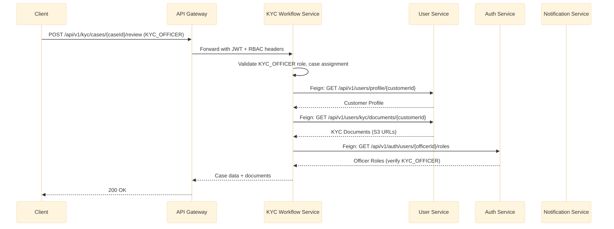

### 6.3 Asynchronous Communication (Kafka Events) - Updated

```mermaid
%%{init: {'theme': 'base'}}%%
graph TB
    subgraph SYNC ["Synchronous (Feign/REST)"]
        CLIENT[Client] --> GW[API Gateway]
        GW --> AUTH[Auth Service]
        GW --> USER[User Service]
        GW --> KYC[KYC Workflow Service]
        GW --> ACC[Account Service]
        GW --> TXN[Transaction Service]
        
        TXN -.->|validateTransfer| ACC
        ACC -.->|getKycStatus| KYC
        ACC -.->|getProfile| USER
        KYC -.->|getProfile| USER
        KYC -.->|verifyRoles| AUTH
    end
    
    subgraph ASYNC ["Asynchronous (Kafka)"]
        KAFKA[(Kafka Event Bus)]
        
        AUTH -->|otp-verification-topic| KAFKA
        AUTH -->|user-created-topic| KAFKA
        USER -->|kyc-topic| KAFKA
        USER -->|kyc-submission-topic| KAFKA
        USER -->|kyc-document-topic| KAFKA
        
        KYC -->|kyc-case-topic| KAFKA
        KYC -->|kyc-notification-topic| KAFKA
        
        ACC -->|account-events-topic| KAFKA
        ACC -->|debit-success-topic| KAFKA
        ACC -->|debit-failed-topic| KAFKA
        ACC -->|credit-success-topic| KAFKA
        ACC -->|credit-failed-topic| KAFKA
        ACC -->|reversal-success-topic| KAFKA
        ACC -->|balance-hold-topic| KAFKA
        
        TXN -->|transfer-requested-topic| KAFKA
        
        KAFKA -->|transfer-requested-topic| ACC
        KAFKA -->|debit-success-topic| ACC
        KAFKA -->|reversal-topic| ACC
        KAFKA -->|kyc-case-topic| ACC
        
        KAFKA -->|credit-success-topic| TXN
        KAFKA -->|credit-failed-topic| TXN
        KAFKA -->|reversal-success-topic| TXN
        
        KAFKA -->|credit-success-topic| NOTIF[Notification Service]
        KAFKA -->|credit-failed-topic| NOTIF
        KAFKA -->|reversal-success-topic| NOTIF
        KAFKA -->|kyc-topic| NOTIF
        KAFKA -->|kyc-case-topic| NOTIF
        KAFKA -->|kyc-notification-topic| NOTIF
        KAFKA -->|otp-verification-topic| NOTIF
        
        KAFKA -->|kyc-case-topic| COMPLIANCE[Compliance Service]
        KAFKA -.->|Planned| LEDGER[Ledger Service]
    end
```

### 6.4 Service Discovery Configuration

| Environment | Mechanism | Implementation |
|-------------|-----------|----------------|
| **Production (EKS)** | Kubernetes DNS (CoreDNS) | `service.namespace.svc.cluster.local`; Headless services for direct pod access |
| **Local (Docker Compose)** | Netflix Eureka | `eureka-server:8761`; All services register with Eureka |
| **Transition Strategy** | Dual-write period | Services register with both during migration; Eureka deprecated after validation |
| **Client-Side Load Balancing** | Spring Cloud LoadBalancer | Reactor-based; integrates with Kubernetes EndpointSlices |
| **Service Mesh (Future)** | Istio/Linkerd | mTLS, traffic splitting, advanced observability |

---

## 7. Event-Driven Architecture

### 7.1 Kafka Topic Design (Updated)

| Topic | Partitions | Retention | Key | Producers | Consumers | Purpose |
|-------|------------|-----------|-----|-----------|-----------|---------|
| `transfer-requested-topic` | 3 | 7 days | txnRef | Transaction Service | Account Service (DebitConsumer) | Initiate transfer saga |
| `debit-success-topic` | 3 | 7 days | txnRef | Account Service | Account Service (CreditConsumer), Transaction Service | Debit completed |
| `debit-failed-topic` | 3 | 7 days | txnRef | Account Service | Transaction Service | Debit failed |
| `credit-success-topic` | 3 | 7 days | txnRef | Account Service | Transaction Service, Notification Service | Credit completed |
| `credit-failed-topic` | 3 | 7 days | txnRef | Account Service | Transaction Service, Notification Service | Credit failed |
| `reversal-topic` | 3 | 7 days | txnRef | Transaction Service | Account Service (ReversalConsumer) | Trigger reversal |
| `reversal-success-topic` | 3 | 7 days | txnRef | Account Service | Transaction Service, Notification Service | Reversal completed |
| `account-events-topic` | 3 | 7 days | accountNumber | Account Service | Ledger Service (Planned), KYC Workflow | Account lifecycle events |
| `kyc-topic` | 3 | 7 days | authUserId | User Service | Notification Service | KYC status changes (legacy) |
| `kyc-submission-topic` | 3 | 7 days | authUserId | User Service | KYC Workflow Service | New KYC submission |
| `kyc-document-topic` | 3 | 7 days | authUserId | User Service | KYC Workflow Service | Document uploaded |
| `kyc-case-topic` | 3 | 7 days | caseId | KYC Workflow Service | Account Service, Notification Service, Compliance Service | KYC case lifecycle |
| `kyc-notification-topic` | 3 | 7 days | caseId | KYC Workflow Service | Notification Service | KYC workflow notifications |
| `otp-verification-topic` | 3 | 24 hours | email | Auth Service | Notification Service | Email OTP delivery |
| `user-created-topic` | 3 | 7 days | authUserId | Auth Service | KYC Workflow Service, User Service | New user registration |
| `*.dlq` | 3 | 30 days | eventId | All (via DLQ config) | Dead Letter Processor | Failed message handling |

### 7.2 Event Payloads (Key Events) - Updated

```json
// KycCaseEvent
{
  "eventId": "uuid",
  "caseId": "KYC-20261118-001",
  "caseNumber": "KYC-20261118-001",
  "authUserId": 12345,
  "eventType": "KYC_CASE_REVIEWED",
  "previousStatus": "UNDER_REVIEW",
  "newStatus": "RECOMMENDED_APPROVAL",
  "actorId": 67890,
  "actorRole": "KYC_OFFICER",
  "recommendation": "APPROVE",
  "findings": [
    {"documentType": "PAN_CARD", "status": "VERIFIED", "remarks": "Valid PAN"},
    {"documentType": "AADHAAR", "status": "VERIFIED", "remarks": "OCR matched"}
  ],
  "requestedInfo": null,
  "timestamp": "2026-11-18T10:30:00Z"
}
```

```json
// KycNotificationEvent
{
  "eventId": "uuid",
  "caseId": "KYC-20261118-001",
  "recipientUserId": 12345,
  "recipientRole": "CUSTOMER",
  "notificationType": "CASE_STATUS_CHANGE",
  "title": "KYC Application Update",
  "message": "Your KYC application has been approved.",
  "actionRequired": false,
  "actionUrl": "/kyc/status/KYC-20261118-001",
  "timestamp": "2026-11-18T10:30:00Z"
}
```

```json
// TransferRequestedEvent
{
  "eventId": "uuid",
  "txnRef": "TXN-20261118-001",
  "fromAccount": "CITI123456789012",
  "toAccount": "CITI987654321098",
  "amount": 5000.00,
  "authUserId": 12345,
  "idempotencyKey": "client-provided-key",
  "timestamp": "2026-11-18T10:30:00Z"
}
```

```json
// DebitSuccessEvent
{
  "eventId": "uuid",
  "txnRef": "TXN-20261118-001",
  "fromAccount": "CITI123456789012",
  "amount": 5000.00,
  "balanceAfter": 15000.00,
  "availableBalanceAfter": 15000.00,
  "timestamp": "2026-11-18T10:30:01Z"
}
```

### 7.3 Transactional Outbox Pattern (Same as before)

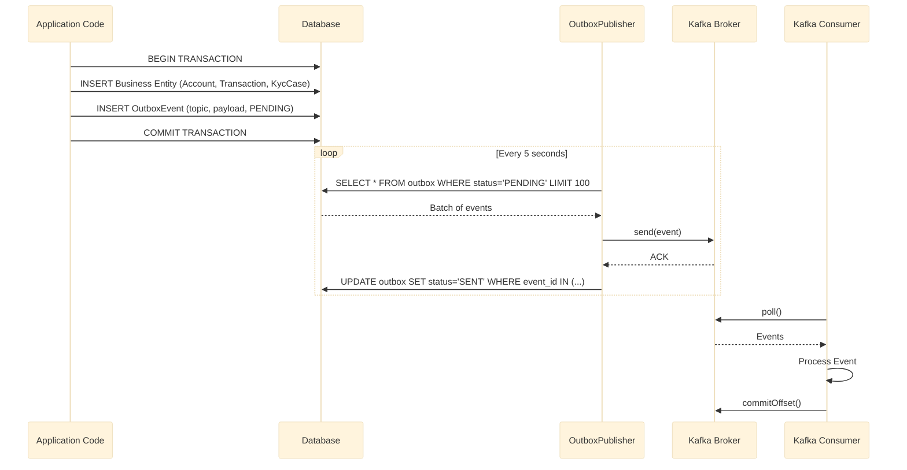

### 7.4 Outbox Configuration (Same as before)

| Parameter | Value | Description |
|-----------|-------|-------------|
| Poll Interval | 5 seconds | Frequency of outbox polling |
| Batch Size | 100 | Max events per poll |
| Serializer | StringSerializer | Avoids double JSON encoding |
| Retry Policy | Exponential backoff (3 retries) | On Kafka send failure |
| DLQ | Enabled | Failed messages after max retries |

---

## 8. Financial Transaction Processing

### 8.1 Hybrid Saga Architecture

The platform uses a **hybrid saga architecture** based on the functional domain:

| Domain | Pattern | Owner | Rationale |
|--------|---------|-------|-----------|
| **Fund Transfers** | Orchestration | Transaction Service | Financial consistency; centralized state management; compensation coordination |
| **Notifications** | Choreography | Notification Service | Independent; fire-and-forget; no compensation needed |
| **Audit Events** | Async Event Consumption | Compliance Service | Independent; idempotent; no saga participation |

### 8.2 Fund Transfer Saga (Orchestration-Based)

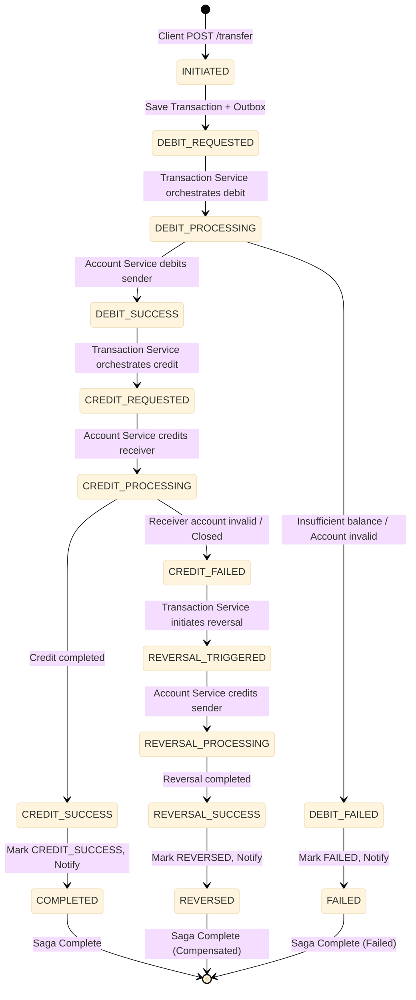

### 8.3 Transaction Service as Saga Orchestrator

The Transaction Service acts as the **orchestration owner** for fund transfers:

| Responsibility | Implementation |
|----------------|----------------|
| **State Machine** | Persistent saga state (INITIATED, DEBIT_REQUESTED, DEBIT_SUCCESS, CREDIT_REQUESTED, CREDIT_SUCCESS, CREDIT_FAILED, REVERSAL_TRIGGERED, REVERSAL_SUCCESS, COMPLETED, FAILED, REVERSED) |
| **Outbox Publishing** | Transactional outbox for reliable command/events |
| **Compensation Coordination** | Explicit reversal-topic publication on credit failure |
| **Retry Policies** | Exponential backoff (3 retries) for each step; DLQ after exhaustion |
| **Idempotency** | Client-provided Idempotency-Key; server-side deduplication per user |
| **Failure Handling** | Timeout monitoring; manual intervention queue for stuck sagas |
| **Observability** | Saga correlation IDs propagated via Kafka headers and MDC |

### 8.4 Detailed Sequence Diagram

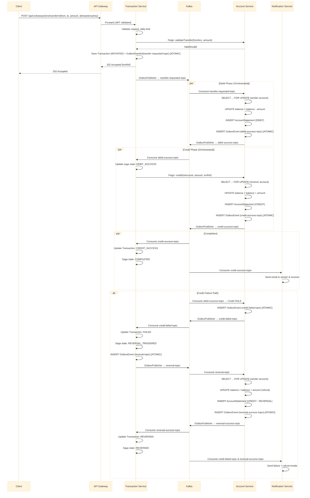

### 8.5 Idempotency Strategy (Updated with user-scoping)

| Level | Mechanism | Scope |
|-------|-----------|-------|
| **Client** | Idempotency-Key header | Per user per request |
| **Transaction Service** | IdempotencyKey entity (user-scoped unique) | Prevents duplicate initiation |
| **Account Service** | txnRef suffix deduplication in AccountStatement | Prevents duplicate posting |
| **Kafka Consumers** | Status checks before processing | Prevents duplicate consumption |
| **Consumer Groups** | Stable group IDs + exactly-once semantics | At-least-once delivery |
| **KYC Workflow** | Case number uniqueness, Idempotent state transitions | Prevents duplicate case creation |

---

## 9. Double-Entry Ledger Architecture (Same as before - already comprehensive)

---

## 10. Security Architecture (Updated - Comprehensive RBAC)

### 10.1 Authentication Flow (Updated with MFA)

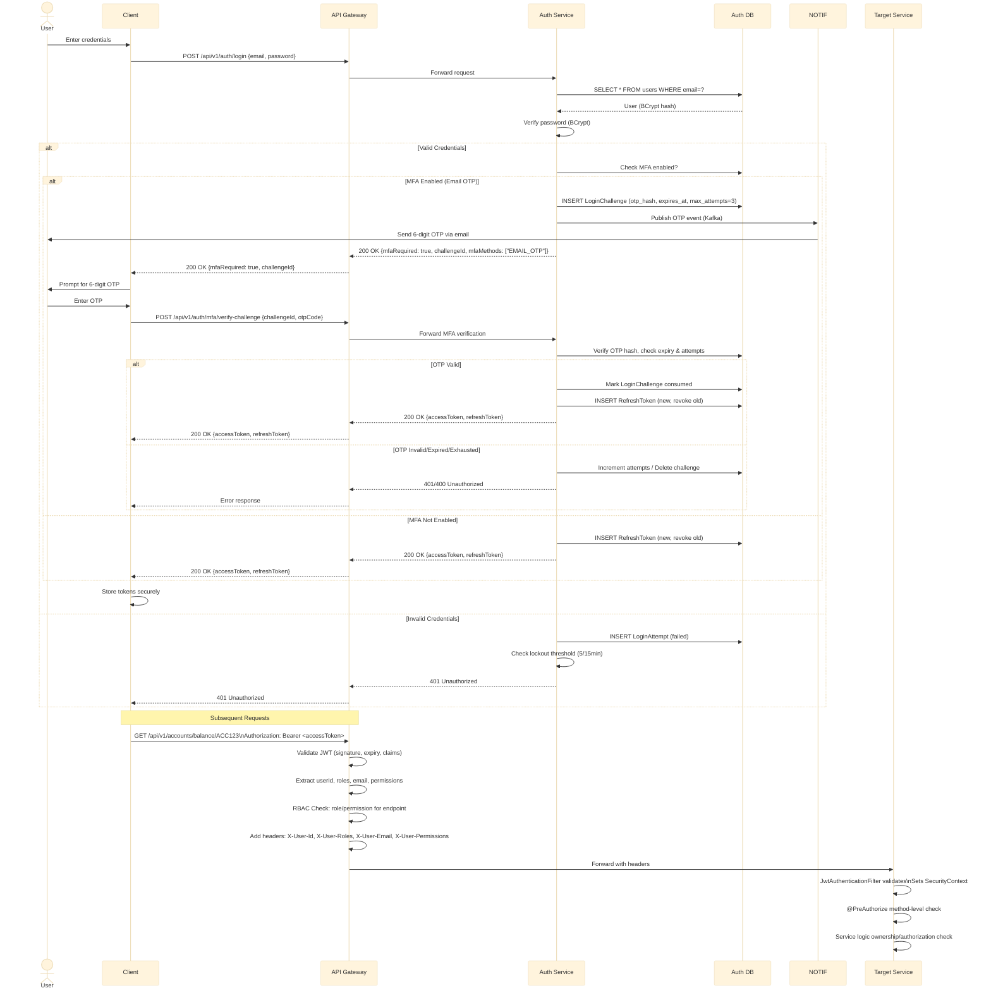

### 10.2 Token Specification (Same as before)

### 10.3 Refresh Token Rotation (Same as before)

### 10.4 Authorization Model (Updated - Comprehensive RBAC + ABAC)

```mermaid
%%{init: {'theme': 'base'}}%%
graph TB
    subgraph RBAC ["Role-Based Access Control"]
        ROLES[Roles: CUSTOMER, KYC_OFFICER, KYC_MANAGER, SUPPORT_AGENT, OPERATIONS_OFFICER, COMPLIANCE_OFFICER, ADMIN, AUDITOR, SERVICE]
        PERMISSIONS[Permissions: 25 granular permissions\n(See Section 3.3)]
        ROLE_PERM[Role-Permission Mapping\n(See Section 3.4 Matrix)]
    end
    
    subgraph ABAC ["Attribute-Based Access Control"]
        ATTRS[Attributes: userId, accountOwnership, kycCaseAssignment, kycCaseAuthorization, kycStatus, riskScore, caseScope]
        POLICIES[Policies: Ownership, KYC Case Assignment, KYC Case Authorization, Separation of Duties, KYC Required, Daily Limits]
    end
    
    subgraph ENFORCEMENT ["Enforcement Points"]
        GATEWAY[API Gateway: JWT validation, RBAC coarse check, Rate limiting]
        FILTER[JwtAuthenticationFilter: Token validation, SecurityContext, Permission extraction]
        ANNOTATION[@PreAuthorize: Method-level RBAC + SpEL]
        SERVICE[Service Logic: ABAC ownership checks, Business rules, Separation of duties]
        KYC_ENFORCE[KYC Workflow Engine: State machine, Maker-Checker enforcement, Case assignment]
    end
    
    ROLES --> PERMISSIONS
    PERMISSIONS --> ROLE_PERM
    ATTRS --> POLICIES
    GATEWAY --> FILTER
    FILTER --> ANNOTATION
    ANNOTATION --> SERVICE
    SERVICE --> KYC_ENFORCE
```

### 10.5 Service-to-Service Security (Same as before)

### 10.6 Security Controls Summary (Updated)

| Control | Implementation | Status |
|---------|----------------|--------|
| **Password Hashing** | BCrypt (cost 10) | ✅ |
| **JWT Signing** | HS256 (32+ char secret) | ✅ |
| **Rate Limiting (Auth)** | Resilience4j/Bucket4j (5 req/min login) | ⚠️ Planned (P0) |
| **Rate Limiting (API)** | Redis Token Bucket (Gateway) | ✅ |
| **Account Lockout** | Failed attempt tracking (5/15min) | ⚠️ Planned (P1) |
| **MFA/Email OTP** | 6-digit, 5-min expiry, 3 attempts, BCrypt hashed | ✅ Implemented |
| **Password Reset** | Secure token (15min, single-use) | ⚠️ Planned (P0) |
| **RBAC** | Spring @EnableMethodSecurity + @PreAuthorize + PermissionEvaluator | ✅ Designed |
| **ABAC** | Custom PermissionEvaluator + SpEL expressions | ✅ Designed |
| **Separation of Duties** | KYC Workflow Engine state machine | ✅ Designed |
| **Input Validation** | Bean Validation (@Positive, @Max, @Pattern) | ⚠️ Partial (Planned) |
| **Error Handling** | Generic client messages, detailed server logs | ⚠️ Planned |
| **Audit Logging** | Immutable audit trail (KYC Case History, Ledger) | ✅ Designed |
| **Encryption at Rest** | MySQL TDE (Planned), Column-level for PII | ❌ |
| **Encryption in Transit** | TLS 1.2+ (Planned) | ❌ |
| **Secrets Management** | HashiCorp Vault (Planned) | ❌ |
| **Container Security** | Non-root user, read-only FS, dropped caps | ⚠️ Planned |
| **KYC Document Security** | S3 SSE-KMS, Pre-signed URLs, Malware scanning | ⚠️ Planned |

### 10.7 JWT Claims Structure (Updated)

```json
{
  "sub": "12345",
  "email": "customer@example.com",
  "roles": ["ROLE_CUSTOMER"],
  "permissions": [
    "CUSTOMER_PROFILE_READ",
    "CUSTOMER_PROFILE_WRITE",
    "KYC_DOCUMENT_UPLOAD",
    "ACCOUNT_CREATE",
    "ACCOUNT_READ",
    "TRANSFER_INITIATE"
  ],
  "kycStatus": "APPROVED",
  "riskScore": 15,
  "iat": 1731923400,
  "exp": 1731924300
}
```

```json
{
  "sub": "67890",
  "email": "kyc.officer@citicore.com",
  "roles": ["ROLE_KYC_OFFICER"],
  "permissions": [
    "CUSTOMER_PROFILE_READ_ALL",
    "KYC_DOCUMENT_READ",
    "KYC_CASE_REVIEW",
    "KYC_CASE_RECOMMEND",
    "KYC_CASE_REQUEST_INFO",
    "ACCOUNT_READ",
    "ACCOUNT_STATEMENT"
  ],
  "assignedCases": ["KYC-20261118-001", "KYC-20261118-002"],
  "iat": 1731923400,
  "exp": 1731924300
}
```

```json
{
  "sub": "54321",
  "email": "kyc.manager@citicore.com",
  "roles": ["ROLE_KYC_MANAGER"],
  "permissions": [
    "CUSTOMER_PROFILE_READ_ALL",
    "KYC_DOCUMENT_READ",
    "KYC_CASE_ASSIGN",
    "KYC_CASE_APPROVE",
    "KYC_CASE_REJECT",
    "KYC_CASE_RETURN",
    "KYC_CASE_ESCALATE",
    "KYC_AUDIT_READ",
    "ACCOUNT_READ",
    "ACCOUNT_STATEMENT"
  ],
  "authorizedCases": ["KYC-20261118-001", "KYC-20261118-003"],
  "iat": 1731923400,
  "exp": 1731924300
}
```

### 10.8 Role and Permission Revocation/Refresh Strategy

| Scenario | Mechanism | Timing |
|----------|-----------|--------|
| **Role revocation by Admin** | Cache eviction (Redis) + JWT short expiry (15min) | Next token refresh (max 15min) |
| **Permission change** | Cache eviction + JWT short expiry | Next token refresh (max 15min) |
| **KYC Case reassignment** | Case assignment cache invalidation | Immediate (Redis pub/sub) |
| **User suspension** | Refresh token revocation (DB) + Cache eviction | Immediate |
| **Password change** | All refresh tokens revoked + Cache eviction | Immediate |
| **MFA enable/disable** | Cache eviction + Next JWT refresh | Max 15min |
| **Emergency lockout** | Refresh token revocation + Redis blocklist | Immediate |

---

## 11. KYC Architecture (Updated - Maker-Checker Workflow)

### 11.1 KYC Business Roles & Responsibilities

#### Customer Responsibilities
- Register and submit KYC information
- Upload identity and address documents (PAN, Aadhaar, Passport, Utility Bill, etc.)
- View KYC application status
- Respond to requests for additional documents/information
- View the final decision and permitted rejection reasons

#### KYC Officer Responsibilities (Maker)
- Access authorized or assigned KYC applications
- Review customer information and uploaded documents
- Perform the configured verification checks (document authenticity, OCR match, face match)
- Record findings and remarks per document/check
- Request additional information or documents from customer
- Recommend approval or rejection with justification
- Submit the case to the KYC Manager for a final decision
- **Constraint:** The KYC Officer MUST NOT perform final approval of their own reviewed case

#### KYC Manager Responsibilities (Checker)
- View authorized KYC cases (not own reviews)
- Review the KYC Officer's findings and recommendation
- Approve or reject the application with reason
- Return incomplete cases for further review
- Record the final decision and reason
- Escalate exceptional cases where appropriate
- Assign cases to officers based on workload/expertise

#### KYC Vendor Integration (Mock Provider)
- **Interface:** `KycVerificationProvider` with `verify(identityDocuments)` method
- **Initial Implementation:** Mock provider returning deterministic responses for testing
- **Future:** Pluggable adapter for real vendors (Jumio, Onfido, etc.)
- **Test Data:** Synthetic PAN/Aadhaar patterns only; no real identity data
- **Configuration:** Provider selection via Spring profiles (`mock`, `jumio`, `onfido`)

### 11.2 KYC Workflow and Status Model (Complete Lifecycle)

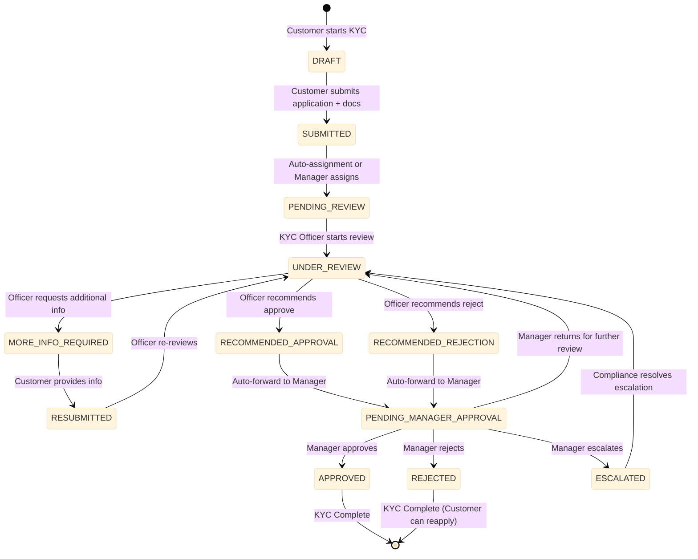

### 11.3 KYC State Transitions & Authorized Roles

| From State | To State | Trigger | Authorized Role | Conditions |
|------------|----------|---------|-----------------|------------|
| `DRAFT` | `SUBMITTED` | Customer submits application | CUSTOMER | All required docs uploaded |
| `SUBMITTED` | `PENDING_REVIEW` | Case created + auto-assignment | SYSTEM | Case created, officer assigned |
| `PENDING_REVIEW` | `UNDER_REVIEW` | Officer starts review | KYC_OFFICER (assigned) | Officer claims case |
| `UNDER_REVIEW` | `MORE_INFO_REQUIRED` | Officer requests info | KYC_OFFICER (assigned) | Specific documents/info requested |
| `MORE_INFO_REQUIRED` | `RESUBMITTED` | Customer provides info | CUSTOMER | All requested items provided |
| `RESUBMITTED` | `UNDER_REVIEW` | Officer re-reviews | KYC_OFFICER (assigned) | Auto on resubmission |
| `UNDER_REVIEW` | `RECOMMENDED_APPROVAL` | Officer recommends approve | KYC_OFFICER (assigned) | All checks passed, findings recorded |
| `UNDER_REVIEW` | `RECOMMENDED_REJECTION` | Officer recommends reject | KYC_OFFICER (assigned) | Deficiency found, findings recorded |
| `RECOMMENDED_APPROVAL` | `PENDING_MANAGER_APPROVAL` | Auto-forward | SYSTEM | Recommendation submitted |
| `RECOMMENDED_REJECTION` | `PENDING_MANAGER_APPROVAL` | Auto-forward | SYSTEM | Recommendation submitted |
| `PENDING_MANAGER_APPROVAL` | `APPROVED` | Manager approves | KYC_MANAGER (authorized, NOT reviewer) | Reviews findings, records decision |
| `PENDING_MANAGER_APPROVAL` | `REJECTED` | Manager rejects | KYC_MANAGER (authorized, NOT reviewer) | Records rejection reason |
| `PENDING_MANAGER_APPROVAL` | `UNDER_REVIEW` | Manager returns for review | KYC_MANAGER (authorized) | Incomplete, needs more info |
| `PENDING_MANAGER_APPROVAL` | `ESCALATED` | Manager escalates | KYC_MANAGER (authorized) | Exceptional case |
| `ESCALATED` | `UNDER_REVIEW` | Compliance resolves | COMPLIANCE_OFFICER | Escalation resolved |

### 11.4 Separation of Duties Enforcement

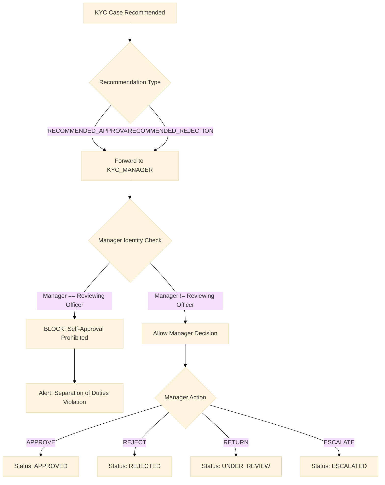

**Enforcement Rules:**
1. **Maker-Checker Separation:** The `KYC_OFFICER` who submits a recommendation (approve/reject) CANNOT be the same user who performs the final approval/rejection.
2. **Case Assignment:** `KYC_MANAGER` assigns cases to officers. An officer can only access assigned cases.
3. **Authorization Scope:** `KYC_MANAGER` can only approve/reject cases they are authorized for (not their own reviews).
4. **Audit Trail:** Every transition records actor ID, role, timestamp, reason, and previous/new state.

### 11.5 KYC Service Communication & Audit Flow

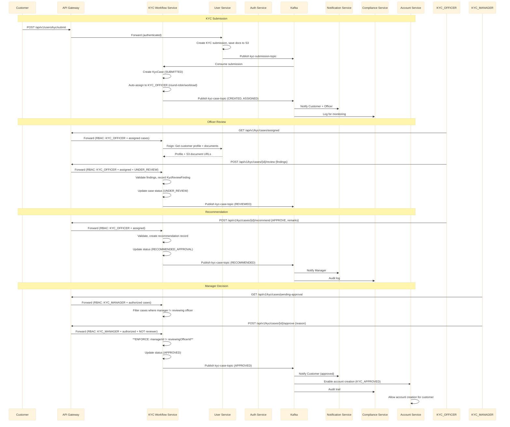

### 11.6 KYC Data Model

#### 11.6.1 KycCase Entity
```java
@Entity
@Table(name = "kyc_cases")
public class KycCase {
    @Id
    @GeneratedValue(strategy = GenerationType.IDENTITY)
    private Long id;
    
    @Column(name = "case_number", unique = true, nullable = false)
    private String caseNumber; // KYC-YYYYMMDD-XXXX
    
    @Column(name = "auth_user_id", nullable = false)
    private Long authUserId; // Customer
    
    @Enumerated(EnumType.STRING)
    @Column(name = "status", nullable = false)
    private KycCaseStatus status; // See state model
    
    @Column(name = "assigned_officer_id")
    private Long assignedOfficerId; // KYC_OFFICER
    
    @Column(name = "reviewing_officer_id")
    private Long reviewingOfficerId; // Officer who reviewed
    
    @Column(name = "deciding_manager_id")
    private Long decidingManagerId; // KYC_MANAGER who decided
    
    @Column(name = "recommendation")
    @Enumerated(EnumType.STRING)
    private KycRecommendation recommendation; // APPROVE, REJECT
    
    @Column(name = "rejection_reason")
    private String rejectionReason;
    
    @Column(name = "escalation_reason")
    private String escalationReason;
    
    @Column(name = "sla_deadline")
    private LocalDateTime slaDeadline;
    
    @Column(name = "created_at", nullable = false)
    private LocalDateTime createdAt;
    
    @Column(name = "updated_at", nullable = false)
    private LocalDateTime updatedAt;
    
    @Column(name = "completed_at")
    private LocalDateTime completedAt;
}
```

#### 11.6.2 KycCaseAssignment Entity
```java
@Entity
@Table(name = "kyc_case_assignments")
public class KycCaseAssignment {
    @Id
    @GeneratedValue(strategy = GenerationType.IDENTITY)
    private Long id;
    
    @Column(name = "case_id", nullable = false)
    private Long caseId;
    
    @Column(name = "assignee_id", nullable = false)
    private Long assigneeId; // KYC_OFFICER
    
    @Column(name = "assigned_by_id", nullable = false)
    private Long assignedById; // KYC_MANAGER or SYSTEM
    
    @Enumerated(EnumType.STRING)
    @Column(name = "assignment_type", nullable = false)
    private AssignmentType type; // INITIAL, REASSIGN, ESCALATION
    
    @Column(name = "assigned_at", nullable = false)
    private LocalDateTime assignedAt;
    
    @Column(name = "acknowledged_at")
    private LocalDateTime acknowledgedAt;
    
    @Column(name = "completed_at")
    private LocalDateTime completedAt;
}
```

#### 11.6.3 KycCaseHistory Entity (Audit Trail)
```java
@Entity
@Table(name = "kyc_case_history")
public class KycCaseHistory {
    @Id
    @GeneratedValue(strategy = GenerationType.IDENTITY)
    private Long id;
    
    @Column(name = "case_id", nullable = false)
    private Long caseId;
    
    @Column(name = "actor_id", nullable = false)
    private Long actorId; // User who performed action
    
    @Column(name = "actor_role", nullable = false)
    private String actorRole; // CUSTOMER, KYC_OFFICER, KYC_MANAGER, etc.
    
    @Enumerated(EnumType.STRING)
    @Column(name = "action", nullable = false)
    private KycCaseAction action; // SUBMITTED, ASSIGNED, REVIEWED, RECOMMENDED, APPROVED, REJECTED, RETURNED, ESCALATED, INFO_REQUESTED, RESUBMITTED
    
    @Enumerated(EnumType.STRING)
    @Column(name = "previous_status", nullable = false)
    private KycCaseStatus previousStatus;
    
    @Enumerated(EnumType.STRING)
    @Column(name = "new_status", nullable = false)
    private KycCaseStatus newStatus;
    
    @Column(name = "reason", columnDefinition = "TEXT")
    private String reason;
    
    @Column(name = "metadata", columnDefinition = "JSON")
    private String metadata; // Additional context (findings, requested docs, etc.)
    
    @Column(name = "timestamp", nullable = false)
    private LocalDateTime timestamp;
}
```

#### 11.6.4 KycReviewFinding Entity
```java
@Entity
@Table(name = "kyc_review_findings")
public class KycReviewFinding {
    @Id
    @GeneratedValue(strategy = GenerationType.IDENTITY)
    private Long id;
    
    @Column(name = "case_id", nullable = false)
    private Long caseId;
    
    @Column(name = "document_type", nullable = false)
    private String documentType; // PAN_CARD, AADHAAR, PASSPORT, UTILITY_BILL, etc.
    
    @Column(name = "document_ref_id")
    private Long documentRefId; // FK to kyc_document_refs
    
    @Enumerated(EnumType.STRING)
    @Column(name = "verification_status", nullable = false)
    private VerificationStatus status; // VERIFIED, FAILED, PENDING_MANUAL, NOT_PROVIDED
    
    @Column(name = "remarks", columnDefinition = "TEXT")
    private String remarks;
    
    @Column(name = "checked_by_id", nullable = false)
    private Long checkedById; // KYC_OFFICER
    
    @Column(name = "checked_at", nullable = false)
    private LocalDateTime checkedAt;
    
    @Column(name = "ocr_confidence")
    private BigDecimal ocrConfidence;
    
    @Column(name = "face_match_score")
    private BigDecimal faceMatchScore;
}
```

### 11.7 KYC Document Access Security

| Document Access | Customer | KYC_OFFICER (Assigned) | KYC_MANAGER (Authorized) | SUPPORT/OPERATIONS | COMPLIANCE | ADMIN |
|-----------------|----------|------------------------|--------------------------|-------------------|------------|-------|
| **View own documents** | ✅ | ✅ | ✅ | ❌ | ✅ | ✅ |
| **Download own documents** | ✅ | ✅ | ✅ | ❌ | ✅ | ✅ |
| **Upload documents** | ✅ | ❌ | ❌ | ❌ | ❌ | ✅ |
| **Delete documents** | ❌ | ❌ | ❌ | ❌ | ❌ | ✅ |
| **View assigned case docs** | ❌ | ✅ | ✅ | Limited* | ✅ | ✅ |
| **Pre-signed URL expiry** | 15 min | 15 min | 15 min | N/A | 15 min | 15 min |

> *SUPPORT_AGENT: Limited to verification status only, not document content.

**Security Controls:**
- All document access via pre-signed S3 URLs (15-minute expiry)
- S3 bucket encryption: SSE-KMS
- Document access logged in `KycCaseHistory` with actor, timestamp, action
- Malware scanning on upload (S3 Object Lambda + ClamAV)
- No direct S3 access; all through KYC Workflow Service

---

## 12. Infrastructure & Deployment

### 12.1 Docker Compose (Local Development) - Updated

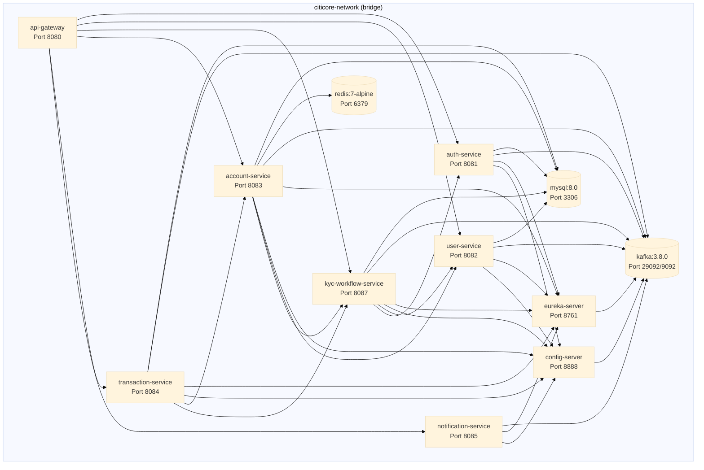

### 12.2 Kubernetes Deployment Architecture (Target) - Updated

```mermaid
%%{init: {'theme': 'base'}}%%
graph TB
    subgraph EXTERNAL ["External"]
        LB[Load Balancer\nAWS ALB / CloudFlare]
        USERS[Users]
        ADMINS[Admins]
    end
    
    subgraph INGRESS ["Ingress Layer"]
        ING[NGINX Ingress Controller\nTLS Termination\nWAF Rules]
    end
    
    subgraph NAMESPACE_CITICORE ["Namespace: citicore-prod"]
        subgraph GATEWAY_NS ["Gateway"]
            GW_DEP[Deployment: api-gateway\nReplicas: 3\nHPA: CPU 70%]
            GW_SVC[Service: api-gateway\nClusterIP]
        end
        
        subgraph CORE_NS ["Core Services"]
            AUTH_DEP[Deployment: auth-service\nReplicas: 3\nHPA: CPU 70%]
            USER_DEP[Deployment: user-service\nReplicas: 3\nHPA: CPU 70%]
            KYC_DEP[Deployment: kyc-workflow-service\nReplicas: 3\nHPA: CPU 70%]
            ACC_DEP[Deployment: account-service\nReplicas: 5\nHPA: CPU 70%\nPDB: minAvailable 2]
            TXN_DEP[Deployment: transaction-service\nReplicas: 3\nHPA: CPU 70%]
            NOTIF_DEP[Deployment: notification-service\nReplicas: 2\nHPA: CPU 70%]
            LEDGER_DEP[Deployment: ledger-service\nReplicas: 2\nHPA: CPU 70%]
            COMPLIANCE_DEP[Deployment: compliance-service\nReplicas: 2\nHPA: CPU 70%]
        end
        
        subgraph PLATFORM_NS ["Platform"]
            EUREKA_DEP[Deployment: eureka-server\nReplicas: 2]
            CONFIG_DEP[Deployment: config-server\nReplicas: 2]
        end
    end
    
    subgraph NAMESPACE_DATA ["Namespace: data-layer"]
        MYSQL_PRIMARY[(MySQL Primary\nStatefulSet: 1\nReplicas: 2)\nPVC: 500Gi]
        MYSQL_REPLICA[(MySQL Replica\nStatefulSet: 2)\nRead-Only]
        REDIS_CLUSTER[(Redis Cluster\n6 Nodes: 3M/3R)\nPVC: 50Gi]
        KAFKA_CLUSTER[(Kafka Cluster\nStrimzi Operator\n3 Brokers, RF=3)\nPVC: 200Gi/broker]
    end
    
    subgraph NAMESPACE_OBS ["Namespace: observability"]
        PROM[Prometheus Operator\nServiceMonitors]
        GRAF[Grafana]
        LOKI[Loki + Promtail]
        ZIPKIN[Zipkin/Jaeger]
        ALERT[Alertmanager]
    end
    
    subgraph NAMESPACE_SEC ["Namespace: security"]
        VAULT[HashiCorp Vault\nHA Mode\nAuto-unseal]
        CERT[cert-manager\nLet's Encrypt / Internal CA]
    end
    
    USERS --> LB
    ADMINS --> LB
    LB --> ING
    ING --> GW_SVC
    GW_SVC --> GW_DEP
    GW_DEP --> AUTH_DEP
    GW_DEP --> USER_DEP
    GW_DEP --> KYC_DEP
    GW_DEP --> ACC_DEP
    GW_DEP --> TXN_DEP
    GW_DEP --> NOTIF_DEP
    GW_DEP --> LEDGER_DEP
    GW_DEP --> COMPLIANCE_DEP
    
    AUTH_DEP --> MYSQL_PRIMARY
    USER_DEP --> MYSQL_PRIMARY
    KYC_DEP --> MYSQL_PRIMARY
    ACC_DEP --> MYSQL_PRIMARY
    ACC_DEP --> MYSQL_REPLICA
    ACC_DEP --> REDIS_CLUSTER
    TXN_DEP --> MYSQL_PRIMARY
    LEDGER_DEP --> MYSQL_PRIMARY
    COMPLIANCE_DEP --> MYSQL_PRIMARY
    ALL_DEP[All Services] --> KAFKA_CLUSTER
    ALL_DEP --> EUREKA_DEP
    ALL_DEP --> CONFIG_DEP
    ALL_DEP --> VAULT
    ALL_DEP --> PROM
    ALL_DEP --> LOKI
    ALL_DEP --> ZIPKIN
```

### 12.3 Network Policies (Zero Trust) - Same as before

### 12.4 CI/CD Pipeline - Same as before

---

## 13. Monitoring & Observability

### 13.1 Observability Stack - Same as before

### 13.2 Key Metrics (Updated with KYC Metrics)

| Category | Metrics | Source |
|----------|---------|--------|
| **RED (Request/Error/Duration)** | `http_server_requests_seconds_count`, `http_server_requests_seconds_sum`, `http_server_requests_seconds_bucket` | Micrometer (Spring MVC) |
| **JVM** | `jvm_memory_used_bytes`, `jvm_gc_pause_seconds`, `jvm_threads_live` | Micrometer (JVM) |
| **Database** | `hikaricp_connections_active`, `hikaricp_connections_idle`, `hikaricp_connections_pending` | Micrometer (HikariCP) |
| **Cache** | `cache_gets_total`, `cache_puts_total`, `cache_evictions_total` | Micrometer (Redis) |
| **Kafka** | `kafka_consumer_fetch_manager_records_lag_max`, `kafka_producer_record_send_rate` | Micrometer (Kafka) |
| **Business** | `banking.transfers.initiated`, `banking.transfers.completed`, `banking.transfers.failed`, `banking.transfers.reversed`, `banking.accounts.active`, `banking.balance.total` | Custom `BankingMetrics` |
| **KYC Business** | `kyc.cases.submitted`, `kyc.cases.approved`, `kyc.cases.rejected`, `kyc.cases.escalated`, `kyc.cases.avg_processing_time`, `kyc.cases.sla_breaches` | Custom `KycMetrics` |
| **Saga** | `saga.step.duration`, `saga.step.success`, `saga.step.failure`, `saga.compensation.triggered` | Custom |
| **Outbox** | `outbox.events.pending`, `outbox.events.published`, `outbox.events.failed`, `outbox.poll.duration` | Custom |
| **Security** | `auth.login.success`, `auth.login.failed`, `auth.lockout.triggered`, `auth.mfa.success`, `auth.mfa.failed` | Custom `SecurityMetrics` |
| **RBAC** | `rbac.denied.by_role`, `rbac.denied.by_permission`, `rbac.separation_of_duties_violations` | Custom `RbacMetrics` |

### 13.3 Distributed Tracing Context Propagation - Same as before

### 13.4 Health Checks - Updated with KYC Service

| Probe | Endpoint | Checks | Failure Action |
|-------|----------|--------|----------------|
| **Liveness** | `/actuator/health/liveness` | Process alive, no deadlock | Kubernetes restarts pod |
| **Readiness** | `/actuator/health/readiness` | DB connectivity, Kafka, Redis, Feign targets, Business (outbox lag < 10k, replica lag < 30s, KYC SLA compliance) | Kubernetes removes from Service |
| **Startup** | `/actuator/health/startup` | All readiness checks + migrations complete | Kubernetes waits (up to 5 min) |

### 13.5 Key Dashboards - Updated

| Dashboard | Panels | Purpose |
|-----------|--------|---------|
| **System Overview** | Request rate, Error rate, Latency (p50/p95/p99), Saturation (CPU, Mem, DB pool) | Golden signals |
| **Service Deep Dive** | Per-service RED, JVM, DB pool, Cache hit rate | Troubleshooting |
| **Business KPIs** | Transfers/day, Success rate, Avg transfer time, Active accounts, Total balances | Business monitoring |
| **KYC Workflow** | Cases submitted/approved/rejected, Avg processing time, SLA compliance, Officer workload, SLA breaches | KYC operations |
| **Saga Monitor** | Saga in-flight, Step durations, Failure rates, Compensation rate | Transaction flow |
| **Security Monitor** | Login success/failure, Lockouts, MFA, RBAC denials, SoD violations | Security posture |
| **Kafka Monitor** | Consumer lag, Producer throughput, Under-replicated partitions | Event bus health |
| **Database Monitor** | Query latency, Connections, Replication lag, Lock waits | Data layer health |

### 13.6 Alerting Rules (Critical) - Updated

| Alert | Condition | Severity | Runbook |
|-------|-----------|----------|---------|
| `ServiceDown` | `up{job=~".*-service"} == 0` for 2m | Critical | Check pod logs, restart |
| `HighErrorRate` | `rate(http_server_requests_seconds_count{status=~"5.."}[5m]) > 0.05` | Critical | Check dependencies, circuit breakers |
| `HighLatency` | `histogram_quantile(0.99, rate(http_server_requests_seconds_bucket[5m])) > 2` | Warning | Check DB, Kafka, external calls |
| `KafkaConsumerLag` | `kafka_consumer_fetch_manager_records_lag_max > 10000` | Warning | Scale consumers, check processing |
| `OutboxLag` | `outbox_events_pending > 10000` | Critical | Check publisher, Kafka connectivity |
| `ReplicaLag` | `mysql_replica_lag_seconds > 30` | Warning | Check replication, network |
| `KycSlaBreach` | `kyc_cases_sla_breach > 0` | Critical | Review officer workload, reassign |
| `KycSoDViolation` | `rbac_separation_of_duties_violations > 0` | Critical | Audit trail review, investigate |
| `AuthLockoutSpike` | `rate(auth_lockout_triggered[5m]) > 10` | Warning | Check for brute force attack |
| `DiskSpace` | `disk_usage_percent > 85` | Warning | Cleanup, expand volume |
| `CertExpiry` | `ssl_cert_expiry_days < 30` | Warning | Renew certificate |

---

## 14. End-to-End Workflows

### 14.1 Customer Onboarding Workflow (Updated with KYC Maker-Checker)

```mermaid
%%{init: {'theme': 'base'}}%%
flowchart TD
    START([Customer Visits App]) --> REGISTER[POST /auth/register\n{email, password, phone}]
    REGISTER --> VALIDATE{Valid Input?}
    VALIDATE -->|No| ERROR1[Return 400 Validation Error]
    VALIDATE -->|Yes| SAVE_USER[Save User (PENDING, unverified)]
    SAVE_USER --> GEN_OTP[Generate 8-char OTP]
    GEN_OTP --> SAVE_OTP[Save OTP to User (expires 10min)]
    SAVE_OTP --> PUBLISH_OTP[Publish to otp-verification-topic]
    PUBLISH_OTP --> EMAIL_OTP[Notification Service: Send Email]
    EMAIL_OTP --> RETURN[Return 201: Registration initiated]
    RETURN --> VERIFY_UI[Customer Enters OTP]
    VERIFY_UI --> VERIFY_API[POST /auth/verify {email, code}]
    VERIFY_API --> CHECK_OTP{OTP Valid & Not Expired?}
    CHECK_OTP -->|No| ERROR2[Return 400: Invalid/Expired OTP]
    CHECK_OTP -->|Yes| ACTIVATE[Update User: ACTIVE, emailVerified=true]
    ACTIVATE --> ISSUE_TOKENS[Generate JWT Access + Refresh]
    ISSUE_TOKENS --> RETURN_TOKENS[Return Tokens]
    RETURN_TOKENS --> PROFILE[Customer Completes Profile\nPOST /users/profile]
    PROFILE --> KYC_UPLOAD[Customer Uploads KYC Docs\nPOST /users/kyc/upload]
    KYC_UPLOAD --> KYC_SUBMIT[Customer Submits KYC\nPOST /users/kyc/submit]
    KYC_SUBMIT --> KYC_PENDING[KYC Status: SUBMITTED]
    KYC_PENDING --> KYC_WF_CREATE[KYC Workflow: Create Case\nStatus: SUBMITTED → PENDING_REVIEW]
    KYC_WF_CREATE --> AUTO_ASSIGN[Auto-assign to KYC_OFFICER]
    AUTO_ASSIGN --> NOTIFY_OFFICER[Notify Assigned Officer]
    NOTIFY_OFFICER --> OFFICER_REVIEW[KYC Officer Reviews Case]
    OFFICER_REVIEW --> REVIEW_ACTION{Officer Action}
    REVIEW_ACTION -->|Request Info| REQUEST_INFO[Status: MORE_INFO_REQUIRED\nNotify Customer]
    REQUEST_INFO --> CUSTOMER_RESPOND[Customer Provides Info]
    CUSTOMER_RESPOND --> RESUBMITTED[Status: RESUBMITTED → UNDER_REVIEW]
    RESUBMITTED --> OFFICER_REVIEW
    REVIEW_ACTION -->|Recommend Approve| RECOMMEND_APPROVE[Status: RECOMMENDED_APPROVAL]
    REVIEW_ACTION -->|Recommend Reject| RECOMMEND_REJECT[Status: RECOMMENDED_REJECTION]
    RECOMMEND_APPROVE --> MANAGER_REVIEW[KYC Manager Reviews]
    RECOMMEND_REJECT --> MANAGER_REVIEW
    MANAGER_REVIEW --> MANAGER_ACTION{Manager Action}
    MANAGER_ACTION -->|Approve| APPROVED[Status: APPROVED\nNotify Customer]
    MANAGER_ACTION -->|Reject| REJECTED[Status: REJECTED\nNotify Customer + Reasons]
    MANAGER_ACTION -->|Return for Review| RETURN_REVIEW[Status: UNDER_REVIEW\nNotify Officer]
    MANAGER_ACTION -->|Escalate| ESCALATED[Status: ESCALATED\nNotify Compliance]
    RETURN_REVIEW --> OFFICER_REVIEW
    ESCALATED --> COMPLIANCE_RESOLVE[Compliance Resolves]
    COMPLIANCE_RESOLVE --> OFFICER_REVIEW
    APPROVED --> KYC_APPROVED_EVENT[Publish KYC_APPROVED Event]
    KYC_APPROVED_EVENT --> ACCOUNT_CREATE[Customer Creates Account\nPOST /accounts/create]
    REJECTED --> REAPPLY[Customer Can Reapply]
    REAPPLY --> KYC_UPLOAD
    ACCOUNT_CREATE --> KYC_CHECK[Account Service: Feign KYC Status]
    KYC_CHECK -->|Not Approved| ERROR3[Return 400: KYC Required]
    KYC_CHECK -->|Approved| CREATE_ACC_DB[Create Account (SAVINGS/CURRENT)]
    CREATE_ACC_DB --> PUBLISH_ACC[Publish ACCOUNT_CREATED Event]
    PUBLISH_ACC --> LEDGER_POST[Ledger: Post Journal Entry\nDebit: Cash / Credit: Customer Deposits]
    LEDGER_POST --> SUCCESS[Account Created Successfully]
    SUCCESS --> END([Onboarding Complete])
```

### 14.2 KYC Officer Review Workflow

```mermaid
%%{init: {'theme': 'base'}}%%
flowchart TD
    START([KYC Officer Login]) --> DASHBOARD[View Assigned Cases\nGET /kyc/cases/assigned]
    DASHBOARD --> SELECT_CASE[Select Case: KYC-20261118-001]
    SELECT_CASE --> VIEW_CASE[GET /kyc/cases/{caseId}\nView Profile, Documents, History]
    VIEW_CASE --> REVIEW_DOCS[Review Each Document\nGET /kyc/cases/{caseId}/documents/{docId}]
    REVIEW_DOCS --> PERFORM_CHECKS[Perform Verification Checks\n- Document Authenticity\n- OCR Data Match\n- Face Match (if selfie)\n- Sanctions/PEP Screening]
    PERFORM_CHECKS --> RECORD_FINDINGS[Record Findings per Document\nPOST /kyc/cases/{caseId}/findings]
    RECORD_FINDINGS --> DECISION_POINT{All Checks Pass?}
    DECISION_POINT -->|No - Missing Info| REQUEST_INFO[POST /kyc/cases/{caseId}/request-info\n{requiredDocuments, remarks}]
    REQUEST_INFO --> NOTIFY_CUSTOMER[Kafka → Notification: Customer Action Required]
    NOTIFY_CUSTOMER --> WAIT_RESPONSE[Wait for Customer Resubmission]
    WAIT_RESPONSE --> RESUBMITTED[Case Status: RESUBMITTED]
    RESUBMITTED --> VIEW_CASE
    DECISION_POINT -->|No - Deficiency| RECOMMEND_REJECT[POST /kyc/cases/{caseId}/recommend\n{REJECT, rejectionReason, findings}]
    RECOMMEND_REJECT --> MANAGER_QUEUE[Case → PENDING_MANAGER_APPROVAL]
    DECISION_POINT -->|Yes - All Clear| RECOMMEND_APPROVE[POST /kyc/cases/{caseId}/recommend\n{APPROVE, remarks, findings}]
    RECOMMEND_APPROVE --> MANAGER_QUEUE
    MANAGER_QUEUE --> NOTIFY_MANAGER[Kafka → Notification: Case Ready for Decision]
    NOTIFY_MANAGER --> END([Officer Review Complete])
```

### 14.3 KYC Manager Approval Workflow

```mermaid
%%{init: {'theme': 'base'}}%%
flowchart TD
    START([KYC Manager Login]) --> DASHBOARD[View Pending Approval Cases\nGET /kyc/cases/pending-approval]
    DASHBOARD --> SELECT_CASE[Select Case: KYC-20261118-001]
    SELECT_CASE --> VIEW_REVIEW[GET /kyc/cases/{caseId}/review\nView Officer Findings, Recommendation]
    VIEW_REVIEW --> SEPARATION_CHECK{Manager == Reviewing Officer?}
    SEPARATION_CHECK -->|Yes| BLOCK[BLOCK: Cannot approve own review\nReturn 403 Forbidden]
    SEPARATION_CHECK -->|No| MANAGER_DECISION{Manager Decision}
    MANAGER_DECISION -->|Approve| APPROVE[POST /kyc/cases/{caseId}/approve\n{approvalReason}]
    MANAGER_DECISION -->|Reject| REJECT[POST /kyc/cases/{caseId}/reject\n{rejectionReason, permittedReasons}]
    MANAGER_DECISION -->|Return for Review| RETURN[POST /kyc/cases/{caseId}/return\n{returnReason}]
    MANAGER_DECISION -->|Escalate| ESCALATE[POST /kyc/cases/{caseId}/escalate\n{escalationReason}]
    APPROVE --> UPDATE_STATUS[Status: APPROVED\nDecidingManager = currentUser]
    REJECT --> UPDATE_STATUS[Status: REJECTED\nDecidingManager = currentUser]
    RETURN --> UPDATE_STATUS[Status: UNDER_REVIEW\nAssignedOfficer = originalOfficer]
    ESCALATE --> UPDATE_STATUS[Status: ESCALATED\nEscalationReason recorded]
    UPDATE_STATUS --> PUBLISH_EVENT[Publish kyc-case-topic\nAPPROVED/REJECTED/RETURNED/ESCALATED]
    PUBLISH_EVENT --> NOTIFY[Kafka → Notification Service]
    NOTIFY --> CUSTOMER_NOTIFY[Notify Customer]
    NOTIFY --> ACCOUNT_SVC[If APPROVED → Account Service enables account creation]
    NOTIFY --> COMPLIANCE[Compliance Service: Audit Trail]
    CUSTOMER_NOTIFY --> END([Manager Decision Complete])
    BLOCK --> END
```

### 14.4 Account Management Workflow - Same as before (with dual balance)

### 14.5 Fund Transfer Workflow (Detailed) - Same as before

---

## 15. Architecture Review Observations (Updated)

### 15.1 Existing Design Decisions Retained

| Decision | Description | Status |
|----------|-------------|--------|
| **Schema per Service** | Each microservice owns its schema within a single RDS MySQL deployment; no shared schemas; separate credentials per service | ✅ Retained |
| **Event-Driven Architecture** | Kafka for async communication; transactional outbox for reliability | ✅ Retained |
| **Saga Pattern (Hybrid)** | Orchestration for fund transfers; Choreography for notifications; Async event consumption for audit | ✅ Retained |
| **Primary/Replica Routing** | Account Service read/write splitting | ✅ Retained |
| **Redis Cache-Aside** | Balance caching with 5min TTL | ✅ Retained |
| **Double-Entry Ledger (Planned)** | General Ledger service for regulatory compliance | ✅ Retained |
| **Spring Cloud Gateway** | Reactive routing, JWT validation, rate limiting | ✅ Retained |
| **Eureka Service Discovery (Local Only)** | Local/Docker Compose service registry | ✅ Retained |
| **Transactional Outbox** | Reliable event publishing | ✅ Retained |
| **Pessimistic Locking** | SELECT FOR UPDATE for account balance operations | ✅ Retained |

### 15.2 New RBAC Decisions

| Decision | Description | Impact |
|----------|-------------|--------|
| **9 System Roles** | CUSTOMER, KYC_OFFICER, KYC_MANAGER, SUPPORT_AGENT, OPERATIONS_OFFICER, COMPLIANCE_OFFICER, ADMIN, AUDITOR, SERVICE | Replaces 5-role model; supports separation of duties |
| **25 Granular Permissions** | Fine-grained permissions per resource and action | Enables least-privilege access |
| **Role-Permission Matrix** | Explicit mapping (Section 3.4) | Auditable, configurable |
| **User-to-Role Assignment** | Self-registration (CUSTOMER), Admin assignment (staff), Manager case assignment (officers) | Clear ownership |
| **Resource Ownership & Scopes** | Customer: own data; Officers: assigned cases; Managers: authorized cases; Staff: role-based | Enforces data isolation |
| **JWT Claims with Permissions** | Roles + permissions + case assignments in token | Enables stateless authorization |
| **Permission Revocation Strategy** | 15min JWT expiry + Redis cache eviction + Refresh token revocation | Near-real-time revocation |
| **API Gateway RBAC Enforcement** | Coarse-grained check at gateway + fine-grained @PreAuthorize in services | Defense in depth |
| **Backend Service Independent Enforcement** | Each service validates JWT, checks permissions, enforces ownership | No reliance on gateway alone |
| **Separation of Duties (SoD) Engine** | KYC Workflow Service enforces officer ≠ manager for same case | Regulatory compliance |
| **Security Audit Logging** | Immutable audit trail for all KYC transitions, auth events, admin actions | Compliance, forensics |

### 15.3 New KYC Workflow Decisions

| Decision | Description | Impact |
|----------|-------------|--------|
| **13-State KYC Lifecycle** | DRAFT → SUBMITTED → PENDING_REVIEW → UNDER_REVIEW → MORE_INFO_REQUIRED → RESUBMITTED → RECOMMENDED_APPROVAL/REJECTION → PENDING_MANAGER_APPROVAL → APPROVED/REJECTED/ESCALATED | Complete traceability |
| **Maker-Checker Enforcement** | Officer reviews & recommends; Manager approves/rejects; Officer ≠ Manager | Regulatory requirement |
| **Case Assignment Model** | Manager assigns to Officer; Auto-assignment option; Reassignment support | Workload distribution |
| **SLA Monitoring** | Case SLA deadlines; Breach alerts; Escalation path | Operational excellence |
| **Audit Trail per Transition** | Actor, role, timestamp, previous/new state, reason, metadata | Full traceability |
| **Document Access Control** | Pre-signed URLs; Role-based visibility; Encryption at rest (SSE-KMS) | Data protection |
| **KYC Workflow Service** | New microservice (Port 8087) owning KYC case lifecycle | Separation of concerns |
| **KYC Events** | kyc-case-topic, kyc-notification-topic for workflow events | Decoupled communication |
| **Account Creation Gating** | Account Service checks KYC status via Feign + Kafka event | Prevents accounts without KYC |

### 15.4 Existing Design Conflicts Discovered

| Conflict | Description | Resolution |
|----------|-------------|------------|
| **User Service SecurityConfig** | References `/accounts/**` instead of `/users/**` (copy-paste bug) | Fixed in SecurityConfig |
| **Account Service PermitAll** | All endpoints public (SEC-009) | Fixed: require authentication + RBAC |
| **User Service PermitAll** | All endpoints public (SEC-010) | Fixed: require authentication + RBAC |
| **Saga Choreography vs Orchestration** | Documentation says choreography but Transaction Service acts as orchestrator | Clarified: Choreography with Transaction Service as initiator |
| **Cross-DB Referential Integrity** | Database per service but FK references across DBs | Application-level validation + reconciliation jobs (documented) |
| **Idempotency Key Not User-Scoped** | Global unique constraint allows cross-user collision | Fixed: composite unique (auth_user_id, idempotency_key) |
| **Account Statement txn_ref Unique** | Global unique prevents transfer debit+credit with same txnRef | Fixed: composite unique (account_number, txn_ref) |
| **KYC Review in User Service** | KYC review logic mixed with profile management | Moved to dedicated KYC Workflow Service |
| **Single KYC Status** | User Service has simple KYC_STATUS enum | Replaced with full KYC Case state machine |

### 15.5 Decisions Requiring Approval

| Decision | Options | Recommendation | Status |
|----------|---------|----------------|--------|
| **DEC-001: Database Topology** | Single DB with schemas vs Multi-DB with app-level integrity | Single DB with schemas for referential integrity | **Pending** |
| **DEC-002: Saga Pattern** | Pure choreography vs Orchestration | Keep choreography; Transaction Service as initiator only | **Pending** |
| **DEC-003: KYC Service Ownership** | KYC Workflow Service vs Extended User Service | Dedicated KYC Workflow Service (cleaner separation) | **Approved** |
| **DEC-004: Case Assignment** | Manager assigns vs Auto-assignment (round-robin) | Hybrid: Auto-assign with Manager override | **Approved** |
| **DEC-005: SoD Enforcement Location** | Gateway vs KYC Workflow Service vs Both | KYC Workflow Service (business logic) + Gateway (coarse) | **Approved** |
| **DEC-006: JWT Claims Size** | All permissions in JWT vs Reference to permission service | Permissions in JWT (15min expiry, stateless) | **Approved** |
| **DEC-007: Ledger Service** | Separate microservice vs Embedded in Account Service | Separate microservice (regulatory independence) | **Approved** |
| **DEC-008: Compliance Service** | Build vs Buy (sanctions/PEP screening) | Build abstraction; integrate vendor APIs | **Approved** |
| **DEC-009: MFA Methods** | Email OTP only vs Email OTP + SMS + TOTP | Email OTP primary | **Approved** |
| **DEC-010: Document Malware Scanning** | S3 Object Lambda + ClamAV vs Vendor API | S3 Object Lambda + ClamAV (cost-effective) | **Pending** |

---

## Appendix A: Glossary (Updated)

| Term | Definition |
|------|------------|
| **Saga** | Distributed transaction pattern using choreography/orchestration |
| **Outbox Pattern** | Reliable event publishing via database table + poller |
| **Double-Entry** | Accounting where every transaction affects two accounts (debit/credit) |
| **GL** | General Ledger - master record of all financial transactions |
| **Sub-Ledger** | Detailed ledger for specific domain (customer deposits, loans) |
| **Control Account** | GL account that summarizes sub-ledger balances |
| **TOCTOU** | Time-of-Check-Time-of-Use race condition |
| **BOLA** | Broken Object Level Authorization (OWASP API1) |
| **BFLA** | Broken Function Level Authorization (OWASP API5) |
| **RBAC** | Role-Based Access Control |
| **ABAC** | Attribute-Based Access Control |
| **SoD** | Separation of Duties |
| **Maker-Checker** | Dual-control workflow where one role creates/recommends and another approves |
| **KYC** | Know Your Customer - identity verification process |
| **PEP** | Politically Exposed Person |
| **SAR** | Suspicious Activity Report |
| **RPO** | Recovery Point Objective - max data loss tolerance |
| **RTO** | Recovery Time Objective - max downtime tolerance |
| **PITR** | Point-in-Time Recovery |
| **TDE** | Transparent Data Encryption |
| **SSE-KMS** | Server-Side Encryption with KMS-managed keys |

---

## Appendix B: Related Documents

| Document | Purpose |
|----------|---------|
| `PROJECT_ARCHITECTURE.md` | Original architecture documentation |
| `SECURITY_AUDIT.md` | Security vulnerability assessment |
| `DATABASE_AUDIT.md` | Database design & consistency audit |
| `BANKING_FUNCTIONALITY_GAP_ANALYSIS.md` | Functional coverage vs banking requirements |
| `IMPLEMENTATION_ROADMAP.md` | Phased implementation plan |
| `PRODUCTION_READINESS.md` | Production deployment readiness assessment |
| `ARCHITECTURE_REVIEW_OBSERVATIONS.md` | Architecture review findings |

---

## Appendix C: RBAC Permission Matrix Summary

### C.1 Customer-Facing Permissions
| Module | Permissions |
|--------|-------------|
| **Profile** | CUSTOMER_PROFILE_READ, CUSTOMER_PROFILE_WRITE |
| **KYC** | KYC_DOCUMENT_UPLOAD, KYC_DOCUMENT_READ (own) |
| **Accounts** | ACCOUNT_CREATE, ACCOUNT_READ (own), ACCOUNT_DEPOSIT, ACCOUNT_WITHDRAW, ACCOUNT_TRANSFER, ACCOUNT_STATEMENT (own), ACCOUNT_CLOSE (own) |
| **Transfers** | TRANSFER_INITIATE, TRANSFER_HISTORY (own) |

### C.2 KYC Officer Permissions
| Module | Permissions |
|--------|-------------|
| **Customer** | CUSTOMER_PROFILE_READ_ALL (assigned cases) |
| **KYC** | KYC_DOCUMENT_READ (assigned), KYC_CASE_REVIEW, KYC_CASE_RECOMMEND, KYC_CASE_REQUEST_INFO |
| **Accounts** | ACCOUNT_READ (assigned), ACCOUNT_STATEMENT (assigned) |
| **Transfers** | TRANSFER_HISTORY (assigned) |

### C.3 KYC Manager Permissions
| Module | Permissions |
|--------|-------------|
| **Customer** | CUSTOMER_PROFILE_READ_ALL (authorized cases) |
| **KYC** | KYC_DOCUMENT_READ (authorized), KYC_CASE_ASSIGN, KYC_CASE_APPROVE, KYC_CASE_REJECT, KYC_CASE_RETURN, KYC_CASE_ESCALATE, KYC_AUDIT_READ |
| **Accounts** | ACCOUNT_READ (authorized), ACCOUNT_STATEMENT (authorized) |
| **Transfers** | TRANSFER_HISTORY (authorized) |

### C.4 Staff Permissions (Support, Operations, Compliance)
| Role | Key Permissions |
|------|-----------------|
| **SUPPORT_AGENT** | CUSTOMER_PROFILE_READ_ALL, KYC_DOCUMENT_READ (limited), ACCOUNT_READ, ACCOUNT_STATEMENT, TRANSFER_HISTORY |
| **OPERATIONS_OFFICER** | CUSTOMER_PROFILE_READ_ALL, ACCOUNT_CREATE, ACCOUNT_READ, ACCOUNT_DEPOSIT, ACCOUNT_STATEMENT, TRANSFER_MONITOR, TRANSFER_HISTORY |
| **COMPLIANCE_OFFICER** | CUSTOMER_PROFILE_READ_ALL, KYC_DOCUMENT_READ, KYC_AUDIT_READ, ACCOUNT_READ, ACCOUNT_STATEMENT, TRANSFER_MONITOR, TRANSFER_HISTORY, AUDIT_TRAIL_READ |

### C.5 Admin Permissions
| Module | Permissions |
|--------|-------------|
| **All** | All permissions including ADMIN_USER_MANAGE, ADMIN_ROLE_ASSIGN, ADMIN_CONFIG_MANAGE |

---

## Document Control

| Version | Date | Author | Changes |
|---------|------|--------|---------|
| 1.0 | 2026-11-17 | Architecture Team | Initial target state architecture documentation |
| 2.0 | 2026-11-18 | Architecture Team | **Major Update**: Comprehensive RBAC model (9 roles, 25 permissions), KYC Maker-Checker workflow (13 states, separation of duties), New KYC Workflow Service, Updated security architecture, Updated service topology, Updated event model, Updated workflows |

---

**END OF DOCUMENT**