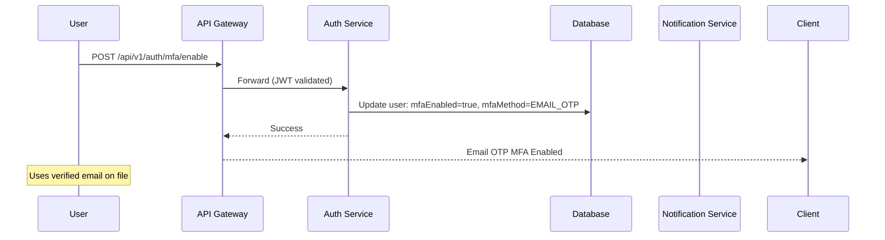
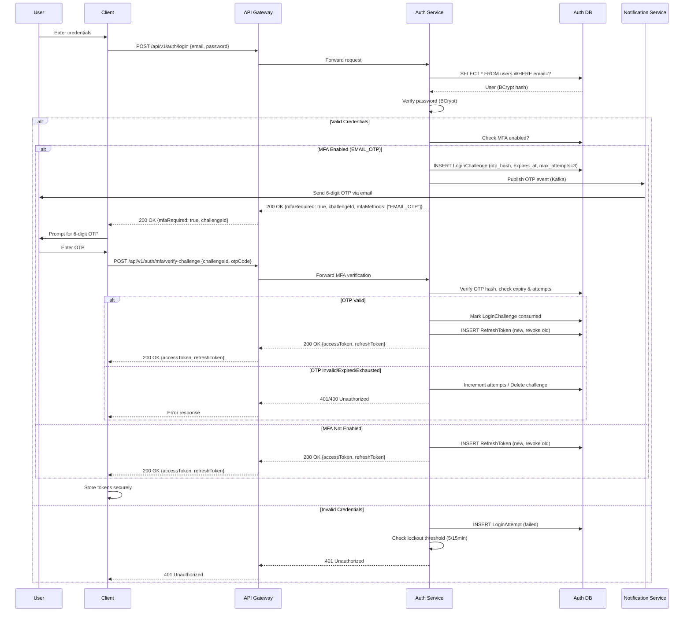
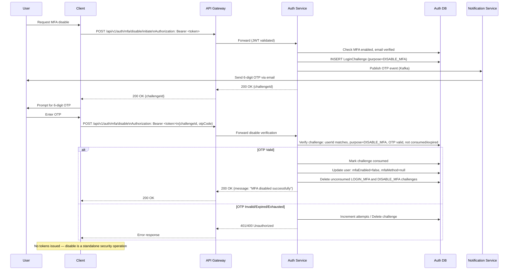

# ADR-009: MFA Methods — Email OTP Primary

## Status
✅ **APPROVED** (2026-11-23) — *Updated from TOTP to Email OTP*

## Context

The CitiCore platform requires Multi-Factor Authentication (MFA) for enhanced security, particularly for staff roles (KYC_OFFICER, KYC_MANAGER, ADMIN, etc.) and high-value customer transactions.

**Requirements:**
- Strong second factor for staff roles (regulatory requirement)
- Customer-friendly method for broader accessibility
- Support for account recovery if MFA method lost
- Compliance with RBI/PCI-DSS guidelines
- Simplified user experience — no authenticator app required

## Decision

**Use Email OTP as the primary (and only) MFA method.**

### MFA Methods

| Method | Role | Type | Description |
|--------|------|------|-------------|
| **Email OTP** | Primary | Email | 6-digit numeric code, 5-min expiry, 3 max attempts |

### Enrollment Flow



### Authentication Flow (with MFA)



### MFA Disable Flow



### Email OTP Implementation

```java
@Service
public class EmailOtpService {
    
    private static final String OTP_CHARS = "0123456789";
    
    @Value("${citicore.auth.mfa.email-otp.length:6}")
    private int otpLength;
    
    @Value("${citicore.auth.mfa.email-otp.expiry-minutes:5}")
    private int expiryMinutes;
    
    @Value("${citicore.auth.mfa.email-otp.max-attempts:3}")
    private int maxAttempts;
    
    private final SecureRandom secureRandom = new SecureRandom();
    
    public String generateOtp() {
        StringBuilder sb = new StringBuilder(otpLength);
        for (int i = 0; i < otpLength; i++) {
            sb.append(OTP_CHARS.charAt(secureRandom.nextInt(OTP_CHARS.length())));
        }
        return sb.toString();
    }
    
    public String hashOtp(String otp) {
        // Use BCrypt to hash the OTP for storage
        return BCrypt.hashpw(otp, BCrypt.gensalt());
    }
    
    public boolean verifyOtp(String rawOtp, String hashedOtp) {
        return BCrypt.checkpw(rawOtp, hashedOtp);
    }
    
    public LocalDateTime calculateExpiry() {
        return LocalDateTime.now().plusMinutes(expiryMinutes);
    }
}
```

### Login Challenge Entity

```java
@Entity
@Table(name = "login_challenges")
public class LoginChallenge {
    
    @Id @GeneratedValue
    private Long id;
    
    private Long userId;
    
    @Column(unique = true)
    private String challengeId; // UUID
    
    private String otpHash; // BCrypt hashed OTP
    
    private LocalDateTime expiresAt;
    
    private int attempts = 0;
    private int maxAttempts = 3;
    
    private boolean consumed = false;
    private LocalDateTime consumedAt;
    
    private String purpose = "LOGIN_MFA";
    
    // Business logic methods
    public boolean isExpired() { return expiresAt.isBefore(LocalDateTime.now()); }
    public boolean isExhausted() { return attempts >= maxAttempts; }
    public void incrementAttempts() { this.attempts++; }
    public void markConsumed() { this.consumed = true; this.consumedAt = LocalDateTime.now(); }
}
```

### Enrollment & Recovery

| Scenario | Flow |
|----------|------|
| **First Enrollment** | User enables MFA → Email OTP MFA activated immediately (uses verified email) |
| **Disable MFA** | Two-step: (1) Initiate disable → challenge created, OTP sent; (2) Verify challenge ID + OTP → MFA disabled |
| **Forgot Password + MFA** | Password reset → MFA remains enabled (email unchanged) |
| **Admin Reset** | Admin triggers MFA reset → User re-enables MFA |

### Configuration

```yaml
# application.yml
citicore:
  auth:
    mfa:
      email-otp:
        enabled: true
        length: 6
        expiry-minutes: 5
        max-attempts: 3
        resend-cooldown-minutes: 1
        rate-limit-per-hour: 5
    lockout:
      max-attempts: 5
      duration-minutes: 15
```

### JWT Claims for MFA

```json
{
  "sub": "67890",
  "email": "kyc.officer@citicore.com",
  "roles": ["ROLE_KYC_OFFICER"],
  "permissions": [...],
  "mfaEnabled": true,
  "mfaMethod": "EMAIL_OTP",
  "iat": 1731923400,
  "exp": 1731924300
}
```

### API Endpoints

| Endpoint | Method | Description |
|----------|--------|-------------|
| `/api/v1/auth/mfa/enable` | POST | Enable Email OTP MFA (requires authenticated user, verified email) |
| `/api/v1/auth/mfa/verify-challenge` | POST | Verify OTP during login (challengeId + otpCode) |
| `/api/v1/auth/mfa/resend-otp` | POST | Resend OTP for existing challenge (challengeId) |
| `/api/v1/auth/mfa/disable/initiate` | POST | Initiate MFA disable — creates `DISABLE_MFA` challenge, sends OTP, returns challengeId |
| `/api/v1/auth/mfa/disable` | POST | Verify `DISABLE_MFA` challenge (challengeId + otpCode), disables MFA, no tokens issued |

### Security Considerations

1. **OTP Storage**: Only BCrypt hash stored in database, never raw OTP
2. **Challenge Binding**: Each challenge bound to user, purpose (LOGIN_MFA or DISABLE_MFA), and opaque challengeId
3. **Short Expiry**: 5-minute expiry limits exposure window
4. **Attempt Limits**: Maximum 3 verification attempts per challenge
5. **Resend Limits**: Maximum 3 resends per challenge, 1-minute cooldown between resends
6. **Rate Limiting**: 5 challenge creations per hour per user
7. **Single-Use**: Challenges consumed on successful verification, safe against concurrent requests (pessimistic locking)
8. **Account Enumeration**: Consistent responses regardless of account existence
9. **No Logging**: OTP values, challenge secrets never logged
10. **Email Compromise Risk**: Acknowledged — email OTP less phishing-resistant than TOTP/FIDO2; mitigated by short expiry, attempt limits, and rate limiting
11. **Disable MFA Isolation**: `DISABLE_MFA` challenges are separate from `LOGIN_MFA` challenges; they never issue login tokens. All unconsumed challenges for the user are cleaned up when MFA is disabled.

---

## Document Control

| Version | Date | Author | Changes |
|---------|------|--------|---------|
| 2.0 | 2026-11-23 | Architecture Team | Migrated from TOTP to Email OTP primary |
| 1.0 | 2026-11-18 | Architecture Team | Initial ADR (TOTP primary) |

---

**END OF ADR**