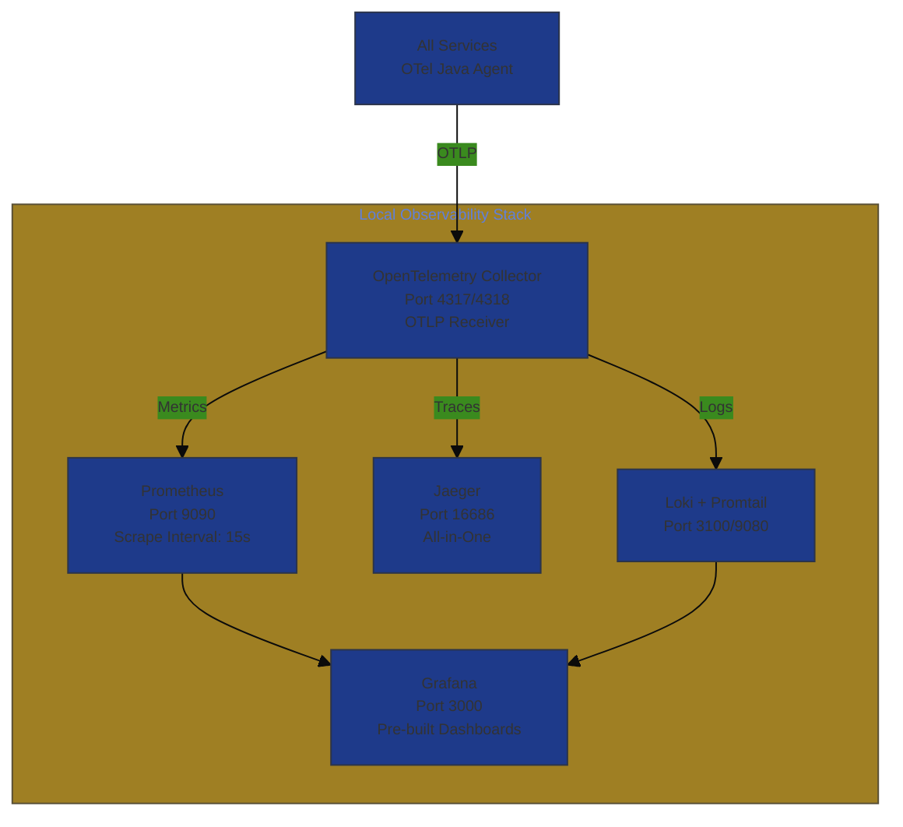
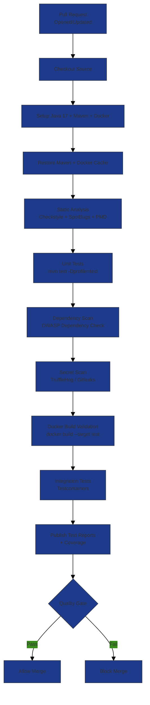
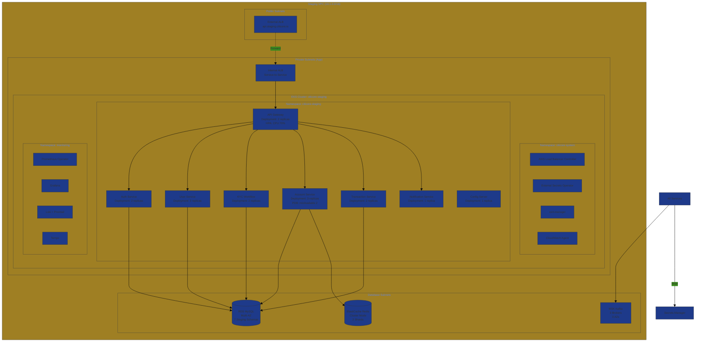
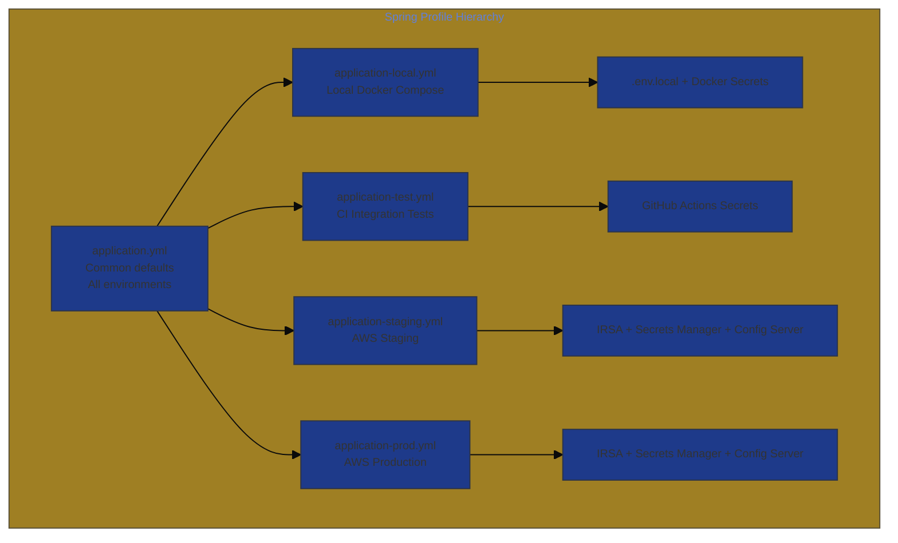
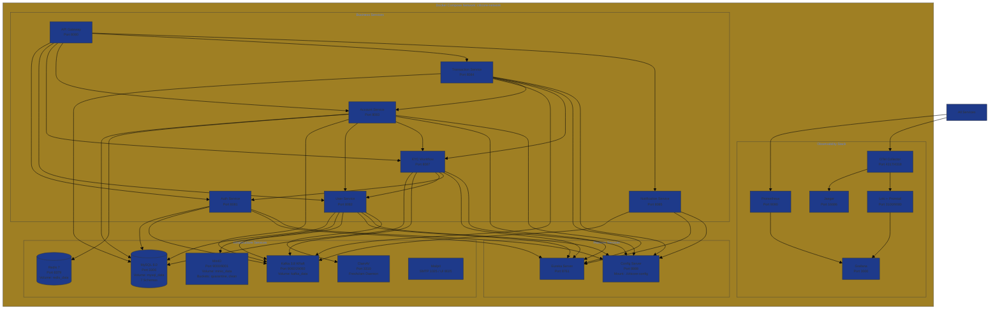

# CitiCore Banking Platform - Enterprise SDLC Environment Architecture

## Document Information

| Field | Value |
|-------|-------|
| **Document Title** | CitiCore Enterprise SDLC Environment Architecture |
| **Version** | 1.0 |
| **Status** | Draft for Review |
| **Classification** | Internal - Confidential |
| **Author** | Architecture Team |
| **Reviewers** | Engineering Lead, Security Lead, Platform Team, DevOps Lead, Compliance Officer |
| **Last Updated** | 2026-11-19 |

---

## Table of Contents

1. [Executive Summary](#1-executive-summary)
2. [Core Principles](#2-core-principles)
3. [Environment Overview](#3-environment-overview)
4. [Local Development Environment](#4-local-development-environment)
5. [Automated Testing / CI Environment](#5-automated-testing--ci-environment)
6. [Staging Environment](#6-staging-environment)
7. [Production Environment](#7-production-environment)
8. [Environment Isolation & Security](#8-environment-isolation--security)
9. [Application Configuration Architecture](#9-application-configuration-architecture)
10. [Infrastructure Comparison Matrix](#10-infrastructure-comparison-matrix)
11. [SDLC Flow Diagrams](#11-sdlc-flow-diagrams)

---

## 1. Executive Summary

This document defines the complete SDLC (Software Development Life Cycle) environment architecture for the CitiCore Banking Platform. It covers four distinct environments spanning from local developer workstations to production AWS infrastructure, ensuring:

- **Complete AWS Independence** for local development
- **Environment Parity** where behaviorally consistent
- **Security Isolation** between environments
- **Progressive Deployment** through automated CI/CD pipelines
- **Cost Optimization** via right-sized infrastructure per environment

### Approved ADR Alignment

This environment architecture respects all approved Architecture Decision Records:

| ADR | Decision | Environment Impact |
|-----|----------|-------------------|
| **DEC-001** | Single RDS with Separate Schemas | Local: Single MySQL with schemas; Prod: AWS RDS MySQL 8.0 |
| **DEC-002** | Hybrid Saga Pattern | Local: Embedded Kafka; Prod: AWS MSK |
| **DEC-010** | ClamAV Malware Scanning | Local: ClamAV container; Prod: S3 Object Lambda + ClamAV |
| **DEC-011** | RDS KMS + App-Level Encryption | Local: No encryption; Prod: RDS KMS + App-level |
| **DEC-012** | AWS Secrets Manager | Local: `.env.local` + Docker secrets; Prod: AWS Secrets Manager + IRSA |
| **DEC-013** | Mandatory TLS for RDS | Local: Optional TLS; Prod: Mandatory TLS 1.2+ |
| **DEC-014** | K8s DNS (Prod) / Eureka (Local) | Local: Eureka; Prod: K8s DNS (CoreDNS) |
| **DEC-015** | Mock KYC Provider | Local/Test: Mock; Staging/Prod: Pluggable adapter |

---

## 2. Core Principles

| Principle | Description |
|-----------|-------------|
| **Zero AWS Dependency (Local)** | Local development requires only Docker Desktop; no AWS credentials, CLI, or connectivity |
| **Environment Parity** | Same container images, same Spring profiles, same business logic across environments |
| **Progressive Isolation** | Local → CI → Staging → Production: increasing isolation, decreasing mutability |
| **Infrastructure as Code** | All environments defined declaratively; Terraform for AWS, Docker Compose for local |
| **Immutable Artifacts** | Same container image promoted through environments; no rebuild between stages |
| **Secrets by Environment** | Separate secret stores per environment; no cross-environment leakage |
| **Observability by Default** | All environments instrumented; local has lightweight stack, production has full stack |
| **Cost Awareness** | Local: free; CI: ephemeral; Staging: right-sized; Production: HA with cost controls |

---

## 3. Environment Overview

```mermaid
%%{init: {'theme': 'base', 'themeVariables': {'primaryColor': '#1e3a8a', 'fontSize': '11px'}}}%%
graph TB
    subgraph LOCAL ["LOCAL DEVELOPMENT<br/>Developer Workstation"]
        LD_INFRA[Docker Compose<br/>Single Host]
        LD_DB[(MySQL 8.0<br/>Schemas per Service)]
        LD_KAFKA[Kafka KRaft<br/>Single Broker]
        LD_REDIS[(Redis 7)]
        LD_S3[MinIO<br/>S3 Compatible]
        LD_CLAM[ClamAV]
        LD_MAIL[Mailpit]
        LD_EUREKA[Eureka Server]
        LD_OBS[Prometheus + Grafana + Jaeger]
        LD_SERVICES[Auth, User, KYC,<br/>Account, Txn, Notification,<br/>Gateway, Config, Eureka]
    end

    subgraph CI ["AUTOMATED TESTING / CI<br/>GitHub Actions Runners"]
        CI_INFRA[Ephemeral Runners<br/>Self-Hosted or GitHub-Hosted]
        CI_DB[(MySQL 8.0<br/>Test Schemas)]
        CI_KAFKA[Kafka KRaft<br/>Test Topics]
        CI_REDIS[(Redis 7)]
        CI_S3[MinIO]
        CI_CLAM[ClamAV]
        CI_MAIL[Mailpit]
        CI_SERVICES[Service Containers<br/>or Testcontainers]
    end

    subgraph STAGING ["STAGING<br/>AWS Account: citicore-staging"]
        ST_VPC[VPC: 10.1.0.0/16<br/>2 AZs]
        ST_EKS[EKS Cluster<br/>citicore-staging<br/>Managed Node Group]
        ST_RDS[(RDS MySQL 8.0<br/>Multi-AZ<br/>Staging Schemas)]
        ST_MSK[MSK Kafka<br/>3 Brokers]
        ST_ELASTI[(ElastiCache Redis<br/>Cluster Mode)]
        ST_S3[S3 Buckets<br/>Staging Prefix]
        ST_SM[Secrets Manager<br/>Staging Secrets]
        ST_KMS[KMS Keys<br/>Staging Keys]
        ST_SMTP[SES Sandbox]
        ST_OBS[CloudWatch + X-Ray<br/>+ Grafana Cloud]
        ST_SERVICES[All Services<br/>Staging Versions]
    end

    subgraph PROD ["PRODUCTION<br/>AWS Account: citicore-prod"]
        PR_VPC[VPC: 10.0.0.0/16<br/>3 AZs]
        PR_EKS[EKS Cluster<br/>citicore-prod<br/>Managed Node Groups<br/>Multi-AZ]
        PR_RDS[(RDS MySQL 8.0<br/>Multi-AZ<br/>Production Schemas)]
        PR_MSK[MSK Kafka<br/>3 Brokers<br/>Multi-AZ]
        PR_ELASTI[(ElastiCache Redis<br/>Cluster Mode<br/>Multi-AZ)]
        PR_S3[S3 Buckets<br/>Prod Buckets]
        PR_SM[Secrets Manager<br/>Prod Secrets]
        PR_KMS[KMS Keys<br/>Prod Keys]
        PR_SMTP[SES Production]
        PR_OBS[CloudWatch + X-Ray<br/>+ Grafana + Prometheus]
        PR_SERVICES[All Services<br/>Prod Versions<br/>HA Deployment]
    end

    LOCAL -.->|Promote Image| CI
    CI -.->|Deploy| STAGING
    STAGING -.->|Manual Approval| PROD

    style LOCAL fill:#e8f5e9,stroke:#2e7d32,stroke-width:2px
    style CI fill:#fff3e0,stroke:#ef6c00,stroke-width:2px
    style STAGING fill:#e3f2fd,stroke:#1565c0,stroke-width:2px
    style PROD fill:#fce4ec,stroke:#c2185b,stroke-width:2px
```



---

## 4. Local Development Environment

### 4.1 Purpose

Enable developers to run the complete CitiCore platform locally with zero external dependencies, supporting full banking workflows, integration testing, and debugging.

### 4.2 Infrastructure

| Component | Technology | Configuration |
|-----------|------------|---------------|
| **Orchestration** | Docker Compose v2 | Single `docker-compose.yml` + optional `docker-compose.override.yml` |
| **Runtime** | Docker Desktop | Linux containers; 8GB+ RAM recommended |
| **Network** | `citicore-network` bridge | Service-to-service via container names |

### 4.3 Database

| Aspect | Specification |
|--------|---------------|
| **Engine** | MySQL 8.0 (matching AWS RDS version) |
| **Deployment** | Single container `citicore-mysql` |
| **Persistence** | Named volume `citicore-mysql-data` |
| **Schemas** | 7 schemas per DEC-001: `citicore_authdb`, `citicore_kycdb`, `citicore_userdb`, `citicore_account`, `citicore_transactiondb`, `citicore_ledgerdb`, `citicore_compliancedb` |
| **Initialization** | `/mysql/init` directory with schema creation + seed data scripts |
| **Credentials** | Via `.env.local` (root user for init; service users created by init scripts) |
| **Health Check** | `mysqladmin ping` every 10s |
| **Port** | 3306 (host) → 3306 (container) |
| **TLS** | Disabled locally (optional for testing) |
| **Reset** | `docker compose down -v && docker compose up` |

**Initialization Scripts Structure:**
```
/mysql/init/
├── 01-create-schemas.sql
├── 02-create-users.sql
├── 03-grants.sql
├── 10-auth-schema.sql
├── 20-kyc-schema.sql
├── 30-user-schema.sql
├── 40-account-schema.sql
├── 50-transaction-schema.sql
├── 60-ledger-schema.sql
├── 70-compliance-schema.sql
└── 99-seed-data.sql
```

### 4.4 Kafka (KRaft Mode)

| Aspect | Specification |
|--------|---------------|
| **Engine** | Apache Kafka 3.8+ in KRaft mode (no ZooKeeper) |
| **Deployment** | Single container `citicore-kafka` |
| **Mode** | KRaft (controller + broker combined) |
| **Persistence** | Named volume `citicore-kafka-data` |
| **Listeners** | `INTERNAL://kafka:9092`, `EXTERNAL://localhost:29092` |
| **Configuration** | `KAFKA_PROCESS_ROLES=broker,controller` |
| **Topics** | Auto-create enabled; partition count 3; RF=1 |
| **Health Check** | `kafka-topics.sh --bootstrap-server localhost:9092 --list` |
| **Ports** | 9092 (internal), 29092 (external/host) |
| **Topic Initialization** | Optional: `/kafka/init-topics.sh` for DLQ, retry topics |

### 4.5 Redis

| Aspect | Specification |
|--------|---------------|
| **Engine** | Redis 7 Alpine |
| **Deployment** | Single container `citicore-redis` |
| **Persistence** | AOF enabled (`--appendonly yes`); named volume `citicore-redis-data` |
| **Port** | 6379 |
| **Health Check** | `redis-cli ping` every 5s |
| **Config** | Default; eviction policy `allkeys-lru` for cache testing |

### 4.6 Object Storage (MinIO)

| Aspect | Specification |
|--------|---------------|
| **Engine** | MinIO (latest) |
| **Deployment** | Single container `citicore-minio` |
| **Persistence** | Named volume `citicore-minio-data` |
| **Ports** | 9000 (API), 9001 (Console) |
| **Buckets** | Auto-created via init script: `citicore-kyc-quarantine`, `citicore-kyc-clean` |
| **Credentials** | `MINIO_ROOT_USER` / `MINIO_ROOT_PASSWORD` from `.env.local` |
| **S3 Compatibility** | Full S3 API v4 signature support |
| **Presigned URLs** | Supported for KYC document access testing |

### 4.7 Malware Scanning (ClamAV)

| Aspect | Specification |
|--------|---------------|
| **Engine** | ClamAV (official Docker image) |
| **Deployment** | Single container `citicore-clamav` |
| **Mode** | Daemon mode (`clamd`) with TCP socket on 3310 |
| **Signature Updates** | `freshclam` daemon running in background |
| **Integration** | User Service calls ClamAV via REST or ClamAV client library |
| **Quarantine Flow** | Upload → MinIO quarantine bucket → ClamAV scan → Clean/Infected verdict → Move or delete |

### 4.8 Email (Mailpit)

| Aspect | Specification |
|--------|---------------|
| **Engine** | Mailpit (modern MailHog alternative) |
| **Deployment** | Single container `citicore-mailpit` |
| **Ports** | 1025 (SMTP), 8025 (Web UI) |
| **Usage** | All services send email to `mailpit:1025`; developers view at `http://localhost:8025` |
| **No Real Emails** | Zero risk of sending to real customers |

### 4.9 Service Discovery (Eureka)

| Aspect | Specification |
|--------|---------------|
| **Engine** | Netflix Eureka (custom CitiCore image) |
| **Deployment** | Single container `citicore-eureka-server` |
| **Port** | 8761 |
| **Configuration** | Standalone mode (no peer replication) |
| **Registration** | All services register via `spring.cloud.eureka.client.service-url.defaultZone` |

### 4.10 Configuration (Config Server)

| Aspect | Specification |
|--------|---------------|
| **Engine** | Spring Cloud Config Server (native profile) |
| **Deployment** | Single container `citicore-config-server` |
| **Config Source** | Local filesystem mount `./citicore-config:/citicore-config:ro` |
| **Port** | 8888 |
| **Refresh** | Spring Cloud Bus via local Kafka |

### 4.11 Microservices

| Service | Port | Dockerfile | Profile |
|---------|------|------------|---------|
| Auth Service | 8081 | `Dockerfile` | `local` |
| User Service | 8082 | `Dockerfile` | `local` |
| KYC Workflow Service | 8087 | `Dockerfile` | `local` |
| Account Service | 8083 | `Dockerfile.local` | `local` |
| Transaction Service | 8084 | `Dockerfile` | `local` |
| Notification Service | 8085 | `Dockerfile` | `local` |
| API Gateway | 8080 | `Dockerfile` | `local` |
| Config Server | 8888 | `Dockerfile` | `local` |
| Eureka Server | 8761 | `Dockerfile` | `local` |

### 4.11 Observability Stack (Lightweight)



| Component | Version | Ports | Purpose |
|-----------|---------|-------|---------|
| Prometheus | 2.47+ | 9090 | Metrics collection & alerting |
| Grafana | 10.2+ | 3000 | Dashboards & visualization |
| Jaeger | 1.50+ | 16686 (UI), 14268 (Thrift) | Distributed tracing |
| OpenTelemetry Collector | 0.100+ | 4317 (gRPC), 4318 (HTTP) | OTLP receiver |
| Loki + Promtail | 2.9+ | 3100, 9080 | Log aggregation |

### 4.12 Secrets Management

| Aspect | Specification |
|--------|---------------|
| **Primary** | `.env.local` file (gitignored) |
| **Template** | `.env.example` with placeholders |
| **Docker Compose** | `env_file: .env.local` in each service |
| **Secrets File** | Optional: `secrets/` directory with files mounted as `/run/secrets/<name>` |
| **Rotation** | Manual via `.env.local` edit |
| **No AWS** | Zero AWS Secrets Manager dependency |

**.env.example Structure:**
```bash
# Database
MYSQL_ROOT_PASSWORD=changeme
DB_USERNAME=citicore_user
DB_PASSWORD=changeme

# Kafka
KAFKA_BOOTSTRAP_SERVERS=kafka:9092

# Redis
REDIS_HOST=redis
REDIS_PORT=6379

# MinIO
MINIO_ROOT_USER=minioadmin
MINIO_ROOT_PASSWORD=changeme

# JWT
JWT_SECRET=local-dev-secret-min-32-chars-long

# Email (Mailpit)
MAIL_USERNAME=test
MAIL_PASSWORD=test

# ClamAV
CLAMAV_HOST=clamav
CLAMAV_PORT=3310

# KYC Provider
KYC_PROVIDER=mock
```

### 4.13 Developer Workflow

```bash
# 1. Clone repository
git clone <repo-url>
cd CitiCoreProject

# 2. Configure environment
cp .env.example .env.local
# Edit .env.local with local values

# 3. Start infrastructure
docker compose up -d mysql redis kafka minio clamav mailpit eureka-server config-server

# 4. Wait for health checks
docker compose ps

# 5. Start services (or run from IDE)
docker compose up -d auth-service user-service kyc-workflow-service account-service transaction-service notification-service api-gateway

# 6. Verify
curl http://localhost:8080/actuator/health

# 7. Run tests
./mvnw test -Dspring.profiles.active=local

# 8. Stop & reset
docker compose down -v  # -v removes volumes for clean reset
```

### 4.14 Reset Procedures

| Operation | Command |
|-----------|---------|
| Stop all | `docker compose down` |
| Stop + remove volumes (full reset) | `docker compose down -v` |
| Reset single service DB | `docker compose exec mysql mysql -u root -p -e "DROP DATABASE citicore_authdb; CREATE DATABASE citicore_authdb;"` |
| Rebuild images | `docker compose build --no-cache` |
| View logs | `docker compose logs -f <service>` |

---

## 5. Automated Testing / CI Environment

### 5.1 Purpose

Validate every pull request and main branch commit through automated quality gates, ensuring only verified code progresses toward production.

### 5.2 Infrastructure

| Aspect | Specification |
|--------|---------------|
| **Platform** | GitHub Actions |
| **Runners** | GitHub-hosted `ubuntu-latest` (or self-hosted for Docker layer caching) |
| **Isolation** | Fresh runner per workflow; no persistent state |
| **Concurrency** | Cancel in-progress runs on new pushes to same PR/branch |

### 5.3 Pipeline Stages



### 5.4 Infrastructure per Stage

| Stage | Database | Kafka | Redis | S3 | Other |
|-------|----------|-------|-------|-----|-------|
| **Unit Tests** | H2 (in-memory) | Embedded Kafka (Mock) | Embedded Redis | Mock S3 Client | MockEmailSender |
| **Integration Tests** | Testcontainers MySQL 8.0 | Testcontainers Kafka KRaft | Testcontainers Redis | Testcontainers MinIO | Testcontainers ClamAV + Mailpit |
| **Docker Build** | N/A | N/A | N/A | N/A | Multi-stage Dockerfile validation |

### 5.4 Quality Gates

| Gate | Threshold | Tool |
|------|-----------|------|
| **Code Coverage** | ≥ 80% (line) | JaCoCo |
| **Mutation Coverage** | ≥ 60% | Pitest (optional) |
| **Static Analysis** | Zero critical/high | SonarQube / Checkstyle |
| **Dependencies** | Zero critical CVEs | OWASP Dependency Check |
| **Secrets** | Zero detected | TruffleHog / Gitleaks |
| **Container Scan** | Zero critical vulns | Trivy |
| **Build Time** | < 20 minutes | GitHub Actions |

### 5.5 Test Data Management

- **Synthetic Only**: No production data ever in CI
- **Testcontainers**: Ephemeral containers per test class
- **Schema Initialization**: Flyway migrations run automatically
- **Seed Data**: Minimal deterministic fixtures per test

### 5.6 Artifacts

| Artifact | Storage | Retention |
|----------|---------|-----------|
| Test Reports | GitHub Actions Artifacts | 30 days |
| Coverage Reports | GitHub Pages / SonarQube | 90 days |
| Docker Images (PR) | GHCR (tag: `pr-<number>-<sha>`) | 7 days |
| SBOM | GitHub Dependency Graph | Permanent |

---

## 6. Staging Environment

### 6.1 Purpose

Pre-production validation environment mirroring production architecture for integration testing, performance testing, and stakeholder demos.

### 6.2 AWS Account & Network

| Aspect | Specification |
|--------|---------------|
| **AWS Account** | `citicore-staging` (separate from prod) |
| **VPC CIDR** | `10.1.0.0/16` |
| **Availability Zones** | 2 (e.g., `us-east-1a`, `us-east-1b`) |
| **Subnets** | Public (ALB), Private (EKS/RDS), Database (RDS) |
| **NAT Gateways** | 1 per AZ (for outbound) |
| **VPC Flow Logs** | Enabled to CloudWatch |

### 6.3 Infrastructure Components

| Component | Specification |
|-----------|---------------|
| **EKS Cluster** | `citicore-staging` v1.28+; Managed Node Group (m6i.xlarge, 2-6 nodes) |
| **RDS MySQL** | `citicore-staging-db`; MySQL 8.0; Multi-AZ; db.r6g.xlarge; 7 staging schemas |
| **MSK Kafka** | `citicore-staging-kafka`; 3 brokers; m5.large; 3 AZs; TLS + IAM auth |
| **ElastiCache Redis** | `citicore-staging-cache`; Cluster Mode Enabled; cache.r6g.xlarge; 2 shards |
| **S3** | `citicore-staging-kyc-quarantine`, `citicore-staging-kyc-clean`; SSE-KMS |
| **Secrets Manager** | `citicore/staging/*`; rotation enabled (90 days) |
| **KMS** | `citicore-staging-rds-key`, `citicore-staging-field-key` |
| **ALB** | Internal (private subnets) + External (public) for API Gateway |
| **ECR** | `citicore-staging` repository; lifecycle policy (keep 30 images) |
| **SES** | Sandbox mode (verified emails only) |
| **Observability** | CloudWatch + X-Ray + Grafana Cloud (or self-hosted Grafana) |

### 6.4 Kubernetes Architecture (Staging)



### 6.5 Deployment Model

| Aspect | Specification |
|--------|---------------|
| **Deployment Tool** | Helm via GitHub Actions |
| **Image Source** | ECR `citicore-staging` (promoted from CI) |
| **Versioning** | SemVer tags: `v1.2.3-staging.<build>` |
| **Migration** | Flyway via initContainer or pre-deploy hook |
| **Rollout** | RollingUpdate (maxSurge 25%, maxUnavailable 0) |
| **PDB** | minAvailable: 2 for account-service; 1 for others |
| **HPA** | CPU 70%, Memory 80%, custom metrics (queue depth) |

### 6.6 Data Management

| Aspect | Specification |
|--------|---------------|
| **Database** | Synthetic test data only; no PII |
| **Refresh** | Weekly automated restore from prod snapshot (anonymized) |
| **Migrations** | Flyway (versioned, repeatable); applied pre-deploy |
| **Seeding** | Test data scripts for integration tests |

### 6.7 Testing Approach

| Test Type | Execution | Trigger |
|-----------|-----------|---------|
| **Smoke Tests** | Post-deploy | Every deployment |
| **Integration Tests** | GitHub Actions | On deploy to staging |
| **Contract Tests** | Consumer-driven | PR pipeline |
| **Performance Tests** | k6/Gatling | Weekly / on-demand |
| **Chaos Engineering** | LitmusChaos | Monthly |
| **Security Scans** | Trivy / OWASP ZAP | Weekly |

---

## 7. Production Environment

### 7.1 Purpose

Highly available, secure, compliant production environment serving real customers with full regulatory compliance.

### 7.2 AWS Account & Network

| Aspect | Specification |
|--------|---------------|
| **AWS Account** | `citicore-prod` (isolated from staging) |
| **VPC CIDR** | `10.0.0.0/16` |
| **Availability Zones** | 3 (e.g., `us-east-1a`, `us-east-1b`, `us-east-1c`) |
| **Subnets** | Public (ALB), Private (EKS), Database (RDS/MSK/ElastiCache) |
| **NAT Gateways** | 1 per AZ (managed) |
| **Transit Gateway** | For hybrid/on-prem connectivity (future) |
| **VPC Flow Logs** | Enabled → S3 + CloudWatch |

### 7.3 Infrastructure Components

| Component | Specification |
|-----------|---------------|
| **EKS Cluster** | `citicore-prod` v1.28+; EKS Managed Node Groups (m6i.2xlarge, 3-20 nodes per AZ) |
| **RDS MySQL** | `citicore-prod-db`; MySQL 8.0; Multi-AZ (3 AZ); db.r6g.2xlarge; 7 production schemas; KMS encrypted |
| **MSK Kafka** | `citicore-prod-kafka`; 3 brokers; m5.2xlarge; 3 AZs; TLS 1.2+; IAM auth; RF=3 |
| **ElastiCache Redis** | `citicore-prod-cache`; Cluster Mode Enabled; cache.r6g.2xlarge; 3 shards; Multi-AZ; TLS |
| **S3** | `citicore-prod-kyc-quarantine`, `citicore-prod-kyc-clean`; SSE-KMS; Versioning; Object Lock (compliance) |
| **Secrets Manager** | `citicore/prod/*`; Automatic rotation (90 days DB, 180 days JWT); KMS encrypted |
| **KMS** | `citicore-prod-rds-key` (RDS), `citicore-prod-field-key` (envelope); Automatic rotation |
| **ALB** | External (WAF + Shield Advanced) + Internal; ACM certificates |
| **ECR** | `citicore-prod`; Image scanning on push; Lifecycle (keep 100 images) |
| **SES** | Production mode; Dedicated IP pool; DKIM/DMARC/SPF configured |
| **Route 53** | `api.citicore.io` (ALB alias); Private hosted zones |
| **CloudFront** | Optional for static assets / SPA |
| **WAF** | Managed rules (OWASP Top 10) + Custom rate limiting |
| **Shield** | Standard (automatic) + Advanced (optional) |
| **GuardDuty** | Enabled (all regions) |
| **Security Hub** | Enabled (centralized findings) |

### 7.4 Kubernetes Architecture (Production)

```mermaid
%%{init: {'theme': 'base', 'themeVariables': {'primaryColor': '#1e3a8a', 'fontSize': '10px'}}}%%
graph TB
    subgraph PROD_VPC ["Production VPC (10.0.0.0/16)"]
        subgraph PUBLIC_PROD ["Public Subnets (3 AZs)"]
            ALB_EXT[External ALB<br/>api.citicore.io<br/>WAF + Shield]
        end

        subgraph PRIVATE_PROD ["Private Subnets - App (3 AZs)"]
            ALB_INT[Internal ALB<br/>Service Mesh Ready]

            subgraph EKS_PROD ["EKS Cluster: citicore-prod"]
                subgraph SYSTEM_NS_PROD ["Namespace: citicore-system"]
                    AWS_LB_PROD[AWS LB Controller]
                    ESO_PROD[External Secrets Operator]
                    CERT_MGR_PROD[cert-manager]
                    CW_AGENT_PROD[CloudWatch Agent]
                    ISTIO[Istio Control Plane<br/>Future mTLS]
                end

                subgraph CITICORE_NS_PROD ["Namespace: citicore-prod"]
                    GW_PROD[API Gateway<br/>Deployment: 3 replicas<br/>HPA: CPU 70%, Custom]
                    AUTH_PROD[Auth Service<br/>Deployment: 3 replicas<br/>PDB: minAvailable 2]
                    USER_PROD[User Service<br/>Deployment: 3 replicas]
                    KYC_PROD[KYC Workflow<br/>Deployment: 3 replicas]
                    ACC_PROD[Account Service<br/>Deployment: 5 replicas<br/>PDB: minAvailable 3]
                    TXN_PROD[Transaction Service<br/>Deployment: 3 replicas<br/>PDB: minAvailable 2]
                    NOTIF_PROD[Notification Service<br/>Deployment: 2 replicas]
                    LEDGER_PROD[Ledger Service<br/>Deployment: 2 replicas]
                    COMPLIANCE_PROD[Compliance Service<br/>Deployment: 2 replicas]
                    CONFIG_PROD[Config Server<br/>Deployment: 2 replicas]
                end

                subgraph MONITORING_NS_PROD ["Namespace: monitoring"]
                    PROM_PROD[Prometheus Operator<br/>HA: 2 replicas]
                    GRAF_PROD[Grafana<br/>HA: 2 replicas]
                    LOKI_PROD[Loki Cluster<br/>3 replicas]
                    TEMPO_PROD[Tempo<br/>HA: 2 replicas]
                    ALERT_MGR[Alertmanager<br/>HA: 3 replicas]
                end
            end
        end

        subgraph DATA_SUBNETS_PROD ["Database Subnets (3 AZs)"]
            RDS_PROD[(RDS MySQL<br/>Multi-AZ (3 AZs)<br/>db.r6g.2xlarge<br/>7 Prod Schemas)]
            MSK_PROD[MSK Kafka<br/>3 Brokers<br/>m5.2xlarge<br/>3 AZs<br/>RF=3, minISR=2]
            ELASTI_PROD[(ElastiCache Redis<br/>Cluster Mode<br/>3 Shards<br/>Multi-AZ<br/>cache.r6g.2xlarge)]
        end
    end

    ALB_EXT --> ALB_INT
    ALB_INT --> GW_PROD
    GW_PROD --> AUTH_PROD
    GW_PROD --> USER_PROD
    GW_PROD --> KYC_PROD
    GW_PROD --> ACC_PROD
    GW_PROD --> TXN_PROD
    GW_PROD --> NOTIF_PROD
    GW_PROD --> LEDGER_PROD
    GW_PROD --> COMPLIANCE_PROD
    
    AUTH_PROD -.->|IRSA| SECRETS_PROD[Secrets Manager]
    ALL_PROD[All Prod Services] -.->|IRSA| SECRETS_PROD
    ALL_PROD --> MSK_PROD
    ALL_PROD --> RDS_PROD
    ACC_PROD --> ELASTI_PROD
    KYC_PROD --> S3_PROD[S3 KYC Buckets]
```

### 7.5 Deployment Model

| Aspect | Specification |
|--------|---------------|
| **Deployment Tool** | Helm via GitHub Actions (OIDC federation) |
| **Image Source** | ECR `citicore-prod` (promoted from staging) |
| **Versioning** | SemVer tags: `v1.2.3` (immutable) |
| **Migration** | Flyway via pre-deploy Job; backward compatible |
| **Rollout** | Blue/Green (ALB weighted) or Canary (Istio) |
| **PDB** | minAvailable: 3 for account; 2 for txn/auth/kyc; 1 for others |
| **HPA** | CPU 70%, Memory 80%, Custom (Kafka lag, queue depth) |
| **VPA** | Enabled for system components |
| **Cluster Autoscaler** | Enabled; GPU node group for future ML |

### 7.6 Data Management

| Aspect | Specification |
|--------|---------------|
| **Backup** | RDS: Daily snapshots (35-day retention) + PITR; Cross-region copy to DR region |
| **MSK** | MirrorMaker 2 for cross-region replication |
| **S3** | Versioning + Object Lock (Compliance mode, 7-year retention) |
| **Redis** | RDB snapshots every 60 min; AOF every second |
| **Disaster Recovery** | RPO: 15 min (RDS PITR); RTO: 2 hours; Quarterly DR drills |

### 7.7 Security & Compliance

| Control | Implementation |
|---------|----------------|
| **Network** | Private subnets only; ALB only public ingress; Security Groups per tier |
| **Encryption** | RDS KMS + App-level envelope; MSK TLS + IAM auth; ElastiCache TLS; S3 SSE-KMS |
| **Secrets** | AWS Secrets Manager + IRSA; Rotation policies; No secrets in code/images |
| **IAM** | Least privilege; IRSA for all service accounts; No long-lived keys |
| **WAF** | Managed rules (OWASP) + Custom rate limits (API Gateway) |
| **Compliance** | PCI-DSS SAQ-A; SOX controls; RBI guidelines; Data residency (US-East-1) |
| **Audit** | CloudTrail (all regions); Config Rules; Security Hub centralized |

---

## 8. Environment Isolation & Security

### 8.1 Isolation Boundaries

```mermaid
%%{init: {'theme': 'base', 'themeVariables': {'primaryColor': '#1e3a8a', 'fontSize': '10px'}}}%%
graph TB
    subgraph ISOLATION ["Environment Isolation Model"]
        subgraph LOCAL_ISO ["Local Development"]
            L_DEV[Developer Machine]
            L_DOCKER[Docker Desktop]
            L_NET[localhost network]
            L_SECRETS[.env.local + Docker Secrets]
            L_DATA[Synthetic Data Only]
        end

        subgraph CI_ISO ["CI / Testing"]
            CI_RUNNER[GitHub Runner]
            CI_NET[Ephemeral Network]
            CI_SECRETS[GitHub Secrets (repo/org)]
            CI_DATA[Testcontainers Synthetic]
        end

        subgraph STAGING_ISO ["Staging (AWS Account: citicore-staging)"]
            ST_VPC[VPC 10.1.0.0/16]
            ST_IAM[Staging IAM Roles]
            ST_KMS[Staging KMS Keys]
            ST_SECRETS[Staging Secrets Manager]
            ST_DATA[Anonymized Test Data]
        end

        subgraph PROD_ISO ["Production (AWS Account: citicore-prod)"]
            PR_VPC[VPC 10.0.0.0/16]
            PR_IAM[Prod IAM Roles]
            PR_KMS[Prod KMS Keys]
            PR_SECRETS[Prod Secrets Manager]
            PR_DATA[Real Customer Data]
        end
    end

    L_DEV -.->|No Access| STAGING_ISO
    L_DEV -.->|No Access| PROD_ISO
    CI_RUNNER -.->|OIDC Deploy| STAGING_ISO
    CI_RUNNER -.->|No Access| PROD_ISO
    STAGING_ISO -.->|Manual Promotion| PROD_ISO
    STAGING_ISO -.->|No Direct Access| PROD_ISO
```

### 8.2 Resource Separation

| Resource | Local | CI | Staging | Production |
|----------|-------|-----|---------|------------|
| **AWS Account** | None | None | `citicore-staging` | `citicore-prod` |
| **VPC** | Docker bridge | None | `10.1.0.0/16` | `10.0.0.0/16` |
| **Database** | MySQL (Docker) | Testcontainers | RDS (staging schemas) | RDS (prod schemas) |
| **Kafka** | KRaft (Docker) | Testcontainers | MSK (staging cluster) | MSK (prod cluster) |
| **Redis** | Redis (Docker) | Testcontainers | ElastiCache (staging) | ElastiCache (prod) |
| **S3/MinIO** | MinIO (Docker) | Testcontainers | S3 (staging buckets) | S3 (prod buckets) |
| **Secrets** | `.env.local` + Docker Secrets | GitHub Secrets | Secrets Manager (staging) | Secrets Manager (prod) |
| **KMS** | None | None | Staging Keys | Production Keys |
| **IAM Roles** | None | GitHub Actions OIDC | Staging IRSA | Production IRSA |
| **Encryption Keys** | None | None | Staging Keys | Production Keys |
| **Data** | Synthetic | Synthetic | Anonymized | Real Customer PII |

### 8.3 Secret & Configuration Delivery

```mermaid
%%{init: {'theme': 'base', 'themeVariables': {'primaryColor': '#1e3a8a', 'fontSize': '10px'}}}%%
graph TB
    subgraph SECRETS_DELIVERY ["Secret & Config Delivery by Environment"]
        subgraph LOCAL_DEL ["Local"]
            ENV_LOCAL[.env.local file<br/>gitignored]
            DOCKER_SECRETS[Docker Compose Secrets<br/>/run/secrets/]
            CONFIG_LOCAL[Config Server (native)<br/>file:///citicore-config]
        end

        subgraph CI_DEL ["CI"]
            GH_SECRETS[GitHub Actions Secrets<br/>Repository/Organization]
            GH_VARS[GitHub Actions Variables]
            CONFIG_CI[Config Server (native)<br/>Test configs]
        end

        subgraph STAGING_DEL ["Staging (AWS)"]
            IRSA_STAGING[IRSA: ServiceAccount → IAM Role]
            SECRETS_MGR_ST[Secrets Manager<br/>citicore/staging/*]
            CONFIG_ST[Config Server (native/Git)<br/>Staging configs]
            ESO_ST[External Secrets Operator<br/>Syncs to K8s Secrets]
        end

        subgraph PROD_DEL ["Production (AWS)"]
            IRSA_PROD[IRSA: ServiceAccount → IAM Role]
            SECRETS_MGR_PROD[Secrets Manager<br/>citicore/prod/*]
            CONFIG_PROD[Config Server (Git backend)<br/>Prod configs]
            ESO_PROD[External Secrets Operator<br/>Syncs to K8s Secrets]
            KMS_PROD[AWS KMS<br/>Envelope Encryption Keys]
        end

        LOCAL_DEL -.->|No AWS| CI_DEL
        CI_DEL -.->|OIDC Deploy| STAGING_DEL
        STAGING_DEL -.->|Manual Approval| PROD_DEL
```

### 8.4 Network Security

| Control | Local | CI | Staging | Production |
|---------|-------|-----|---------|------------|
| **Database Access** | localhost:3306 | Testcontainers localhost | Private subnet + SG | Private subnet + SG + RDS Proxy |
| **Kafka Access** | localhost:29092 | Testcontainers localhost | Private subnet + SG + IAM Auth | Private subnet + SG + IAM Auth |
| **Redis Access** | localhost:6379 | Testcontainers localhost | Private subnet + SG + TLS | Private subnet + SG + TLS |
| **S3/MinIO** | localhost:9000 | Testcontainers localhost | VPC Endpoint (S3) | VPC Endpoint (S3) |
| **Public Ingress** | None | None | ALB (restricted) | ALB + WAF + Shield |
| **Service Mesh** | None | None | Optional (Istio prep) | Istio (planned) |

---

## 9. Application Configuration Architecture

### 9.1 Spring Profile Strategy



### 9.2 Configuration Categories

| Category | Local | Test | Staging | Production | Source |
|----------|-------|------|---------|------------|--------|
| **Non-sensitive Config** | `application-local.yml` | `application-test.yml` | Config Server (Git) | Config Server (Git) | Git / Config Server |
| **Environment Endpoints** | `localhost:xxx` | Testcontainers URLs | Staging AWS endpoints | Production AWS endpoints | Profile YAML |
| **Secrets** | `.env.local` + Docker Secrets | GitHub Secrets | AWS Secrets Manager | AWS Secrets Manager | Env-specific store |
| **Feature Flags** | `application-local.yml` | `application-test.yml` | Config Server | Config Server | Config Server |
| **External Integrations** | Mock providers | Mock providers | Mock/Staging endpoints | Production endpoints | Profile YAML + Secrets |

### 9.3 Spring Cloud Config Strategy

| Aspect | Decision |
|--------|----------|
| **Local/Dev** | Native profile (file:///citicore-config) |
| **CI/Test** | Native profile (test configs in repo) |
| **Staging** | Git backend (staging branch) |
| **Production** | Git backend (main branch; protected) |
| **Refresh** | Spring Cloud Bus via Kafka (all envs) |
| **Encryption** | Config Server encrypt/decrypt endpoints (AES-256) |

### 9.4 Storage Abstraction (MinIO ↔ S3)

```java
// Unified interface - implementation selected by profile
public interface DocumentStorage {
    String upload(InputStream input, String bucket, String key, String contentType);
    InputStream download(String bucket, String key);
    String generatePresignedUrl(String bucket, String key, Duration expiry);
    void delete(String bucket, String key);
}

// Local: MinioDocumentStorage (Spring profile: local, test)
// AWS: S3DocumentStorage (Spring profile: staging, prod)
// Both implement DocumentStorage
```

### 9.5 Email Abstraction (Mailpit ↔ SES)

```java
// Unified interface
public interface EmailService {
    void send(EmailMessage message);
    List<EmailMessage> getReceived(); // Only for testing
}

// Local: MailpitEmailService (profile: local, test)
// AWS: SesEmailService (profile: staging, prod)
```

### 9.6 KYC Provider Abstraction (Mock ↔ Real)

```java
// Unified interface
public interface KycVerificationProvider {
    VerificationResult verify(VerificationRequest request);
    ProviderInfo getProviderInfo();
    boolean isHealthy();
}

// Local/Test: MockKycProvider (profile: local, test)
// Staging: MockKycProvider (profile: staging) - until real vendor approved
// Production: JumioKycAdapter / OnfidoKycAdapter (profile: prod)
```

### 9.7 Service Discovery Abstraction

```yaml
# Local (application-local.yml)
spring:
  cloud:
    kubernetes:
      discovery:
        enabled: false
  eureka:
    client:
      service-url:
        defaultZone: http://eureka-server:8761/eureka
      register-with-eureka: true
      fetch-registry: true

# Production (application-prod.yml)
spring:
  cloud:
    kubernetes:
      discovery:
        enabled: true
        all-namespaces: false
  eureka:
    client:
      enabled: false
```

---

## 10. Infrastructure Comparison Matrix

| Category | Local Development | CI / Testing | Staging | Production |
|----------|-------------------|--------------|---------|------------|
| **Purpose** | Developer inner loop | Quality gates | Pre-prod validation | Live customer traffic |
| **Orchestration** | Docker Compose | GitHub Actions | Kubernetes (EKS) | Kubernetes (EKS) |
| **Compute** | Docker Desktop | GitHub Runners | EKS Managed Nodes | EKS Managed Nodes (3 AZ) |
| **Service Discovery** | Netflix Eureka | Testcontainers Mock | K8s DNS (CoreDNS) | K8s DNS (CoreDNS) |
| **Config Server** | Native (local files) | Native (test files) | Git Backend | Git Backend |
| **Database** | MySQL 8.0 (Docker) | Testcontainers MySQL | RDS MySQL 8.0 Multi-AZ | RDS MySQL 8.0 Multi-AZ (3 AZ) |
| **Schemas** | 7 schemas (single DB) | 7 schemas (ephemeral) | 7 staging schemas | 7 production schemas |
| **DB Credentials** | `.env.local` root/user | Testcontainers auto | Secrets Manager (staging) | Secrets Manager (prod) |
| **DB Encryption** | None | None | RDS KMS + App-level | RDS KMS + App-level |
| **DB TLS** | Disabled | Disabled | Enforced (require_secure_transport) | Enforced (require_secure_transport) |
| **Kafka** | KRaft (Docker) | Testcontainers | MSK (3 brokers) | MSK (3 brokers, 3 AZ) |
| **Kafka Auth** | PLAINTEXT | PLAINTEXT | IAM Auth + TLS | IAM Auth + TLS |
| **Kafka Topics** | Auto-create (RF=1) | Auto-create (RF=1) | Managed (RF=3) | Managed (RF=3, minISR=2) |
| **Redis** | Redis 7 (Docker) | Testcontainers | ElastiCache (Cluster) | ElastiCache (Cluster, Multi-AZ) |
| **Redis TLS** | Disabled | Disabled | Enabled | Enabled |
| **Object Storage** | MinIO (Docker) | Testcontainers | S3 (staging buckets) | S3 (prod buckets) |
| **S3 Encryption** | None | None | SSE-KMS | SSE-KMS + Object Lock |
| **Malware Scan** | ClamAV (Docker) | Testcontainers ClamAV | S3 Object Lambda + ClamAV | S3 Object Lambda + ClamAV |
| **Email** | Mailpit (Docker) | Testcontainers Mailpit | SES Sandbox | SES Production |
| **Secrets** | `.env.local` + Docker Secrets | GitHub Secrets | Secrets Manager + IRSA | Secrets Manager + IRSA |
| **KMS** | None | None | Staging Keys | Production Keys |
| **Service Discovery** | Eureka | Testcontainers Mock | K8s DNS (CoreDNS) | K8s DNS (CoreDNS) |
| **Config Server** | Native (local files) | Native (test files) | Git Backend | Git Backend |
| **Observability** | Prometheus + Grafana + Jaeger | GitHub Actions Logs | CloudWatch + Grafana Cloud | CloudWatch + Grafana + Prometheus |
| **Tracing** | Jaeger (all-in-one) | N/A | X-Ray + Tempo | X-Ray + Tempo |
| **Logging** | Loki + Promtail | GitHub Actions Logs | CloudWatch Logs | CloudWatch Logs |
| **Deployment** | `docker compose up` | N/A | Helm (GitHub Actions) | Helm (GitHub Actions + OIDC) |
| **Rollout Strategy** | Recreate | N/A | RollingUpdate | Blue/Green or Canary |
| **Network** | Docker Bridge | Ephemeral | VPC 10.1.0.0/16 (2 AZ) | VPC 10.0.0.0/16 (3 AZ) |
| **Security** | None | GitHub Secrets | Private Subnets + SG + IRSA | Private Subnets + SG + WAF + IRSA |
| **Compliance** | None | Synthetic data only | Anonymized test data | Full (PCI/SOX/RBI) |

---

## 11. SDLC Flow Diagrams

### 11.1 Complete SDLC Environment Architecture

```mermaid
%%{init: {'theme': 'base', 'themeVariables': {'primaryColor': '#1e3a8a', 'fontSize': '9px'}}}%%
flowchart TD
    subgraph DEV ["👨‍💻 LOCAL DEVELOPMENT"]
        DEV_CODE[Code + Config]
        DEV_COMPOSE[docker compose up]
        DEV_INFRA[MySQL + Kafka + Redis + MinIO + ClamAV + Mailpit + Eureka + Config Server]
        DEV_SVCS[All 9 Services]
        DEV_OBS[Prometheus + Grafana + Jaeger]
    end

    subgraph CI ["🤖 AUTOMATED TESTING (GitHub Actions)"]
        CI_TRIGGER[PR / Push]
        CI_BUILD[Build + Unit Tests]
        CI_STATIC[Static Analysis + Dep Scan + Secret Scan]
        CI_DOCKER[Docker Build Validation]
        CI_INTEGRATION[Integration Tests (Testcontainers)]
        CI_QUALITY[Quality Gates: Coverage, Vulns, Secrets]
        CI_IMAGE[Build & Push Image to GHCR<br/>tag: pr-<num>-<sha>]
    end

    subgraph STAGING ["🚀 STAGING (AWS citicore-staging)"]
        STAGE_DEPLOY[Helm Deploy via GitHub Actions<br/>OIDC Federation]
        STAGE_INFRA[EKS + RDS + MSK + ElastiCache + S3 + SES]
        STAGE_SVCS[All Services (Staging Versions)]
        STAGE_TESTS[Smoke + Integration + Contract Tests]
        STAGE_VALIDATE[Kafka + RDS + Redis Connectivity]
    end

    subgraph PROD ["🏭 PRODUCTION (AWS citicore-prod)"]
        PROD_APPROVE[Manual Release Approval]
        PROD_DEPLOY[Helm Deploy (Blue/Green)<br/>GitHub Actions + OIDC]
        PROD_INFRA[EKS (3 AZ) + RDS (3 AZ) + MSK (3 AZ) + ElastiCache (3 AZ) + S3 + SES]
        PROD_SVCS[All Services (Prod Versions, HA)]
        PROD_MONITOR[CloudWatch + X-Ray + Grafana + Alerting]
        PROD_DISASTER[DR: Cross-region RDS + MSK MirrorMaker]
    end

    DEV_CODE --> DEV_COMPOSE
    DEV_COMPOSE --> DEV_INFRA
    DEV_INFRA --> DEV_SVCS
    DEV_SVCS --> DEV_OBS
    DEV_SVCS -.->|Push to Git| CI_TRIGGER
    
    CI_TRIGGER --> CI_BUILD
    CI_BUILD --> CI_STATIC
    CI_STATIC --> CI_DOCKER
    CI_DOCKER --> CI_INTEGRATION
    CI_INTEGRATION --> CI_QUALITY
    CI_QUALITY -->|Pass| CI_IMAGE
    CI_IMAGE -.->|Promote| STAGE_DEPLOY
    
    STAGE_DEPLOY --> STAGE_INFRA
    STAGE_INFRA --> STAGE_SVCS
    STAGE_SVCS --> STAGE_TESTS
    STAGE_TESTS --> STAGE_VALIDATE
    STAGE_VALIDATE -.->|Manual Approve| PROD_APPROVE
    
    PROD_APPROVE --> PROD_DEPLOY
    PROD_DEPLOY --> PROD_INFRA
    PROD_INFRA --> PROD_SVCS
    PROD_SVCS --> PROD_MONITOR
    PROD_SVCS --> PROD_DISASTER
```

### 11.2 Local Docker Compose Infrastructure



### 11.3 Production AWS Architecture

```mermaid
%%{init: {'theme': 'base', 'themeVariables': {'primaryColor': '#1e3a8a', 'fontSize': '9px'}}}%%
graph TB
    subgraph AWS_PROD ["AWS Production Account: citicore-prod"]
        subgraph GLOBAL ["Global Services"]
            ROUTE53[Route 53<br/>api.citicore.io]
            ACM[ACM Certificates]
            WAF[AWS WAF<br/>Managed + Custom Rules]
            SHIELD[AWS Shield Advanced]
            CLOUDFRONT[CloudFront<br/>Optional for Static Assets]
            SES[SES Production<br/>Dedicated IP Pool]
        end

        subgraph VPC_PROD ["VPC: 10.0.0.0/16 (3 AZs)"]
            subgraph PUBLIC ["Public Subnets"]
                ALB_EXT[External ALB<br/>WAF + Shield<br/>api.citicore.io]
            end

            subgraph PRIVATE_APP ["Private App Subnets (3 AZs)"]
                ALB_INT[Internal ALB]
                
                subgraph EKS ["EKS Cluster: citicore-prod (v1.28+)"]
                    subgraph SYSTEM ["citicore-system namespace"]
                        AWS_LB_CTRL[AWS LB Controller]
                        ESO[External Secrets Operator]
                        CERT_MGR[cert-manager]
                        CW_AGENT[CloudWatch Agent]
                        ISTIO[Istio (Future mTLS)]
                    end

                    subgraph APP ["citicore-prod namespace"]
                        GW[API Gateway<br/>3+ replicas]
                        AUTH[Auth Service<br/>3+ replicas]
                        USER[User Service<br/>3+ replicas]
                        KYC[KYC Workflow<br/>3+ replicas]
                        ACC[Account Service<br/>5+ replicas]
                        TXN[Transaction Service<br/>3+ replicas]
                        NOTIF[Notification Service<br/>2+ replicas]
                        LEDGER[Ledger Service<br/>2+ replicas]
                        COMPLIANCE[Compliance Service<br/>2+ replicas]
                        CONFIG[Config Server<br/>2+ replicas]
                    end

                    subgraph MONITORING ["monitoring namespace"]
                        PROM[Prometheus Operator<br/>HA]
                        GRAF[Grafana<br/>HA]
                        LOKI[Loki Cluster]
                        TEMPO[Tempo<br/>HA]
                        ALERT_MGR[Alertmanager<br/>HA]
                    end
                end
            end

            subgraph PRIVATE_DATA ["Database Subnets (3 AZs)"]
                RDS[(RDS MySQL 8.0<br/>Multi-AZ (3 AZ)<br/>db.r6g.2xlarge<br/>7 Prod Schemas<br/>KMS Encrypted)]
                MSK[MSK Kafka<br/>3 Brokers / 3 AZ<br/>m5.2xlarge<br/>RF=3, minISR=2<br/>IAM Auth + TLS]
                ELASTI[(ElastiCache Redis<br/>Cluster Mode<br/>3 Shards / 3 AZ<br/>cache.r6g.2xlarge<br/>TLS + Auth)]
            end

            subgraph STORAGE ["S3 Storage"]
                S3_QUARANTINE[S3: citicore-prod-kyc-quarantine<br/>SSE-KMS + Object Lock]
                S3_CLEAN[S3: citicore-prod-kyc-clean<br/>SSE-KMS + Object Lock]
            end
        end

        subgraph SECURITY ["Security Services"]
            SECRETS[Secrets Manager<br/>citicore/prod/*<br/>Rotation Policies]
            KMS_RDS[KMS: citicore-prod-rds-key]
            KMS_FIELD[KMS: citicore-prod-field-key]
            GUARDDUTY[GuardDuty]
            SEC_HUB[Security Hub]
            CLOUDTRAIL[CloudTrail (All Regions)]
        end
    end

    %% Connections
    ROUTE53 --> ALB_EXT
    ACM --> ALB_EXT
    WAF --> ALB_EXT
    SHIELD --> ALB_EXT
    ALB_EXT --> ALB_INT
    ALB_INT --> GW
    
    GW --> AUTH
    GW --> USER
    GW --> KYC
    GW --> ACC
    GW --> TXN
    GW --> NOTIF
    GW --> LEDGER
    GW --> COMPLIANCE

    AUTH -.->|IRSA| SECRETS
    USER -.->|IRSA| SECRETS
    KYC -.->|IRSA| SECRETS
    ACC -.->|IRSA| SECRETS
    TXN -.->|IRSA| SECRETS
    ALL_SVCS[All Services] -.->|IRSA| SECRETS
    ALL_SVCS --> MSK
    ALL_SVCS --> RDS
    ACC --> ELASTI
    KYC --> S3_QUARANTINE
    KYC --> S3_CLEAN
    
    RDS -.->|KMS| KMS_RDS
    ENCRYPTED_FIELDS[PAN/Aadhaar Fields] -.->|KMS| KMS_FIELD
```

### 11.4 Local Kafka vs AWS MSK Integration

```mermaid
%%{init: {'theme': 'base', 'themeVariables': {'primaryColor': '#1e3a8a', 'fontSize': '10px'}}}%%
graph LR
    subgraph LOCAL_KAFKA ["Local Development (Docker Compose)"]
        L_KAFKA[Kafka 3.8 KRaft<br/>Single Broker<br/>PLAINTEXT<br/>Port 9092 (internal)<br/>Port 29092 (external)]
        L_CONFIG[application-local.yml<br/>bootstrap.servers=kafka:9092<br/>security.protocol=PLAINTEXT]
        L_TOPICS[Auto-create topics<br/>Partitions: 3, RF=1<br/>DLQ: enabled]
    end

    subgraph PROD_MSK ["Production (AWS MSK)"]
        P_MSK[MSK Kafka 3.8<br/>3 Brokers / 3 AZs<br/>TLS 1.2+ / IAM Auth<br/>Port 9098 (TLS)]
        P_CONFIG[application-prod.yml<br/>bootstrap.servers=broker1:9098,broker2:9098,broker3:9098<br/>security.protocol=SASL_SSL<br/>sasl.mechanism=AWS_MSK_IAM]
        P_TOPICS[Managed topics<br/>Partitions: 12+, RF=3<br/>minISR=2<br/>DLQ: enabled]
    end

    subgraph COMPATIBILITY ["Application Compatibility Layer"]
        KAFKA_CLIENT[Kafka Client Config<br/>Spring Kafka / Apache Kafka Client]
        SERIALIZATION[Serialization<br/>JSON (Avro/Protobuf future)]
        CONSUMER_GROUPS[Consumer Groups<br/>Stable IDs per Service]
        ERROR_HANDLING[Error Handling<br/>Retry + DLQ + Backoff]
    end

    L_KAFKA -.->|Same Client Lib| KAFKA_CLIENT
    P_MSK -.->|Same Client Lib| KAFKA_CLIENT
    L_CONFIG -.->|Profile Config| KAFKA_CLIENT
    P_CONFIG -.->|Profile Config| KAFKA_CLIENT
    KAFKA_CLIENT --> SERIALIZATION
    KAFKA_CLIENT --> CONSUMER_GROUPS
    KAFKA_CLIENT --> ERROR_HANDLING
```

### 11.5 Local MinIO vs Production S3 Integration

```mermaid
%%{init: {'theme': 'base', 'themeVariables': {'primaryColor': '#1e3a8a', 'fontSize': '10px'}}}%%
graph LR
    subgraph LOCAL_MINIO ["Local Development (MinIO)"]
        L_MINIO[MinIO Container<br/>Port 9000 (API) / 9001 (Console)<br/>S3 API Compatible v4]
        L_BUCKETS[Buckets:<br/>citicore-kyc-quarantine<br/>citicore-kyc-clean]
        L_CREDS[Credentials:<br/>MINIO_ROOT_USER<br/>MINIO_ROOT_PASSWORD]
        L_CONFIG[application-local.yml<br/>endpoint=http://minio:9000<br/>region=us-east-1<br/>path-style-access=true]
    end

    subgraph PROD_S3 ["Production (Amazon S3)"]
        P_S3[S3 Service<br/>Regional (us-east-1)<br/>SSE-KMS Encryption<br/>Versioning + Object Lock]
        P_BUCKETS[Buckets:<br/>citicore-prod-kyc-quarantine<br/>citicore-prod-kyc-clean]
        P_CREDS[IRSA Credentials:<br/>IAM Role → S3 Permissions<br/>No Static Keys]
        P_CONFIG[application-prod.yml<br/>region=us-east-1<br/>path-style-access=false]
    end

    subgraph ABSTRACTION ["Storage Abstraction (DocumentStorage Interface)"]
        INTERFACE[DocumentStorage Interface<br/>upload(), download(),<br/>generatePresignedUrl(), delete()]
        L_IMPL[MinioDocumentStorage<br/>@Profile("local", "test")]
        P_IMPL[S3DocumentStorage<br/>@Profile("staging", "prod")]
        FACTORY[StorageFactory<br/>Selects by Profile]
    end

    L_MINIO --> L_IMPL
    P_S3 --> P_IMPL
    L_IMPL --> INTERFACE
    P_IMPL --> INTERFACE
    INTERFACE --> FACTORY
    FACTORY -->|Spring Profile| L_IMPL
    FACTORY -->|Spring Profile| P_IMPL
```

### 11.6 Local Secrets vs AWS Secrets Manager

```mermaid
%%{init: {'theme': 'base', 'themeVariables': {'primaryColor': '#1e3a8a', 'fontSize': '10px'}}}%%
graph TB
    subgraph LOCAL_SECRETS ["Local Development"]
        ENV_FILE[.env.local file<br/>gitignored<br/>Simple KEY=VALUE]
        DOCKER_SECRETS[Docker Compose Secrets<br/>/run/secrets/<name><br/>File-based]
        CONFIG_LOCAL[Config Server (native)<br/>Local file configs]
        SCOPE_LOCAL[Scope: Single Developer Machine<br/>No Rotation<br/>Manual Management]
    end

    subgraph CI_SECRETS ["CI/CD (GitHub Actions)"]
        GH_SECRETS[GitHub Actions Secrets<br/>Encrypted at Rest<br/>Repo/Org/Environment Scope]
        GH_VARS[GitHub Actions Variables<br/>Non-sensitive Config]
        SCOPE_CI[Scope: Pipeline Execution<br/>Ephemeral<br/>Auto-injected]
    end

    subgraph AWS_SECRETS ["AWS Environments (Staging + Production)"]
        SECRETS_MGR[AWS Secrets Manager<br/>citicore/{staging,prod}/*<br/>AES-256 Encryption at Rest]
        IRSA[IAM Roles for Service Accounts<br/>Pod Identity → IAM Role<br/>No Static Credentials]
        ESO[External Secrets Operator<br/>Syncs Secrets → K8s Secrets]
        KMS[KMS Encryption Keys<br/>Envelope Encryption for Fields]
        ROTATION[Automatic Rotation<br/>DB: 90 days<br/>JWT: 180 days<br/>Lambda-based]
        SCOPE_AWS[Scope: Environment-scoped<br/>Least Privilege IAM<br/>Audit Trail (CloudTrail)]
    end

    subgraph APPLICATION ["Application Integration"]
        SPRING_CONFIG[Spring Config Import<br/>optional:configserver:<br/>aws-secretsmanager:]
        VAULT_INTEGRATION[Spring Cloud AWS<br/>Secrets Manager Integration]
        PROFILE_SELECT[Profile-based Selection<br/>local/test → .env<br/>staging/prod → AWS Secrets Manager]
    end

    LOCAL_SECRETS --> SPRING_CONFIG
    CI_SECRETS --> SPRING_CONFIG
    AWS_SECRETS --> SPRING_CONFIG
    SPRING_CONFIG --> PROFILE_SELECT
    PROFILE_SELECT -->|local/test| LOCAL_SECRETS
    PROFILE_SELECT -->|ci| CI_SECRETS
    PROFILE_SELECT -->|staging/prod| AWS_SECRETS
```

### 11.7 CI/CD Pipeline

```mermaid
%%{init: {'theme': 'base', 'themeVariables': {'primaryColor': '#1e3a8a', 'fontSize': '9px'}}}%%
flowchart TD
    subgraph PR_PIPELINE ["Pull Request Pipeline"]
        PR_START[PR Opened / Updated]
        PR_CHECKOUT[Checkout Source<br/>actions/checkout@v4]
        PR_SETUP[Setup Java 17 + Maven + Docker<br/>actions/setup-java@v4]
        PR_CACHE[Cache Maven (~/.m2) + Docker Layers<br/>actions/cache@v4]
        PR_LINT[Static Analysis<br/>Checkstyle + SpotBugs + PMD]
        PR_UNIT[Unit Tests<br/>mvn test -Dspring.profiles.active=test]
        PR_DEP[Dependency Vulnerability Scan<br/>OWASP Dependency Check]
        PR_SECRET[Secret Scanning<br/>TruffleHog / Gitleaks]
        PR_DOCKER[Docker Build Validation<br/>docker build --target test<br/>Multi-stage Build Check]
        PR_INTEGRATION[Integration Tests<br/>Testcontainers (MySQL, Kafka, Redis, MinIO, ClamAV, Mailpit)]
        PR_QUALITY[Quality Gates<br/>Coverage ≥ 80%<br/>Zero Critical Vulns<br/>Zero Secrets]
        PR_REPORT[Publish Reports<br/>Test Results + Coverage + SBOM]
        PR_GATE{All Gates Pass?}
    end

    subgraph MAIN_PIPELINE ["Main Branch Pipeline"]
        MAIN_TRIGGER[Push to main / Tag Push]
        MAIN_BUILD[Build Application<br/>mvn clean package -DskipTests]
        MAIN_TEST[Run Automated Tests<br/>Unit + Integration]
        MAIN_DOCKER[Build Versioned Image<br/>docker build -t ghcr.io/org/citicore/<svc>:v1.2.3]
        MAIN_SCAN[Container Scan<br/>Trivy (Critical/High)]
        MAIN_PUSH[Push to GHCR/ECR<br/>SemVer Tags + Latest]
        MAIN_ARTIFACTS[Generate Release Artifacts<br/>Helm Charts + SBOM + Changelog]
    end

    subgraph STAGING_DEPLOY ["Staging Deployment"]
        STAGE_TRIGGER[Main Pipeline Success<br/>or Manual Dispatch]
        STAGE_OIDC[GitHub Actions OIDC → AWS STS<br/>AssumeRole: citicore-staging-deploy]
        STAGE_HELM[Helm Upgrade --install<br/>Namespace: citicore-staging<br/>Values: staging.yaml]
        STAGE_MIGRATE[Flyway Migrations<br/>Pre-deploy Hook]
        STAGE_SMOKE[Smoke Tests<br/>Health Checks + Critical Paths]
        STAGE_INTEGRATION[Integration Tests<br/>Full Test Suite]
        STAGE_VALIDATE[Validate Connectivity<br/>Kafka + RDS + Redis + S3]
    end

    subgraph PROD_DEPLOY ["Production Deployment"]
        PROD_APPROVE[Manual Release Approval<br/>Required Reviewers]
        PROD_OIDC[GitHub Actions OIDC → AWS STS<br/>AssumeRole: citicore-prod-deploy]
        PROD_HELM[Helm Upgrade --install<br/>Namespace: citicore-prod<br/>Values: prod.yaml]
        PROD_MIGRATE[Flyway Migrations<br/>Pre-deploy Job<br/>Backward Compatible]
        PROD_ROLLOUT[Controlled Rollout<br/>Blue/Green (ALB Weighted)<br/>or Canary (Istio)]
        PROD_VERIFY[Verify Health Checks<br/>Error Rates + Latency]
        PROD_ROLLBACK[Rollback Capability<br/>Helm Rollback / ALB Switch]
    end

    PR_START --> PR_CHECKOUT --> PR_SETUP --> PR_CACHE --> PR_LINT
    PR_LINT --> PR_UNIT --> PR_DEP --> PR_SECRET --> PR_DOCKER
    PR_DOCKER --> PR_INTEGRATION --> PR_QUALITY --> PR_REPORT --> PR_GATE
    PR_GATE -->|Pass| MAIN_TRIGGER
    PR_GATE -->|Fail| BLOCK[Block Merge]
    
    MAIN_TRIGGER --> MAIN_BUILD --> MAIN_TEST --> MAIN_DOCKER
    MAIN_DOCKER --> MAIN_SCAN --> MAIN_PUSH --> MAIN_ARTIFACTS
    MAIN_ARTIFACTS --> STAGE_TRIGGER
    
    STAGE_TRIGGER --> STAGE_OIDC --> STAGE_HELM --> STAGE_MIGRATE
    STAGE_MIGRATE --> STAGE_SMOKE --> STAGE_INTEGRATION --> STAGE_VALIDATE
    STAGE_VALIDATE --> PROD_APPROVE
    
    PROD_APPROVE --> PROD_OIDC --> PROD_HELM --> PROD_MIGRATE
    PROD_MIGRATE --> PROD_ROLLOUT --> PROD_VERIFY
    PROD_VERIFY -.->|Rollback| PROD_ROLLBACK
```

### 11.8 Staging-to-Production Release Promotion

```mermaid
%%{init: {'theme': 'base', 'themeVariables': {'primaryColor': '#1e3a8a', 'fontSize': '10px'}}}%%
flowchart TD
    subgraph BUILD ["Build & Publish"]
        COMMIT[Commit to main<br/>or Tag Release]
        BUILD_IMG[Build Container Images<br/>SemVer Tag: v1.2.3]
        SCAN_IMG[Scan Images<br/>Trivy Critical/High]
        PUSH_REG[Push to Registry<br/>GHCR / ECR]
    end

    subgraph STAGE ["Staging Validation"]
        DEPLOY_STAGE[Deploy to Staging<br/>Helm + OIDC]
        MIGRATE_STAGE[Run Migrations<br/>Flyway]
        TEST_STAGE[Run Tests<br/>Smoke + Integration + Contract]
        VALIDATE_STAGE[Validate<br/>Kafka + RDS + Redis + S3]
        PERF_STAGE[Performance Test<br/>k6 / Gatling]
        SEC_STAGE[Security Scan<br/>OWASP ZAP + Trivy]
    end

    subgraph APPROVAL ["Release Approval"]
        CHANGELOG[Generate Changelog<br/>Conventional Commits]
        REVIEW[Manual Review<br/>Product + Engineering + Security]
        APPROVE[Approved?]
    end

    subgraph PRODUCTION ["Production Release"]
        DEPLOY_PROD[Deploy to Production<br/>Helm + OIDC]
        MIGRATE_PROD[Run Migrations<br/>Flyway (Backward Compatible)]
        ROLLOUT[Controlled Rollout<br/>Blue/Green or Canary]
        VERIFY[Verify Health<br/>Error Rate < 0.1%<br/>Latency p99 < 500ms]
        MONITOR[Monitor<br/>15 min Intensive<br/>Then Standard]
        ROLLBACK[Rollback Ready<br/>Helm Rollback / ALB Switch]
    end

    COMMIT --> BUILD_IMG --> SCAN_IMG --> PUSH_REG
    PUSH_REG --> DEPLOY_STAGE
    DEPLOY_STAGE --> MIGRATE_STAGE --> TEST_STAGE
    TEST_STAGE --> VALIDATE_STAGE --> PERF_STAGE --> SEC_STAGE
    SEC_STAGE --> CHANGELOG --> REVIEW --> APPROVE
    APPROVE -->|Yes| DEPLOY_PROD
    APPROVE -->|No| REJECT[Reject + Feedback]
    DEPLOY_PROD --> MIGRATE_PROD --> ROLLOUT --> VERIFY
    VERIFY --> MONITOR
    VERIFY -.->|Fail| ROLLBACK
```

### 11.9 Network and Security Boundaries

```mermaid
%%{init: {'theme': 'base', 'themeVariables': {'primaryColor': '#1e3a8a', 'fontSize': '9px'}}}%%
graph TB
    subgraph NETWORK ["Network Segmentation by Environment"]
        subgraph LOCAL_NET ["Local (Docker Bridge)"]
            L_NET[citicore-network<br/>172.x.x.x/16<br/>No External Access]
            L_SVCS[All Services<br/>Container Names as Hostnames]
            L_DB[(MySQL: 3306)]
            L_KAFKA[Kafka: 9092/29092]
            L_REDIS[Redis: 6379]
            L_S3[MinIO: 9000]
        end

        subgraph CI_NET ["CI (Ephemeral)"]
            CI_NET[GitHub Runner Network<br/>Isolated per Job]
            CI_DB[(Testcontainers DB)]
            CI_KAFKA[Testcontainers Kafka]
            CI_REDIS[Testcontainers Redis]
        end

        subgraph STAGING_NET ["Staging (AWS VPC 10.1.0.0/16)"]
            ST_PUBLIC[Public Subnets<br/>ALB Only]
            ST_PRIVATE[Private App Subnets<br/>EKS Nodes]
            ST_DATA[Database Subnets<br/>RDS + MSK + ElastiCache]
            ST_SG[Security Groups<br/>Tier-based Rules]
            ST_VPC_EP[VPC Endpoints<br/>S3 + Secrets Manager]
        end

        subgraph PROD_NET ["Production (AWS VPC 10.0.0.0/16)"]
            PR_PUBLIC[Public Subnets<br/>ALB + WAF + Shield]
            PR_PRIVATE[Private App Subnets<br/>EKS Nodes (3 AZ)]
            PR_DATA[Database Subnets<br/>RDS + MSK + ElastiCache (3 AZ)]
            PR_SG[Security Groups<br/>Service-level Rules]
            PR_NACL[Network ACLs<br/>Subnet-level]
            PR_VPC_EP[VPC Endpoints<br/>S3 + Secrets Manager + KMS]
            PR_TGW[Transit Gateway<br/>Hybrid/On-prem]
        end
    end

    subgraph SECURITY ["Security Boundaries"]
        subgraph NETWORK_SEC ["Network Security"]
            SG[Security Groups<br/>Least Privilege]
            NACL[Network ACLs<br/>Defense in Depth]
            VPC_EP[VPC Endpoints<br/>No Internet for AWS Services]
            TGW[Transit Gateway<br/>Controlled Hybrid Access]
        end

        subgraph DATA_SEC ["Data Security"]
            TLS[TLS 1.2+ Everywhere<br/>RDS / MSK / ElastiCache / ALB]
            KMS[KMS Encryption<br/>RDS Storage + S3 + Envelope]
            KMS_ROT[Key Rotation<br/>Automatic + Manual]
            OBJ_LOCK[S3 Object Lock<br/>Compliance Mode]
        end

        subgraph ACCESS_SEC ["Access Control"]
            IRSA[IRSA for K8s<br/>No Static Keys]
            WAF[AWS WAF<br/>Rate Limit + OWASP Rules]
            SHIELD[Shield Advanced<br/>DDoS Protection]
            GUARDDUTY[GuardDuty<br/>Threat Detection]
        end

        subgraph AUDIT_SEC ["Audit & Compliance"]
            CLOUDTRAIL[CloudTrail<br/>All Regions]
            CONFIG[AWS Config<br/>Drift Detection]
            SECHUB[Security Hub<br/>Centralized Findings]
        end
    end
```

### 11.10 Application Configuration and Profile Selection

```mermaid
%%{init: {'theme': 'base', 'themeVariables': {'primaryColor': '#1e3a8a', 'fontSize': '10px'}}}%%
graph TB
    subgraph CONFIG_FLOW ["Configuration Resolution Flow"]
        START[Application Startup]
        PROFILE_DETECT[Detect Active Profile<br/>SPRING_PROFILES_ACTIVE]
        
        PROFILE_DETECT -->|local| LOCAL_CONFIG[application-local.yml<br/>+ .env.local + Docker Secrets]
        PROFILE_DETECT -->|test| TEST_CONFIG[application-test.yml<br/>+ GitHub Actions Secrets]
        PROFILE_DETECT -->|staging| STAGING_CONFIG[application-staging.yml<br/>+ Config Server (Git) + Secrets Manager]
        PROFILE_DETECT -->|prod| PROD_CONFIG[application-prod.yml<br/>+ Config Server (Git) + Secrets Manager]
        
        LOCAL_CONFIG --> COMMON[application.yml (Base)]
        TEST_CONFIG --> COMMON
        STAGING_CONFIG --> COMMON
        PROD_CONFIG --> COMMON
        
        COMMON --> RESOLVE[Resolve All Properties]
        RESOLVE --> ABSTRACTIONS[Inject Abstractions]
        
        ABSTRACTIONS --> STORAGE[DocumentStorage<br/>MinIO ↔ S3]
        ABSTRACTIONS --> EMAIL[EmailService<br/>Mailpit ↔ SES]
        ABSTRACTIONS --> KYC_PROV[KycVerificationProvider<br/>Mock ↔ Real]
        ABSTRACTIONS --> DISCOVERY[Service Discovery<br/>Eureka ↔ K8s DNS]
        ABSTRACTIONS --> DB[DataSource<br/>Local MySQL ↔ RDS]
        ABSTRACTIONS --> KAFKA[Kafka Client<br/>PLAINTEXT ↔ SASL_SSL+IAM]
        ABSTRACTIONS --> REDIS[Redis Client<br/>Plain ↔ TLS+Auth]
    end

    subgraph PROFILE_SPECIFICS ["Profile-Specific Configuration"]
        LOCAL_SPEC[Local:<br/>- Eureka enabled<br/>- Kafka PLAINTEXT<br/>- MinIO endpoint<br/>- Mailpit SMTP<br/>- No TLS for DB<br/>- Mock KYC Provider]
        
        TEST_SPEC[Test:<br/>- Testcontainers for all<br/>- Embedded Kafka/Redis/DB<br/>- Mock all external<br/>- Fast startup]
        
        STAGING_SPEC[Staging:<br/>- K8s DNS discovery<br/>- MSK IAM Auth + TLS<br/>- S3 SSE-KMS<br/>- SES Sandbox<br/>- DB TLS enforced<br/>- Mock KYC Provider]
        
        PROD_SPEC[Production:<br/>- K8s DNS discovery<br/>- MSK IAM Auth + TLS<br/>- S3 SSE-KMS + Object Lock<br/>- SES Production<br/>- DB TLS enforced<br/>- Real KYC Provider<br/>- Full Observability<br/>- WAF + Shield]
    end
```

---

## Document Control

| Version | Date | Author | Changes |
|---------|------|--------|---------|
| 1.0 | 2026-11-19 | Architecture Team | Initial SDLC Environment Architecture |

---

**END OF DOCUMENT**